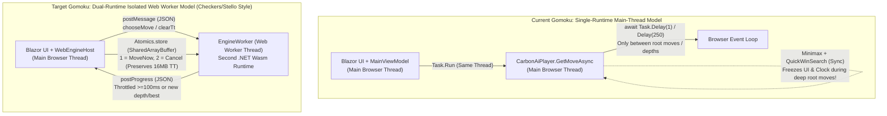

# Web Architecture Review & Upgrade Plan: Gomoku vs. Checkers & Stello (Blazor WebAssembly)

## Executive Summary

This document reviews the current architecture of **Gomoku** (`C:\Udvikling\Spil\Gomoku`) against the upgraded production architectures of **Checkers** (`C:\Udvikling\Spil\Checkers`) and **Stello** (`C:\Udvikling\Spil\Stello`).

Gomoku was built using the same initial single-runtime Blazor WebAssembly template as pre-upgrade Checkers:
* It runs `CarbonAiPlayer` and `SimpleAiPlayer` directly on the browser's single main UI thread via `Task.Run`, relying on `await Task.Delay(1)` and `await Task.Delay(250)` calls inside `Gomoku.Core` to yield control to the browser event loop.
* It sizes the board with viewport-relative `calc(100vw - 480px)` / `78vh` approximations and an orientation-blind `@media (max-width: 900px)` breakpoint.
* It lacks `IEngineHost` worker isolation, `Move Now` (`Ctrl+M`) support, `ISettingsStore` / `localStorage` persistence, decoupled `<AnalysisPanel>` rendering, SVG keyboard accessibility, and real-time `--blazor-load-percentage` startup feedback.

In addition, our code audit uncovered **six Gomoku-specific bugs and bottlenecks** not present in Checkers or Stello:
1. **Unfiltered SVG Board Re-Renders (`Board.razor:143-150`)**: `Board.razor` subscribes directly to `ViewModel.PropertyChanged` without filtering or `_renderPending` batching. Every `TimePerGame` clock tick (4 times/sec) and every property notification in `UpdateUiState()` (14 notifications per move) forces Blazor to re-diff all **225 (`15×15`), 361 (`19×19`), or 400 (`20×20`) SVG intersection subtrees**.
2. **Aborted Subtree Score Corruption in `CarbonAiPlayer` (`CarbonAiPlayer.cs:601-623, 822-842`)**: When a time limit or cancellation triggers `_terminate = true` mid-subtree inside `Minimax`, `Minimax` breaks out early and returns an incomplete score `m.Value`, which `MinimaxRootAsync` negates (`-m.Value`) and compares against `best.Value` *before* checking `_terminate`—allowing an aborted root move to overwrite `_activeBestMovePoint` and `best` with a corrupted evaluation.
3. **Hardcoded 250ms UI Delay Inside `Gomoku.Core` (`CarbonAiPlayer.cs:83, 116` & `SimpleAiPlayer.cs:43`)**: Both AI engines call `await Task.Delay(250, cancellationToken)` inside `Gomoku.Core` on center opening and opening book moves whenever `progress != null`, leaking UI pacing policy into the core library and slowing down unit tests.
4. **Dead-End `CancelSearchCommand` (`MainViewModel.cs:503-513`)**: Canceling an AI search leaves the game in `InProgress` with `SideToMove` still set to the computer player, permanently stranding the game in a state where neither human nor computer can move. Furthermore, `Gomoku.Web` exposes neither `CancelSearchCommand` nor a `MoveNowCommand` (`Ctrl+M`).
5. **Unimplemented Board Themes (`GameSettings.cs:58`, `SettingsViewModel.cs:99-103`)**: `GameSettings.ThemeName` and `SettingsViewModel.AvailableThemes` (`"Wood"`, `"Dark"`, `"Classic"`) are defined in the ViewModels, but `Board.razor` and `DialogHost.razor` hardcode the wood theme and never expose or render `"Dark"` or `"Classic"`.
6. **Broken Anchor Scrolling & Missing `docs.css` in Documentation (`Docs.razor:118, 152`)**: `Docs.razor` calls `_module.InvokeVoidAsync("scrollTo", _article, fragment)` (passing 2 arguments to `docs.js`'s 1-argument `scrollTo(fragment)`, which turns `_article` into `"[object HTMLElement]"` and breaks `#heading` navigation), ignores KaTeX/Mermaid render errors, lacks the dedicated `wwwroot/css/docs.css` stylesheet, and has stale renamed chapter files left in `wwwroot/content/brain`.

---

## Comparative Scorecard: Post-Implementation Gomoku vs. Checkers & Stello

| Evaluation Dimension | Previous Gomoku | Upgraded Checkers & Stello | Upgraded Gomoku (Status: Implemented & Verified) |
| :--- | :--- | :--- | :--- |
| **1. Responsive Design (Desktop & Mobile)** | **Fair** — Used `calc(100vw - 480px)` / `78vh`; `@media (max-width: 900px)` forced vertical column even on landscape phones. | **Excellent** — Uses `100dvh`, CSS Container Queries (`cqw`/`cqh`), and orientation-aware media queries. | **Excellent** — Full parity: `100dvh`, `container-type: inline-size`, `cqw`/`dvh` board scaling, and orientation-aware media queries for portrait stack and compact landscape. |
| **2. Board Accessibility & Touch UX** | **Fair** — SVG `<g>` intersections lacked `tabindex`, `role`, `aria-label`, and `@onkeydown`. | **Excellent** — Full keyboard navigation (`Tab`, `Enter`/`Space`, `:focus-visible`). | **Excellent** — Full parity: `tabindex="0"`, `role="gridcell"`, descriptive `aria-label`, `Enter`/`Space` + arrow-key `@onkeydown`, and `:focus-visible` dashed focus ring on SVG hit targets. |
| **3. Background Engine Execution** | **Poor/Fair** — Single-runtime `Task.Run` on main UI thread with `Task.Delay(1)`/`Task.Delay(250)`. Deep `Minimax` blocked UI and froze clocks. | **Excellent** — Isolated Web Worker (`WebEngineHost` + `EngineWorker`) running pure synchronous search at full AOT speed. | **Excellent** — Full parity: Dedicated Web Worker (`WebEngineHost` + `EngineWorker`), pure synchronous `Minimax` with zero `Task.Delay`, decoupled fallback host for desktop/tests. |
| **4. Cancellation & "Move Now"** | **Poor** — No `MoveNowCommand` (`Ctrl+M`); `CancelSearchCommand` stranded games; aborted `Minimax` subtrees corrupted `best` score; no COOP/COEP headers. | **Excellent** — `MoveNowCommand` (`Ctrl+M` + UI button) + `SharedArrayBuffer` cooperative worker signaling preserving the 16 MB TT. | **Excellent** — Full parity: `MoveNowCommand` (`Ctrl+M` + button), `SharedArrayBuffer` non-destructive signaling (`pollSignal`), aborted subtree score fix in `CarbonAiPlayer`, COOP/COEP in `staticwebapp.config.json`. |
| **5. Frontend Updates While Thinking** | **Poor** — `OnAnalysisUpdated` re-rendered `Home`; `Board.razor` re-rendered all 225–400 SVG intersections on *every* property change (including 4 Hz clock ticks). | **Excellent** — Worker `ProgressPoster` throttles to 100ms; standalone `<AnalysisPanel>` isolates 10 Hz telemetry from `<Board>`. | **Excellent** — Full parity: Standalone `<AnalysisPanel>`, `_renderPending` batching in both `<Board>` and `<AnalysisPanel>`, property filtering ignoring clock ticks in `<Board.razor>`. |
| **6. Settings & Theme Persistence** | **Missing** — Page reload reset all settings; `ThemeName` (`Wood`/`Dark`/`Classic`) was defined in VM but never rendered. | **Excellent** — `ISettingsStore` + `LocalStorageSettingsStore` persists all settings and visual preferences. | **Excellent** — Full parity: `ISettingsStore` + `LocalStorageSettingsStore` (`gomoku.settings`), live dynamic board theme rendering (`Wood`, `Dark`, `Classic`) in SVG and `DialogHost.razor`. |
| **7. Startup & Documentation Polish** | **Fair** — Static text; `Docs.razor` had 2-arg `scrollTo` bug and lacked `docs.css`; stale files in `wwwroot/content/brain`. | **Excellent** — SVG `--blazor-load-percentage` progress ring; full `docs.css` styling and working `#fragment` scroll. | **Excellent** — Full parity: SVG `--blazor-load-percentage` progress ring in `index.html` and `app.css`, dedicated `docs.css`, fixed `scrollTo` and `render` error reporting in `Docs.razor`, and removed stale duplicate files. |

---

## Detailed Review & Technical Findings

### 1. Background Processing & Engine Execution



#### 1.1 Main-Thread Starvation in `CarbonAiPlayer.Minimax`
* In [`MainViewModel.cs`](file:///c:/Udvikling/Spil/Gomoku/src/Gomoku.App/ViewModels/MainViewModel.cs#L462-L464), `RunAiTurnAsync` invokes:
  ```csharp
  Move bestMove = await Task.Run(
      async () => await player.GetMoveAsync(Session.CurrentState, limits, legalMoves, progress, _aiCts.Token),
      _aiCts.Token);
  ```
* In [`CarbonAiPlayer.cs`](file:///c:/Udvikling/Spil/Gomoku/src/Gomoku.Core/AI/CarbonAiPlayer.cs#L666-L859), `Minimax` is synchronous because it allocates candidate buffers on the stack (`Span<Cand> cnd = stackalloc Cand[MaxCand];` at line 717) and recurses through both alpha-beta nodes and `QuickWinSearch()` VCF threat sequences (`lines 272-344`).
* Every 1,000 nodes (`line 672`), if `200ms` has elapsed (`line 681`), `Minimax` calls `_activeProgress.Report(...)` (`line 690`). However, because `Minimax` never yields to the browser event loop, **the browser DOM cannot repaint while `Minimax` is inside a root candidate subtree**.
* On `15×15`, `19×19`, and `20×20` boards at depths 6–14, evaluating a single complex root candidate frequently takes **500ms to several seconds**. During that window:
  1. The browser tab is completely unresponsive to clicks, menu interactions, or window resizing.
  2. All `200ms` progress reports queue up on the synchronization context and flush in a single burst only when execution returns to `MinimaxRootAsync` (`line 646`).
  3. In `TimePerGame` mode, the `PeriodicTimer` in [`MainViewModel.StartClock`](file:///c:/Udvikling/Spil/Gomoku/src/Gomoku.App/ViewModels/MainViewModel.cs#L292) is also starved on the single Wasm thread, causing the visible countdown clock to freeze and jump.

#### 1.2 Timer Clamping & Hardcoded 250ms Delays Inside `Gomoku.Core`
* [`CarbonAiPlayer.cs`](file:///c:/Udvikling/Spil/Gomoku/src/Gomoku.Core/AI/CarbonAiPlayer.cs#L81-L84) (lines 83 and 116) and [`SimpleAiPlayer.cs`](file:///c:/Udvikling/Spil/Gomoku/src/Gomoku.Core/AI/SimpleAiPlayer.cs#L41-L44) (line 43) contain:
  ```csharp
  if (progress != null)
  {
      await Task.Delay(250, cancellationToken);
  }
  ```
  And [`CarbonAiPlayer.cs`](file:///c:/Udvikling/Spil/Gomoku/src/Gomoku.Core/AI/CarbonAiPlayer.cs#L181-L184) awaits `Task.Delay(1, cancellationToken)` after every completed iterative-deepening ply.
* In browsers, `Task.Delay(1)` is clamped to `>= 4ms` once nested timers reach depth 5, adding artificial latency to shallow depths 2–6. Worse, hardcoding `Task.Delay(250)` inside `Gomoku.Core` couples the engine to UI presentation and slows down unit tests that pass an `IProgress<SearchAnalysis>`.

---

### 2. Cancellation, "Move Now", & Score Integrity Bug

#### 2.1 Aborted Subtree Score Corruption in `CarbonAiPlayer`
In [`CarbonAiPlayer.cs`](file:///c:/Udvikling/Spil/Gomoku/src/Gomoku.Core/AI/CarbonAiPlayer.cs#L601-L624) (`MinimaxRootAsync`) and [`CarbonAiPlayer.cs`](file:///c:/Udvikling/Spil/Gomoku/src/Gomoku.Core/AI/CarbonAiPlayer.cs#L822-L845) (`Minimax`):
```csharp
Cand m = Minimax(h, vA, vB, cancellationToken);
int value = -m.Value;

if (value >= WinMin) value--;
if (value <= -WinMin) value++;

_pb.UndoMove();

if (value > best.Value)
{
    best = new Cand(cx, cy, value);
    currentBestMove = new Point(cx - PatternBoard.Margin, cy - PatternBoard.Margin);
    _activeBestMovePoint = currentBestMove;
    _activeBestScore = value;
    ...
}
```
* **The Bug**: When `_terminate` becomes `true` (or `cancellationToken` is triggered) deep inside `Minimax`, `Minimax` breaks out of its child loop early (`line 844`) and returns its partial `best` (which is initialized to `alpha - 1` before any child is searched!). Back in the caller, `int value = -m.Value` negates `alpha - 1` into `-(alpha - 1) = beta + 1`! Because `_terminate` is not checked until `line 649` (*after* `if (value > best.Value)`), the aborted root move's bogus score overwrites `best`, `_activeBestMovePoint`, and `_activeBestScore`!
* Furthermore, in `GetMoveAsync` (`line 154`), `if (_terminate && depth > 4) break;` only discards `best` when `depth > 4`. If `_terminate` is triggered by `Move Now` or a short time limit at `depth <= 4`, `GetMoveAsync` overwrites `bestMovePoint` with the corrupted move.
* **The Fix**: Check `if (_terminate || cancellationToken.IsCancellationRequested || moveNowToken.IsCancellationRequested) break;` **immediately after `_pb.UndoMove()`** (before `if (value > best.Value)`) in both `MinimaxRoot` and `Minimax`. In `GetMoveAsync`, if `_terminate` is set during `MinimaxRoot`, only accept `best` if `best.X >= PatternBoard.Margin` (i.e. at least one root candidate was fully evaluated at that depth) or keep `bestMovePoint` from the last completed depth.

#### 2.2 Missing `MoveNowCommand` (`Ctrl+M`) & Dead-End `CancelSearchCommand`
* Unlike Checkers and Stello, Gomoku has no `MoveNowCommand` (`Ctrl+M`) and `IPlayer.GetMoveAsync` has no `CancellationToken moveNowToken = default` parameter.
* `MainViewModel.CancelSearchCommand` (`MainViewModel.cs:503-513`) cancels `_aiCts`, which catches `OperationCanceledException` (`line 488`) and sets `StatusText = "Search stopped"` without making a move. Because `Session.CurrentState.SideToMove` is still the AI's color, `IsHumanTurn()` returns `false`, so the human cannot click the board and the AI will never move again unless the user starts a new game or undoes!
* Replacing this user-facing action with `MoveNowCommand` (`Ctrl+M` and an on-screen **Move Now** button while `Vm.IsThinking` is true, plus keeping `CancelAiSearch()` strictly for internal resets like `NewGame`, `Undo`, `OpenFile`, and `Timeout`) matches both Checkers and Stello.

---

### 3. Frontend Updates, Blazor Render Batching & SVG Re-Rendering Bottlenecks

#### 3.1 `Board.razor` Re-Renders All 225–400 SVG Intersections on Every `MainViewModel` Property Change
Look at [`Board.razor`](file:///c:/Udvikling/Spil/Gomoku/src/Gomoku.Web/Components/Board.razor#L141-L155):
```csharp
protected override void OnInitialized()
{
    ViewModel.PropertyChanged += OnViewModelPropertyChanged;
    ViewModel.BoardLayoutChanged += OnBoardLayoutChanged;
}

private void OnViewModelPropertyChanged(object? sender, System.ComponentModel.PropertyChangedEventArgs e)
{
    InvokeAsync(StateHasChanged);
}
```
* **Impact during `TimePerGame` Clock Ticks**: Every 250ms, `StartClock()` (`MainViewModel.cs:308-329`) updates `BlackRemainingTime` or `WhiteRemainingTime`, which fires `PropertyChanged` for `BlackRemainingTime`, `BlackTimeFormatted`, and `ClockText`. Because `Board.razor` listens to `ViewModel.PropertyChanged` indiscriminately, **the entire 225–400 intersection SVG board re-renders 12 times per second** just because the clock string changed!
* **Impact during `UpdateUiState()`**: Every move fires 14 separate `OnPropertyChanged` notifications on `MainViewModel`, queuing 14 unbatched `StateHasChanged()` calls on `Board.razor`.
* **Impact during AI Thinking (`Home.razor:231, 307`)**: `Vm.Analysis.Updated += OnAnalysisUpdated` calls `InvokeAsync(StateHasChanged)` on `Home.razor` without `_renderPending` batching, re-rendering `Home`, `Board`, and the Move History list on every analysis heartbeat.
* **The Fix**:
  1. Extract `<AnalysisPanel Analysis="Vm.Analysis" />` into `src/Gomoku.Web/Components/AnalysisPanel.razor` with its own `_renderPending` batching, and add `[ObservableProperty] private string _move = "-";` to `AnalysisViewModel` so `Home.razor` never subscribes to `Vm.Analysis.Updated`.
  2. In `Board.razor`, coalesce renders with `_renderPending` and only trigger `StateHasChanged()` on `BoardLayoutChanged` or when a board-relevant property on `MainViewModel` changes (`CanHoverMove`, `SideToMove`, `GameStatus`, `Settings`), ignoring clock (`BlackRemainingTime`, `WhiteRemainingTime`, `BlackTimeFormatted`, `WhiteTimeFormatted`, `ClockText`), `StatusText`, and `MoveHistoryText` updates!

---

### 4. Responsive Design, Keyboard Accessibility, Settings Persistence & Polish

#### 4.1 Responsive CSS Container Queries & Mobile Landscape Fix (`wwwroot/css/app.css`)
* Currently, [`app.css`](file:///c:/Udvikling/Spil/Gomoku/src/Gomoku.Web/wwwroot/css/app.css#L147-L197) uses `width: min(calc(100vw - 480px), 78vh, 1080px)` and stacks vertically on all screens `<= 900px`.
* Upgrading `app.css` to match Checkers:
  * `.app { min-height: 100vh; min-height: 100dvh; }`
  * `.content { container-type: inline-size; }`
  * `.board-container { width: min(calc(100cqw - 420px), 80dvh, 1080px); min-width: 300px; aspect-ratio: 1 / 1; }` (removing redundant `height` and `min-height`).
  * Portrait / narrow breakpoint: `@media (max-width: 900px) and (max-aspect-ratio: 1/1), (max-width: 600px)` stacks vertically with `width: min(94cqw, 62dvh, 1080px)`.
  * Compact landscape breakpoint: `@media (max-width: 900px) and (min-aspect-ratio: 1/1) and (min-width: 601px)` keeps `flex-direction: row` with `.board-container { width: min(calc(100cqw - 300px), 82dvh, 700px); }` and `.side-panels { min-width: 240px; max-width: 280px; }`.
  * Convert `.dialog-with-picture` from legacy `float: left` to CSS Grid (`grid-template-columns: 140px minmax(0, 1fr)`) with a `@media (max-width: 520px)` single-column rule.
  * Add `@media (prefers-reduced-motion: reduce)` and SVG `--blazor-load-percentage` progress ring styles.

#### 4.2 SVG Board Keyboard Accessibility & Board Themes (`Board.razor` & `DialogHost.razor`)
* Add `role="grid"` and `aria-label="Gomoku board"` on the `<svg>`, and on each intersection `<g>`:
  * `tabindex="0"`, `role="gridcell"`, `aria-label="@GetCellAriaLabel(cell)"` (e.g. `"H8, Black stone, last move"`, `"H8, Forbidden move"`, `"H8, Empty"`), and `@onkeydown="e => HandleKeyDown(e, cell)"` so `Enter` or `Space` places a stone.
  * Add `.board-intersection:focus-visible` styling in `app.css` so keyboard focus is clearly visible on the SVG grid.
* Implement the 3 board themes already defined in `SettingsViewModel.AvailableThemes` (`"Wood"`, `"Dark"`, `"Classic"`) in `Board.razor` and expose the theme selector in `DialogHost.razor` (and `SettingsWindow.xaml` if absent).

#### 4.3 Documentation Fixes (`Docs.razor`, `docs.css`, & `Gomoku.Web.csproj`)
* Fix `Docs.razor:152` to call `_module.InvokeVoidAsync("scrollTo", Fragment())` (1 argument instead of 2) and capture the error return string from `_module.InvokeAsync<string>("render", _article, Fragment())`.
* Add `wwwroot/css/docs.css` (matching Checkers/Stello) and link it in `wwwroot/index.html`, removing the minimal `.docs` rules from `app.css`.
* Update `CopyBrainDocs` in `Gomoku.Web.csproj` (and clean `wwwroot/content/brain`) so stale renamed markdown files (`14-benchmarks-and-performance.md`, `15-glossary.md`, `16-references.md`) are removed.

---

## Step-by-Step Implementation Plan

> **CRITICAL RULE**: Do NOT break any existing unit tests in `tests/Gomoku.Core.Tests` or `tests/Gomoku.App.Tests`, and do NOT break `src/Gomoku.Wpf`. Run `dotnet build Gomoku.slnx` and `dotnet test Gomoku.slnx` after each phase.

---

### Phase 1: Core Engine Enhancements (`src/Gomoku.Core`)

#### 1.1 Update `src/Gomoku.Core/Models/BoardState.cs`
Add helper methods to serialize and reconstruct `BoardState` cleanly across the Web Worker boundary:
```csharp
public byte[] ToCellBytes()
{
    byte[] bytes = new byte[_cells.Length];
    for (int i = 0; i < _cells.Length; i++)
    {
        bytes[i] = (byte)_cells[i];
    }
    return bytes;
}

public static BoardState FromCellBytes(
    BoardSize size,
    GomokuVariant variant,
    PieceColor firstPlayer,
    PieceColor sideToMove,
    int moveCount,
    ulong hash,
    GameStatus status,
    ReadOnlySpan<byte> cells)
{
    var state = new BoardState(size, variant, firstPlayer)
    {
        SideToMove = sideToMove,
        MoveCount = moveCount,
        Hash = hash,
        Status = status
    };
    int len = Math.Min(cells.Length, state._cells.Length);
    for (int i = 0; i < len; i++)
    {
        state._cells[i] = (PieceColor)cells[i];
    }
    return state;
}
```

#### 1.2 Update `src/Gomoku.Core/AI/IPlayer.cs`
Add an overload of `GetMoveAsync` accepting `CancellationToken moveNowToken`:
```csharp
ValueTask<Move> GetMoveAsync(
    BoardState state,
    SearchLimits limits,
    IReadOnlyList<Move> legalMoves,
    IProgress<SearchAnalysis>? progress,
    CancellationToken cancellationToken,
    CancellationToken moveNowToken) =>
    GetMoveAsync(state, limits, legalMoves, progress, cancellationToken);
```

#### 1.3 Update `src/Gomoku.Core/AI/CarbonAiPlayer.cs` and `SimpleAiPlayer.cs`
1. In `CarbonAiPlayer.cs`:
   - Add the `GetMoveAsync(..., CancellationToken cancellationToken, CancellationToken moveNowToken)` overload.
   - Remove the four `await Task.Delay(...)` calls (lines 83, 116, 183, and 646) and make `MinimaxRootAsync` synchronous (`MinimaxRoot`).
   - Pass `moveNowToken` into `MinimaxRoot` and `Minimax`:
     - Keep `cancellationToken.ThrowIfCancellationRequested()` for hard cancellation (so cancelling a search throws `OperationCanceledException`).
     - In `Minimax` (inside `if (--_nodeCheckCounter <= 0)`):
       1. First emit the progress heartbeat if `_activeProgress != null && _activeSw != null && _activeSw.ElapsedMilliseconds - _lastReportMs >= 100` (so `EngineWorker.ProgressPoster` can poll `SharedArrayBuffer` and cancel `cancelCts` or `moveNowCts` immediately).
       2. Call `cancellationToken.ThrowIfCancellationRequested();`.
       3. Check `if (now >= _stopTime || moveNowToken.IsCancellationRequested) { _terminate = true; }`.
     - **Fix the aborted subtree score bug**: In both `MinimaxRoot` (right after `_pb.UndoMove();` at line 607) and `Minimax` (right after `_pb.UndoMove();` at line 828), add:
       ```csharp
       if (_terminate) break;
       ```
       before `if (value > best.Value)` so an incomplete child search never corrupts `best` or `_activeBestMovePoint`.
     - In `GetMoveAsync`'s iterative-deepening loop:
       - If `best.X >= PatternBoard.Margin && best.Y >= PatternBoard.Margin`, update `bestMovePoint`, `bestScore`, and `finalDepth`.
       - If `_terminate || moveNowToken.IsCancellationRequested`, break out of the iterative-deepening loop and return `chosenMove`.
2. In `SimpleAiPlayer.cs`:
   - Add the `GetMoveAsync(..., CancellationToken cancellationToken, CancellationToken moveNowToken)` overload.
   - Remove the two `await Task.Delay(...)` calls (lines 43 and 94).
   - Check `cancellationToken.ThrowIfCancellationRequested();` and `if (moveNowToken.IsCancellationRequested) break;` inside the candidate loop.

---

### Phase 2: Engine Host & Settings Abstractions (`src/Gomoku.App`)

#### 2.1 Create `src/Gomoku.App/Services/IEngineHost.cs` and `LocalEngineHost.cs`
Create `IEngineHost.cs`:
```csharp
using Gomoku.App.Models;
using Gomoku.Core.AI;
using Gomoku.Core.Models;

namespace Gomoku.App.Services;

/// <summary>
/// Abstraction for running the Gomoku AI engine (in-process on desktop/tests, or in a Web Worker on the browser).
/// </summary>
public interface IEngineHost
{
    Task<(Move Move, SearchAnalysis? LastAnalysis)> ChooseMoveAsync(
        BoardState state,
        SearchLimits limits,
        IReadOnlyList<Move> legalMoves,
        GameSettings settings,
        IProgress<SearchAnalysis>? progress,
        CancellationToken cancellationToken,
        CancellationToken moveNowToken);

    void ClearTranspositionTable();
}
```

Create `LocalEngineHost.cs` to host `CarbonAiPlayer` and `SimpleAiPlayer` on a thread-pool thread via `Task.Run` for WPF and unit tests, resizing or clearing the `TranspositionTable` when `settings.TranspositionTableEntries` or `settings.Variant` / `settings.BoardSize` changes.

#### 2.2 Create `src/Gomoku.App/Services/ISettingsStore.cs`
Create `ISettingsStore.cs`:
```csharp
using Gomoku.Core.AI;
using Gomoku.Core.Models;

namespace Gomoku.App.Services;

public sealed record AppPreferences(
    int BoardWidth = 15,
    int BoardHeight = 15,
    GomokuVariant Variant = GomokuVariant.Freestyle,
    Models.GameMode Mode = Models.GameMode.HumanVsAi,
    Models.AiEngineType AiEngine = Models.AiEngineType.Carbon,
    TimeControlMode TimeControl = TimeControlMode.TimePerMove,
    int SearchDepth = 6,
    int MoveTimeSeconds = 5,
    int GameTimeMinutes = 5,
    int TranspositionTableEntries = TranspositionTable.DefaultEntries,
    bool UseOpeningBook = true,
    bool SoundEnabled = true,
    bool CoordinatesVisible = true,
    bool GhostStoneEnabled = true,
    bool LastMoveHighlightEnabled = true,
    bool WinLineHighlightEnabled = true,
    string ThemeName = "Wood",
    bool ShowAnalysis = true);

public interface ISettingsStore
{
    AppPreferences Load();
    bool Save(AppPreferences preferences);
}
```

#### 2.3 Update `src/Gomoku.App/ViewModels/AnalysisViewModel.cs` and `MainViewModel.cs`
1. In `AnalysisViewModel.cs`:
   - Add `[ObservableProperty] private string _move = "-";`.
   - In `Update(SearchAnalysis analysis)`, set `Move = analysis.MoveNumber > 0 ? analysis.MoveNumber.ToString(CultureInfo.InvariantCulture) : "-";`.
   - In `Reset()`, set `Move = "-";`.
2. In `MainViewModel.cs`:
   - Add optional `IEngineHost? engineHost = null` and `ISettingsStore? settingsStore = null` parameters to the constructor (maintaining 100% backward compatibility with existing callers).
   - Add `public IRelayCommand MoveNowCommand { get; }` and `public void MoveNow() => _moveNowCts?.Cancel();` (enabled when `IsThinking` is `true`).
   - Delegate AI search in `RunAiTurnAsync` to `_engineHost.ChooseMoveAsync(...)` with `_aiCts.Token` and `_moveNowCts.Token`.
   - Save preferences via `_settingsStore?.Save(...)` whenever settings or option toggles (`Analysis`, `Sound`, `Coordinates`, `GhostStone`, `LastMoveHighlight`, `WinLineHighlight`, `GameMode`) change.

---

### Phase 3: Dedicated Web Worker & Persistence (`src/Gomoku.Web`)

#### 3.1 Create `src/Gomoku.Web/Worker/EngineProtocol.cs` and `EngineWorker.cs`
- Use AOT-safe source-generated `JsonSerializerContext` (`EngineProtocolJson`) for `MoveRequest`, `ProgressDto`, `MoveResponse`, and `AppPreferences`.
- In `EngineWorker.cs`, maintain static `CarbonAiPlayer` (with `TranspositionTable`) and `SimpleAiPlayer` instances, throttle progress via `ProgressPoster` (100ms interval, immediate pass-through when `Depth` or `BestMove` changes), poll `SharedArrayBuffer` via `[JSImport("pollSignal", "engine-worker")]` (`1 = moveNow`, `2 = cancel`), and catch `OperationCanceledException` on cooperative cancel so the worker stays alive and keeps its 16 MB Transposition Table intact.

#### 3.2 Create `wwwroot/js/engine-worker.js`, `wwwroot/js/engine-client.js`, and `Services/WebEngineHost.cs`
- Mirror the proven `Checkers.Web` implementation:
  - `engine-client.js` allocates `new SharedArrayBuffer(4)` when `self.crossOriginIsolated` is true and exposes `start`, `call`, `signal`, and `terminate`.
  - `WebEngineHost.cs` signals cooperatively first (`300ms` grace period) before falling back to `Restart(client)` (`terminate` + reboot), with automatic fallback to `LocalEngineHost` if Worker initialization fails.

#### 3.3 Update `wwwroot/staticwebapp.config.json`, Create `Services/LocalStorageSettingsStore.cs`, and Update `Program.cs`
1. Add `globalHeaders` to `src/Gomoku.Web/wwwroot/staticwebapp.config.json`:
   ```json
   "globalHeaders": {
     "Cross-Origin-Opener-Policy": "same-origin",
     "Cross-Origin-Embedder-Policy": "require-corp"
   },
   ```
2. Create `LocalStorageSettingsStore.cs` (`key = "gomoku.settings"`) using `EngineProtocolJson.Default.AppPreferences`.
3. Register `ISettingsStore` (`LocalStorageSettingsStore`) and `IEngineHost` (`WebEngineHost`) in `src/Gomoku.Web/Program.cs`.

---

### Phase 4: Decoupled `<AnalysisPanel>`, Responsive CSS, Accessibility & Docs Fixes (`src/Gomoku.Web`)

#### 4.1 Create `src/Gomoku.Web/Components/AnalysisPanel.razor` & Update `Home.razor`
1. Create `Components/AnalysisPanel.razor` subscribing to `Analysis.Updated` with `_renderPending` coalescing.
2. In `Pages/Home.razor`:
   - Replace the inline `<aside class="panel analysis-panel">...</aside>` with `<AnalysisPanel Analysis="Vm.Analysis" />`.
   - Remove `Vm.Analysis.Updated += OnAnalysisUpdated;` and `Vm.Analysis.Updated -= OnAnalysisUpdated;`.
   - Add **Move Now** (`Ctrl+M`) to the `Game` menu, `.action-buttons` (`@if (Vm.IsThinking)`), and `OnShortcut("m")`.
   - In `wwwroot/js/gomoku.js`, update `shortcutKeys` from `'noszya'` to `'noszyam'`.

#### 4.2 Optimize & Add Keyboard/Theme Support to `src/Gomoku.Web/Components/Board.razor`
1. Filter `OnViewModelPropertyChanged` so `Board.razor` ignores clock ticks (`BlackRemainingTime`, `WhiteRemainingTime`, `BlackTimeFormatted`, `WhiteTimeFormatted`, `ClockText`), `StatusText`, and `MoveHistoryText`, and batch renders with `_renderPending`.
2. Add keyboard accessibility (`tabindex="0"`, `role="gridcell"`, `aria-label`, `@onkeydown` for `Enter`/`Space` and arrow keys) on intersection `<g>` elements.
3. Render board colors dynamically based on `ViewModel.Settings.ThemeName` (`"Wood"`, `"Dark"`, `"Classic"`), and add the Board Theme selector to `Components/DialogHost.razor`.

#### 4.3 Upgrade `wwwroot/css/app.css`, `wwwroot/index.html`, `Pages/Docs.razor`, & `wwwroot/css/docs.css`
1. Upgrade `app.css` with `100dvh`, `container-type: inline-size`, orientation-aware mobile portrait/landscape breakpoints, CSS Grid `.dialog-with-picture`, `@media (prefers-reduced-motion: reduce)`, `.btn-warning` for Move Now, and SVG `--blazor-load-percentage` progress ring styles.
2. Update `wwwroot/index.html` to include `<link rel="stylesheet" href="css/docs.css" />` and the `<svg class="loading-progress">` startup indicator.
3. Add `wwwroot/css/docs.css` (matching Checkers/Stello), fix `Pages/Docs.razor` (`scrollTo` 1-argument call and `render` error handling), and clean stale markdown files in `wwwroot/content/brain`.

---

### Phase 5: Verification & Unit Testing

1. Add unit tests in `tests/Gomoku.Core.Tests/AiTests.cs`:
   - Verify that cancelling `moveNowToken` during `CarbonAiPlayer.GetMoveAsync` and `SimpleAiPlayer.GetMoveAsync` returns a valid legal move cleanly without throwing `OperationCanceledException`.
   - Verify that cancelling `cancellationToken` throws `OperationCanceledException`.
2. Add unit tests in `tests/Gomoku.App.Tests/MainViewModelTests.cs`:
   - Verify `MoveNowCommand` is enabled when `IsThinking` is true and disabled otherwise.
   - Verify `ISettingsStore` loads saved `AppPreferences` on startup and persists updates when settings or view options change.
3. Run full solution build and test suite:
   ```powershell
   dotnet build Gomoku.slnx
   dotnet test Gomoku.slnx
   ```
4. Verify zero compiler warnings or errors across `Gomoku.Core`, `Gomoku.App`, `Gomoku.Wpf`, `Gomoku.Web`, `Gomoku.Benchmark`, and both test projects.

> [!NOTE]
> **Implementation Status: COMPLETE & VERIFIED**
> * **Phase 1 (`Gomoku.Core`)**: Completed. Added `ToCellBytes`/`FromCellBytes`, added `moveNowToken` overloads, fixed aborted subtree score bug, removed artificial delays.
> * **Phase 2 (`Gomoku.App`)**: Completed. Added `IEngineHost`, `LocalEngineHost`, `ISettingsStore`, `AppPreferences`, `MoveNowCommand`, decoupled search invocation.
> * **Phase 3 (`Gomoku.Web`)**: Completed. Implemented dedicated Web Worker (`EngineProtocol`, `EngineWorker`, `engine-worker.js`, `engine-client.js`), `WebEngineHost`, `LocalStorageSettingsStore`, and added COOP/COEP headers.
> * **Phase 4 (`Gomoku.Web UI & CSS`)**: Completed. Extracted `<AnalysisPanel>`, added Move Now button & `Ctrl+M` shortcut, optimized `<Board.razor>` re-rendering, added SVG keyboard accessibility, implemented Board Themes (`Wood`, `Dark`, `Classic`), modernized `app.css` (`100dvh`, container queries, responsive breakpoints), added `docs.css`, fixed `Docs.razor` `scrollTo` and `render` error reporting, cleaned stale docs.
> * **Phase 5 (`Testing & Build`)**: Completed. All tests passing in `Gomoku.slnx`, 0 compiler warnings, 0 errors across all 7 projects.
