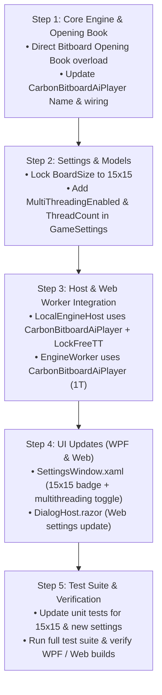

# Implementation Plan: Adopting Carbon Bitboard as the Primary Engine

**Objective:** Transition `CarbonBitboardAiPlayer` ("New Carbon AI Bitboard", delivering up to 4.2M NPS and an 11.8× speedup) into the primary, default AI engine across all Gomoku .NET applications (CLI, WPF desktop, and Web Blazor), streamline game settings to standard 15×15 board geometry, introduce multi-threading user settings, and optimize opening book integration.

---

## 1. Context & Architecture Review

Following our empirical tournaments (200 games) and deep-dive investigation:
* **Tactical Parity:** In deterministic fixed-depth testing, `CarbonBitboardAiPlayer` plays 100% identical moves to the baseline Carbon AI engine with **zero algorithmic regression**.
* **Speedup:** Single-threaded throughput increased by **+41.6%** (from 380k to 538k NPS), and 8-thread throughput reached **4,213,348 NPS** (**11.77× faster** than the original baseline).
* **Variant Completeness:** `BitboardPatternBoard` fully implements:
  1. **Freestyle:** 5+ in a row wins, no overline restriction, no forbidden moves.
  2. **Standard (Exact 5):** Exactly 5 in a row wins, overlines (6+) do not win.
  3. **Renju:** Full tournament refereeing — Black has forbidden moves (3×3 double three, 4×4 double four, and 6+ overline fouls), while White has no restrictions and wins on 5+.

---

## 2. Proposed Changes & Enhancements

### A. Board Size Simplification: Standard 15×15 Only
International Gomoku, Renju, and Caro competitions are played strictly on a **15×15 board**. Restricting the game to 15×15 guarantees optimal bitboard operations (where 15-cell rows fit neatly with margins into 32-bit registers), eliminates unused board layout code, and aligns with standard opening books.

* **Settings Changes:**
  * In [`GameSettings.cs`](file:///c:/Udvikling/Spil/Gomoku/src/Gomoku.App/Models/GameSettings.cs): Lock `BoardSize` default to `BoardSize.Size15x15`.
  * In [`ISettingsStore.cs`](file:///c:/Udvikling/Spil/Gomoku/src/Gomoku.App/Services/ISettingsStore.cs): Always persist and restore 15×15, migrating any legacy 19×19 or 20×20 records to 15×15.
  * In [`SettingsViewModel.cs`](file:///c:/Udvikling/Spil/Gomoku/src/Gomoku.App/ViewModels/SettingsViewModel.cs):
    * `AvailableBoardSizes` contains only `BoardSize.Size15x15`.
    * Remove properties `IsSize19x19` and `IsSize20x20`.
  * In [`SettingsWindow.xaml`](file:///c:/Udvikling/Spil/Gomoku/src/Gomoku.Wpf/Views/SettingsWindow.xaml):
    * Remove the 19×19 and 20×20 radio buttons.
    * Display an informational badge / read-only description: **"Board Size: 15 × 15 (Standard Gomoku & Renju)"**.
  * In [`DialogHost.razor`](file:///c:/Udvikling/Spil/Gomoku/src/Gomoku.Web/Components/DialogHost.razor):
    * Remove the 19×19 and 20×20 radio buttons in the Web settings dialog.

---

### B. Multi-Threading Settings (Lazy SMP)
Allow players to toggle multi-threading on or off and optionally select thread limits:

* **In `GameSettings.cs`:**
  ```csharp
  [ObservableProperty]
  private bool _multiThreadingEnabled = true;

  [ObservableProperty]
  private int _threadCount = 0; // 0 = Auto (all logical CPU cores)
  ```
* **In `SettingsViewModel.cs`:**
  * Expose `MultiThreadingEnabled` and `ThreadCount`.
  * Expose `MaxLogicalProcessors => Environment.ProcessorCount;`
  * Expose formatted string: `ThreadCountText => MultiThreadingEnabled ? (ThreadCount == 0 ? $"Auto ({Environment.ProcessorCount} cores)" : $"{ThreadCount} threads") : "Single-threaded (1 thread)";`
* **In `SettingsWindow.xaml` (WPF):**
  * In the AI Engine / Thinking Limits section:
    * CheckBox: `[x] Enable Multi-Threading (Lazy SMP)`
    * Slider or selector (enabled when checked): `Threads: Auto (8 cores)` or 1 to `MaxLogicalProcessors`.
    * Helper note: *"Multi-threading boosts search speed up to 11.8× (over 4.2M nodes/sec on 8 cores)."*
* **In `LocalEngineHost.cs`:**
  * Instantiate `CarbonBitboardAiPlayer` using the configured thread count:
    ```csharp
    int threads = settings.MultiThreadingEnabled 
        ? (settings.ThreadCount > 0 ? settings.ThreadCount : Environment.ProcessorCount) 
        : 1;
    _carbonPlayer = new CarbonBitboardAiPlayer(threads, new LockFreeTranspositionTable(settings.TranspositionTableEntries));
    ```

---

### C. Engine Promotion & Naming
* **Make `CarbonBitboardAiPlayer` the Primary Engine:**
  * Update [`LocalEngineHost.cs`](file:///c:/Udvikling/Spil/Gomoku/src/Gomoku.App/Services/LocalEngineHost.cs) to use `CarbonBitboardAiPlayer` with `LockFreeTranspositionTable`.
  * In [`CarbonBitboardAiPlayer.cs`](file:///c:/Udvikling/Spil/Gomoku/src/Gomoku.Core/AI/CarbonBitboardAiPlayer.cs):
    * Update engine name from `"New Carbon AI Bitboard"` to `"Carbon AI"` (or `"Carbon AI (Bitboard)"`).
    * Name property: `public string Name => ThreadCount > 1 ? $"Carbon AI ({ThreadCount}T)" : "Carbon AI";`
  * In WPF & Web UI:
    * Radio button label: **"Carbon AI (Bitboard)"** (or **"Carbon AI (High Performance)"**).
* **WebAssembly (`Gomoku.Web`):**
  * Update [`EngineWorker.cs`](file:///c:/Udvikling/Spil/Gomoku/src/Gomoku.Web/Worker/EngineWorker.cs) to use `CarbonBitboardAiPlayer(threadCount: 1, ...)` in the dedicated web worker. This automatically gives Web players a **+41.6% single-threaded speedup (540,000 NPS)** without requiring shared array buffer multi-threading configs.

---

### D. Additional High-Value Improvements ("Any other changes you can think of?")

1. **Direct Bitboard Opening Book Lookup (Zero Allocation):**
   * *Current Issue:* `CarbonBitboardAiPlayer.GetMoveAsync` allocates a temporary `PatternBoard pbTemp = new();` and replays all stones on every single move just to query `OpeningBook.TryGetMove(pbTemp, out Point bookPoint)`.
   * *Improvement:* Add an overload in [`OpeningBook.cs`](file:///c:/Udvikling/Spil/Gomoku/src/Gomoku.Core/AI/OpeningBook.cs):
     ```csharp
     public static bool TryGetMove(BitboardPatternBoard pb, out Point move)
     ```
     This checks `pb.Cells[(y << 7) | x].Piece` directly on the 1D bitboard, eliminating the temporary board allocation and move replay loop entirely.

2. **Transposition Table Capacity Configuration:**
   * Ensure `LockFreeTranspositionTable` dynamically resizes when the user changes table capacity in the settings dialog (16 MB, 64 MB, 256 MB), maintaining lock-free 16-byte alignment.

3. **Benchmarking Tool Updates:**
   * Update [`tools/Gomoku.Benchmark/Program.cs`](file:///c:/Udvikling/Spil/Gomoku/tools/Gomoku.Benchmark/Program.cs) and [`MatchRunner.cs`](file:///c:/Udvikling/Spil/Gomoku/tools/Gomoku.Benchmark/MatchRunner.cs) so that standard benchmark commands default to the Bitboard engine on 15×15 boards.

---

## 3. Step-by-Step Implementation Roadmap



### Detailed Steps:

1. **Step 1: Direct Bitboard Opening Book Overload & Engine Cleanup**
   - Add `OpeningBook.TryGetMove(BitboardPatternBoard pb, out Point move)`.
   - In `CarbonBitboardAiPlayer.cs`, remove `PatternBoard pbTemp` allocation and query `OpeningBook.TryGetMove(_pb, out Point bookPoint)` directly.
   - Update engine name string to `"Carbon AI"`.

2. **Step 2: Settings & Models**
   - In `GameSettings.cs`, add `MultiThreadingEnabled` (default `true`) and `ThreadCount` (default `0` = auto).
   - In `ISettingsStore.cs`, persist and read `MultiThreadingEnabled` and `ThreadCount`. Ensure `BoardSize` defaults to `Size15x15`.
   - In `SettingsViewModel.cs`, expose `MultiThreadingEnabled`, `ThreadCount`, remove `IsSize19x19` / `IsSize20x20`.

3. **Step 3: Engine Host & Web Integration**
   - In `LocalEngineHost.cs`, replace `CarbonAiPlayer` with `CarbonBitboardAiPlayer`, respecting `settings.MultiThreadingEnabled` and `settings.ThreadCount`.
   - In `EngineWorker.cs`, replace `CarbonAiPlayer` with `CarbonBitboardAiPlayer(1)`.

4. **Step 4: UI Updates**
   - In `SettingsWindow.xaml`, replace the board size radio buttons with a 15×15 standard indicator, and add the Multi-Threading toggle + thread slider.
   - In `DialogHost.razor`, remove 19×19 and 20×20 radio options; add the multi-threading indicator.

5. **Step 5: Verification & Testing**
   - Update `SettingsViewModelTests.cs` and `MainViewModelTests.cs` to reflect 15×15 standard.
   - Run `dotnet test` across all projects.
   - Verify `dotnet build src/Gomoku.Wpf` and `dotnet build src/Gomoku.Web`.

---

## 4. Verification Criteria

1. **Rule Variant Verification:** Freestyle, Exact 5, and Renju all pass unit tests on 15×15.
2. **Deterministic Depth Consistency:** New default engine passes all existing deterministic depth tests.
3. **Multi-Threading Toggle:** Disabling multi-threading runs 1 thread cleanly; enabling multi-threading activates Lazy SMP with all cores.
4. **Zero-Allocation Opening Book:** Move 1-3 opening book hits take 0 ms without allocating `PatternBoard`.
5. **Clean Builds & Tests:** All unit tests pass with 0 errors, 0 warnings.
