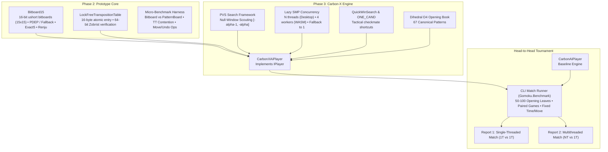

# Implementation Plan: Carbon-X Hybrid Engine & Head-to-Head Benchmark Suite

## Goal Description
Engineer and validate the **Carbon-X Hybrid Gomoku Engine** in modern C# (.NET 10), combining 16-bit SIMD bitboards for the $15 \times 15$ grid, Principal Variation Search (PVS) with null-window scouting, an adaptive lock-free Transposition Table, and Lazy SMP multithreading. 

The implementation will be executed in two targeted phases:
* **Phase 2: Prototype & Benchmark Harness:** Build the 16-bit bitboard primitive (`Bitboard15`), lock-free TT, and micro-benchmarks in `Gomoku.Benchmark` measuring raw throughput and threading scaling against the current `PatternBoard`.
* **Phase 3: Engine Implementation & Automated Head-to-Head Matches:** Implement the full `CarbonXAiPlayer` and execute a rigorous CLI tournament against the current `Carbon` engine across 50–100 opening leaf positions in paired matches (alternating Black and White) under fixed time-per-move controls. The tournament will produce two separate reports:
  1. **Single-Threaded Match:** Carbon-X (1 Thread) vs. Carbon (1 Thread).
  2. **Multithreaded Match:** Carbon-X ($N$ Threads) vs. Carbon (1 Thread).

---

## User Review Required

> [!IMPORTANT]
> **Match Tournament Setup:**
> * **Time Control:** Fixed time per move (default: 1.0s or 2.0s per move via CLI option).
> * **Paired Matches for Fair Testing:** For every opening leaf position, two games are played:
>   * Game A: Carbon-X plays Black; Carbon plays White.
>   * Game B: Carbon plays Black; Carbon-X plays White.
> * **Opening Diversity:** 50–100 distinct opening leaves extracted from the opening book to thoroughly test tactical midgame calculation, fork defense, and endgame conversion.
> * **Output Division:** Separate summary reports for **Single-Threaded** and **Multithreaded** matches.

---

## Architecture Overview



---

## Proposed Changes

### Phase 2: Prototype & Benchmark Harness

#### [NEW] `src/Gomoku.Core/Engine/Bitboard15.cs`
High-performance 16-bit bitboard state representation for $15 \times 15$ Gomoku:
* Bitboard storage: `ushort Rows[2, 15]`, `ushort Cols[2, 15]`, `ushort Diag[2, 29]`, `ushort Adiag[2, 29]`.
* Bit index 15 is reserved as an invariant boundary wall (mask `0x7FFF`).
* Hardware acceleration: `Bmi2.X64.ParallelBitDeposit` with universal software fallback for ARM64 and WebAssembly.
* Rule methods: `HasFive()`, `HasExactFive()`, `HasOverline()`, `CheckForbid()`.
* Fast make move and undo move updating only affected bit lines.

#### [NEW] `src/Gomoku.Core/AI/LockFreeTranspositionTable.cs`
Concurrent, zero-lock transposition table supporting single-threaded and multi-threaded search:
* 16-byte entry layout:
  ```csharp
  [StructLayout(LayoutKind.Explicit, Size = 16)]
  public struct TTEntry
  {
      [FieldOffset(0)] public ulong Key;        // Full 64-bit Zobrist hash key
      [FieldOffset(8)] public short MovePacked; // (Row << 4) | Col
      [FieldOffset(10)] public sbyte Depth;     // Search depth
      [FieldOffset(11)] public byte Bound;      // Exact(3), Lower(2), Upper(1)
      [FieldOffset(12)] public int Eval;        // Evaluation score
      [FieldOffset(16)] // Alignment to 16 bytes
  }
  ```
* Full 64-bit key verification guarantees **zero hash collision blunders**.
* Multi-threaded reads/writes use atomic 64-bit load/store instructions with key-stability checks.

#### [MODIFY] `tools/Gomoku.Benchmark/Program.cs`
Expand the benchmark CLI tool to include:
* Direct make/undo throughput comparison: `Bitboard15` vs `PatternBoard`.
* Transposition table multi-threaded contention benchmark.
* Move generation and threat detection throughput.

---

### Phase 3: Engine Implementation & Head-to-Head Tournament

#### [NEW] `src/Gomoku.Core/AI/CarbonXAiPlayer.cs`
The complete Hybrid Engine implementing `IPlayer`:
* **PVS Search:** Principal Variation Search with null-window scouting (`[-alpha-1, -alpha]`).
* **Adaptive Concurrency:** Configurable thread count $N \ge 1$:
  * In single-threaded mode ($N = 1$): Executes sequentially with zero thread synchronization overhead.
  * In multi-threaded mode ($N > 1$): Deploys Lazy SMP where Thread 0 explores depth $d$, Thread 1 explores depth $d+1$, and remaining threads scout alternative root candidates to seed the shared Transposition Table.
* **Tactical Pruning:** Integrates `ONE_CAND` (forcing immediate replies to opponent four-threats) and `QuickWinSearch` (continuous-four VCF solver).
* **Opening Theory:** Integrates the existing 22-opening dihedral $D_4$ opening book.
* **Threat Evaluation:** 15-grade threat classification with weighted offense + defense ($1.5 \cdot T_1 + T_2 + 1.2 \cdot \text{Defense}$) localized to affected lines.

#### [NEW] `tools/Gomoku.Benchmark/MatchRunner.cs`
Automated head-to-head tournament runner:
* **Opening Suite:** Extracts 50–100 leaf positions from the opening book or standard 3-stone / 5-stone opening systems (e.g. Direct and Indirect openings).
* **Paired Games:** For each opening position:
  * Game 1: Carbon-X plays Black; Carbon plays White.
  * Game 2: Carbon plays Black; Carbon-X plays White.
* **Clock Management:** Strict time-per-move enforcement (e.g. 1.0s or 2.0s per move) with soft and hard limits.
* **Reporting:** Generates two distinct tournament tables:
  1. **Match 1 (Single-Threaded):** Carbon-X (1 Thread) vs. Carbon (1 Thread).
  2. **Match 2 (Multithreaded):** Carbon-X (All Cores) vs. Carbon (1 Thread).
* Metrics reported: Win/Loss/Draw record, Win percentage, Average search depth reached per move, Average NPS, and Average game length.

---

## Verification Plan

### Automated Tests
1. **Bitboard Rule Parity Unit Tests (`Gomoku.Core.Tests`):**
   * Validate that `Bitboard15` generates identical win/loss/foul detections as `RuleEngine` across 1,000 randomized and known game states.
2. **Lock-Free TT Thread-Safety Tests (`Gomoku.Core.Tests`):**
   * Concurrent store and probe stress test across 16 threads with zero deadlocks and zero key corruptions.
3. **Engine Smoke Tests:**
   * Test `CarbonXAiPlayer` in both single-threaded ($N=1$) and multi-threaded ($N=4$) modes finding known mate-in-3 and mate-in-5 tactical solutions.

### Head-to-Head Tournament Execution
Run the CLI match runner from terminal:
```powershell
dotnet run --project tools/Gomoku.Benchmark -c Release -- --match --time 1.0 --openings 50
```
Verify the output summary displays:
* Single-threaded match results: Wins, Losses, Draws, Win Rate.
* Multithreaded match results: Wins, Losses, Draws, Win Rate.
* Depth and throughput metrics.
