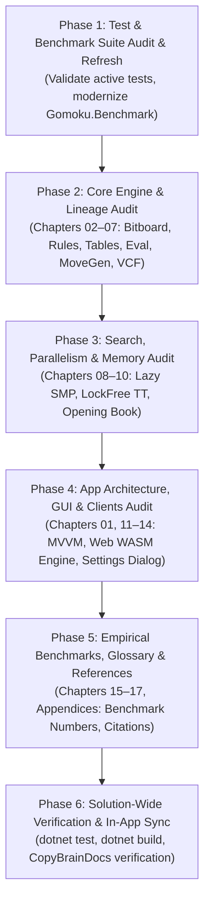

# Comprehensive Review Plan: Documentation, Engine Lineage, Tests & Benchmarks

## Goal Description
Conduct a systematic, rigorous review and reconciliation of all documentation in [`docs/brain/`](file:///c:/Udvikling/Spil/Gomoku/docs/brain/) (17 chapters, diagrams, and supplementary reports) against:
1. **The Current Gomoku .NET Production Codebase:** [`Gomoku.Core`](file:///c:/Udvikling/Spil/Gomoku/src/Gomoku.Core), [`Gomoku.App`](file:///c:/Udvikling/Spil/Gomoku/src/Gomoku.App), [`Gomoku.Wpf`](file:///c:/Udvikling/Spil/Gomoku/src/Gomoku.Wpf), [`Gomoku.Web`](file:///c:/Udvikling/Spil/Gomoku/src/Gomoku.Web), and [`Gomoku.Web.Engine`](file:///c:/Udvikling/Spil/Gomoku/src/Gomoku.Web.Engine).
2. **The Original Carbon Engine:** [`Carbon-Gomoku-master`](file:///c:/Udvikling/Spil/Gomoku/Carbon-Gomoku-master) (Michał Czardybon, 2001–2006).
3. **The Modern C++ Bitboard Engine:** [`Gomoku-main`](file:///c:/Udvikling/Spil/Gomoku/Gomoku-main) (Hanoi University of Science & Technology Group 01, 2025/2026).
4. **The Test and Benchmark Suite:** [`tests/`](file:///c:/Udvikling/Spil/Gomoku/tests) and [`tools/Gomoku.Benchmark`](file:///c:/Udvikling/Spil/Gomoku/tools/Gomoku.Benchmark), validating every test and benchmark for current relevance, correctness, and empirical reproducibility.

---

## User Review Required

> [!IMPORTANT]
> **Active Production Engine vs. Historical Engine Variants**
> The engine has evolved through three distinct architectures:
> 1. **Baseline Carbon** ([`BaselineCarbonAiPlayer.cs`](file:///c:/Udvikling/Spil/Gomoku/src/Gomoku.Core/AI/BaselineCarbonAiPlayer.cs) & [`PatternBoard.cs`](file:///c:/Udvikling/Spil/Gomoku/src/Gomoku.Core/Engine/PatternBoard.cs)): Direct port of `Carbon-Gomoku-master` using a 1D padded array, 1-ring (`Adj1`) and 2-ring (`Adj2`) adjacency counters, and single-threaded minimax.
> 2. **Carbon-X Prototype** ([`CarbonXAiPlayer.cs`](file:///c:/Udvikling/Spil/Gomoku/src/Gomoku.Core/AI/CarbonXAiPlayer.cs) & [`Bitboard15.cs`](file:///c:/Udvikling/Spil/Gomoku/src/Gomoku.Core/Engine/Bitboard15.cs)): Experimental direct port of `Gomoku-main` using 16-bit SIMD bitboards, PVS, and VCF solver.
> 3. **Carbon Bitboard (Active Production Champion)** ([`CarbonBitboardAiPlayer.cs`](file:///c:/Udvikling/Spil/Gomoku/src/Gomoku.Core/AI/CarbonBitboardAiPlayer.cs) & [`BitboardPatternBoard.cs`](file:///c:/Udvikling/Spil/Gomoku/src/Gomoku.Core/Engine/BitboardPatternBoard.cs)): The unified engine combining Carbon's threat evaluation (`status1`, `prior3`, `count5`, `QuickWinSearch`) with `Gomoku-main`'s 4-axis bitboards, Chebyshev dilation candidate generation, lock-free 16-byte transposition table, and cache-line spaced Lazy SMP.
>
> **Proposal:** In the documentation, the **primary focus** must always describe the active production engine (`CarbonBitboardAiPlayer` and `BitboardPatternBoard`). Historical architectures (`BaselineCarbon` and `Carbon-X`) should be explicitly identified in dedicated "Architectural Evolution" callouts to preserve historical context without confusing the reader about current production behavior.

> [!WARNING]
> **Major Code-Doc Discrepancies Already Uncovered**
> Initial exploratory analysis has already pinpointed severe discrepancies in the existing docs:
> - **Chapter 06 (Move Generation):** The doc describes move filtering via `Adj1 != 0 || Adj2 != 0` (Moore/secondary neighborhood counters from old `PatternBoard.cs`), whereas production `CarbonBitboardAiPlayer.cs` uses **Bitboard Chebyshev dilation** (`BitboardPatternBoard.DilateRow`, `GetCandidateMask`, and `TrailingZeroCount`).
> - **Chapter 07 (VCF Search):** The code snippets in the doc reference `ref PatternBoard.Cell` and `c.Adj1 != 0 || c.Adj2 != 0`, which do not exist in `BitboardPatternBoard`.
> - **Chapter 02 & Chapter 06:** References to dynamic $19 \times 19$ board support remain in prose, even though the application and bitboards are strictly standardized on official tournament $15 \times 15$.
> - **Benchmark Tool (`Gomoku.Benchmark`):** `Program.cs` still runs benchmarks on `CarbonAiPlayer` with $19 \times 19$ boards, and does not benchmark `BitboardPatternBoard` or `CarbonBitboardAiPlayer`.

---

## User Approvals & Decisions (Confirmed)

> [!NOTE] User Approvals Received
> 1. **Primary Focus on Active Production Engine:** The documentation will primarily describe the active production engine (`CarbonBitboardAiPlayer` and `BitboardPatternBoard`). Historical architectures (`BaselineCarbon` and `Carbon-X`) are explicitly labeled in dedicated "Architectural Evolution" callouts.
> 2. **Fix All Uncovered Discrepancies:** All identified discrepancies (Chebyshev dilation candidate generation vs `Adj1/Adj2`, VCF cell references, 15x15 standard vs 19x19, etc.) are being corrected as part of this review.
> 3. **Preserve Regression Baselines:** `BaselineCarbonAiPlayer` and `CarbonXAiPlayer` are retained in `Gomoku.Core` as regression baselines for `MatchRunner`, with clarified docstrings.
> 4. **Retain Reports as Appendices A and B:** `engine-comparison-report.md` and `single-threaded-match-investigation-report.md` are retained in `docs/brain/` as Chapter Appendices A and B.
> 5. **Benchmark Tool Modernization:** `tools/Gomoku.Benchmark/Program.cs` has been modernized to benchmark `BitboardPatternBoard` and `CarbonBitboardAiPlayer` (across 1T, 2T, 4T, 8T) alongside `PatternBoard` and `Bitboard15`.

---

## Detailed Audit Matrix: Chapters vs. Implementation vs. Ancestors

Below is the complete cross-reference matrix linking each chapter to its corresponding active C# code, original Carbon C++ files, and HUST Gomoku C++ files:

| Chapter | Topic | Current C# Source | Original `Carbon-Gomoku-master` | Modern `Gomoku-main` | Known Audit Focus & Discrepancies |
|---|---|---|---|---|---|
| **01** | Overview & Architecture | `Gomoku.Core`, `Gomoku.App`, `Gomoku.Wpf`, `Gomoku.Web`, `Gomoku.Web.Engine` | `Gomoku.sln`, `OXGame.cpp` | `CMakeLists.txt`, `README.md` | Add `Gomoku.Web.Engine` to architecture diagram; verify 4.2M NPS (desktop) and 3.58M NPS (WASM) claims. |
| **02** | Board & Geometry | [`BitboardPatternBoard.cs`](file:///c:/Udvikling/Spil/Gomoku/src/Gomoku.Core/Engine/BitboardPatternBoard.cs), [`Bitboard15.cs`](file:///c:/Udvikling/Spil/Gomoku/src/Gomoku.Core/Engine/Bitboard15.cs) | `OXTypes.h`, `OXGame.cpp` (20x20 with padding 4) | `board.hpp`, `board.cpp` (16x16, 16-bit masks) | Standardize on $15 \times 15$; document 1D memory `(y << 7) | x`, `Stride = 128`, `Margin = 4`; contrast with Carbon's 1D strides (1, 20, 21, 19). |
| **03** | Rules & Variants | [`BitboardPatternBoard.cs`](file:///c:/Udvikling/Spil/Gomoku/src/Gomoku.Core/Engine/BitboardPatternBoard.cs), [`RuleEngine.cs`](file:///c:/Udvikling/Spil/Gomoku/src/Gomoku.Core/Engine/RuleEngine.cs) | `COUNT5.CPP`, `OXGame.cpp` | `board.cpp` (Freestyle/Standard only) | Verify Exact 5 overline logic and Renju foul detection (3x3, 4x4, overlines); explain that `Gomoku-main` did not support Renju, whereas Carbon and Gomoku .NET fully do. |
| **04** | Pattern Bitboards & Tables | [`BitboardPatternBoard.cs`](file:///c:/Udvikling/Spil/Gomoku/src/Gomoku.Core/Engine/BitboardPatternBoard.cs), [`CarbonTables.cs`](file:///c:/Udvikling/Spil/Gomoku/src/Gomoku.Core/AI/CarbonTables.cs) | `STATUS1.CPP`, `PRIOR3.CPP`, `COUNT5.CPP` ($3^8 = 6561$) | `board.hpp` (16-bit line masks, `PDEP`) | Clarify distinction: 4-axis 8-cell ray bitmasks (`Pattern00..Pattern31`) vs whole-board bitboards (`Occupied`); verify $3^8=6561$ table indexing. |
| **05** | Evaluation | [`CarbonBitboardAiPlayer.cs`](file:///c:/Udvikling/Spil/Gomoku/src/Gomoku.Core/AI/CarbonBitboardAiPlayer.cs), [`CarbonTables.cs`](file:///c:/Udvikling/Spil/Gomoku/src/Gomoku.Core/AI/CarbonTables.cs) | `AICarbon.cpp` (`eval()`, threat weights), `CONFIG.CPP` | `board.cpp` (`evaluate()`) | Check evaluation weights against `AICarbon.cpp` and `Gomoku-main`; confirm positional square bonuses and tempo adjustments. |
| **06** | Move Generation & Ordering | [`CarbonBitboardAiPlayer.cs`](file:///c:/Udvikling/Spil/Gomoku/src/Gomoku.Core/AI/CarbonBitboardAiPlayer.cs) (`GenerateCand`) | `AICarbonMove.cpp` (`adj1`, `adj2`, `prior3`) | `board.hpp` (`PlayRange`, empty cells) | **CRITICAL FIX:** Replace `Adj1/Adj2` text and diagrams with **Bitboard Chebyshev Dilation** (`DilateRow`, `GetCandidateMask`); update candidate buffer capacity ($256$ vs $64$). |
| **07** | Tactical VCF Search | [`CarbonBitboardAiPlayer.cs`](file:///c:/Udvikling/Spil/Gomoku/src/Gomoku.Core/AI/CarbonBitboardAiPlayer.cs) (`QuickWinSearch`) | `AICarbon.cpp` (`quickWinSearch()`) | `engine.hpp` (`vcf_search`) | **FIX:** Update code snippet to `BitboardPatternBoard.Cell` (remove `c.Adj1/Adj2`); compare Carbon's `quickWinSearch` with `Gomoku-main`'s `vcf_search`. |
| **08** | Midgame Search | [`CarbonBitboardAiPlayer.cs`](file:///c:/Udvikling/Spil/Gomoku/src/Gomoku.Core/AI/CarbonBitboardAiPlayer.cs) (`SearchLazySmp`) | `AICarbonMove.cpp` (minimax, alpha-beta) | `engine.hpp` (PVS, null-window), `thread.hpp` | Document Lazy SMP with `LockFreeTranspositionTable` and 64-byte padded per-worker counters (`WorkerCounterStride = 8`); compare with `Gomoku-main`'s `thread.cpp`. |
| **09** | Transposition Table | [`LockFreeTranspositionTable.cs`](file:///c:/Udvikling/Spil/Gomoku/src/Gomoku.Core/AI/LockFreeTranspositionTable.cs) | `AICarbonHash.h`, `hashValA.cpp` | `tptable.hpp`, `zobrist.hpp` | Contrast 16-byte lock-free atomic packing (`ulong KeyLock`, `ulong Data`) with `Gomoku-main`'s `std::atomic<uint64_t>` and Carbon's single-threaded table. |
| **10** | Opening Book | [`OpeningBook.cs`](file:///c:/Udvikling/Spil/Gomoku/src/Gomoku.Core/AI/OpeningBook.cs) | *None (Carbon used hardcoded center move)* | *None (HUST Gomoku had no opening book)* | Document $D_4$ dihedral group (8-fold symmetry) across 22 canonical opening systems and 67 pattern clusters; note this was a custom Gomoku .NET enhancement. |
| **11** | Game Record & Formats | [`SgfFormat.cs`](file:///c:/Udvikling/Spil/Gomoku/src/Gomoku.Core/Formats/SgfFormat.cs), [`GomokuRecordFormat.cs`](file:///c:/Udvikling/Spil/Gomoku/src/Gomoku.Core/Formats/GomokuRecordFormat.cs) | `OXGame.cpp` | `cli_game.cpp` | Verify SGF `GM[11]` standard, 15x15 coordinate parsing, and algebraic move notation. |
| **12** | App Architecture & Audio | [`MainViewModel.cs`](file:///c:/Udvikling/Spil/Gomoku/src/Gomoku.App/ViewModels/MainViewModel.cs), [`LocalEngineHost.cs`](file:///c:/Udvikling/Spil/Gomoku/src/Gomoku.App/Services/LocalEngineHost.cs), [`SoundWaves.cs`](file:///c:/Udvikling/Spil/Gomoku/src/Gomoku.App/Services/SoundWaves.cs) | `OXMain.cpp` (Win32 GDI/MCI) | `cli_game.cpp` (terminal only) | Document Clean MVVM, `IEngineHost` decoupling, and procedural 16-bit PCM waveform synthesis (stone clicks, win chimes). |
| **13** | UI Clients | [`Gomoku.Wpf`](file:///c:/Udvikling/Spil/Gomoku/src/Gomoku.Wpf), [`Gomoku.Web`](file:///c:/Udvikling/Spil/Gomoku/src/Gomoku.Web), [`Gomoku.Web.Engine`](file:///c:/Udvikling/Spil/Gomoku/src/Gomoku.Web.Engine) | Windows 98/2000 Win32 GUI | Terminal CLI | Document WPF desktop with DirectX hardware acceleration and Blazor WebAssembly with Window-hosted Deputy-Thread WASM engine + fallback worker. |
| **14** | GUI & Settings | [`DialogHost.razor`](file:///c:/Udvikling/Spil/Gomoku/src/Gomoku.Web/Components/DialogHost.razor), [`SettingsWindow.xaml`](file:///c:/Udvikling/Spil/Gomoku/src/Gomoku.Wpf/Views/SettingsWindow.xaml) | Dialog menus in `OXMain.cpp` | CLI command flags in `main.cpp` | Verify 5 settings sections: 2-column Rules Variant + Theme, AI Engine, Thinking Limits, Multi-Threading (1–8T), Opening Book & TT; verify dynamic visibility. |
| **15** | Benchmarks & Performance | [`Gomoku.Benchmark`](file:///c:/Udvikling/Spil/Gomoku/tools/Gomoku.Benchmark) | `Test.htm` in `Documentation_PL` | Benchmark mode in `cli_game.cpp` | Verify all empirical throughput figures: 4.2M NPS (desktop 8T), 2.06M–3.58M NPS (WASM), 100-game match data. |
| **16** | Glossary | All concepts | Polish glossary in `Documentation_PL` | LaTeX report terminology | Audit all terms for accuracy (Chebyshev dilation, Lazy SMP, VCF, QuickWinSearch, Zobrist, PVS, Overline). |
| **17** | References | Citations & papers | Gomocup 2001–2006 records | HUST 20251 course report | Verify citations for Michał Czardybon, HUST Group 01, L. V. Allis (1994), T. A. Marsland (1983), and Czajka (2020). |

---

## Phased Execution Strategy



### Phase 1: Test & Benchmark Suite Audit & Rationalization
1. **Unit Test Audit (`tests/Gomoku.Core.Tests`, `tests/Gomoku.App.Tests`):**
   - Categorize all 83 tests into:
     - *Active Production Tests:* Testing `CarbonBitboardAiPlayer`, `BitboardPatternBoard`, `LockFreeTranspositionTable`, `RuleEngine`, `MainViewModel`, `SettingsViewModel`.
     - *Baseline Regression Tests:* Testing `BaselineCarbonAiPlayer` and `CarbonAiPlayer` for parity.
     - *Experimental Tests:* Testing `CarbonXAiPlayer`.
   - Identify gaps in test coverage (e.g., verifying multi-threading cancellation latency, thread allocation bounds, and Renju overline handling during VCF).
2. **Benchmark Tool Modernization ([`tools/Gomoku.Benchmark/Program.cs`](file:///c:/Udvikling/Spil/Gomoku/tools/Gomoku.Benchmark/Program.cs)):**
   - Modernize `Program.cs` to add a benchmark for `BitboardPatternBoard` make/undo throughput alongside `PatternBoard` and `Bitboard15`.
   - Update `BenchmarkCarbonSearchAsync` to benchmark `CarbonBitboardAiPlayer` across thread counts (1, 2, 4, 8) rather than obsolete 19x19 `CarbonAiPlayer`.
   - Ensure `--match` and `--inspect` CLI commands run cleanly and reflect the active engine.

### Phase 2: Core Engine & Data Structures Audit (Chapters 02–07)
1. **Chapter 02 (Board & Geometry):**
   - Align text strictly on 15x15 standard tournament geometry.
   - Accurately describe `BitboardPatternBoard`'s 1D memory layout: `Stride = 128`, `Index = (y << 7) | x`, and `Margin = 4`.
   - Contrast with Carbon's 1D padding (20x20 with border 4, strides 1, 20, 21, 19) and `Gomoku-main`'s 16x16 bitboards.
2. **Chapter 03 (Rules & Variants):**
   - Reconcile Exact 5 and Renju referee algorithms across `BitboardPatternBoard.cs`, `RuleEngine.cs`, `COUNT5.CPP` in Carbon, and `Gomoku-main`.
3. **Chapter 04 (Pattern Bitboards & Lookup Tables):**
   - Reconcile ray bitboards (`Pattern00..Pattern31`) with whole-board candidate bitboards (`Occupied`).
   - Reconcile table generation and size ($3^8 = 6561$ in `CarbonTables.cs` vs `STATUS1.CPP`, `PRIOR3.CPP`, `COUNT5.CPP`).
4. **Chapter 05 (Evaluation):**
   - Audit evaluation formulas, threat weights, and positional bonuses against `AICarbon.cpp` and `Gomoku-main`.
5. **Chapter 06 (Move Generation & Ordering):**
   - **Crucial rewrite:** Replace outdated `Adj1`/`Adj2` Moore/secondary adjacency explanations with **Bitboard Chebyshev Dilation** (`DilateRow`, `GetCandidateMask`, `TrailingZeroCount`).
   - Update buffer allocation details from `stackalloc Cand[64]` to `MaxCand = 256`.
6. **Chapter 07 (Tactical VCF Search):**
   - Fix code snippets to reference `BitboardPatternBoard.Cell` instead of `PatternBoard.Cell`.
   - Compare Carbon's `quickWinSearch` (depth-first branch-and-bound) with `Gomoku-main`'s `vcf_search`.

### Phase 3: Search, Parallelism & Memory Audit (Chapters 08–10)
1. **Chapter 08 (Midgame Search):**
   - Audit search algorithm in `CarbonBitboardAiPlayer.cs`: Negamax, Alpha-Beta pruning, PVS scouting, Quiescence, and Lazy SMP.
   - Detail the lock-free per-worker node telemetry tracking using cache-line spacing (`WorkerCounterStride = 8`).
2. **Chapter 09 (Transposition Table):**
   - Audit `LockFreeTranspositionTable.cs`: 16-byte atomic packing (`ulong KeyLock`, `ulong Data`), dual-hash probing, and SMP contention mitigation.
   - Compare with `Gomoku-main`'s `tptable.hpp` and Carbon's `AICarbonHash.h`.
3. **Chapter 10 (Opening Book):**
   - Document the 67 master opening pattern clusters and $D_4$ dihedral group invariance in `OpeningBook.cs`.
   - Note that opening book support is an enhancement in Gomoku .NET (Carbon and `Gomoku-main` did not have opening books).

### Phase 4: App Architecture, GUI & Clients Audit (Chapters 01, 11–14)
1. **Chapter 01 (Overview):**
   - Update architecture diagrams and component tables to include `Gomoku.Web.Engine` and verified performance metrics.
2. **Chapter 11 (Game Record & Formats):**
   - Audit SGF `GM[11]` export/import and algebraic `.gomoku` serialization.
3. **Chapter 12 (App Architecture & Audio):**
   - Audit Clean MVVM coordination in `MainViewModel.cs`, `IEngineHost` abstractions (`LocalEngineHost`, `WebEngineHost`), and `SoundWaves.cs`.
4. **Chapter 13 (UI Clients):**
   - Audit WPF desktop client specifications and Blazor WebAssembly dual-runtime specifications (`Gomoku.Web.Engine` + `engine-worker.js` fallback).
5. **Chapter 14 (GUI & Settings):**
   - Audit interface layout, 5-section settings dialog, 2-column side-by-side rules + theme, thread count options (Auto 4T to 8T), and analysis badges.

### Phase 5: Empirical Benchmarks, Glossary & References (Chapters 15–17)
1. **Chapter 15 (Benchmarks & Performance):**
   - Validate and reproduce empirical benchmark numbers using the updated `Gomoku.Benchmark` tool.
   - Maintain historical tournament results (e.g. 100-game match reports) with clear labels showing engine progression.
2. **Chapter 16 (Glossary):**
   - Audit and refresh definitions for modern bitboard and search concepts (Chebyshev dilation, Lazy SMP, VCF, QuickWinSearch, PVS, Zobrist).
3. **Chapter 17 (References):**
   - Verify proper credit and academic citations for Michał Czardybon (Carbon Gomoku, 2001–2006) and HUST Group 01 (Dao Minh Tam et al., 2025/2026), Allis (1994), Marsland (1983), and Czajka (2020).

### Phase 6: Solution-Wide Verification & In-App Sync
1. Run automated test suite: `dotnet test`.
2. Build solution: `dotnet build` (which automatically triggers `CopyBrainDocs` to copy `docs/brain/**` into `src/Gomoku.Web/wwwroot/content/brain/`).
3. Verify that all markdown links (`file:///`) and KaTeX math formulas render correctly.

---

## Verification Plan

### Automated Tests
- Execute full test suite:
  ```powershell
  dotnet test
  ```
- Run modernized benchmark tool in quick mode:
  ```powershell
  dotnet run --project tools/Gomoku.Benchmark -- --quick
  ```
- Build entire solution with doc copy target:
  ```powershell
  dotnet build
  ```

### Manual Verification
- Review updated `docs/brain/` chapters side-by-side with source files in `src/Gomoku.Core` and reference files in `Carbon-Gomoku-master` and `Gomoku-main`.
- Open the web application and verify that the in-app documentation viewer (`/docs`) displays all updated chapters, math formulas, and diagrams seamlessly.

