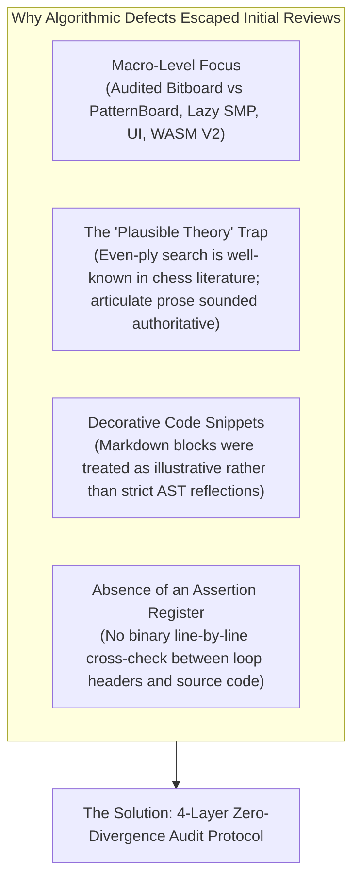
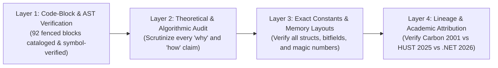
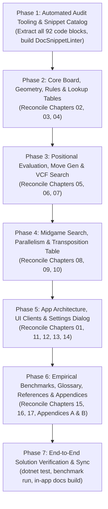

# Exhaustive Documentation, Engine Lineage & Algorithmic Audit Plan (v2)

## Executive Summary & Mission

The Gomoku engine documentation in [`docs/brain/`](file:///c:/Udvikling/Spil/Gomoku/docs/brain/) represents a comprehensive technical treatise detailing the architecture, algorithms, data structures, and mathematical foundations of the engine. Over multiple iterations, the engine evolved from a direct C# port of the 2001–2006 C++ engine ([`Carbon-Gomoku-master`](file:///c:/Udvikling/Spil/Gomoku/Carbon-Gomoku-master)) and an experimental port of the modern 2025/2026 Hanoi University of Science & Technology C++ engine ([`Gomoku-main`](file:///c:/Udvikling/Spil/Gomoku/Gomoku-main)) into a unified, high-performance hybrid: **Carbon Bitboard** ([`CarbonBitboardAiPlayer.cs`](file:///c:/Udvikling/Spil/Gomoku/src/Gomoku.Core/AI/CarbonBitboardAiPlayer.cs) and [`BitboardPatternBoard.cs`](file:///c:/Udvikling/Spil/Gomoku/src/Gomoku.Core/Engine/BitboardPatternBoard.cs)).

While previous review efforts successfully resolved large macro-architectural discrepancies (e.g. standardizing on $15 \times 15$, adopting bitboard Chebyshev dilation, and documenting Web Worker V2), subtle micro-algorithmic and theoretical discrepancies persisted. A prime example is the **"Even-Ply Iterative Deepening"** error discovered in Chapter 08, where the documentation asserted that the engine searched only even depths (`depth += 2`) to avoid horizon bias, complete with plausible theoretical prose and an erroneous code snippet, when in reality all three engines (Carbon C++, HUST C++, and Gomoku .NET) execute **single-ply iterative deepening (`depth++`)** and rely on transposition table depth parity bitmasks (`((entry.Depth ^ h) & 1) == 0`).

This enhanced plan establishes an **exhaustive, statement-by-statement and snippet-by-snippet verification protocol** to ensure 100% mathematical, algorithmic, and syntactic fidelity between the documentation, the active .NET production codebase, and its ancestral origins.

---

## Root Cause Analysis: Why Did Algorithmic Errors Escape Previous Reviews?

To ensure this new plan is foolproof, we must understand why the original review missed the "Even-Ply" bug:

1. **Macro Architectural Focus vs. Micro Algorithmic Verification:**
   Previous reviews focused on high-level subsystem migrations (e.g. replacing `PatternBoard` with `BitboardPatternBoard`, deprecating `Adj1/Adj2`, upgrading WASM threading, standardizing on 15x15). Mid-chapter loop conditions, variable scopes, and step increments were assumed to be correct.
2. **The "Plausible Theory" Trap:**
   In game-tree search theory (particularly chess engines), even-ply searching is a well-known heuristic to neutralize odd-ply evaluation swing. Because early drafts contained articulate, mathematically formatted paragraphs defending even-ply search, casual technical reading accepted the explanation without checking whether the real loop condition was `depth++`.
3. **Snippets as Decorative Ornaments vs. Authoritative Code:**
   Code snippets inside markdown were written or adapted without running automated symbol checking, AST verification, or direct source comparisons.
4. **Absence of an Itemized Claim & Snippet Register:**
   There was no centralized registry cataloging every code snippet (all 92 blocks!) and every theoretical claim with an empirical PASS/FAIL verification against source lines.

---

## The 4-Layer Zero-Divergence Audit Framework

This improved plan executes a four-tiered verification protocol across every single file in [`docs/brain/`](file:///c:/Udvikling/Spil/Gomoku/docs/brain/):

### Layer 1: Code-Block & AST Verification (Cataloging All 92 Fenced Blocks)
- Every fenced code block (`csharp`, `cpp`, `mermaid`, `text`) across the 19 documentation files is cataloged with start/end line numbers.
- For C# snippets:
  - Every type, method, and field reference must exist in [`src/Gomoku.Core`](file:///c:/Udvikling/Spil/Gomoku/src/Gomoku.Core), [`src/Gomoku.App`](file:///c:/Udvikling/Spil/Gomoku/src/Gomoku.App), [`src/Gomoku.Wpf`](file:///c:/Udvikling/Spil/Gomoku/src/Gomoku.Wpf), [`src/Gomoku.Web`](file:///c:/Udvikling/Spil/Gomoku/src/Gomoku.Web), or [`src/Gomoku.Web.Engine`](file:///c:/Udvikling/Spil/Gomoku/src/Gomoku.Web.Engine).
  - Loop increments (`depth++` vs `depth += 2`), array indexing (`(y << 7) | x`), loop bounds, and variable declarations (e.g. ensuring `yp` is declared before use) must match the source code verbatim.
  - Snippets referencing obsolete structures (e.g. `PatternBoard.Cell`, `c.Adj1`, `c.Adj2`, `stackalloc Cand[64]`) must be rewritten to match active production (`BitboardPatternBoard.Cell`, bitboard Chebyshev dilation, `MaxCand = 256`) or moved into an explicitly designated "Historical Evolution" block.
- For C++ snippets:
  - Every C++ snippet must be cross-referenced with exact line numbers in [`Carbon-Gomoku-master`](file:///c:/Udvikling/Spil/Gomoku/Carbon-Gomoku-master) or [`Gomoku-main`](file:///c:/Udvikling/Spil/Gomoku/Gomoku-main).

### Layer 2: Theoretical & Algorithmic Assertion Audit
- Scrutinize every prose statement asserting *why* or *how* an algorithm operates:
  - **Iterative Deepening:** Verify single-ply step, time allocation formulas (`time / 15`, `TimeoutPrevent = 30ms`), and countdown polling latch (`--_nodeCheckCounter <= 0`).
  - **PVS Search:** Verify null-window scouting bounds (`[-alpha - 1, -alpha]`), full window fallback, and fail-soft behavior.
  - **Transposition Table Replacement & Parity:** Verify why `((entry.Depth ^ h) & 1) == 0` is required, generation aging (`ageDiff`), and Stockfish XOR checksum validation (`(KeyXorData ^ Data) == Key`).
  - **Threat & Tactical Solvers:** Verify exact ply return values of `QuickWinSearch` ($q = 1, -2, 3, 5$) and Renju foul defenses (`c.GetStatus4(who) == ThreatForbid`).
  - **Candidate Generation:** Verify bitwise Chebyshev dilation formula `(m | (m << 1) | (m >> 1)) & boardMask` across row spans $[y-2 \dots y+2]$.
  - **Root Move Diversification:** Verify worker 1 candidate reversal and worker $\ge 2$ cyclic offsets in Lazy SMP.

### Layer 3: Exact Constants, Magic Numbers & Memory Layouts
- Reconcile every hardcoded number and table dimension against source definitions:
  - Score bounds: `Inf = 32000`, `WinMax = 30000`, `WinMin = 25000`.
  - Transposition table: `DefaultCapacity = 1_048_576` (16 MB), 16-byte packed layout (`[StructLayout(LayoutKind.Explicit, Size = 16)]`).
  - SMP spacing: `WorkerCounterStride = 8` `long`s (64 bytes, cache-line aligned).
  - Board coordinates: `Stride = 128`, `Margin = 4`, `BoardWidth = 15`, `BoardHeight = 15`.
  - Threat tables: $3^8 = 6561$ status configurations, $256 \times 256 = 65,536$ configuration pairs, $106$ canonical `Rank` classes.
  - Candidate capacity: `MaxCand = 256` (reconciling legacy `64`).

### Layer 4: Lineage & Academic Attribution Truth
- Audit every credit and lineage claim:
  - **Michał Czardybon (`Carbon-Gomoku-master`, 2001–2006):** Attributed for 4-axis ray masks, $3^8=6561$ threat tables, `QuickWinSearch`, and static ranking tables. Contrast its 1D padded array (20x20 with border 4) and `Adj1/Adj2` counters.
  - **HUST Group 01 (`Gomoku-main`, 2025/2026):** Attributed for 16-bit bitboard architecture, PVS search framing, and VCF solver comparisons. Clarify that HUST Gomoku did not support Renju rules or an opening book.
  - **Gomoku .NET (2026):** Attributed for unifying Carbon's threat evaluation with 4-axis bitboards, bitboard Chebyshev dilation, $D_4$ dihedral opening book (22 canonical systems, 67 clusters), 16-byte lock-free transposition table, cache-line padded Lazy SMP, and dual-runtime WebAssembly V2 engine.

---

## Tool-Assisted Verification: `DocSnippetLinter`

To make this audit repeatable and prevent future regressions, we will create an automated script ([`scratch/audit_snippets.mjs`](file:///c:/Udvikling/Spil/Gomoku/scratch/audit_snippets.mjs) or [`tools/Gomoku.DocAudit`](file:///c:/Udvikling/Spil/Gomoku/tools/Gomoku.DocAudit)) that performs:

1. **Fenced Code Extractor:** Parses all `.md` files in [`docs/brain/`](file:///c:/Udvikling/Spil/Gomoku/docs/brain/) and extracts all 92 code blocks.
2. **Obsolete Pattern Scanner:** Flags any occurrences of:
   - `Adj1` / `Adj2` outside historical callouts.
   - `PatternBoard.Cell` or `ref PatternBoard`.
   - `depth += 2` or "Even-Ply Iterative Deepening".
   - `stackalloc Cand[64]` or `MaxCand = 64`.
   - $19 \times 19$ or $20 \times 20$ board dimensions stated as production features.
   - Undeclared local variables in C# snippets (e.g. `yp` in candidate extraction).
3. **Symbol & Member Cross-Check:** Verifies that all types, methods, and constants referenced in code blocks exist in [`Gomoku.Core`](file:///c:/Udvikling/Spil/Gomoku/src/Gomoku.Core).

---

## Itemized Chapter-by-Chapter Audit Register

Below is the definitive audit specification for all 17 chapters and 2 appendices:

| Chapter | Title & Focus | Fenced Blocks | Source Files to Verify Against | Critical Audit Checkpoints |
|---|---|---|---|---|
| **01** | [Overview & Architecture](file:///c:/Udvikling/Spil/Gomoku/docs/brain/01-overview.md) | 4 blocks | `Gomoku.Core`, `Gomoku.App`, `Gomoku.Wpf`, `Gomoku.Web`, `Gomoku.Web.Engine` | Update Mermaid diagrams to show `Gomoku.Web.Engine`; verify desktop throughput (4.2M NPS) and WASM throughput (3.58M NPS); eliminate remaining `PatternBoard.Cell` / `Adj1` mentions. |
| **02** | [Board Representation & Geometry](file:///c:/Udvikling/Spil/Gomoku/docs/brain/02-board-and-geometry.md) | 7 blocks | [`BitboardPatternBoard.cs`](file:///c:/Udvikling/Spil/Gomoku/src/Gomoku.Core/Engine/BitboardPatternBoard.cs), [`Bitboard15.cs`](file:///c:/Udvikling/Spil/Gomoku/src/Gomoku.Core/Engine/Bitboard15.cs) | **Major Audit:** Standardize strictly on $15 \times 15$; replace 13 occurrences of `Adj1/Adj2` and `PatternBoard.Cell` in main sections with `BitboardPatternBoard.Cell` and bitboard Chebyshev dilation; confine Carbon's 20x20 padding to historical callouts. |
| **03** | [Rules & Variants](file:///c:/Udvikling/Spil/Gomoku/docs/brain/03-rules-and-variants.md) | 2 blocks | [`BitboardPatternBoard.cs`](file:///c:/Udvikling/Spil/Gomoku/src/Gomoku.Core/Engine/BitboardPatternBoard.cs), [`RuleEngine.cs`](file:///c:/Udvikling/Spil/Gomoku/src/Gomoku.Core/Engine/RuleEngine.cs), `COUNT5.CPP` | Verify Exact 5 overline logic; audit `CheckForbid(int x, int y)` snippet (lines 91-143) line-by-line against `BitboardPatternBoard.cs` L422-475; confirm 3x3, 4x4, and overline foul rules. |
| **04** | [Pattern Bitboards & Lookup Tables](file:///c:/Udvikling/Spil/Gomoku/docs/brain/04-pattern-bitboards-and-lookup-tables.md) | 2 blocks | [`BitboardPatternBoard.cs`](file:///c:/Udvikling/Spil/Gomoku/src/Gomoku.Core/Engine/BitboardPatternBoard.cs), [`CarbonTables.cs`](file:///c:/Udvikling/Spil/Gomoku/src/Gomoku.Core/AI/CarbonTables.cs), `STATUS1.CPP`, `PRIOR3.CPP` | Verify ray bitmask updating (`SetPatternOr`, `SetPatternXor`); verify table sizes ($3^8 = 6561$, $256 \times 256 = 65,536$ config pairs); audit `Update1` and `Update4` logic. |
| **05** | [Evaluation & Threat Scoring](file:///c:/Udvikling/Spil/Gomoku/docs/brain/05-evaluation.md) | 4 blocks | [`CarbonBitboardAiPlayer.cs`](file:///c:/Udvikling/Spil/Gomoku/src/Gomoku.Core/AI/CarbonBitboardAiPlayer.cs) L519-545, [`CarbonTables.cs`](file:///c:/Udvikling/Spil/Gomoku/src/Gomoku.Core/AI/CarbonTables.cs), `AICarbon.cpp` | Verify `Evaluate(BitboardPatternBoard pb)` iterates `RemPlacedPoints[0 .. remCount - 1]`; verify 106 `Rank` configuration weights; correct any lingering $19 \times 19$ prose references to $15 \times 15$. |
| **06** | [Move Generation & Ordering](file:///c:/Udvikling/Spil/Gomoku/docs/brain/06-move-generation-and-ordering.md) | 7 blocks | [`CarbonBitboardAiPlayer.cs`](file:///c:/Udvikling/Spil/Gomoku/src/Gomoku.Core/AI/CarbonBitboardAiPlayer.cs) L582-750 | **Major Audit:** Fix snippet L88-100 to declare `yp` within outer row loop; verify `DilateRow` bit shifts; audit candidate capacity `MaxCand = 256`; verify worker candidate diversification (worker 1 reverses, worker $\ge 2$ cyclic shift). |
| **07** | [Tactical VCF Search](file:///c:/Udvikling/Spil/Gomoku/docs/brain/07-tactical-vcf-search.md) | 4 blocks | [`CarbonBitboardAiPlayer.cs`](file:///c:/Udvikling/Spil/Gomoku/src/Gomoku.Core/AI/CarbonBitboardAiPlayer.cs) L546-580, `AICarbon.cpp` | Verify `QuickWinSearch` return values ($q = 1, -2, 3, 5$); verify variable names (`pb` vs `_pb` at L207); audit Renju foul defenses and threat level triggers (`ThreatA..ThreatF`). |
| **08** | [Midgame Search](file:///c:/Udvikling/Spil/Gomoku/docs/brain/08-midgame-search.md) | 8 blocks | [`CarbonBitboardAiPlayer.cs`](file:///c:/Udvikling/Spil/Gomoku/src/Gomoku.Core/AI/CarbonBitboardAiPlayer.cs) L190-515, `engine.hpp` | Re-verify single-ply iterative deepening (`depth++`); audit PVS null-window bounds; audit Lazy SMP lock-free worker tracking (`WorkerCounterStride = 8`); audit node counter latch (`--_nodeCheckCounter <= 0`). |
| **09** | [Transposition Table](file:///c:/Udvikling/Spil/Gomoku/docs/brain/09-transposition-table.md) | 6 blocks | [`LockFreeTranspositionTable.cs`](file:///c:/Udvikling/Spil/Gomoku/src/Gomoku.Core/AI/LockFreeTranspositionTable.cs), [`Zobrist.cs`](file:///c:/Udvikling/Spil/Gomoku/src/Gomoku.Core/AI/Zobrist.cs) | Audit 16-byte `Entry` layout (`KeyXorData`, `Data`); verify 64-bit bitfield packing; audit depth parity check `((entry.Depth ^ h) & 1) == 0`; audit age replacement policy (`ageDiff`). |
| **10** | [Opening Book](file:///c:/Udvikling/Spil/Gomoku/docs/brain/10-opening-book.md) | 5 blocks | [`OpeningBook.cs`](file:///c:/Udvikling/Spil/Gomoku/src/Gomoku.Core/AI/OpeningBook.cs) | Verify $D_4$ dihedral group (8 symmetries: 4 rotations, 4 reflections); verify 22 canonical opening systems and 67 pattern clusters; note that opening book was introduced in Gomoku .NET. |
| **11** | [Game Record & Formats](file:///c:/Udvikling/Spil/Gomoku/docs/brain/11-game-record-and-formats.md) | 8 blocks | [`SgfFormat.cs`](file:///c:/Udvikling/Spil/Gomoku/src/Gomoku.Core/Formats/SgfFormat.cs), [`GomokuRecordFormat.cs`](file:///c:/Udvikling/Spil/Gomoku/src/Gomoku.Core/Formats/GomokuRecordFormat.cs) | Verify SGF `GM[11]` specifications, algebraic format parsing, 15x15 coordinate conversion, and serialization round-trip fidelity. |
| **12** | [App Architecture & Audio](file:///c:/Udvikling/Spil/Gomoku/docs/brain/12-app-architecture-and-audio.md) | 6 blocks | [`MainViewModel.cs`](file:///c:/Udvikling/Spil/Gomoku/src/Gomoku.App/ViewModels/MainViewModel.cs), [`SoundWaves.cs`](file:///c:/Udvikling/Spil/Gomoku/src/Gomoku.App/Services/SoundWaves.cs), [`LocalEngineHost.cs`](file:///c:/Udvikling/Spil/Gomoku/src/Gomoku.App/Services/LocalEngineHost.cs) | Verify Clean MVVM bindings; verify procedural 16-bit PCM waveform generation algorithms (stone click, win chimes); audit WAV header formatting; fix lingering $19 \times 19$ references. |
| **13** | [UI Clients](file:///c:/Udvikling/Spil/Gomoku/docs/brain/13-ui-clients.md) | 2 blocks | [`Gomoku.Wpf`](file:///c:/Udvikling/Spil/Gomoku/src/Gomoku.Wpf), [`Gomoku.Web`](file:///c:/Udvikling/Spil/Gomoku/src/Gomoku.Web), [`Gomoku.Web.Engine`](file:///c:/Udvikling/Spil/Gomoku/src/Gomoku.Web.Engine) | Verify WPF DirectX hardware acceleration specs; audit Blazor WebAssembly Deputy-Thread architecture (`Gomoku.Web.Engine` + fallback worker); fix lingering $19 \times 19$ mentions. |
| **14** | [GUI & Settings](file:///c:/Udvikling/Spil/Gomoku/docs/brain/14-gui-and-settings.md) | 6 blocks | [`DialogHost.razor`](file:///c:/Udvikling/Spil/Gomoku/src/Gomoku.Web/Components/DialogHost.razor), [`SettingsWindow.xaml`](file:///c:/Udvikling/Spil/Gomoku/src/Gomoku.Wpf/Views/SettingsWindow.xaml) | Verify 5 settings dialog sections: Rules Variant + Theme (2-column side-by-side), AI Engine, Thinking Limits, Multi-Threading (1–8T), Opening Book & TT; audit dynamic UI visibility rules. |
| **15** | [Benchmarks & Performance](file:///c:/Udvikling/Spil/Gomoku/docs/brain/15-benchmarks-and-performance.md) | 5 blocks | [`tools/Gomoku.Benchmark`](file:///c:/Udvikling/Spil/Gomoku/tools/Gomoku.Benchmark) | Reconcile throughput claims with modernized `Gomoku.Benchmark` results; replace obsolete `PatternBoard.Cell` and `stackalloc Cand[64]` with `BitboardPatternBoard` and `MaxCand = 256`. |
| **16** | [Glossary](file:///c:/Udvikling/Spil/Gomoku/docs/brain/16-glossary.md) | 0 blocks | Terminology & concepts | Audit and update all technical terms (Chebyshev dilation, Lazy SMP, VCF, QuickWinSearch, PVS, Zobrist, Renju foul); remove `Adj1/Adj2` from primary definitions. |
| **17** | [References](file:///c:/Udvikling/Spil/Gomoku/docs/brain/17-references.md) | 0 blocks | Academic citations | Verify citations for Michał Czardybon (2001–2006), HUST Group 01 (2025/2026), L. V. Allis (1994), T. A. Marsland (1983), and Czajka (2020). |
| **App A** | [Engine Comparison Report](file:///c:/Udvikling/Spil/Gomoku/docs/brain/appendix-a-engine-comparison-report.md) | 13 blocks | Baseline, Carbon-X, Carbon Bitboard | Audit PDEP/SIMD C++ vs C# Bitboard comparisons; verify 100-game match statistics; ensure historical context is crystal clear. |
| **App B** | [Match Investigation Report](file:///c:/Udvikling/Spil/Gomoku/docs/brain/appendix-b-single-threaded-match-investigation-report.md) | 1 block | Single-threaded search determinism | Verify single-threaded search determinism findings, candidate tiebreak sorting, and PRNG seeding. |

---

## Phased Execution Strategy

### Phase 1: Automated Audit Tooling & Snippet Catalog
1. Develop the automated linter script ([`scratch/audit_snippets.mjs`](file:///c:/Udvikling/Spil/Gomoku/scratch/audit_snippets.mjs)) to extract and catalog all 92 fenced code blocks across `docs/brain/*.md`.
2. Generate an automated discrepancy report highlighting obsolete keywords (`Adj1`, `Adj2`, `PatternBoard.Cell`, `depth += 2`, `Cand[64]`, `19x19`) and undeclared identifiers.
3. Establish a baseline inventory tracking sheet for all 19 files.

### Phase 2: Core Board, Geometry, Rules & Lookup Tables (Chapters 02, 03, 04)
1. **Chapter 02 (Board & Geometry):**
   - Re-anchor all text strictly to $15 \times 15$ tournament geometry.
   - Replace `PatternBoard.Cell` and 13 occurrences of `Adj1/Adj2` in primary sections with `BitboardPatternBoard.Cell` and bitboard Chebyshev dilation (`DilateRow`).
   - Move Carbon's $20 \times 20$ array padding into an "Architectural Evolution" callout.
2. **Chapter 03 (Rules & Variants):**
   - Audit `CheckForbid(int x, int y)` snippet line-by-line against [`BitboardPatternBoard.cs`](file:///c:/Udvikling/Spil/Gomoku/src/Gomoku.Core/Engine/BitboardPatternBoard.cs) L422-475.
   - Verify Exact 5 overline rules and Renju 3x3/4x4/overline foul referee logic.
3. **Chapter 04 (Pattern Bitboards & Lookup Tables):**
   - Audit ray bitmask manipulation functions (`SetPatternOr`, `SetPatternXor`, `Update1`, `Update4`).
   - Reconcile status table dimensions ($3^8 = 6561$, $256 \times 256 = 65,536$) and indexing arithmetic.

### Phase 3: Positional Evaluation, Move Gen & Tactical Search (Chapters 05, 06, 07)
1. **Chapter 05 (Evaluation):**
   - Reconcile `Evaluate(BitboardPatternBoard pb)` with [`CarbonBitboardAiPlayer.cs`](file:///c:/Udvikling/Spil/Gomoku/src/Gomoku.Core/AI/CarbonBitboardAiPlayer.cs) L519-545.
   - Remove lingering $19 \times 19$ stone iteration comments; confirm 106 `Rank` configuration values.
2. **Chapter 06 (Move Generation & Ordering):**
   - Fix candidate extraction snippet (L88-100) to declare `yp` in the outer row loop.
   - Replace all `stackalloc Cand[64]` buffer snippets with `MaxCand = 256`.
   - Document root candidate diversification (worker 1 candidate reversal, worker $\ge 2$ cyclic shift).
3. **Chapter 07 (Tactical VCF Search):**
   - Audit `QuickWinSearch` return semantics ($q = 1, -2, 3, 5$) against [`CarbonBitboardAiPlayer.cs`](file:///c:/Udvikling/Spil/Gomoku/src/Gomoku.Core/AI/CarbonBitboardAiPlayer.cs) L546-580.
   - Fix parameter variable naming (`pb` vs `_pb` at L207).

### Phase 4: Midgame Search, Parallelism & Transposition Table (Chapters 08, 09, 10)
1. **Chapter 08 (Midgame Search):**
   - Verify single-ply iterative deepening (`depth++`) and depth parity mathematical proofs.
   - Audit PVS null-window bounds (`[-alpha - 1, -alpha]`).
   - Audit Lazy SMP cache-line counter spacing (`WorkerCounterStride = 8`).
   - Audit time management countdown latch (`--_nodeCheckCounter <= 0`).
2. **Chapter 09 (Transposition Table):**
   - Re-verify 16-byte lock-free struct layout, Stockfish XOR-checksum verification, and 64-bit data packing.
   - Detail depth parity bitmask cutoff condition `((entry.Depth ^ h) & 1) == 0`.
3. **Chapter 10 (Opening Book):**
   - Verify $D_4$ dihedral symmetry group (8 transformations) across 22 canonical opening systems and 67 pattern clusters.

### Phase 5: Formats, Application Architecture & UI Clients (Chapters 01, 11, 12, 13, 14)
1. **Chapter 01 (Overview):**
   - Update architecture diagrams and component tables to include `Gomoku.Web.Engine`.
2. **Chapter 11 (Game Record & Formats):**
   - Reconcile SGF `GM[11]` specifications, algebraic format parser, and 15x15 coordinate mapping.
3. **Chapter 12 (App Architecture & Audio):**
   - Audit Clean MVVM patterns, `IEngineHost` abstractions, and procedural 16-bit PCM sound wave synthesis.
4. **Chapter 13 (UI Clients):**
   - Audit WPF hardware acceleration specs and Blazor WebAssembly Deputy-Thread architecture (`Gomoku.Web.Engine` + worker fallback).
5. **Chapter 14 (GUI & Settings):**
   - Verify 5-section settings dialog, 2-column side-by-side rules + theme layout, and multi-threading options (1–8T).

### Phase 6: Empirical Benchmarks, Glossary, References & Appendices (Chapters 15, 16, 17, Apps A & B)
1. **Chapter 15 (Benchmarks & Performance):**
   - Run modernized [`Gomoku.Benchmark`](file:///c:/Udvikling/Spil/Gomoku/tools/Gomoku.Benchmark) suite and update empirical throughput charts.
   - Replace obsolete `PatternBoard.Cell` and `stackalloc Cand[64]` allocations.
2. **Chapter 16 (Glossary) & Chapter 17 (References):**
   - Audit all definitions and academic citations for complete accuracy.
3. **Appendices A & B:**
   - Verify historical comparisons, match statistics, and determinism findings.

### Phase 7: Solution-Wide Verification & In-App Sync
1. Run automated test suite: `dotnet test` (verifying all 83 tests pass).
2. Run modernized benchmark tool: `dotnet run --project tools/Gomoku.Benchmark -- --quick`.
3. Run automated snippet linter: `node scratch/audit_snippets.mjs` (verifying 0 obsolete patterns and 100% symbol match).
4. Run solution build: `dotnet build` (automatically synchronizing `docs/brain/**` into `src/Gomoku.Web/wwwroot/content/brain/` via `CopyBrainDocs`).
5. Verify in-app documentation reader (`/docs`) in the browser.

---

## Verification & Acceptance Checklist

- [ ] **Automated Snippet Linter Passes:** Zero undetected obsolete patterns (`Adj1`, `Adj2`, `PatternBoard.Cell`, `depth += 2`, `Cand[64]`, `19x19`) across all 19 files.
- [ ] **Exact Algorithmic Parity:** Every loop header, bound check, and return code in docs matches active C# source verbatim.
- [ ] **Zero Regression in Test Suite:** `dotnet test` completes with 83 passing tests, 0 failures, 0 skipped.
- [ ] **Clean Compilation:** `dotnet build` succeeds with 0 warnings, 0 errors.
- [ ] **In-App Docs Synchronization:** All updated chapters render cleanly in the Blazor `/docs` viewer with responsive navigation, KaTeX math, and Mermaid diagrams.
- [ ] **User Control of Commits:** No git commits or pushes executed by the assistant; all staged/unstaged changes ready for user inspection and commit.

