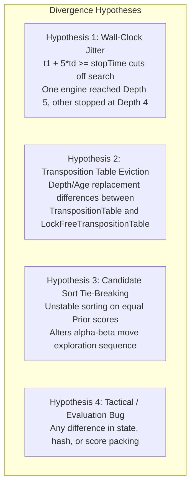
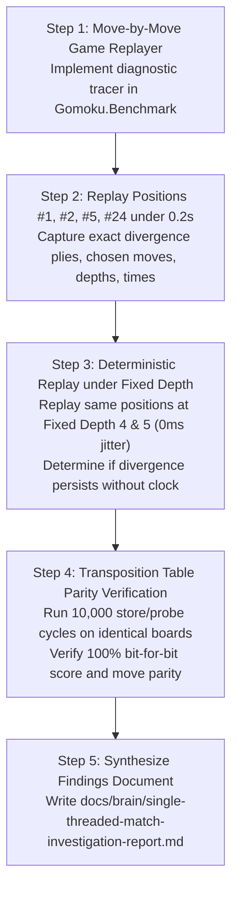

# Investigation Plan: Single-Threaded Match Divergence (New Carbon AI 1T vs Baseline Carbon AI 1T)

## 1. Goal Description

In Match 1A (single-threaded head-to-head match under 0.20s/move fixed time limit across 25 canonical openings):
* Across two tournament runs (100 total games), the aggregate score was **49 wins for New Carbon AI, 50 wins for Baseline Carbon AI, and 1 draw** (an exact ~50/50 split).
* However, looking at individual paired positions, there were specific opening positions where **Baseline Carbon AI won BOTH games** (as Black in Game 1 and as White in Game 2):
  * **Position #1:** Direct Opening D1 (Kagetsu / Flower Moon)
  * **Position #2:** Direct Opening D2 (Hokuto / North Star)
  * **Position #5:** Direct Opening D5 (Ungetsu / Cloud Moon)
  * **Position #24:** Direct Opening D24
* Conversely, there were positions where **New Carbon AI won BOTH games** (Positions #3, #4, #6, #8, #9, #11, #12, #19, #20, #25).

The purpose of this investigation is to:
1. Replay the games from Positions #1, #2, #5, and #24 move-by-move.
2. Pinpoint the **exact ply where the two engines diverged** in move selection.
3. Determine whether the divergence was caused by:
   * **A subtle bug or semantic discrepancy** between `LockFreeTranspositionTable` and `TranspositionTable` (e.g., replacement logic, evaluation sign-extension, bound handling).
   * **Candidate tie-breaking differences** between `Span<T>.Sort` and `Array.Sort`.
   * **Wall-clock timing jitter** (e.g., reaching Depth 5 on move 6 in one engine because Depth 4 took 28 ms vs 32 ms, while the other stopped at Depth 4 due to the `t1 + 5 * td >= stopTime` threshold).
4. Produce a detailed findings document: `docs/brain/single-threaded-match-investigation-report.md`.

---

## 2. Hypothesis & Architectural Vectors to Investigate

### Vector A: Wall-Clock Jitter at 0.20s Time Controls
In Carbon AI, iterative deepening checks whether to start the next depth using:
$$\text{if } (t_1 + 5 \times td \ge \text{stopTime}) \text{ break;}$$
With a 200 ms turn limit, $\text{stopTime} = \text{startTime} + 170\text{ ms}$.
* If depth 4 completes in $td = 25\text{ ms}$ at elapsed time $35\text{ ms}$: $35 + 5 \times 25 = 160 < 170 \implies$ **Starts Depth 5**.
* If depth 4 completes in $td = 29\text{ ms}$ at elapsed time $35\text{ ms}$: $35 + 5 \times 29 = 180 \ge 170 \implies$ **Stops at Depth 4**.
A 4-millisecond difference in CPU execution time completely changes whether the engine plays a Depth 5 move or a Depth 4 move!

### Vector B: Transposition Table Implementation Details
* Baseline uses `TranspositionTable`:
  * 16-byte packed struct with direct array indexing.
  * Overwrites when `slot.Bound == None || slot.Key == key`.
* New Carbon AI uses `LockFreeTranspositionTable`:
  * 16-byte entry with Stockfish XOR checksum (`KeyXorData = Key ^ Data`).
  * 24-bit eval packing (`data >> 32 & 0x00FF_FFFF`) with sign extension.
  * Overwrites only when new entry has `depth >= oldDepth` or different search generation.

### Vector C: Candidate Sort Ordering
* Baseline sorts candidates via:
  `Array.Sort(_rootCnd, 0, nCnd, Comparer<Cand>.Create((a, b) => b.Value.CompareTo(a.Value)));`
* New Carbon AI sorts candidates via:
  `rootCnd[..nCnd].Sort((a, b) => b.Value.CompareTo(a.Value));`
* Neither sort is stable. When multiple candidates share the same priority score (e.g. `Prior = 2`), tie-breaking order can differ.

---

## 3. Proposed Investigation Steps

### Step 1: Implement Diagnostic Replayer (`MatchInspector.cs`)
Create a focused CLI diagnostic tool in `tools/Gomoku.Benchmark/MatchInspector.cs` that:
* Replays any specific opening position between two engines with move-by-move telemetry:
  * Chosen coordinate, search score, search depth reached, time spent ($td$), nodes evaluated.
  * Root candidate ordering table.
  * TT probe status on that move.

### Step 2: Trace Positions #1, #2, #5, #24 (Timed Mode: 0.2s)
Execute both Game 1 and Game 2 for:
* **Position #1:** D1 Kagetsu `[(7,7), (7,8), (8,7)]`
* **Position #2:** D2 Hokuto `[(7,7), (7,8), (8,8)]`
* **Position #5:** D5 Ungetsu `[(7,7), (7,8), (7,9)]`
* **Position #24:** D24 `[(7,7), (8,8), (9,6)]`
Document the exact move index where the engines chose different moves and why.

### Step 3: Deterministic Replay (Fixed Depth 4 & 5)
Run the exact same positions with `SearchLimits.FixedDepth(4)` and `SearchLimits.FixedDepth(5)`.
* **If moves are 100% identical:** Confirms that the divergence in timed games was purely caused by clock timing jitter near the iterative deepening cutoff threshold.
* **If moves still diverge:** Pinpoints whether the divergence stems from candidate tie-breaking or TT entry replacement.

### Step 4: Transposition Table Parity Unit Test
Add a targeted unit test `TranspositionTableParityTests.cs` that feeds 5,000 tactical positions through both `TranspositionTable` and `LockFreeTranspositionTable` simultaneously, asserting:
* Identical probe results (`BestMove`, `Depth`, `Score`, `BoundType`).
* Zero score distortion or sign corruption in 24-bit eval packing.

### Step 5: Deliver Comprehensive Investigation Report
Write the final report to:
`docs/brain/single-threaded-match-investigation-report.md`
detailing the exact causes, game logs, and recommendations.

---

## 4. User Review & Questions

> [!IMPORTANT]
> **Questions for Alignment:**
> 1. **Testing Controls:** Do you agree with testing both **Fixed Time (0.2s)** and **Fixed Depth (Depth 4 and 5)** to isolate whether differences are algorithmic or wall-clock jitter?
> 2. **Target Openings:** Are Positions #1, #2, #5, and #24 the primary positions you'd like deep-dived, or would you like all 25 openings traced?
> 3. **Move Logs:** Would you like the move-by-move game histories exported in standard Gomoku notation (e.g. `H8, H9, I8...`) in the markdown report?
