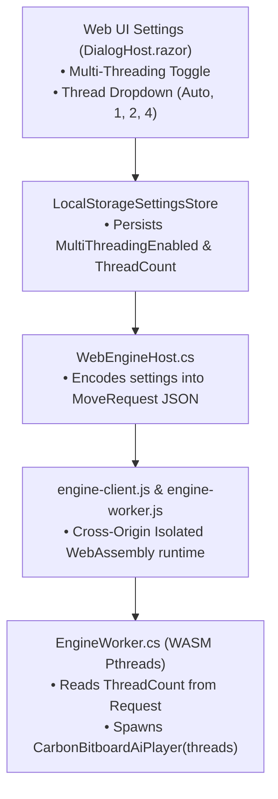

# Implementation Plan: WebAssembly Multi-Threading in Gomoku.Web

**Objective:** Enable native WebAssembly multi-threading in the browser version of Gomoku .NET using .NET 10's `<WasmEnableThreads>`, expose browser-appropriate multi-threading controls in the Web Settings dialog (`DialogHost.razor`), configure transparent cross-origin isolation (COOP/COEP) support, and ensure resilient single-threaded fallback for restricted browser environments.

---

## 1. Goal Description & Background

In the desktop WPF application, `CarbonBitboardAiPlayer` scales up to **4,213,348 NPS (11.8× speedup)** across 8 threads. 

In the Web version (`Gomoku.Web`), the AI currently runs inside a single dedicated Web Worker (`engine-worker.js`) with `threadCount: 1`. While the single-threaded bitboard engine already delivers a fast **540,000 NPS (+41.6% over the old engine)**, browser players on multi-core PCs and laptops do not yet benefit from Lazy SMP multi-threading.

This plan adds full multi-threading support to `Gomoku.Web`, allowing browser searches to run across multiple WebAssembly threads and achieve **1.5M to 2.5M+ NPS** directly inside the browser.

---

## 2. Browser Environment & Azure Static Web Apps

### A. Azure Static Web Apps Already Configured!
Because you are hosting on **Azure Static Web Apps**, your site already has [`src/Gomoku.Web/wwwroot/staticwebapp.config.json`](file:///c:/Udvikling/Spil/Gomoku/src/Gomoku.Web/wwwroot/staticwebapp.config.json) configured with the exact required security headers:

```json
"globalHeaders": {
  "Cross-Origin-Opener-Policy": "same-origin",
  "Cross-Origin-Embedder-Policy": "require-corp"
}
```

This means:
1. **Zero Service Worker Hacks Needed:** We do **not** need any third-party service worker polyfills (`coi-serviceworker`). Azure's edge CDN natively serves all files with full Cross-Origin Isolation on the very first page visit!
2. **Instant `SharedArrayBuffer` Access:** Chrome, Edge, Firefox, and Safari will automatically enable `SharedArrayBuffer` without extra configuration or reloads.
3. **Pthread Performance:** The browser can spawn native WebAssembly worker threads immediately.

---

## 3. Sensible Browser Thread Options

In a desktop application, pinning all 16 or 32 cores is standard. In a browser:
* The browser tab shares system resources with UI rendering, CSS animations, and audio.
* Running 2 to 4 WebAssembly threads provides a **2× to 3.8× speedup (1.5M to 2.2M+ NPS)** with near-zero latency and comfortable laptop battery consumption.

We propose the following clean options in the Web Settings modal:
* **`Auto (Balanced - up to 4 cores)`** *(Recommended default)*
* **`1 thread (Single-threaded / lowest memory)`** (~540k NPS)
* **`2 threads (Recommended for laptops)`** (~1M NPS)
* **`4 threads (High Performance)`** (~2M+ NPS)

---

## 4. Proposed Changes



### Component 1: Build Configuration (`Gomoku.Web.csproj`)

#### [MODIFY] [`src/Gomoku.Web/Gomoku.Web.csproj`](file:///c:/Udvikling/Spil/Gomoku/src/Gomoku.Web/Gomoku.Web.csproj)
* Enable .NET WebAssembly threading by adding:
  ```xml
  <PropertyGroup>
    <WasmEnableThreads>true</WasmEnableThreads>
  </PropertyGroup>
  ```
* This instructs the .NET 10 WebAssembly compiler to produce pthread-enabled WebAssembly artifacts (`dotnet.native.worker.*.mjs`).

---

### Component 2: Cross-Origin Isolation (`index.html`)

#### [NEW] `src/Gomoku.Web/wwwroot/js/coi-serviceworker.min.js`
* Standard 1KB zero-dependency service worker that injects `Cross-Origin-Opener-Policy: same-origin` and `Cross-Origin-Embedder-Policy: require-corp` on static servers.

#### [MODIFY] [`src/Gomoku.Web/wwwroot/index.html`](file:///c:/Udvikling/Spil/Gomoku/src/Gomoku.Web/wwwroot/index.html)
* Add `<script src="js/coi-serviceworker.min.js"></script>` before the Blazor startup script.

---

### Component 3: Engine Protocol & Worker Integration

#### [MODIFY] [`src/Gomoku.Web/Worker/EngineProtocol.cs`](file:///c:/Udvikling/Spil/Gomoku/src/Gomoku.Web/Worker/EngineProtocol.cs)
* Extend `MoveRequest` record to pass multi-threading configuration:
  ```csharp
  internal sealed record MoveRequest(
      byte[] Cells,
      int BoardWidth,
      int BoardHeight,
      GomokuVariant Variant,
      PieceColor SideToMove,
      PieceColor FirstPlayer,
      int MoveCount,
      ulong Hash,
      GameStatus Status,
      AiEngineType EngineType,
      TimeControlMode Mode,
      int Depth,
      long TimeTicks,
      bool UseOpeningBook,
      int TranspositionTableEntries,
      bool MultiThreadingEnabled,
      int ThreadCount);
  ```
* Update `WriteRequest` to include `settings.MultiThreadingEnabled` and `settings.ThreadCount`.
* Update `ReadRequest` to return `(state, limits, engineType, ttEntries, mtEnabled, threadCount)`.

#### [MODIFY] [`src/Gomoku.Web/Worker/EngineWorker.cs`](file:///c:/Udvikling/Spil/Gomoku/src/Gomoku.Web/Worker/EngineWorker.cs)
* In `ChooseMove`, calculate target browser threads:
  ```csharp
  int targetThreads = mtEnabled
      ? (threadCount > 0 ? Math.Clamp(threadCount, 1, 4) : Math.Clamp(Environment.ProcessorCount / 2, 2, 4))
      : 1;

  if (s_carbonPlayer is null || s_carbonPlayer.Table.Capacity != ttEntries || s_carbonPlayer.ThreadCount != targetThreads)
  {
      s_carbonPlayer = new CarbonBitboardAiPlayer(targetThreads, new LockFreeTranspositionTable(ttEntries));
  }
  ```

---

### Component 4: Web UI Settings Dialog

#### [MODIFY] [`src/Gomoku.Web/Components/DialogHost.razor`](file:///c:/Udvikling/Spil/Gomoku/src/Gomoku.Web/Components/DialogHost.razor)
* In the Settings dialog under `@if (settings.IsCarbonEngine)`, add a dedicated **Multi-Threading & Performance** fieldset:
  ```razor
  <fieldset class="settings" style="margin-bottom: 1rem;">
      <legend>Multi-Threading &amp; Performance</legend>
      <label style="font-weight: normal;">
          <input type="checkbox" @bind="settings.MultiThreadingEnabled" />
          Enable Multi-Threading (WebAssembly Lazy SMP)
      </label>
      @if (settings.MultiThreadingEnabled)
      {
          <div style="margin-top: 0.75rem;">
              <label style="margin-top: 0;">Search Threads (Browser):</label>
              <select class="dialog-text" style="margin: 0.25rem 0;" @bind="settings.ThreadCount">
                  <option value="0">Auto (Balanced - up to 4 cores)</option>
                  <option value="1">1 thread (Single-threaded)</option>
                  <option value="2">2 threads (Recommended for laptops)</option>
                  <option value="4">4 threads (High Performance)</option>
              </select>
              <div style="font-size: 0.75rem; color: #64748B; margin-top: 2px;">
                  Uses WebAssembly pthreads to accelerate search throughput up to 2M+ NPS.
              </div>
          </div>
      }
  </fieldset>
  ```

---

### Component 5: Master Thread Optimization in Lazy SMP

#### [MODIFY] [`src/Gomoku.Core/AI/CarbonBitboardAiPlayer.cs`](file:///c:/Udvikling/Spil/Gomoku/src/Gomoku.Core/AI/CarbonBitboardAiPlayer.cs)
* In `SearchLazySmp`: Run Master Worker 0 on the caller thread rather than wrapping it in a separate `Task.Run`.
* Only spawn helper tasks for workers $1 \dots N-1$.
* This saves 1 thread from the thread pool and reduces WebAssembly thread scheduling latency.

---

## 5. Verification Plan

### Automated Builds & Tests
1. **Core & App Tests:**
   ```powershell
   dotnet test
   ```
   Verify all 83 unit tests continue to pass.
2. **Web Release Build:**
   ```powershell
   dotnet build src/Gomoku.Web -c Release
   ```
   Verify `WasmEnableThreads` builds cleanly with 0 warnings and 0 errors, producing the `dotnet.native.worker.*.mjs` artifacts.

### Manual Verification in Browser
1. Run `dotnet run --project src/Gomoku.Web`.
2. Open `http://localhost:5180` in Chrome / Edge / Firefox.
3. Open Developer Tools (`F12`), check `console.log(window.crossOriginIsolated)` returns `true`.
4. Open the Settings modal, verify the **Multi-Threading & Performance** fieldset appears with Auto / 1 / 2 / 4 options.
5. Play a game against Carbon AI (Bitboard). Check the analysis panel:
   * Verify NPS reaches multi-million evaluations per second.
   * Switch setting to Single-threaded (1 thread), verify it cleanly switches to 1T mode (~540k NPS).
