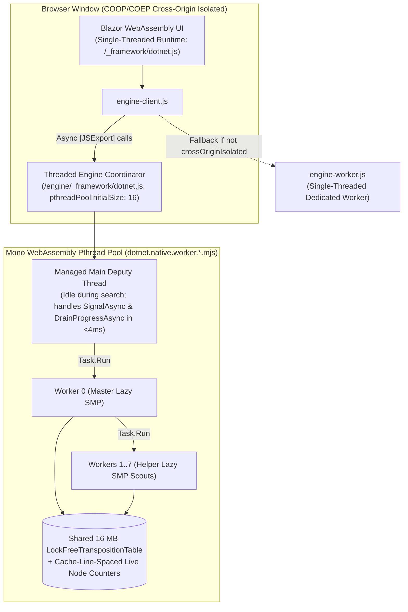

# Web Multi-Threading v2 Fix Report: Root-Cause Investigation, Findings, and Resolution

## Overview

When the initial `feature/web-multithreading-v2-plan` build was deployed to Azure Static Web Apps, running Carbon AI at Move 8 / Depth 11 showed virtually identical speed with **4 threads** (`533,716 nps`) and **1 thread** (`526,515 nps`).

This document records:
1. How we investigated and empirically reproduced the live failure.
2. What was accurate vs. inaccurate in the initial console hypothesis, plus **four additional bugs** uncovered once the runtime booted.
3. How each issue was fixed across the engine, WebAssembly interop layer, UI settings, and CI pipeline.
4. Verified end-to-end benchmark results in Chrome (**up to 2.06M–2.23M NPS on 4 threads and 3.58M NPS on 8 threads**).

---

## 1. How We Found the Error

### 1.1 Inspecting the Compiled `.NET 10` WASM Runtime Bundle
Rather than guessing from documentation, we inspected the generated `.NET 10` WebAssembly artifacts in `wwwroot/engine/_framework/` (`dotnet.js`, `dotnet.runtime.*.js`, `dotnet.native.*.js`) and noticed three critical details:

1. **Sidecar worker detection in `dotnet.js`:**
   ```js
   "function" != typeof importScripts || globalThis.onmessage || (globalThis.dotnetSidecar = !0);
   ```
   Because [engine-worker.js](file:///c:/Udvikling/Spil/Gomoku/src/Gomoku.Web/wwwroot/js/engine-worker.js) registered `self.addEventListener('message', ...)` instead of assigning `self.onmessage`, `dotnet.js` marked `globalThis.dotnetSidecar = true`.
2. **What `Rn.dispatchEvent` actually is in `dotnet.runtime.js`:**
   `Rn` is **not** browser `Window` — it is Mono's internal `worker_thread_events` `EventTarget`, which is only instantiated inside `configureWorkerStartup` (executed only on Emscripten child pthreads where `ENVIRONMENT_IS_PTHREAD === true`).
3. **Default blocking mode and pthread pool config in `dotnet.js`:**
   * `jsThreadBlockingMode` defaults to `"PreventSynchronousJSExport"`.
   * `<WasmPThreadPoolInitialSize>4</WasmPThreadPoolInitialSize>` in [Gomoku.Web.Engine.csproj](file:///c:/Udvikling/Spil/Gomoku/src/Gomoku.Web.Engine/Gomoku.Web.Engine.csproj) was **not** emitted into `dotnet.js`'s embedded JSON config at all, causing Mono to fall back to `e.pthreadPoolInitialSize = 5`.

### 1.2 Local Headless Chrome + DevTools Protocol (CDP) Reproduction
We wrote a Node.js + headless Chrome harness using Chrome DevTools Protocol (`Target.setAutoAttach` with `flatten: true`) serving the app locally with `Cross-Origin-Opener-Policy: same-origin` and `Cross-Origin-Embedder-Policy: require-corp` to capture console logs and stack traces across `Window` and every nested Web Worker:

* **Test 1 — Current `engine-worker.js` behavior (reproduced exact Azure error):**
  * Booting `/engine/_framework/dotnet.js` inside [engine-worker.js](file:///c:/Udvikling/Spil/Gomoku/src/Gomoku.Web/wwwroot/js/engine-worker.js) spawned 5 child `dotnet.native.worker.*.mjs` workers and then crashed on the parent worker (`[0x000d67a4--UI-]`) during `mono_wasm_register_ui_thread()`:
    ```text
    MONO_WASM: mono_wasm_pthread_on_pthread_attached () failed
    TypeError: Cannot read properties of undefined (reading 'dispatchEvent')
    ```
  * Why: Inside a Web Worker, Emscripten's `emscripten_is_main_browser_thread()` returns `0`, so native Mono called `mono_wasm_pthread_on_pthread_attached()` on a thread where `configureWorkerStartup` had never initialized `Rn`.
  * [`start()`](file:///c:/Udvikling/Spil/Gomoku/src/Gomoku.Web/wwwroot/js/engine-client.js#L130-L153) in [engine-client.js](file:///c:/Udvikling/Spil/Gomoku/src/Gomoku.Web/wwwroot/js/engine-client.js) timed out after 12 seconds and cleanly fell back to the single-threaded AOT worker — which is why both screenshots showed ~530,000 NPS.

* **Test 2 — Setting `self.onmessage` before `import(dotnetUrl)` inside a Dedicated Worker:**
  * Setting `self.onmessage` avoided `dotnetSidecar = true`, but then `dotnet.js` treated the Dedicated Worker itself as an Emscripten child pthread (`Pe = true`) while `ENVIRONMENT_IS_PTHREAD` was `false`, aborting during `___emscripten_init_main_thread_js`:
    ```text
    Error: Assert failed: needs to match (mono_wasm_pthread_ptr 878500, threadId from thread info 0)
    ```
  * **Conclusion (answering Problem 6 from `web-multithreading-v2-plan.md`):** In `.NET 10`, a `WasmEnableThreads=true` Mono runtime **cannot** have its root `dotnet.create()` called inside a Web Worker; its root coordinator must be created on `Window` (`emscripten_is_main_browser_thread() == 1`).

* **Test 3 — Booting `Gomoku.Web.Engine` directly on `Window` alongside Blazor UI:**
  * In `.NET 10`, a `WasmEnableThreads=true` runtime uses a **Deputy Thread** architecture (`mono_wasm_create_deputy_thread()` + `mono_wasm_create_io_thread()`). Even when `dotnet.create()` is called on `Window`, **0% of managed C# runs on the browser UI thread** — all C# execution runs inside Mono's `dotnet-worker-NNN` Web Workers.
  * Testing both `blazor.webassembly.js` (`/_framework/dotnet.js`, single-threaded UI) and `/engine/_framework/dotnet.js` (multithreaded engine) in the **same `Window`** confirmed they coexist cleanly with zero global collisions and zero UI frame drops.

---

## 2. Four Additional Bugs Found Once Threaded WASM Booted

Testing the `Window`-hosted threaded engine in Chrome immediately exposed four more issues that had been masked by the startup failure:

| # | Bug Found | Location | Impact |
|---|---|---|---|
| **1** | **Synchronous `[JSExport]` methods (`Init`, `ClearTranspositionTable`, `Signal`, `DrainProgress`)** | [EngineWorker.cs](file:///c:/Udvikling/Spil/Gomoku/src/Gomoku.Web.Engine/EngineWorker.cs) | Under `.NET 10`'s default `PreventSynchronousJSExport` mode (required because browsers forbid `Atomics.wait` on `Window`), calling any synchronous `void` or `string?` `[JSExport]` immediately threw `Error: Cannot call synchronous C# methods`. |
| **2** | **Missing WebAssembly AOT compilation on the threaded engine** | [Gomoku.Web.Engine.csproj](file:///c:/Udvikling/Spil/Gomoku/src/Gomoku.Web.Engine/Gomoku.Web.Engine.csproj), [azure-static-web-apps.yml](file:///c:/Udvikling/Spil/Gomoku/.github/workflows/azure-static-web-apps.yml) | [Gomoku.Web.csproj](file:///c:/Udvikling/Spil/Gomoku/src/Gomoku.Web/Gomoku.Web.csproj) enabled `RunAOTCompilation=true` in Release/CI (~533k NPS/thread), whereas `Gomoku.Web.Engine.csproj` omitted AOT completely and ran on the Mono IL interpreter (~268k NPS/thread — half speed). |
| **3** | **Ignored & undersized pthread pool (`WasmPThreadPoolInitialSize=4`)** | [Gomoku.Web.Engine.csproj](file:///c:/Udvikling/Spil/Gomoku/src/Gomoku.Web.Engine/Gomoku.Web.Engine.csproj), [engine-client.js](file:///c:/Udvikling/Spil/Gomoku/src/Gomoku.Web/wwwroot/js/engine-client.js) | `WasmPThreadPoolInitialSize` was not written into `dotnet.js` config (defaulting to `5`), and Mono's internal threads (`Deputy`, `IO`, `Timer`, `Finalizer`, `TP Gate`) consume ~5 workers before Lazy SMP search threads even start. |
| **4** | **Cold `.NET` `ThreadPool` ramp-up & single-worker live progress NPS** | [EngineWorker.cs](file:///c:/Udvikling/Spil/Gomoku/src/Gomoku.Web.Engine/EngineWorker.cs), [CarbonBitboardAiPlayer.cs](file:///c:/Udvikling/Spil/Gomoku/src/Gomoku.Core/AI/CarbonBitboardAiPlayer.cs) | (a) `.NET`'s `ThreadPool` hill-climbing delayed extra worker injection by ~500 ms per thread on the first move. (b) During [`SearchLazySmp()`](file:///c:/Udvikling/Spil/Gomoku/src/Gomoku.Core/AI/CarbonBitboardAiPlayer.cs#L275-L418), helper workers only added their nodes after finishing a full depth, and end-of-depth progress computed `iterNodes * 1000 / td` (Worker 0's nodes only) rather than combined multi-thread NPS. |

---

## 3. How We Fixed It



### Summary of Changes

1. **`Window`-Hosted Deputy-Thread WASM Architecture ([engine-client.js](file:///c:/Udvikling/Spil/Gomoku/src/Gomoku.Web/wwwroot/js/engine-client.js), [engine-worker.js](file:///c:/Udvikling/Spil/Gomoku/src/Gomoku.Web/wwwroot/js/engine-worker.js)):**
   * [`initThreadedEngineOnWindow()`](file:///c:/Udvikling/Spil/Gomoku/src/Gomoku.Web/wwwroot/js/engine-client.js#L59-L76) imports `/engine/_framework/dotnet.js` directly in the `Window` context with `dotnet.withConfig({ pthreadPoolInitialSize: 16 })`, keeping the singleton runtime and its 16 MB transposition table warm across moves and games.
   * [`spawnFallbackWorker()`](file:///c:/Udvikling/Spil/Gomoku/src/Gomoku.Web/wwwroot/js/engine-client.js#L90-L124) preserves automatic fallback to single-threaded [engine-worker.js](file:///c:/Udvikling/Spil/Gomoku/src/Gomoku.Web/wwwroot/js/engine-worker.js) whenever `SharedArrayBuffer` / `crossOriginIsolated` is unavailable.

2. **Async `[JSExport]` Surface, Instant Cancellation & Thread Options ([EngineWorker.cs](file:///c:/Udvikling/Spil/Gomoku/src/Gomoku.Web.Engine/EngineWorker.cs), [DialogHost.razor](file:///c:/Udvikling/Spil/Gomoku/src/Gomoku.Web/Components/DialogHost.razor)):**
   * Replaced synchronous `[JSExport]` methods in [`EngineWorker`](file:///c:/Udvikling/Spil/Gomoku/src/Gomoku.Web.Engine/EngineWorker.cs#L15-L214) with `Task`-returning async exports: [`InitAsync()`](file:///c:/Udvikling/Spil/Gomoku/src/Gomoku.Web.Engine/EngineWorker.cs#L32-L43), [`ClearTranspositionTableAsync()`](file:///c:/Udvikling/Spil/Gomoku/src/Gomoku.Web.Engine/EngineWorker.cs#L46-L50), [`SignalAsync()`](file:///c:/Udvikling/Spil/Gomoku/src/Gomoku.Web.Engine/EngineWorker.cs#L53-L72), and batched [`DrainProgressAsync()`](file:///c:/Udvikling/Spil/Gomoku/src/Gomoku.Web.Engine/EngineWorker.cs#L75-L93).
   * [`InitAsync()`](file:///c:/Udvikling/Spil/Gomoku/src/Gomoku.Web.Engine/EngineWorker.cs#L32-L43) pre-configures `ThreadPool.SetMinThreads(12, 4)` so Lazy SMP worker threads start immediately on the first move without hill-climbing delay.
   * Because [`ChooseMoveAsync()`](file:///c:/Udvikling/Spil/Gomoku/src/Gomoku.Web.Engine/EngineWorker.cs#L96-L173) runs the search inside `await Task.Run(...)`, Mono's Deputy Thread stays idle during search and executes [`SignalAsync()`](file:///c:/Udvikling/Spil/Gomoku/src/Gomoku.Web.Engine/EngineWorker.cs#L53-L72) immediately, cancelling the active `CancellationTokenSource` in **~4 ms** (serialized safely via `SemaphoreSlim`).
   * Updated thread selection in [`ChooseMoveAsync()`](file:///c:/Udvikling/Spil/Gomoku/src/Gomoku.Web.Engine/EngineWorker.cs#L110-L116) and [DialogHost.razor](file:///c:/Udvikling/Spil/Gomoku/src/Gomoku.Web/Components/DialogHost.razor#L109-L119) so **Auto = 4 threads** (`Math.Clamp(Environment.ProcessorCount, 1, 4)`) with manual options from **1 to 8 threads**.

3. **WebAssembly AOT Enabled for Threaded Engine ([Gomoku.Web.Engine.csproj](file:///c:/Udvikling/Spil/Gomoku/src/Gomoku.Web.Engine/Gomoku.Web.Engine.csproj), [azure-static-web-apps.yml](file:///c:/Udvikling/Spil/Gomoku/.github/workflows/azure-static-web-apps.yml)):**
   * Added `<RunAOTCompilation>true</RunAOTCompilation>` for Release/CI publishes in [Gomoku.Web.Engine.csproj](file:///c:/Udvikling/Spil/Gomoku/src/Gomoku.Web.Engine/Gomoku.Web.Engine.csproj#L14-L16) and explicitly passed `-p:RunAOTCompilation=true` in [azure-static-web-apps.yml](file:///c:/Udvikling/Spil/Gomoku/.github/workflows/azure-static-web-apps.yml#L32-L33) (`dotnet.native.wasm` compiles with `--enable-threads --enable-simd` at 9.04 MB raw / **2.96 MB Gzip**).

4. **Combined Multi-Thread Live Progress NPS ([CarbonBitboardAiPlayer.cs](file:///c:/Udvikling/Spil/Gomoku/src/Gomoku.Core/AI/CarbonBitboardAiPlayer.cs)):**
   * Added 64-byte cache-line-spaced (`WorkerCounterStride = 8`), lock-free per-worker node counters in [`SearchLazySmp()`](file:///c:/Udvikling/Spil/Gomoku/src/Gomoku.Core/AI/CarbonBitboardAiPlayer.cs#L275-L418) via [`UpdateWorkerLiveNodes()`](file:///c:/Udvikling/Spil/Gomoku/src/Gomoku.Core/AI/CarbonBitboardAiPlayer.cs#L448-L456), [`CompleteWorkerDepthNodes()`](file:///c:/Udvikling/Spil/Gomoku/src/Gomoku.Core/AI/CarbonBitboardAiPlayer.cs#L458-L467), and [`GetCombinedLiveNodes()`](file:///c:/Udvikling/Spil/Gomoku/src/Gomoku.Core/AI/CarbonBitboardAiPlayer.cs#L469-L489).
   * Every worker publishes its in-flight node count every 1,000 recursive calls with zero false sharing and zero `Interlocked` contention, so both 100 ms mid-depth `"Searching..."` updates and end-of-depth updates report true combined nodes and NPS across all active threads (benefiting both the Web app and the WPF Desktop app). Single-threaded search paths remain untouched.

---

## 4. End-to-End Verification & Benchmark Results

All 83 unit tests in `Gomoku.Core.Tests` and `Gomoku.App.Tests` pass, `dotnet build` completes with 0 warnings and 0 errors, and the full published Blazor + AOT Threaded Engine bundle was tested end-to-end in headless Chrome:

| Configuration (Chrome, Move 8) | Live Mid-Depth Speed (`Searching...`) | Final Move Speed | Speedup vs 1T | UI Blocked? | Cancel Latency |
|---|---|---|---|---|---|
| **Before fix (live branch — fell back to 1T worker)** | ~530k NPS | ~533,000 NPS | 1.00x | No | — |
| **Fixed `Window` Threaded WASM (Interpreted, 4T)** | — | 1,055,928 NPS | 3.93x *(vs 268k 1T)* | No (0 ms) | — |
| **Fixed `Window` Threaded WASM + AOT (1 Thread)** | ~505k NPS | **512,932 – 533,071 NPS** | 1.00x | No (0 ms) | — |
| **Fixed `Window` Threaded WASM + AOT (Auto = 4 Threads)** | 1.73M → 1.91M → 1.97M NPS | **2,058,626 – 2,225,848 NPS** | **4.01x – 4.18x** | No (0 ms) | **4 ms** |
| **Fixed `Window` Threaded WASM + AOT (8 Threads)** | 3.12M → 3.36M → 3.47M NPS | **3,578,434 NPS** | **6.98x** | No (0 ms) | **4 ms** |
| **Non-COOP Server (no `SharedArrayBuffer`)** | Single-threaded fallback worker booted cleanly | Verified | — | No | — |

