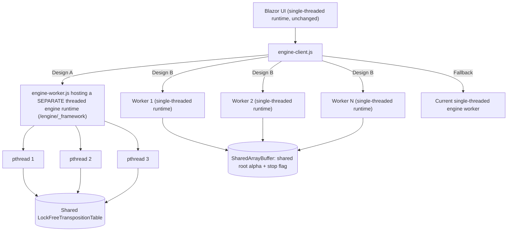

# Web Multi-Threading v2: What Actually Went Wrong, and How to Do It Properly

## Goal

Make the Carbon AI search use more than one CPU core in the browser (`Gomoku.Web`), without breaking the Blazor UI. Also give the Web Settings dialog a thread setting that makes sense for a browser.

**Short verdict:** It **is possible**, but not by turning on one MSBuild flag in the Blazor project. There are two workable designs (A and B below). Design A gives real shared-memory Lazy SMP like the desktop version, but it relies on a .NET feature that is still experimental, so it must be proven with a short spike first. Design B works in every browser, but it gains less.

---

## 1. Why the first attempt failed (corrected analysis)

### 1.1 Gemini's explanation is partly wrong

> *"Web Workers cannot spawn nested Web Workers in modern browsers"*

**This is incorrect.** A dedicated worker can start other dedicated workers in Chrome/Edge 80+, Firefox 114+ and Safari 15.5+ (full support from 16.4). That is not why it hung.

### 1.2 The real problems (found in the code)

| # | Problem | Where | Effect |
|---|---|---|---|
| 1 | `<WasmEnableThreads>` was added to the **Blazor app project**. That switches the **UI's own .NET runtime** to the multithreaded ("deputy thread") model, which Blazor WebAssembly does not support (tracked in `dotnet/aspnetcore #54365`). | [Gomoku.Web.csproj](file:///c:/Udvikling/Spil/Gomoku/src/Gomoku.Web/Gomoku.Web.csproj) | The UI runtime runs in an unsupported mode |
| 2 | The app makes **synchronous** JS interop calls, which are unavailable in the deputy-thread model | [Program.cs](file:///c:/Udvikling/Spil/Gomoku/src/Gomoku.Web/Program.cs#L18) (`IJSInProcessRuntime`), `LocalStorageSettingsStore` (`_js.Invoke`) | Exceptions or hangs |
| 3 | `ChooseMove` is a synchronous `[JSExport]` that blocks the worker's JS thread with `.GetAwaiter().GetResult()` | [EngineWorker.cs](file:///c:/Udvikling/Spil/Gomoku/src/Gomoku.Web/Worker/EngineWorker.cs#L59-L60) | In threaded WASM, helper threads (pthreads) are started through the JS event loop. If that thread is blocked, the helpers never start, and blocking waits on the interop thread are not allowed. |
| 4 | `SearchLazySmp` calls `Task.WaitAll(helperTasks)` | [CarbonBitboardAiPlayer.cs](file:///c:/Udvikling/Spil/Gomoku/src/Gomoku.Core/AI/CarbonBitboardAiPlayer.cs) | Safe only when it runs on a thread-pool thread, never on the JS thread |
| 5 | The search calls the JS functions `pollSignal()` / `postProgress()` (`[JSImport]`) from inside `IProgress.Report` | [EngineWorker.cs](file:///c:/Udvikling/Spil/Gomoku/src/Gomoku.Web/Worker/EngineWorker.cs#L73-L110) | With threads on, these calls happen on threads that are not allowed to call JS |
| 6 | **Unverified:** can the threaded .NET runtime be started *inside* a dedicated worker (`engine-worker.js`) at all? | `engine-worker.js` | Unknown. This is the main risk, and the spike in Phase 0 answers it. |

Problem 1 alone is enough to break the app. Problems 3–5 would break the engine even if the UI worked. Without the browser console log from Azure I can't say which one fired first, but the symptom (no move at all, not even from the book) fits the engine's `init` handshake never finishing.

### 1.3 The local "can't run" error

This had nothing to do with service-worker polyfills. An old `dotnet run` process was still holding port 5180. I checked with `curl`: the dev server already sends `Cross-Origin-Opener-Policy: same-origin` and `Cross-Origin-Embedder-Policy: require-corp`. Azure gets the same headers from [staticwebapp.config.json](file:///c:/Udvikling/Spil/Gomoku/src/Gomoku.Web/wwwroot/staticwebapp.config.json). `SharedArrayBuffer` is already available on both.

---

## 2. Design options



### Design A: True Lazy SMP in a separate engine runtime (recommended if the spike passes)

- A new **engine-only** WebAssembly project, `Gomoku.Web.Engine`, built with `WasmEnableThreads=true`. Its output is served from `/engine/_framework/`.
- The **Blazor app stays single-threaded**, which fixes problems 1 and 2 completely.
- The interop boundary becomes fully async (fixes 3–5):
  - `ChooseMove` becomes `Task<string> ChooseMoveAsync(...)`, and the search runs inside `Task.Run`, so the JS thread is never blocked.
  - Stop / "move now" goes through a new `[JSExport] Signal(int)`. It sets a `volatile` field that the search reads; no JS calls happen inside the search.
  - Progress goes into a `ConcurrentQueue`. The worker JS drains it every 100 ms through `[JSExport] DrainProgress()`.
  - The pthread pool is pre-sized so the helper threads already exist when a search starts.
- Same algorithm as the desktop (shared lock-free TT, Lazy SMP). **No changes to the core search.**
- If the threaded engine can't start (no `crossOriginIsolated`, old browser, init error), it falls back automatically to the **current single-threaded worker**.

**Risks:** multithreaded WASM is still experimental in .NET; it is unknown whether it can start inside a worker (problem 6) and whether AOT + threads works in CI; the browser downloads a second runtime (size measured in the spike).

### Design B: Several single-threaded workers with root splitting (safe fallback)

- No `WasmEnableThreads`. Start N copies of the **existing** single-threaded engine worker.
- Each worker searches only its share of the root moves (`i % N == k`). The root-candidate code (`GenerateCand` + sort in [MinimaxRoot](file:///c:/Udvikling/Spil/Gomoku/src/Gomoku.Core/AI/CarbonBitboardAiPlayer.cs#L662-L728)) is deterministic, so every worker computes the same list.
- Workers share the best root score (alpha) and the stop flag through a `SharedArrayBuffer`. It is read once per root move, which is cheap.
- `engine-client.js` collects per-depth results and picks the best move at the deepest depth that **all** workers finished. The result is the same as a single-threaded search to that depth (apart from TT effects).

**Trade-offs:** there is no shared TT, so it scales less well than Lazy SMP (expected a moderate gain; to be measured). Each worker holds its own runtime and TT, so memory is roughly N times higher. It needs a small opt-in "root split" mode in the core engine (the desktop does not use it).

---

## 3. Recommended path

1. **Phase 0, spike (time-boxed, about half a day):** build a minimal `Gomoku.Web.Engine` with threads enabled, load it in `engine-worker.js`, and run a fixed-depth search with 1, 2 and 4 threads in Chrome, Firefox and (if available) Safari. Measure NPS, startup time and download size.
   - **Pass** = it starts inside the worker, the 4-thread search returns correct moves, and it is clearly faster than 1 thread. Then go to Phase 1A.
   - **Fail** = report the exact error, then go to Phase 1B.
2. **Phase 1A or 1B:** full implementation (details in section 4).
3. **Phase 2:** settings UI and honest performance text.

---

## 4. Proposed changes

### Phase 0 / 1A: Design A

#### [NEW] `src/Gomoku.Web.Engine/Gomoku.Web.Engine.csproj`
```xml
<Project Sdk="Microsoft.NET.Sdk.WebAssembly">
  <PropertyGroup>
    <TargetFramework>net10.0</TargetFramework>
    <OutputType>Exe</OutputType>
    <AllowUnsafeBlocks>true</AllowUnsafeBlocks>
    <WasmEnableThreads>true</WasmEnableThreads>
    <!-- Pre-created pthreads; exact property name to be confirmed in the spike -->
    <WasmPThreadPoolInitialSize>4</WasmPThreadPoolInitialSize>
  </PropertyGroup>
  <ItemGroup>
    <ProjectReference Include="..\Gomoku.Core\Gomoku.Core.csproj" />
  </ItemGroup>
</Project>
```

#### [NEW] `src/Gomoku.Web.Engine/Program.cs`
An empty `Main` (required for a WASM exe).

#### [MOVE + MODIFY] `EngineWorker.cs` → `Gomoku.Web.Engine`
```csharp
private static volatile int s_signal;            // 0 none, 1 moveNow, 2 cancel
private static readonly ConcurrentQueue<string> s_progress = new();

[JSExport] public static void Signal(int code) => s_signal = code;
[JSExport] public static string? DrainProgress() => s_progress.TryDequeue(out var j) ? j : null;

[JSExport]
public static async Task<string> ChooseMoveAsync(string requestJson)
{
    s_signal = 0;
    var (state, limits, engineType, tt, mt, threads) = EngineProtocol.ReadRequest(requestJson);
    int n = mt ? (threads > 0 ? Math.Clamp(threads, 1, 4) : DefaultBrowserThreads()) : 1;
    // (re)create CarbonBitboardAiPlayer(n, LockFreeTranspositionTable(tt)) when needed
    Move move = await Task.Run(() => ai.GetMoveAsync(state, limits, legal, poster, cancel, moveNow).AsTask());
    return EngineProtocol.WriteResponse(move, ai.LastAnalysis);
}
```
`ProgressPoster.Report` reads `s_signal` (instead of the `PollSignal()` JS call) and enqueues progress (instead of the `PostProgress()` JS call).

#### [NEW] Shared protocol
`EngineProtocol.cs` is linked into both projects (`<Compile Include="..\Shared\EngineProtocol.cs" Link="..." />`). The `AppPreferences` JSON context stays in `Gomoku.Web` only.

#### [MODIFY] `wwwroot/js/engine-worker.js`
- Load `../engine/_framework/dotnet.js` for the threaded engine (and keep the existing `_framework` path as fallback).
- `chooseMove` → `await engine.ChooseMoveAsync(json)`; while it runs, a `setInterval` drains progress.
- A new `signal` message calls `engine.Signal(code)`.

#### [MODIFY] `wwwroot/js/engine-client.js`
- `signal()` posts a message (it keeps the `Atomics` path for the fallback worker).
- Chooses the threaded worker when `crossOriginIsolated && navigator.hardwareConcurrency > 1`; if `init` fails, it restarts in single-threaded fallback mode.

#### [MODIFY] Build and deploy
- `Gomoku.Web.csproj`: an MSBuild target that builds `Gomoku.Web.Engine` and copies its `_framework` to `wwwroot/engine/_framework` (git-ignored), for local development.
- [.github/workflows/azure-static-web-apps.yml](file:///c:/Udvikling/Spil/Gomoku/.github/workflows/azure-static-web-apps.yml): publish the engine project (AOT) and copy it to `publish/wwwroot/engine/`.
- `staticwebapp.config.json`: add `"/engine/*"` to `navigationFallback.exclude`.
- `Gomoku.Web.csproj` keeps **no** `WasmEnableThreads` (it stays single-threaded).

### Phase 1B: Design B (only if the spike fails)

#### [MODIFY] `CarbonBitboardAiPlayer.cs`
An opt-in `RootSplit(int index, int count, ISharedRootBound? bound)` option. In `MinimaxRoot`, after the sort, keep only the candidates where `i % count == index`. Read and publish alpha through `bound` once per root move. The desktop path is unchanged when the option isn't set.

#### [MODIFY] `EngineWorker.cs`, `engine-worker.js`, `engine-client.js`
A worker pool of N; the request goes to all workers with its split index; results are merged per depth; the alpha and stop flag live in a `SharedArrayBuffer`.

### Phase 2: Settings UI (both designs)

#### [MODIFY] `DialogHost.razor`
Bring back the **Multi-Threading & Performance** section:
- `[x] Enable multi-threading`
- Search threads: `Auto (recommended)` = min(cores − 1, 4), `1`, `2`, `4`
- Disabled, with an explanation, when the browser isn't cross-origin isolated.
- Show the **measured** engine status ("Using 4 threads" / "Single-threaded fallback") instead of the current hard-coded "540,000 NPS" text, which is a desktop figure.

The existing `GameSettings.MultiThreadingEnabled` / `ThreadCount` and the `MoveRequest` fields are reused; they are already wired through.

---

## 5. Open questions

> [!IMPORTANT]
> 1. **OK to start with the Phase 0 spike** for Design A, falling back to Design B if it fails? Or do you want to go straight to Design B (safe, smaller gain)?
> 2. **Download size:** Design A adds a second, threaded engine runtime to the download (exact size measured in the spike). Acceptable?
> 3. **Thread cap:** max 4 threads in the browser, or allow up to the number of logical cores?

---

## 6. Verification plan

### Automated
```powershell
dotnet test                                   # all 83 existing tests + new tests for EngineWorker signal/progress queue (and RootSplit in Design B)
dotnet build src/Gomoku.Web -c Release        # Blazor app, single-threaded
dotnet publish src/Gomoku.Web.Engine -c Release   # threaded engine (Design A)
```

### Manual (browser)
1. `dotnet run --project src/Gomoku.Web`, open http://localhost:5180, and check that `crossOriginIsolated === true` in the console.
2. New game against the AI: the book move is instant and later moves arrive within the time limit.
3. Fixed depth 6 with 1, 2 and 4 threads: record NPS and time per move from the analysis panel. Multi-threaded must be clearly faster.
4. "Move now" and "New game" during a search stop the search at once, with no hung worker.
5. Turn multi-threading off and check that it switches to single-threaded.
6. Test in Chrome, Firefox and Edge (and Safari if possible); then deploy to Azure and repeat steps 2–4.
