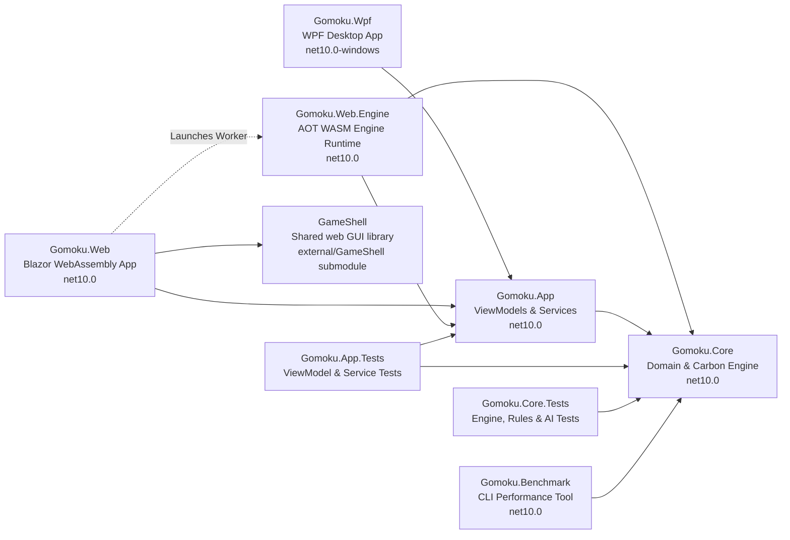
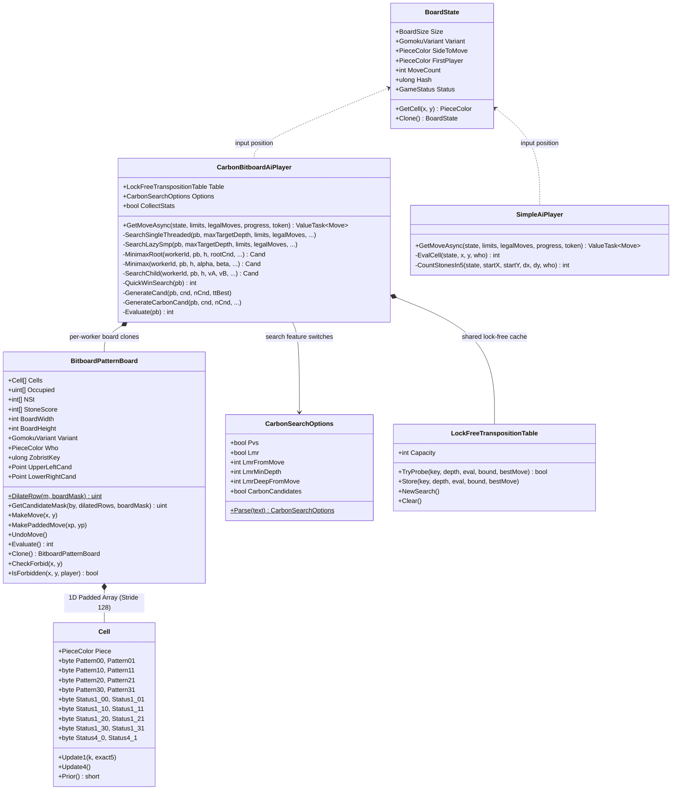
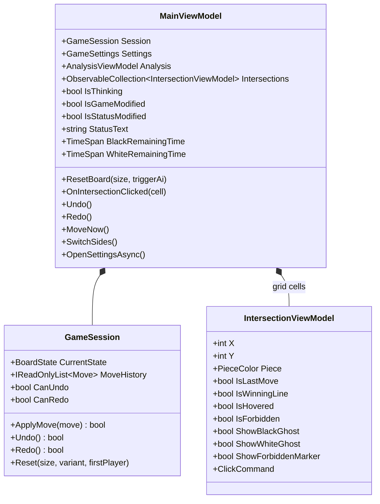
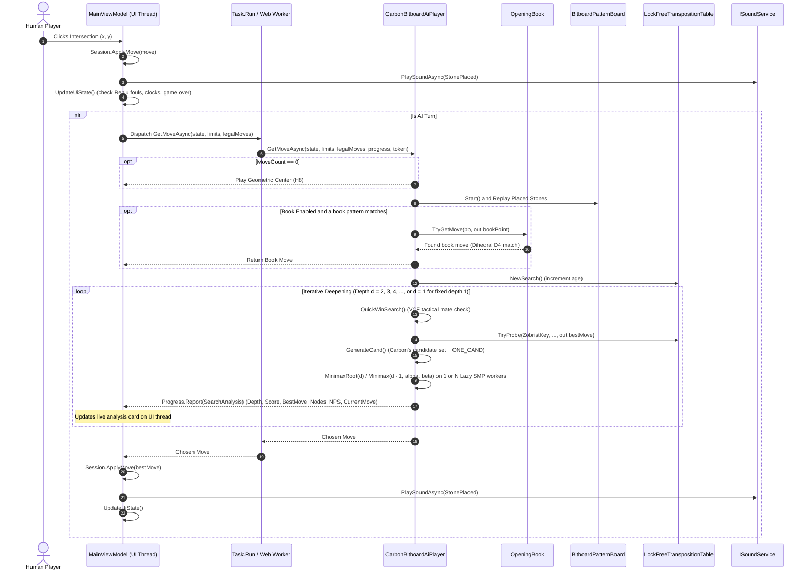

# 01 – Overview

[Back to the index](README.md)

## In short

Gomoku .NET is an enterprise-grade Gomoku (Five in a Row) system engineered in C# and targeting modern .NET 10. The engine is inspired by Michał Czardybon's world-class **Carbon Gomoku** (international Gomocup champion). It features 4-axis pattern bitboards with flat 1D indexing and an undo journal, an incrementally maintained evaluation, Carbon's own candidate set computed from row bitmasks, precomputed threat tensors, sub-millisecond tactical Victory by Continuous Fours (VCF) solving, late move reductions, lock-free transposition tables, and **Lazy SMP parallel search** (an older 8-core measurement reached **$4,213,000+\text{ NPS}$**, $11.8\times$ the NPS of the baseline engine at the time). The software is organized following Clean Architecture principles: the zero-dependency domain engine (`Gomoku.Core`) powers a shared cross-platform MVVM application layer (`Gomoku.App`), which drives both a DirectX hardware-accelerated desktop client (`Gomoku.Wpf`) and an Ahead-of-Time (AOT) compiled WebAssembly client with a multithreaded Lazy SMP engine (about 4.0M NPS on 4 threads) and dedicated background Web Worker isolation (`Gomoku.Web`).

---

## The projects

The solution [Gomoku.slnx](https://github.com/cjp-dev/Gomoku/blob/main/Gomoku.slnx) consists of seven targeted projects:

| Project | Target Framework | Role & Contents |
|---|---|---|
| [Gomoku.Core](https://github.com/cjp-dev/Gomoku/blob/main/src/Gomoku.Core) | `net10.0` | Zero-allocation core engine: board geometries, pattern bitboards, precomputed Carbon lookup tables, VCF solver, Negamax Alpha-Beta search with late move reductions, Zobrist transposition table, opening book, SGF and algebraic serializers. Strictly zero UI dependencies. |
| [Gomoku.App](https://github.com/cjp-dev/Gomoku/blob/main/src/Gomoku.App) | `net10.0` | Shared MVVM application layer using [CommunityToolkit.Mvvm](https://learn.microsoft.com/dotnet/communitytoolkit/mvvm/): view models (`MainViewModel`, `SettingsViewModel`, `IntersectionViewModel`, `AnalysisViewModel`), service abstractions (`IDialogService`, `IGameFileService`, `ISoundService`), and procedural 16-bit PCM audio synthesis (`SoundWaves`). |
| [Gomoku.Wpf](https://github.com/cjp-dev/Gomoku/blob/main/src/Gomoku.Wpf) | `net10.0-windows` | Hardware-accelerated desktop application: Japanese Kaya wood board rendering, dynamic coordinate grids, interactive hover ghost stones, Renju foul markers, AI telemetry dashboard, and native dialogs. |
| [Gomoku.Web](https://github.com/cjp-dev/Gomoku/blob/main/src/Gomoku.Web) | `net10.0` | Client-side Blazor WebAssembly single-page application: runs the full C# engine in the browser sandbox with Ahead-of-Time (AOT) compilation and a dedicated multithreaded WASM engine (`Gomoku.Web.Engine` delivering about 4,000,000 NPS on 4 threads off the main UI thread; older measurements: 2,058,000 NPS on 4 threads and 3,578,000 NPS on 8 threads) with single-threaded Web Worker fallback, offline Progressive Web App (PWA) support, and embedded markdown architecture documentation viewer. |
| [Gomoku.Web.Engine](https://github.com/cjp-dev/Gomoku/blob/main/src/Gomoku.Web.Engine) | `net10.0` | Dedicated multithreaded WebAssembly engine runtime compiled with Ahead-of-Time (AOT) and pthreads: exports `EngineWorker` running on the Managed Main Deputy Thread with 16 pre-warmed pthreads for 60 FPS non-blocking browser gameplay. |
| [Gomoku.Benchmark](https://github.com/cjp-dev/Gomoku/blob/main/tools/Gomoku.Benchmark) | `net10.0` | Console performance and profiling tool: throughput measurements for make/undo operations, transposition table masking speed, and nodes-per-second (NPS) scaling across depths; a fixed-depth position suite (`--suite`, `--compare`), the engine signature generator (`--gen-suite`, `--update-signature`), a forced-win check (`--tactical`), and paired A/B engine matches (`--ab`). |
| [Gomoku.Core.Tests](https://github.com/cjp-dev/Gomoku/blob/main/tests/Gomoku.Core.Tests) | `net10.0` | xUnit test suite for the engine: win detection, Exact5 overline rules, Renju foul algorithms (3x3, 4x4, 6+), Zobrist incremental hash consistency, VCF solving, opening book symmetry, SGF round-tripping, and the engine signature (fixed-depth best move, score and node count for 38 positions plus 64 forced wins). |
| [Gomoku.App.Tests](https://github.com/cjp-dev/Gomoku/blob/main/tests/Gomoku.App.Tests) | `net10.0` | xUnit test suite for the application layer: board reset, human stone placement, turn sequencing, undo/redo stacks, Settings persistence, sound muting, and Renju forbidden marker UI updates. |

---

## The engine at a glance

The engine's types are divided into five functional areas:

| Group | Main Types | Role |
|---|---|---|
| **Board &amp; Geometry** | [`BoardState`](https://github.com/cjp-dev/Gomoku/blob/main/src/Gomoku.Core/Models/BoardState.cs) [`BoardSize`](https://github.com/cjp-dev/Gomoku/blob/main/src/Gomoku.Core/Models/BoardSize.cs) [`Point`](https://github.com/cjp-dev/Gomoku/blob/main/src/Gomoku.Core/Models/Point.cs) [`PieceColor`](https://github.com/cjp-dev/Gomoku/blob/main/src/Gomoku.Core/Models/PieceColor.cs) | Board state representation, standard dimensions ($15 \times 15$, $19 \times 19$, $20 \times 20$), star points, and cell colors (`Empty`, `Black`, `White`, `Wrong`). |
| **Rules &amp; Legality** | [`IRuleEngine`](https://github.com/cjp-dev/Gomoku/blob/main/src/Gomoku.Core/Engine/IRuleEngine.cs) [`RuleEngine`](https://github.com/cjp-dev/Gomoku/blob/main/src/Gomoku.Core/Engine/RuleEngine.cs) [`GomokuVariant`](https://github.com/cjp-dev/Gomoku/blob/main/src/Gomoku.Core/Models/GomokuVariant.cs) | Move validation, winning line detection, and variant enforcement: Freestyle (5+ wins), Exact5 (exact 5 wins), and Renju (asymmetrical foul rules for Black). |
| **Pattern Bitboards** | [`BitboardPatternBoard`](https://github.com/cjp-dev/Gomoku/blob/main/src/Gomoku.Core/Engine/BitboardPatternBoard.cs) [`PatternBoard`](https://github.com/cjp-dev/Gomoku/blob/main/src/Gomoku.Core/Engine/PatternBoard.cs) [`PatternBoard.Cell`](https://github.com/cjp-dev/Gomoku/blob/main/src/Gomoku.Core/Engine/PatternBoard.cs) [`CarbonTables`](https://github.com/cjp-dev/Gomoku/blob/main/src/Gomoku.Core/AI/CarbonTables.Generated.cs) | 4-direction 8-cell ray bitmasks, directional line threat lookups (`STATUS1`), composite 4-way threat tensor (`STATUS4`), tactical candidate scoring (`Prior`), and stone ranking (`Rank`). |
| **Search &amp; AI** | [`CarbonBitboardAiPlayer`](https://github.com/cjp-dev/Gomoku/blob/main/src/Gomoku.Core/AI/CarbonBitboardAiPlayer.cs) [`CarbonAiPlayer`](https://github.com/cjp-dev/Gomoku/blob/main/src/Gomoku.Core/AI/CarbonAiPlayer.cs) [`SimpleAiPlayer`](https://github.com/cjp-dev/Gomoku/blob/main/src/Gomoku.Core/AI/SimpleAiPlayer.cs) [`LockFreeTranspositionTable`](https://github.com/cjp-dev/Gomoku/blob/main/src/Gomoku.Core/AI/LockFreeTranspositionTable.cs) [`TranspositionTable`](https://github.com/cjp-dev/Gomoku/blob/main/src/Gomoku.Core/AI/TranspositionTable.cs) [`Zobrist`](https://github.com/cjp-dev/Gomoku/blob/main/src/Gomoku.Core/Engine/Zobrist.cs) [`SearchLimits`](https://github.com/cjp-dev/Gomoku/blob/main/src/Gomoku.Core/AI/SearchLimits.cs) | Negamax Alpha-Beta search on closed intervals $[\alpha, \beta]$, iterative deepening, VCF solver (`QuickWinSearch`), candidate generation with `ONE_CAND` pruning, late move reductions, 16-byte packed transposition entries, and time control. |
| **Opening Theory &amp; Formats** | [`OpeningBook`](https://github.com/cjp-dev/Gomoku/blob/main/src/Gomoku.Core/AI/OpeningBook.cs) [`SgfSerializer`](https://github.com/cjp-dev/Gomoku/blob/main/src/Gomoku.Core/Formats/SgfFormat.cs) [`GomokuJsonSerializer`](https://github.com/cjp-dev/Gomoku/blob/main/src/Gomoku.Core/Formats/GomokuRecordFormat.cs) [`GameFileSerializer`](https://github.com/cjp-dev/Gomoku/blob/main/src/Gomoku.Core/Formats/GameFileSerializer.cs) | Dihedral group $D_4$ opening book matching across 80 opening records, SGF `GM[11]` export/import, and human-readable `.gomoku` algebraic coordinate notation. |

---

## Class diagrams

### Core Engine Architecture

### Application & MVVM Architecture

---

## The life of one computer move

The following sequence traces the entire execution pipeline when it becomes the computer's turn:

---

## Design principles

1. **Zero-Allocation Search Loops:**
   - In `CarbonAiPlayer.Minimax`, candidate lists (`Span<Cand> cnd = stackalloc Cand[MaxCand]`) and ray bitboards are stack-allocated or struct-based. No managed objects are allocated during search loops, preventing garbage collector pauses during competitive play.
2. **Sentinel-Padded Geometry:**
   - The board allocates a 4-cell outer perimeter filled with `PieceColor.Wrong`. Ray iterations never require bounds-checking conditionals (`x >= 0 && x < width`), maximizing branch prediction efficiency.
3. **Strict Dependency Inversion:**
   - `Gomoku.Core` has **zero** dependencies on UI frameworks, windowing systems, or operating system APIs. All UI interactions (dialogs, file picking, audio playback) are abstracted behind interfaces in `Gomoku.App`.
4. **Deterministic Incremental Hashing and Evaluation:**
   - Transposition keys are maintained incrementally in $O(1)$ time via 64-bit Zobrist XOR operations on every stone placement and undo.
   - The stone score behind the leaf evaluation (`BitboardPatternBoard.StoneScore`) is kept up to date in make, and an undo journal restores the cells a move changed, so `Evaluate()` and `UndoMove()` do no recomputation.
5. **Exact Game Rules Fidelity:**
   - All three standard variants (Freestyle, Exact5, and Renju) are modeled with strict mathematical rigor. Renju fouls (double-three, double-four, overlines) are evaluated recursively to prevent Black from making illegal plays.

---

## Some numbers

| Metric | Measurement / Specification |
|---|---|
| **Board cell array** | Standard $15 \times 15$ tournament geometry ($23 \times 23$ sentinel-padded array in flat 1D layout) |
| **Cell memory footprint** | 19 bytes unmanaged struct in `BitboardPatternBoard.Cell` (1-byte piece, 8 pattern bytes, 8 directional `Status1` bytes, 2 four-way `Status4` bytes; no proximity counters) |
| **Transposition entry** | Exactly 16 bytes packed (`LockFreeTranspositionTable.Entry`); the table is direct-mapped with one entry per slot (no buckets) |
| **Default Transposition Table** | $1,048,576$ entries ($16 \text{ MiB}$ default), user-configurable from $1\text{ MB}$ to $256\text{ MB}$ ($2^{16}$ to $2^{24}$ slots) |
| **Precomputed table sizes** | `STATUS1` ($256 \times 256$), `STATUS4` ($10,000$ bytes), `Prior` ($256 \times 256$), `Rank` ($107$ ints) |
| **PatternBoard throughput** | $> 1,300,000$ make/undo operations per second (single core) |
| **Transposition Table probe speed** | $> 170,000,000$ probes per second with power-of-two bitwise mask and lock-free atomic updates |
| **Carbon AI search speed (1 Thread)** | $\approx 1.1\text{--}1.3$ million nodes per second on the benchmark suite (.NET 10, Linux VM, i7-12850HX; about $0.8$ million before the 2026 optimisations, see [15](15-benchmarks-and-performance.md)); $\approx 1.15$ million in the browser (threaded WASM engine, 1 thread) |
| **Carbon AI search speed (4 Threads WASM)** | **$\approx 4,000,000$ nodes per second** (first reply after H8 to depth 12 in $3.2\text{ s}$; older measurement: $2,058,000\text{--}2,225,000$) |
| **Carbon AI search speed (8 Threads WASM)** | **$\approx 3,578,000$ nodes per second** (older measurement, before the 2026 optimisations) |
| **Carbon AI search speed (8 Threads)**| **$4,213,000+$ nodes per second** (older measurement, $11.8\times$ the baseline NPS; Lazy SMP adds nodes more than depth: on the suite, 4 and 8 threads reach the same depths only $\approx 1.6\times$ faster than 1 thread) |
| **Simple AI search speed** | Instantaneous ($< 1\text{ ms}$, non-searching heuristic evaluation) |
| **Unit test suite** | **83 automated unit tests** across Core and App (`0` warnings, `0` errors) |

---

## Where in the code

| File | Description |
|---|---|
| [BoardState.cs](https://github.com/cjp-dev/Gomoku/blob/main/src/Gomoku.Core/Models/BoardState.cs) | Immutable board state model and cell array |
| [RuleEngine.cs](https://github.com/cjp-dev/Gomoku/blob/main/src/Gomoku.Core/Engine/RuleEngine.cs) | Variant rule definitions and win-line checking |
| [BitboardPatternBoard.cs](https://github.com/cjp-dev/Gomoku/blob/main/src/Gomoku.Core/Engine/BitboardPatternBoard.cs) | 4-ray pattern bitboard with flat 1D memory, occupied row bitmasks, undo journal, and incremental stone score |
| [PatternBoard.cs](https://github.com/cjp-dev/Gomoku/blob/main/src/Gomoku.Core/Engine/PatternBoard.cs) | Classical 4-ray pattern bitboard and candidate tracking |
| [CarbonTables.Generated.cs](https://github.com/cjp-dev/Gomoku/blob/main/src/Gomoku.Core/AI/CarbonTables.Generated.cs) | Precomputed pattern and threat tensors |
| [CarbonBitboardAiPlayer.cs](https://github.com/cjp-dev/Gomoku/blob/main/src/Gomoku.Core/AI/CarbonBitboardAiPlayer.cs) | Primary high-performance AI: Lazy SMP multi-threading, VCF solver, candidate ordering, late move reductions, and live telemetry |
| [CarbonSearchOptions.cs](https://github.com/cjp-dev/Gomoku/blob/main/src/Gomoku.Core/AI/CarbonSearchOptions.cs) | Switches for search features (LMR, PVS, Carbon's candidate set), so a feature can be compared on and off in one build |
| [CandSort.cs](https://github.com/cjp-dev/Gomoku/blob/main/src/Gomoku.Core/AI/CandSort.cs) | Candidate sort: the introsort of `Span.Sort(Comparison)` with the comparison inlined |
| [CarbonAiPlayer.cs](https://github.com/cjp-dev/Gomoku/blob/main/src/Gomoku.Core/AI/CarbonAiPlayer.cs) | Reference Minimax search, VCF solver, candidate ordering, and live telemetry |
| [SimpleAiPlayer.cs](https://github.com/cjp-dev/Gomoku/blob/main/src/Gomoku.Core/AI/SimpleAiPlayer.cs) | Fast 1-ply heuristic pattern evaluator for casual gameplay |
| [LockFreeTranspositionTable.cs](https://github.com/cjp-dev/Gomoku/blob/main/src/Gomoku.Core/AI/LockFreeTranspositionTable.cs) | Direct-mapped lock-free hash table with 16-byte entries supporting parallel Lazy SMP |
| [TranspositionTable.cs](https://github.com/cjp-dev/Gomoku/blob/main/src/Gomoku.Core/AI/TranspositionTable.cs) | 16-byte packed hash table |
| [OpeningBook.cs](https://github.com/cjp-dev/Gomoku/blob/main/src/Gomoku.Core/AI/OpeningBook.cs) | Dihedral symmetry opening book matching with direct bitboard queries |
| [MainViewModel.cs](https://github.com/cjp-dev/Gomoku/blob/main/src/Gomoku.App/ViewModels/MainViewModel.cs) | Application state, AI coordination, multi-threading settings, and clocks |
| [AnalysisViewModel.cs](https://github.com/cjp-dev/Gomoku/blob/main/src/Gomoku.App/ViewModels/AnalysisViewModel.cs) | Real-time search telemetry formatting and analysis presentation |

---

Previous: [Index](README.md) · Next: [02 Board and geometry](02-board-and-geometry.md)

