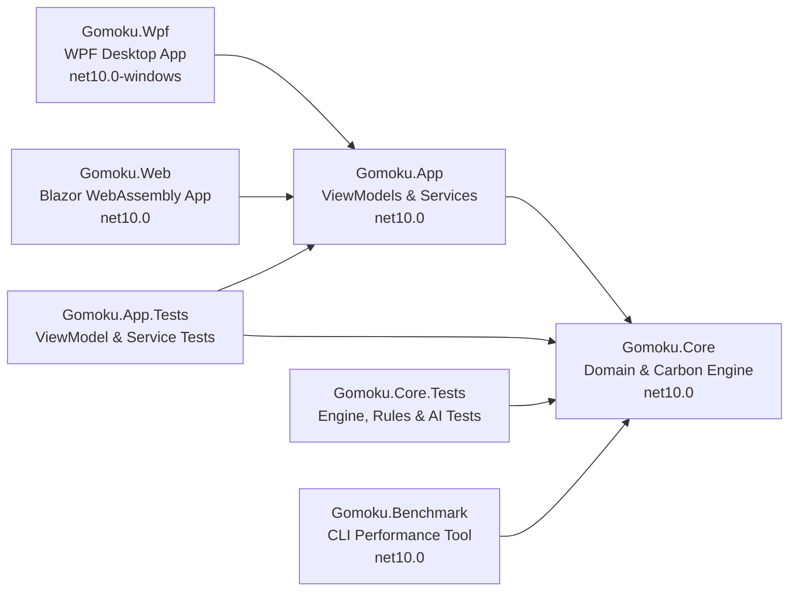
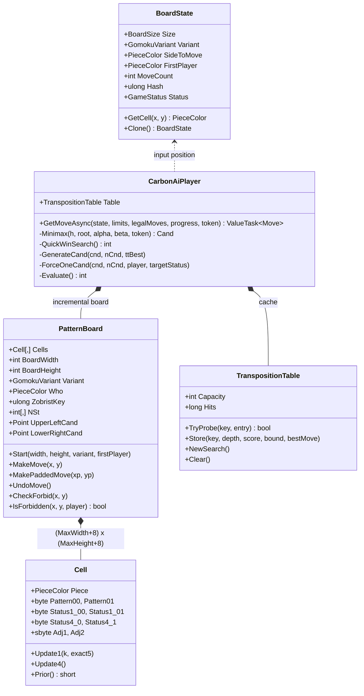
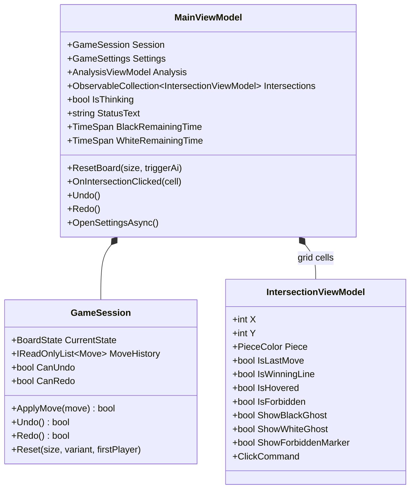
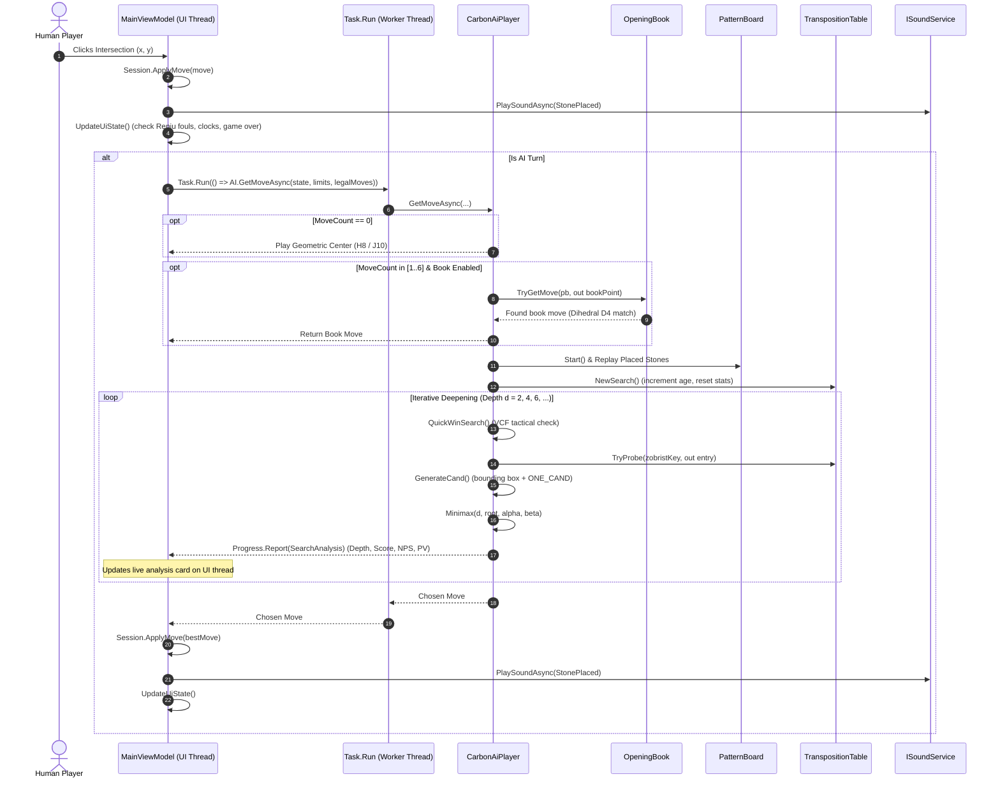

# 01 – Overview

[Back to the index](README.md)

## In short

Gomoku .NET is an enterprise-grade Gomoku (Five in a Row) system engineered in C# and targeting modern .NET 10. The engine is inspired by Michał Czardybon's world-class **Carbon Gomoku** (international Gomocup champion). It features 4-axis pattern bitboards, precomputed threat tensors, sub-millisecond tactical Victory by Continuous Fours (VCF) solving, and closed-interval Negamax Alpha-Beta search. The software is organized following Clean Architecture principles: the zero-dependency domain engine (`Gomoku.Core`) powers a shared cross-platform MVVM application layer (`Gomoku.App`), which drives both a DirectX hardware-accelerated desktop client (`Gomoku.Wpf`) and an Ahead-of-Time (AOT) compiled WebAssembly client (`Gomoku.Web`).

---

## The projects

The solution [Gomoku.slnx](../../Gomoku.slnx) consists of seven targeted projects:

| Project | Target Framework | Role & Contents |
|---|---|---|
| [Gomoku.Core](../../src/Gomoku.Core) | `net10.0` | Zero-allocation core engine: board geometries, pattern bitboards, precomputed Carbon lookup tables, VCF solver, Negamax Alpha-Beta search, Zobrist transposition table, opening book, SGF and algebraic serializers. Strictly zero UI dependencies. |
| [Gomoku.App](../../src/Gomoku.App) | `net10.0` | Shared MVVM application layer using [CommunityToolkit.Mvvm](https://learn.microsoft.com/dotnet/communitytoolkit/mvvm/): view models (`MainViewModel`, `SettingsViewModel`, `IntersectionViewModel`, `AnalysisViewModel`), service abstractions (`IDialogService`, `IGameFileService`, `ISoundService`), and procedural 16-bit PCM audio synthesis (`SoundWaves`). |
| [Gomoku.Wpf](../../src/Gomoku.Wpf) | `net10.0-windows` | Hardware-accelerated desktop application: Japanese Kaya wood board rendering, dynamic coordinate grids, interactive hover ghost stones, Renju foul markers, AI telemetry dashboard, and native dialogs. |
| [Gomoku.Web](../../src/Gomoku.Web) | `net10.0` | Client-side Blazor WebAssembly single-page application: runs the full C# engine in the browser sandbox with Ahead-of-Time (AOT) compilation, offline Progressive Web App (PWA) support, and embedded markdown architecture documentation viewer. |
| [Gomoku.Benchmark](../../tools/Gomoku.Benchmark) | `net10.0` | Console performance and profiling tool: throughput measurements for make/undo operations, transposition table masking speed, and nodes-per-second (NPS) scaling across depths. |
| [Gomoku.Core.Tests](../../tests/Gomoku.Core.Tests) | `net10.0` | xUnit test suite for the engine: win detection, Exact5 overline rules, Renju foul algorithms (3x3, 4x4, 6+), Zobrist incremental hash consistency, VCF solving, opening book symmetry, and SGF round-tripping. |
| [Gomoku.App.Tests](../../tests/Gomoku.App.Tests) | `net10.0` | xUnit test suite for the application layer: board reset, human stone placement, turn sequencing, undo/redo stacks, Settings persistence, sound muting, and Renju forbidden marker UI updates. |

---

## The engine at a glance

The engine's types are divided into five functional areas:

| Group | Main Types | Role |
|---|---|---|
| **Board &amp; Geometry** | [`BoardState`](../../src/Gomoku.Core/Models/BoardState.cs) [`BoardSize`](../../src/Gomoku.Core/Models/BoardSize.cs) [`Point`](../../src/Gomoku.Core/Models/Point.cs) [`PieceColor`](../../src/Gomoku.Core/Models/PieceColor.cs) | Board state representation, standard dimensions ($15 \times 15$, $19 \times 19$, $20 \times 20$), star points, and cell colors (`Empty`, `Black`, `White`, `Wrong`). |
| **Rules &amp; Legality** | [`IRuleEngine`](../../src/Gomoku.Core/Engine/IRuleEngine.cs) [`RuleEngine`](../../src/Gomoku.Core/Engine/RuleEngine.cs) [`GomokuVariant`](../../src/Gomoku.Core/Models/GomokuVariant.cs) | Move validation, winning line detection, and variant enforcement: Freestyle (5+ wins), Exact5 (exact 5 wins), and Renju (asymmetrical foul rules for Black). |
| **Pattern Bitboards** | [`PatternBoard`](../../src/Gomoku.Core/Engine/PatternBoard.cs) [`PatternBoard.Cell`](../../src/Gomoku.Core/Engine/PatternBoard.cs) [`CarbonTables`](../../src/Gomoku.Core/Engine/CarbonTables.Generated.cs) | 4-direction 8-cell ray bitmasks, directional line threat lookups (`STATUS1`), composite 4-way threat tensor (`STATUS4`), tactical candidate scoring (`Prior`), and stone ranking (`Rank`). |
| **Search &amp; AI** | [`CarbonAiPlayer`](../../src/Gomoku.Core/AI/CarbonAiPlayer.cs) [`SimpleAiPlayer`](../../src/Gomoku.Core/AI/SimpleAiPlayer.cs) [`TranspositionTable`](../../src/Gomoku.Core/AI/TranspositionTable.cs) [`Zobrist`](../../src/Gomoku.Core/Engine/Zobrist.cs) [`SearchLimits`](../../src/Gomoku.Core/AI/SearchLimits.cs) | Negamax Alpha-Beta search on closed intervals $[\alpha, \beta]$, iterative deepening, VCF solver (`QuickWinSearch`), candidate generation with `ONE_CAND` pruning, 16-byte packed transposition entries, and time control. |
| **Opening Theory &amp; Formats** | [`OpeningBook`](../../src/Gomoku.Core/AI/OpeningBook.cs) [`SgfSerializer`](../../src/Gomoku.Core/Serialization/SgfSerializer.cs) [`GomokuJsonSerializer`](../../src/Gomoku.Core/Serialization/GomokuJsonSerializer.cs) [`GameFileSerializer`](../../src/Gomoku.Core/Formats/GameFileSerializer.cs) | Dihedral group $D_4$ opening book matching across 67 canonical pattern clusters, SGF `GM[11]` export/import, and human-readable `.gomoku` algebraic coordinate notation. |

---

## Class diagrams

### Core Engine Architecture

### Application & MVVM Architecture

---

## The life of one computer move

The following sequence traces the entire execution pipeline when it becomes the computer's turn:

---

## Design principles

1. **Zero-Allocation Search Loops:**
   - In `CarbonAiPlayer.Minimax`, candidate lists (`Span<Cand> cnd = stackalloc Cand[MaxCand]`) and ray bitboards are stack-allocated or struct-based. No managed objects are allocated during search loops, preventing garbage collector pauses during competitive play.
2. **Sentinel-Padded Geometry:**
   - The board allocates a 4-cell outer perimeter filled with `PieceColor.Wrong`. Ray iterations never require bounds-checking conditionals (`x >= 0 && x < width`), maximizing branch prediction efficiency.
3. **Strict Dependency Inversion:**
   - `Gomoku.Core` has **zero** dependencies on UI frameworks, windowing systems, or operating system APIs. All UI interactions (dialogs, file picking, audio playback) are abstracted behind interfaces in `Gomoku.App`.
4. **Deterministic Incremental Hashing:**
   - Transposition keys are maintained incrementally in $O(1)$ time via 64-bit Zobrist XOR operations on every stone placement and undo.
5. **Exact Game Rules Fidelity:**
   - All three standard variants (Freestyle, Exact5, and Renju) are modeled with strict mathematical rigor. Renju fouls (double-three, double-four, overlines) are evaluated recursively to prevent Black from making illegal plays.

---

## Some numbers

| Metric | Measurement / Specification |
|---|---|
| **Board cell array** | Flat 2D array of $(W+8) \times (H+8)$ cells ($23 \times 23$ for $15 \times 15$; $27 \times 27$ for $19 \times 19$) |
| **Cell memory footprint** | 16 bytes per cell in `PatternBoard.Cell` (bitboards, status values, proximity counters) |
| **Transposition entry** | Exactly 16 bytes packed (`TranspositionEntry`), 4 entries per 64-byte CPU cache line |
| **Default Transposition Table** | $2^{20} = 1,048,576$ entries (exactly $16 \text{ MiB}$ of RAM) |
| **Precomputed table sizes** | `STATUS1` ($256 \times 256$), `STATUS4` ($10,000$ shorts), `Prior` ($256 \times 256$), `Rank` ($106$ bytes) |
| **PatternBoard throughput** | $> 1,300,000$ make/undo operations per second (single core) |
| **Transposition Table probe speed** | $> 170,000,000$ probes per second with power-of-two bitwise mask |
| **Carbon AI search speed** | $\approx 300,000$ to $800,000$ nodes per second (single thread, .NET 10) |
| **Unit test suite** | 31 automated unit tests across Core and App (`0` warnings under `--warnaserror`) |

---

## Where in the code

| File | Description |
|---|---|
| [BoardState.cs](../../src/Gomoku.Core/Models/BoardState.cs) | Immutable board state model and cell array |
| [RuleEngine.cs](../../src/Gomoku.Core/Engine/RuleEngine.cs) | Variant rule definitions and win-line checking |
| [PatternBoard.cs](../../src/Gomoku.Core/Engine/PatternBoard.cs) | 4-ray pattern bitboard and candidate tracking |
| [CarbonTables.Generated.cs](../../src/Gomoku.Core/Engine/CarbonTables.Generated.cs) | Precomputed pattern and threat tensors |
| [CarbonAiPlayer.cs](../../src/Gomoku.Core/AI/CarbonAiPlayer.cs) | Minimax search, VCF solver, and candidate ordering |
| [TranspositionTable.cs](../../src/Gomoku.Core/AI/TranspositionTable.cs) | 16-byte packed hash table |
| [OpeningBook.cs](../../src/Gomoku.Core/AI/OpeningBook.cs) | Dihedral symmetry opening book matching |
| [MainViewModel.cs](../../src/Gomoku.App/ViewModels/MainViewModel.cs) | Application state, AI coordination, and clocks |

---

Previous: [Index](README.md) · Next: [02 Board and geometry](02-board-and-geometry.md)

