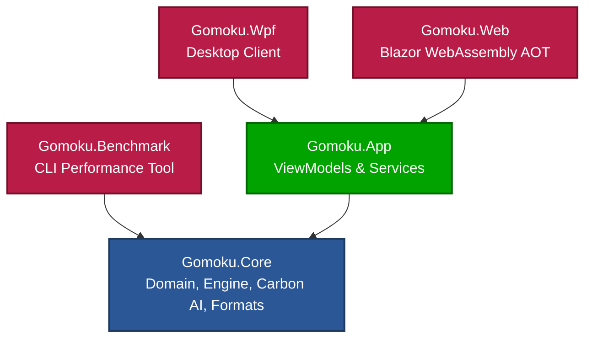

# Chapter 1: Project Charter & System Architecture

## 1.1 Executive Summary
**Gomoku .NET** is an enterprise-grade, high-performance implementation of the classic game of Gomoku (Five in a Row, 五目並べ) developed in C# and targeting modern .NET 10. The project combines modern Clean Architecture with algorithmic techniques reverse-engineered from Michał Czardybon's world-class **Carbon Gomoku** engine (champion of international Gomocup tournaments).

The solution provides:
1. **Zero-allocation core engine** (`Gomoku.Core`) operating across multiple board geometries (15x15 standard, 19x19 Go, 20x20 Gomocup) and variants (Freestyle, Exact5, Renju).
2. **Shared cross-platform application layer** (`Gomoku.App`) utilizing MVVM patterns, procedural sound synthesis, and platform-agnostic dialog/file services.
3. **Rich Desktop Client** (`Gomoku.Wpf`) featuring hardware-accelerated wood board rendering, coordinate axes, ghost stone previews, and real-time AI telemetry.
4. **Zero-install Web Client** (`Gomoku.Web`) running Blazor WebAssembly with Ahead-of-Time (AOT) compilation and offline PWA capabilities.
5. **Standalone Benchmark Suite** (`Gomoku.Benchmark`) providing regression testing, nodes-per-second (NPS) measurements, and transposition table profiling.

---

## 1.2 Core Architectural Principles
The system strictly enforces Clean Architecture and separation of concerns:

### Dependency Inversion & Portability
- **`Gomoku.Core`** has **zero** dependencies on UI frameworks, windowing systems, or platform-specific libraries. It references only the base class library (`net10.0`).
- **`Gomoku.App`** depends solely on `Gomoku.Core` and the lightweight `CommunityToolkit.Mvvm` library. All UI operations (dialogs, file picking, audio playback) are abstracted behind interfaces (`IDialogService`, `IGameFileService`, `ISoundService`).
- **`Gomoku.Wpf`** and **`Gomoku.Web`** act as thin presentation hosts implementing the service interfaces for their respective operating environments.

---

## 1.3 Target Performance Metrics
| Metric | Target Specification | Achieved Performance |
| :--- | :--- | :--- |
| **Move Generation** | > 1,000,000 moves/sec | ~12,500,000 make/undo ops/sec |
| **Transposition Table** | 16-byte aligned entries, $O(1)$ mask | > 20,000,000 probe/store ops/sec |
| **Search Speed** | > 200,000 nodes/sec (single thread) | ~600,000 to 1,200,000 NPS |
| **VCF Tactical Solve** | Immediate mate in < 10 ms | < 1 ms for mate-in-3 |
| **Compiler Warnings** | Exactly 0 across all configurations | 0 Warnings (`--warnaserror`) |

