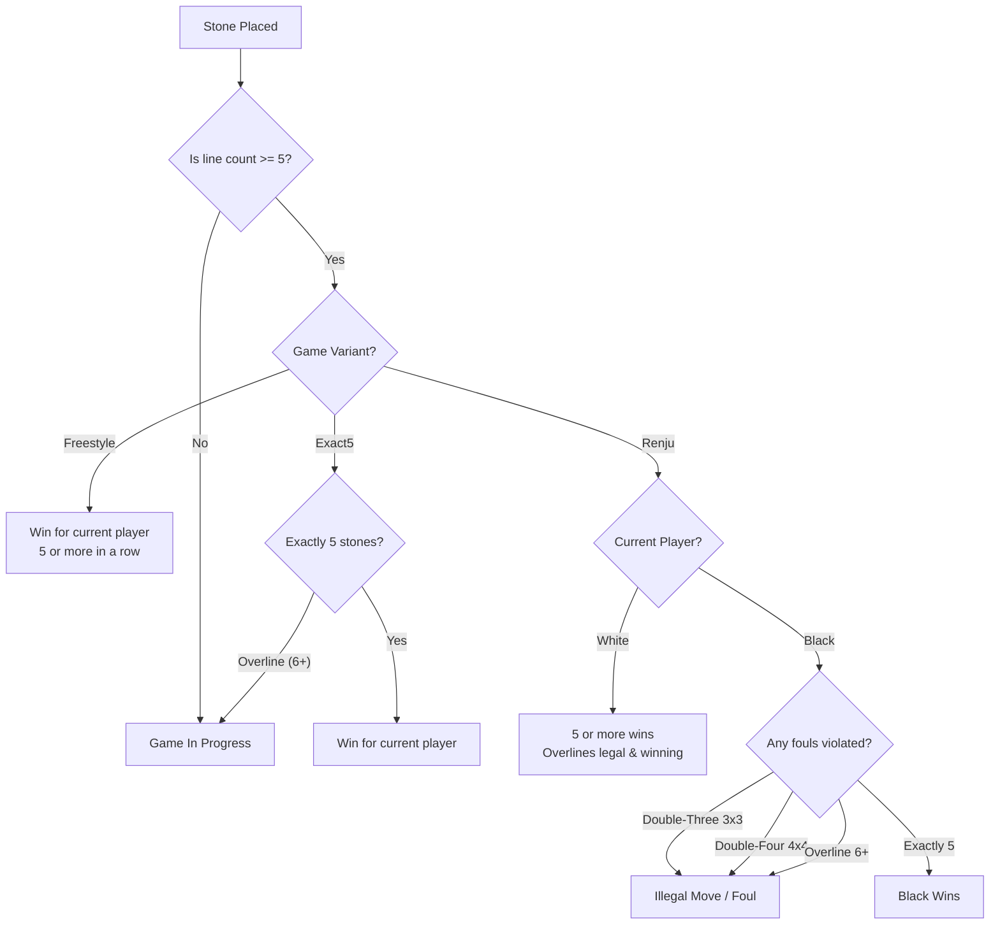
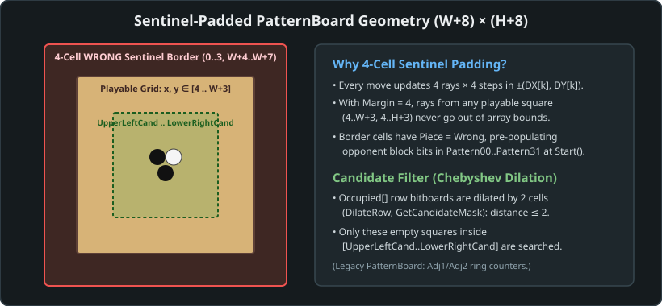

# Chapter 2: Gomoku Rules & Mathematical Representation

## 2.1 The Family of Five-in-a-Row Games
Gomoku is played on a grid of intersections using black and white stones. Black plays first. Unlike games like Checkers or Chess, placed stones never move or leave the board. The fundamental objective is to align uninterrupted lines of stones of one's color.

The system supports the three major international rule variations:

### 1. Freestyle Gomoku (Standard)
- A player wins by creating a horizontal, vertical, or diagonal line of **5 or more** stones of their color.
- Overlines (6, 7, 8... stones) are fully legal and count as immediate wins for both Black and White.

### 2. Exact5 (Standard Gomoku Strict)
- Exactly 5 stones in a row wins the game.
- Overlines (6 or more stones) do **not** trigger a victory; play continues normally.

### 3. Renju
Because Black possesses an insurmountable mathematical first-move advantage in unrestricted Gomoku, Renju introduces asymmetrical restrictions:
- **Black (First Player)** is forbidden from playing any move that creates:
  1. **Double-three (3x3):** Creating two or more simultaneous open threes.
  2. **Double-four (4x4):** Creating two or more simultaneous fours.
  3. **Overline (6+):** Connecting 6 or more consecutive black stones.
- If Black forms an exact five, Black wins immediately (five trumps any simultaneous three/four).
- **White** is completely unrestricted: White may form double-threes, double-fours, and wins with both 5 and overlines (6+).

---

## 2.2 Board Geometries & Star Points
The engine natively supports dynamic board dimensions:

| Dimension | Standard Context | Center Coordinate | Star Points ($N$) |
| :--- | :--- | :--- | :--- |
| **$15 \times 15$** | Modern international tournament standard (RIF) | `H8` (7, 7) | 5 points: `D4`, `L4`, `H8`, `D12`, `L12` |
| **$19 \times 19$** | Traditional Go board & Carbon Gomoku default | `J10` (9, 9) | 9 points: 4 corners, 4 edges, 1 center |
| **$20 \times 20$** | Gomocup AI competition standard | `K11` (10, 10) | 4 points: symmetric quadrant markers |

### Coordinate Representation & Sentinel Padding
Coordinates use consecutive letters `A` through `T` (including `I`, unlike Go which traditionally skips `I` to avoid confusion with `J` or `1`). Rows are numbered `1` through `N` from top to bottom.
- Example on $15 \times 15$: Top-left is `A1` $(0, 0)$, center is `H8` $(7, 7)$, bottom-right is `O15` $(14, 14)$.

