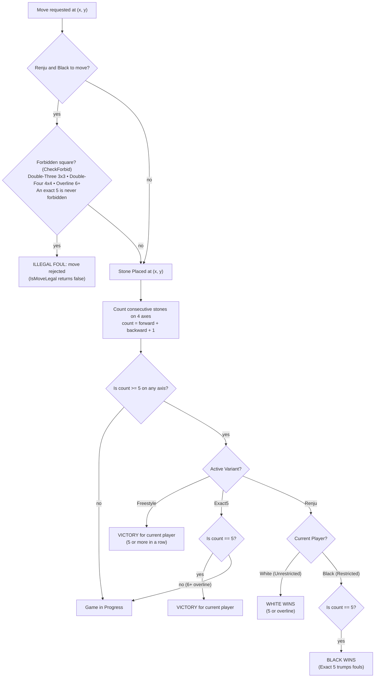
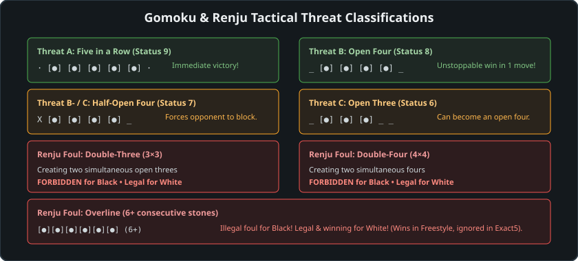

# 03 – Rules and variants

[Back to the index](README.md)

## In short

Gomoku is deceptively simple in premise: two players alternately place stones on an empty grid, aiming to form an uninterrupted line of five stones of their color. However, because Black possesses a proven mathematical first-move advantage on an unrestricted board, three distinct tournament variants have evolved globally. The engine provides complete, mathematically verified implementations of **Freestyle**, **Exact5**, and **Renju**, with automated foul detection for Black (double-three, double-four, and overline) executed in $O(1)$ time via the `CheckForbid` pipeline.

---

## The three variants





### 1. Freestyle Gomoku (Standard International)
- **Winning Condition:** A player wins by aligning **five or more** stones of their color horizontally, vertically, or diagonally.
- **Overlines:** Overlines of 6, 7, 8, or more stones are fully legal and count as immediate wins for both Black and White.
- **Suitability:** Popular in casual and speed games, as well as algorithmic AI competitions (such as Gomocup).

### 2. Exact5 (Standard Gomoku Strict)
- **Winning Condition:** A player wins **only** by forming an exact line of **five** consecutive stones.
- **Overlines:** An unbroken sequence of 6 or more stones is completely ignored; it does not trigger a win, and play continues normally.
- **Historical Context:** Common in traditional European Gomoku tournaments to temper the first-player advantage.

### 3. Renju (Professional Japanese Tournament Standard)
In standard Gomoku, Black (the first player) has been mathematically proven by L. Victor Allis (1993) to possess a winning strategy from the start position. Renju introduces strict, asymmetrical rules to level the competitive playing field:

- **Asymmetrical Restrictions on Black (First Player):**
  Black is strictly prohibited from playing any move that simultaneously creates:
  1. **Double-Three ($3 \times 3$):** Two or more simultaneous open threes (lines that can become open fours).
  2. **Double-Four ($4 \times 4$):** Two or more simultaneous fours (open or blocked).
  3. **Overline ($6+$):** Connecting 6 or more consecutive black stones.
  - Playing on a forbidden intersection is an immediate foul.
  - **The Exact-5 Exception:** If a move creates an exact five in a row, Black wins immediately—even if the move also simultaneously creates a double-three, double-four, or four-three.
- **White (Second Player) is Completely Unrestricted:**
  White may freely form double-threes, double-fours, and overlines. White wins with both exact five and overlines ($6+$). Furthermore, White can win by tactically forcing Black into an inescapable forbidden foul!

---

## Mathematical formulation of line counting

For any placed stone at coordinate $(x, y)$, alignment is tested along the four cardinal ray directions defined by displacement vectors:
$$k \in \{0, 1, 2, 3\} \implies (DX_k, DY_k) \in \{(1, 0), \ (0, 1), \ (1, 1), \ (1, -1)\}$$

For each axis $k$, the engine walks forward $(+DX_k, +DY_k)$ and backward $(-DX_k, -DY_k)$ until a non-matching square or board edge is reached:
$$c_1 = \max \left\{ m \ge 0 \mid \forall i \in [1, m]: \text{Cell}[x + i \cdot DX_k, \ y + i \cdot DY_k] = \text{Player} \right\}$$
$$c_2 = \max \left\{ n \ge 0 \mid \forall j \in [1, n]: \text{Cell}[x - j \cdot DX_k, \ y - j \cdot DY_k] = \text{Player} \right\}$$

The total unbroken stone count along ray $k$ is:
$$\text{Count}_k = c_1 + c_2 + 1$$

The win predicate is evaluated as:
$$\text{Win}_{\text{Freestyle}} \iff \exists k \in [0, 3]: \text{Count}_k \ge 5$$
$$\text{Win}_{\text{Exact5}} \iff \exists k \in [0, 3]: \text{Count}_k = 5$$

$$
\text{Win}_{\text{Renju}}(\text{Player}) \iff \begin{cases}
\exists k: \text{Count}_k = 5 & \text{if Player} = \text{Black} \\
\exists k: \text{Count}_k \ge 5 & \text{if Player} = \text{White}
\end{cases}
$$

---

## The Renju foul algorithm (`CheckForbid`)

In `Gomoku.Core`, Renju foul detection is ported directly from `AICarbon::checkForbid(x, y)`:

```csharp
public void CheckForbid(int x, int y)
{
    int fp = (int)FirstPlayer;
    ref Cell cell = ref GetCell(x, y);
    byte st4 = cell.GetStatus4(fp);
    if (st4 < CarbonTables.ThreatF) return; // Below Threat F (3x3), no foul possible

    // 1. Check for Overline (6+)
    if (st4 == CarbonTables.ThreatA)
    {
        int n6 = 0;
        for (int k = 0; k < 4; k++)
        {
            if (cell.GetStatus1(k, fp) >= 9)
            {
                int n = -1;
                int x1 = x; int y1 = y;
                do { x1 -= DX[k]; y1 -= DY[k]; n++; } while (GetCell(x1, y1).Piece == FirstPlayer);
                x1 = x; y1 = y;
                do { x1 += DX[k]; y1 += DY[k]; n++; } while (GetCell(x1, y1).Piece == FirstPlayer);

                if (n >= 5)
                {
                    if (n == 5) return; // Exact 5-in-a-row is valid and winning!
                    n6++;
                }
            }
        }
        if (n6 > 0)
        {
            if (fp == 0) cell.Status4_0 = CarbonTables.ThreatForbid;
            else cell.Status4_1 = CarbonTables.ThreatForbid;
        }
        return;
    }

    // 2. Check for Double-Four (4x4) and Double-Three (3x3)
    int n3 = 0, n4 = 0;
    for (int k = 0; k < 4; k++)
    {
        int s = cell.GetStatus1(k, fp);
        if (s >= 7) n4++;      // Status >= 7 is a Four
        else if (s >= 6) n3++; // Status == 6 is an Open Three
    }

    if (n4 > 1 || n3 > 1)
    {
        if (fp == 0) cell.Status4_0 = CarbonTables.ThreatForbid;
        else cell.Status4_1 = CarbonTables.ThreatForbid;
    }
}
```

### Algorithmic Steps:
1. **Early Exit via Composite Threat:** If the square's synthesized status `st4` is less than `ThreatF` (grade 3), it cannot form a double-threat or overline, so the function returns immediately.
2. **Exact-5 Priority over Overline:** If `st4 == ThreatA` (five or overline potential), the engine counts the exact stones along the ray:
   - If $n = 5$, the move completes an exact five-in-a-row. **Five in a row trumps all fouls in Renju**, so the function returns without marking a foul.
   - If $n \ge 6$, the move creates an overline. The status is overwritten to `ThreatForbid`.
3. **Four and Three Counting:** The engine counts how many rays have a four ($s \ge 7$) and how many have an open three ($s \ge 6$):
   - If $n_4 > 1$ ($4 \times 4$), it is an illegal double-four foul $\implies$ `ThreatForbid`.
   - If $n_3 > 1$ ($3 \times 3$), it is an illegal double-three foul $\implies$ `ThreatForbid`.
   - If $n_4 = 1$ and $n_3 = 1$ ($4 \times 3$), it is a **Four-Three Fork**, which is **100% legal** for Black and represents the primary winning pattern in high-level Renju!

---

## Worked examples

### Example 1: The Overline Dilemma
Suppose Black has 5 stones in a row horizontally from $(3, 7)$ to $(7, 7)$, and plays at $(8, 7)$:
- **Stone count:** $6$ stones.
- **Freestyle Result:** Immediate victory for Black (`next.Status = BlackWon`).
- **Exact5 Result:** Move is placed legally, but no win is triggered (`next.Status = InProgress`).
- **Renju Result:** Illegal move! `RuleEngine.IsMoveLegal` rejects the move with:
  > *"Move at I8 is a forbidden foul in Renju (Double-Three, Double-Four, or Overline)."*

### Example 2: The Double-Three ($3 \times 3$) Fork
Black has stones placed at $(7, 5), (7, 6)$ vertically and $(5, 7), (6, 7)$ horizontally. Black attempts to play at $(7, 7)$:
- The move creates an open three vertically (`_ O O * _ _`) and an open three horizontally (`_ O O * _ _`).
- Both threes are open at both ends and can become open fours on the subsequent move.
- `CheckForbid(7, 7)` detects $n_3 = 2$, marks `Status4 = ThreatForbid`.
- In the WPF and Web UIs, a red cross (`✕`) is rendered at $(7, 7)$ previewing the foul.

### Example 3: Five Trumps Double-Four
Suppose Black has a line of 4 stones horizontally at $(3, 7), (4, 7), (5, 7), (6, 7)$ and another four vertically at $(7, 4), (7, 5), (7, 6)$. Black plays at $(7, 7)$:
- Horizontally, the stone creates an **exact five** (`OOOOO`).
- Vertically, the stone creates a four.
- Although this is technically a four-four intersection, **the exact five takes absolute precedence**.
- The game terminates immediately as a victory for Black!

---

## Data structures

| Type | Kind | Role |
|---|---|---|
| [`GomokuVariant`](https://github.com/cjp-dev/Gomoku/blob/main/src/Gomoku.Core/Models/GomokuVariant.cs) | `enum` | `Freestyle = 0`, `Exact5 = 1`, `Renju = 2` |
| [`IRuleEngine`](https://github.com/cjp-dev/Gomoku/blob/main/src/Gomoku.Core/Engine/IRuleEngine.cs) | `interface` | `GetLegalMoves(state)`, `IsMoveLegal(state, move, out reason)`, `ApplyMove(state, move)`, `CheckWin(...)` |
| [`RuleEngine`](https://github.com/cjp-dev/Gomoku/blob/main/src/Gomoku.Core/Engine/RuleEngine.cs) | `sealed class` | Singleton rule engine implementation |
| [`BitboardPatternBoard`](https://github.com/cjp-dev/Gomoku/blob/main/src/Gomoku.Core/Engine/BitboardPatternBoard.cs) | `sealed class` | Production board evaluating `CheckForbid(x, y)` and `IsForbidden(x, y, player)` |

---

## Where in the code

| File | Member / Method | Description |
|---|---|---|
| [RuleEngine.cs](https://github.com/cjp-dev/Gomoku/blob/main/src/Gomoku.Core/Engine/RuleEngine.cs) | `CheckWin` | 4-direction stone counting and variant win predicates |
| [RuleEngine.cs](https://github.com/cjp-dev/Gomoku/blob/main/src/Gomoku.Core/Engine/RuleEngine.cs) | `IsMoveLegal` | Turn order, boundary, occupancy, and Renju foul validation |
| [RuleEngine.cs](https://github.com/cjp-dev/Gomoku/blob/main/src/Gomoku.Core/Engine/RuleEngine.cs) | `GetLegalMoves` | Filters out Renju forbidden squares from legal candidate list |
| [BitboardPatternBoard.cs](https://github.com/cjp-dev/Gomoku/blob/main/src/Gomoku.Core/Engine/BitboardPatternBoard.cs) | `CheckForbid` | Incremental status evaluation of 3x3, 4x4, and 6+ fouls (also in baseline PatternBoard) |

---

## Tests

- [BoardAndRulesTests.cs](https://github.com/cjp-dev/Gomoku/blob/main/tests/Gomoku.Core.Tests/BoardAndRulesTests.cs):
  - Freestyle: 5-in-a-row win and 6-in-a-row overline win for Black and White.
  - Exact5: 5-in-a-row win, 6-in-a-row overline ignored (game continues).
  - Renju: Black 3x3 foul rejection, 4x4 foul rejection, 6+ overline foul rejection.
  - Renju: White 3x3, 4x4, and overline legality and victory.
  - Renju: Exact-5 overriding simultaneous four/three.
  - Full board draw detection.

---

Previous: [02 Board and geometry](02-board-and-geometry.md) · Next: [04 Pattern bitboards and lookup tables](04-pattern-bitboards-and-lookup-tables.md)

