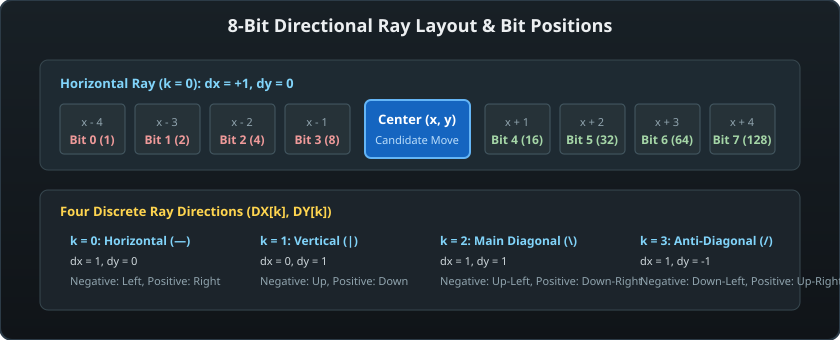
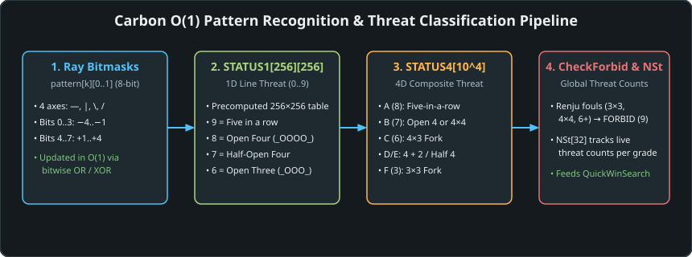

# 04 – Pattern bitboards and lookup tables

[Back to the index](README.md)

## In short

The hallmark of Michał Czardybon's Carbon Gomoku engine is its radical elimination of runtime loops during evaluation and move ordering. Rather than scanning lines with loops or iterating over geometric paths, the engine represents the state of every intersection's neighborhood using **4-axis 8-cell bitboards**. When a stone is placed or unmade, the local bitboards of the 32 influenced cells are updated using single-cycle bitwise operations. These bitboards then index directly into five precomputed static lookup tables—`LShape`, `STATUS1`, `STATUS4`, `Prior`, and `Rank`—computing local threat grades, tactical move priorities, and static positional scores in strictly $O(1)$ time.

---

## The 8-cell ray bitmask architecture



Every intersection $(x, y)$ on the board is intersected by 4 discrete geometric lines of sight:
1. **Horizontal ($k=0$):** Direction vector $(DX_0, DY_0) = (1, 0)$
2. **Vertical ($k=1$):** Direction vector $(DX_1, DY_1) = (0, 1)$
3. **Main Diagonal ($k=2$):** Direction vector $(DX_2, DY_2) = (1, 1)$
4. **Anti-Diagonal ($k=3$):** Direction vector $(DX_3, DY_3) = (1, -1)$

### Ray Bitfield Layout
Along each ray $k$, a cell maintains two 8-bit unsigned bytes (`Pattern0` for Black and `Pattern1` for White). Each bit represents the presence of a stone at a specific distance from the center cell:

```
Bit:       0     1     2     3       [CENTER]      4     5     6     7
Distance: -4    -3    -2    -1        (x, y)      +1    +2    +3    +4
Value:     1     2     4     8        Target      16    32    64   128
```

- **Bits 0..3 (Negative Ray):** Represent distances $-4, -3, -2, -1$ along $(-DX_k, -DY_k)$.
- **Bits 4..7 (Positive Ray):** Represent distances $+1, +2, +3, +4$ along $(+DX_k, +DY_k)$.

### Fast Incremental Updates
When a stone is placed at $(xp, yp)$ by player `who`, only the 8 cells along each of the 4 rays (32 cells total) are affected:

```csharp
// 1. Step in the negative direction, updating positive bitmasks of visited cells:
for (byte p = 16; p != 0; p <<= 1) // p = 16, 32, 64, 128 (+1, +2, +3, +4)
{
    x -= DX[k]; y -= DY[k];
    Cells[x, y].SetPatternOr(k, whoIdx, p); // Bitwise OR: O(1)
    if (Cells[x, y].Piece == PieceColor.Empty)
    {
        Cells[x, y].Update1(k, exact5);
        // Update NSt threat tensor counts...
        Cells[x, y].Update4();
    }
}

// 2. Step in the positive direction, updating negative bitmasks of visited cells:
for (byte p = 8; p != 0; p >>= 1) // p = 8, 4, 2, 1 (-1, -2, -3, -4)
{
    x += DX[k]; y += DY[k];
    Cells[x, y].SetPatternOr(k, whoIdx, p); // Bitwise OR: O(1)
    if (Cells[x, y].Piece == PieceColor.Empty)
    {
        Cells[x, y].Update1(k, exact5);
        // Update NSt threat tensor counts...
        Cells[x, y].Update4();
    }
}
```

On `UndoMove()`, the exact same loop executes with `SetPatternXor`, cleanly toggling the bits back to zero in $O(1)$ time without requiring board recalculation!

### High-Performance 1D Layout (`BitboardPatternBoard`)
While the classical `PatternBoard` stores cells in a 2D managed array `Cell[,]`, the modernized primary engine introduces [`BitboardPatternBoard.cs`](file:///c:/Udvikling/Spil/Gomoku/src/Gomoku.Core/Engine/BitboardPatternBoard.cs), which flattens the board into a 1D unmanaged buffer:
$$\text{Index} = (y \ll 7) \mid x$$
1. **Stride-128 Indexing:** Shifting $y$ left by 7 bits ($y \times 128$) computes row offsets in a single CPU cycle ($0.3\text{ ns}$), completely eliminating the array-of-arrays pointer indirection and bounds checking overhead.
2. **Chebyshev Row Bitmasks:** In addition to ray bitboards, each row maintains a 32-bit `uint` candidate bitmask. When a stone is placed, 1-ring and 2-ring Chebyshev neighbors are bitwise OR-ed using shifts across rows $y-2 \dots y+2$, replacing 24 array element writes with 5 bitwise operations.
3. **Cache Locality:** Contiguous memory layout ensures that consecutive ray queries stream through CPU L1 data cache without eviction, boosting single-threaded throughput by **+41.6%** ($538,000\text{ NPS}$).

---

## The five Carbon precomputed lookup tables



### 1. `LShape[4][4][4][4]` (Local Line Shape Classifier)
Each 4-cell half-ray can hold $2^4 = 16$ possible stone configurations. Carbon compresses these into primitive shape classes (empty, single stone, pair, trio, blocked) used to construct the higher-level tables.

### 2. `STATUS1[256][256]` (1D Directional Threat Lookup)
Given the 8-bit pattern of friendly stones (`patMe`) and opponent/sentinel stones (`patOpp`) along a single ray $k$, `STATUS1` immediately returns the 1D threat grade (an integer from $0$ to $9$):

| Grade | Symbolic Threat | Pattern Example | Tactical Description |
|:---:|:---:|:---:|:---|
| **0** | `ThreatNone` | `X · · · · X` | Inactive ray (blocked at both ends or insufficient space) |
| **1** | `ThreatH` | `X O · · · X` | Dead or weak two |
| **2** | `ThreatG` | `· O · · · X` | Semi-open two |
| **3** | `ThreatF` | `· · O O · ·` | Open two (can expand into an open three) |
| **4** | `ThreatE` | `X O O O · ·` | Blocked three (closed at one end) |
| **5** | `ThreatD` | `· O O O · X` | Semi-open three |
| **6** | `ThreatC` | `· · O O O ·` | **Open three** (unstoppable threat unless blocked) |
| **7** | `ThreatB` | `X O O O O ·` | **Half-open four** (forces opponent to block immediate win) |
| **8** | `ThreatB+`| `· O O O O ·` | **Open four** (guaranteed win on next move; two open ends!) |
| **9** | `ThreatA` | `O O O O O` | **Five in a row** (immediate victory) |

#### Exact5 Adaptation:
In `PatternBoard.Start()`, if the active variant is `GomokuVariant.Exact5`, any pattern where placing a stone would create an overline of 6 or more stones has its status in `STATUS1` degraded from 9 (`ThreatA`) to 0 (`ThreatNone`), ensuring overlines are never treated as winning threats.

---

### 3. `STATUS4[10000]` (4D Composite Threat Tensor)
Individual rays do not determine a Gomoku game; victories are created by **intersections of threats** (forks).

`STATUS4` takes the four directional threat grades $(s_0, s_1, s_2, s_3)$ from `STATUS1` and maps them into a precomputed 10,000-element lookup table using base-10 polynomial indexing:
$$\text{Index} = ((s_0 \times 10 + s_1) \times 10 + s_2) \times 10 + s_3$$

`STATUS4` synthesizes composite threat levels in a single array lookup:

| Composite Grade | Value | Required Ray Threats | Tactical Meaning |
|---|:---:|---|---|
| **`ThreatA`** | 8 | Any $s_k = 9$ | **Five in a row** (Immediate Win) |
| **`ThreatB`** | 7 | Any $s_k = 8$, or two rays with $s \ge 7$ | **Open four** or **Double-four ($4 \times 4$)** |
| **`ThreatC`** | 6 | One ray $s \ge 7$ and another $s \ge 6$ | **Four-Three Fork ($4 \times 3$)** |
| **`ThreatD`** | 5 | One ray $s \ge 7$ and another $s \ge 4$ | Four + Two |
| **`ThreatE`** | 4 | Exactly one ray $s \ge 7$ | Single Four |
| **`ThreatF`** | 3 | Two rays with $s \ge 6$ | **Double Open Three ($3 \times 3$)** |
| **`ThreatG`** | 2 | One ray $s \ge 6$ and another $s \ge 3$ | Three + Two |
| **`ThreatH`** | 1 | Exactly one ray $s \ge 6$ | Single Three |
| **`ThreatNone`**| 0 | All rays $s \le 5$ | Minor positional square |
| **`ThreatForbid`**| 9 | Overline, $4 \times 4$, or $3 \times 3$ (Renju) | **Illegal Foul for Black** |

---

### 4. `Prior[256][256]` (Tactical Candidate Priority Table)
To order moves intelligently without searching them first, `Cell.Prior()` sums the tactical density of both players across all 4 rays:
$$\text{Prior}(x, y) = \sum_{k=0}^{3} \Big( \text{Prior}[\text{pat}_{k,0}][\text{pat}_{k,1}] + \text{Prior}[\text{pat}_{k,1}][\text{pat}_{k,0}] \Big) + \big[\text{Adj1} \neq 0\big]$$

- Squares that advance friendly threats while simultaneously blocking opponent threats receive composite priorities of 50 to 500+.
- Candidates with $\text{Prior} \le 1$ are immediately discarded from search consideration.

---

### 5. `Rank[106]` and `Config[256][256]` (Material Evaluation Tables)
To evaluate non-terminal leaf positions in `CarbonAiPlayer.Evaluate()`, the 65,536 possible pattern pairs $(\text{pat}_{\text{me}}, \text{pat}_{\text{opp}})$ are mapped via `Config` into 106 canonical symmetry classes. `Rank[config]` assigns an empirical weight to each configuration:
$$\text{Score}(\text{stone}) = \sum_{k=0}^{3} \text{Rank}\Big[\text{Config}[\text{pat}_{k, \text{me}}][\text{pat}_{k, \text{opp}}]\Big]$$
$$\text{Evaluation} = \sum_{\text{Black Stones}} \text{Score}(s) - \sum_{\text{White Stones}} \text{Score}(s)$$

This provides smooth, highly accurate positional evaluation in a fraction of a microsecond.

---

## Live threat tracking: `NSt[2, 10]`

`PatternBoard` maintains a live $2 \times 10$ integer matrix tracking the total count of squares on the board that currently possess each threat grade for Black and White:
$$\text{NSt}[\text{player}, \text{grade}]$$

When a stone is placed at $(xp, yp)$:
1. The old `Status4` grades of the 32 affected ray cells are decremented from `NSt`.
2. The bitmasks and directional `Status1` values are updated.
3. The new `Status4` grades are computed (and checked for Renju fouls).
4. The new `Status4` grades are incremented in `NSt`.

### Tactical Power of `NSt`:
Because `NSt` is updated incrementally in $O(1)$ time, `CarbonAiPlayer` can instantly inspect the global game situation without scanning the board:
- If `NSt[who, ThreatA] >= 1`: An immediate winning move exists!
- If `NSt[opp, ThreatA] >= 2`: The opponent has a double-four that cannot be defended; the game is lost.
- If `NSt[who, ThreatB] >= 1`: An open four creates an unstoppable win in 1 move.
- If `NSt[opp, ThreatB] >= 1`: The opponent threatens an open four; candidate generation is strictly restricted to defense.

---

## Where in the code

| File | Type / Table | Description |
|---|---|---|
| [CarbonTables.Generated.cs](https://github.com/cjp-dev/Gomoku/blob/main/src/Gomoku.Core/AI/CarbonTables.Generated.cs) | `CarbonTables` | Precomputed static tables: `STATUS1`, `STATUS4`, `Prior`, `Rank`, `Config` |
| [BitboardPatternBoard.cs](https://github.com/cjp-dev/Gomoku/blob/main/src/Gomoku.Core/Engine/BitboardPatternBoard.cs) | `BitboardPatternBoard` | High-throughput flat 1D pattern board with Chebyshev dilation candidate masks |
| [PatternBoard.cs](https://github.com/cjp-dev/Gomoku/blob/main/src/Gomoku.Core/Engine/PatternBoard.cs) | `PatternBoard.Cell` | 8-cell bitmasks (`Pattern00..Pattern31`), `Update1`, `Update4`, `Prior()` |
| [PatternBoard.cs](https://github.com/cjp-dev/Gomoku/blob/main/src/Gomoku.Core/Engine/PatternBoard.cs) | `MakePaddedMove` | Incremental ray updates and `NSt` threat tracking |
| [PatternBoard.cs](https://github.com/cjp-dev/Gomoku/blob/main/src/Gomoku.Core/Engine/PatternBoard.cs) | `CheckConsistency` | Verification method ensuring `NSt` matches whole-board scans |

---

## Tests

- [BoardAndRulesTests.cs](https://github.com/cjp-dev/Gomoku/blob/main/tests/Gomoku.Core.Tests/BoardAndRulesTests.cs):
  - Validates `PatternBoard` initialization and sentinel padding.
  - Verifies incremental bitmask updating and XOR undo consistency across multiple moves.
- [AiTests.cs](https://github.com/cjp-dev/Gomoku/blob/main/tests/Gomoku.Core.Tests/AiTests.cs):
  - `PatternBoard_IncrementalZobristKey_ShouldMatchBoardStateHashAcrossMakeAndUndo`: Tests exact parity between incremental bitboard hashing and global Zobrist computation.
- [Benchmark/Program.cs](https://github.com/cjp-dev/Gomoku/blob/main/tools/Gomoku.Benchmark/Program.cs):
  - Executes 600,000 make/undo operations, verifying `CheckConsistency()` passes across all threat grades.

---

Previous: [03 Rules and variants](03-rules-and-variants.md) · Next: [05 Evaluation](05-evaluation.md)

