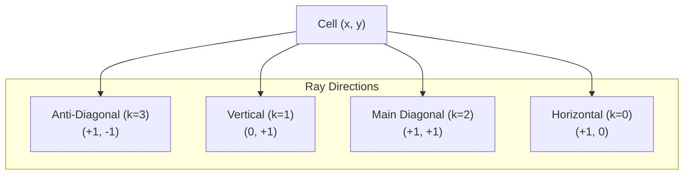

# Chapter 4: Pattern Bitboards & Threat Tensors

## 4.1 The Four Ray Directions
From any intersection $(x, y)$, Gomoku lines can develop along 4 cardinal and diagonal axes:
1. **Horizontal ($k=0$):** $DX = 1, DY = 0$
2. **Vertical ($k=1$):** $DX = 0, DY = 1$
3. **Main Diagonal ($k=2$):** $DX = 1, DY = 1$
4. **Anti-Diagonal ($k=3$):** $DX = 1, DY = -1$



---

## 4.2 8-Cell Ray Bitboards
For each direction $k$ and each player $p \in \{0, 1\}$, a cell maintains a 1-byte bitmask representing the state of the 4 neighbors in each direction along that ray:
- Bits `0..3`: negative direction $(-DX, -DY)$ at distances 4, 3, 2, 1.
- Bits `4..7`: positive direction $(+DX, +DY)$ at distances 1, 2, 3, 4.

When a stone is placed at $(xp, yp)$, only the 8 cells along each ray need their pattern masks updated. This is achieved via lightning-fast bitwise OR operations:
```csharp
// Place stone:
Cells[x, y].SetPatternOr(k, who, p);

// Undo stone:
Cells[x, y].SetPatternXor(k, who, p);
```

---

## 4.3 The STATUS1 Evaluation (1D Threat Grade)
Using the bitmasks of the player (`me`) and opponent (`opp`), `STATUS1` classifies the local 8-cell ray into one of 10 threat levels $(0..9)$:

| Grade | Symbolic Name | Gomoku Threat Meaning |
| :---: | :--- | :--- |
| **0** | `ThreatNone` | Inactive line (blocked on both sides or no potential) |
| **1** | `ThreatH` | Dead two or weak potential |
| **2** | `ThreatG` | Semi-open two |
| **3** | `ThreatF` | Open two `_OO_` |
| **4** | `ThreatE` | Blocked three `XOOO_` |
| **5** | `ThreatD` | Semi-open three |
| **6** | `ThreatC` | Open three `_OO_` (unstoppable unless blocked) |
| **7** | `ThreatB` | Blocked four `XOOOO_` (threatens immediate win) |
| **8** | `ThreatB+` | Open four `_OOOO_` (guaranteed win on next move) |
| **9** | `ThreatA` | Five in a row `OOOOO` (immediate victory) |

---

## 4.4 The STATUS4 Tensor (4D Threat Synthesis)
A Gomoku move rarely exists in isolation along a single direction; the true strength of a move lies in intersections of threats (crosses, double-fours, double-threes).

`STATUS4` takes the 4 directional values $(s_0, s_1, s_2, s_3)$ and indexes into a precomputed 10,000-element tensor:
$$\text{Index} = ((s_0 \times 10 + s_1) \times 10 + s_2) \times 10 + s_3$$

This resolves combinations in $O(1)$ time:
- If any direction is grade 9 $\implies$ **Threat A** (Immediate Win).
- If any direction is grade 8, or two directions are grade 7 $\implies$ **Threat B** (Unstoppable Four).
- If one direction is grade 7 and another is grade 6 $\implies$ **Threat C** (Four-Three).
- If two directions are grade 6 $\implies$ **Threat F** (Double Open Three).

In Renju mode, `CheckForbid(x, y)` inspects these status grades to immediately identify 3x3 and 4x4 fouls for Black.

