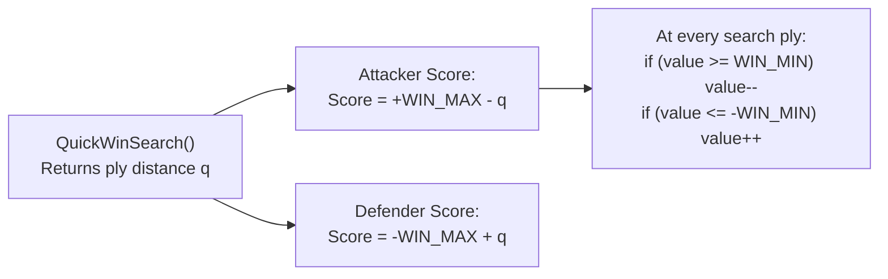

# 05 – Evaluation

[Back to the index](README.md)

## In short

Unlike games such as Chess or Othello where material can be captured or discs flipped, Gomoku is a game of pure placement: placed stones remain permanently on the board until the game concludes. Consequently, evaluation in Gomoku is strictly **structural and geometric**: it measures line continuity, open ends, threat intersections (forks), and tactical tempo. Carbon Gomoku divides evaluation into two complementary tiers:
1. **Tactical Threat Evaluation (`QuickWinSearch`):** Detects forced victories and defeats, assigning mate scores in the range $[\text{WinMin}, \text{WinMax}] = [25000, 30000]$.
2. **Static Positional Leaf Evaluation (`Evaluate`):** At search depth $h=0$, sums the empirical weights of all placed stones across all 4 rays using the precomputed `Config` and `Rank` tables in strictly sub-microsecond time.

---

## Static leaf evaluation (`Evaluate()`)

When minimax search reaches a leaf node ($h = 0$) where no forced mate has been found by `QuickWinSearch`, the static evaluation function computes the positional advantage for the side to move:

```csharp
private int Evaluate(BitboardPatternBoard pb)
{
    int pBlack = 0, pWhite = 0;
    int remCount = pb.RemCount;

    for (int i = 0; i < remCount; i++)
    {
        Point pt = pb.RemPlacedPoints[i];
        ref BitboardPatternBoard.Cell c = ref pb.GetCell(pt.X, pt.Y);
        int a = (int)c.Piece;
        if (a is not (0 or 1)) continue;

        int stoneScore = 0;
        for (int k = 0; k < 4; k++)
        {
            byte patMe = c.GetPattern(k, a);
            byte patOpp = c.GetPattern(k, 1 - a);
            stoneScore += CarbonTables.Rank[CarbonTables.GetConfig(patMe, patOpp)];
        }

        if (a == 0) pBlack += stoneScore;
        else pWhite += stoneScore;
    }

    return pb.Who == PieceColor.Black ? pBlack - pWhite : pWhite - pBlack;
}
```

### Algorithmic Breakdown:
1. **Iteration over Placed Stones:** The engine iterates only over placed stones using `RemPlacedPoints[0 .. RemCount - 1]`. On a $19 \times 19$ board on move 12, this inspects only 12 cells instead of looping over all 361 intersections.
2. **4-Ray Evaluation per Stone:** For each placed stone, its 8-bit friendly pattern (`patMe`) and opponent pattern (`patOpp`) are extracted across the 4 axes ($k = 0, 1, 2, 3$).
3. **Configuration Classification (`Config`):**
   The $256 \times 256 = 65,536$ pattern pairs are mapped by `CarbonTables.Config[patMe, patOpp]` into $106$ canonical geometric equivalence classes (open four, blocked four, open three, broken three, etc.).
4. **Empirical Weight Lookup (`Rank`):**
   `CarbonTables.Rank[config]` returns the precomputed strategic weight of that configuration. Open formations with growth potential receive exponentially higher weights than formations blocked by the board border or opponent stones.
5. **Negamax Perspective:** The evaluation is returned relative to the player whose turn it is to move (`_pb.Who`):
   $$\text{Eval} = \begin{cases} 
   P_{\text{Black}} - P_{\text{White}} & \text{if SideToMove} = \text{Black} \\ 
   P_{\text{White}} - P_{\text{Black}} & \text{if SideToMove} = \text{White} 
   \end{cases}$$

---

## Tactical mate scoring & distance decay

In tactical Gomoku, general positional scores are completely subordinate to forced checkmates. Carbon assigns dedicated score ranges:

| Score Constant | Numeric Value | Description |
|---|:---:|---|
| **`Inf`** | $32,000$ | Minimax search infinity bound |
| **`WinMax`** | $30,000$ | Immediate victory score on the current move ($q = 0$) |
| **`WinMin`** | $25,000$ | Lower threshold for proven forced checkmate sequences |

### The Principle of Shortest Win & Longest Defense
A checkmate in 2 moves is infinitely superior to a checkmate in 8 moves. Similarly, if defeat is inevitable, the AI must choose the line of maximum resistance that delays defeat as long as possible.

To achieve this, winning scores are scaled by the distance (plies) to mate:



1. **On Returning from Child Search:**
   ```csharp
   // Prefer shortest win:
   if (value >= WinMin) value--;
   // Prefer longest defense:
   if (value <= -WinMin) value++;
   ```
2. **On Setting Search Window:**
   To prevent mate scores from falling outside the narrowed null window $[v_A, v_B]$:
   ```csharp
   int vA = -beta;
   int vB = -(best.Value + 1);
   if (vB >= WinMin) vB++;
   if (vA <= -WinMin) vA--;
   ```

---

## Positional threat counts (`NSt` Tensor)

Beyond the leaf evaluation, the live threat counter `PatternBoard.NSt[player, grade]` acts as a real-time heuristic radar throughout the entire search tree:

| Threat Pattern | Status | Tactical Evaluation Impact |
|---|:---:|---|
| **Five in a row** (`ThreatA`) | Grade 8 | Immediate win ($+29999$). The node returns immediately without expanding child moves. |
| **Opponent Five** (`ThreatA`) | Grade 8 | Opponent has an unblocked four. Defense is mandatory; branching factor collapses to 1. |
| **Open Four** (`ThreatB`) | Grade 7 | Unstoppable win in 1 move ($+29997$). The opponent cannot block both ends simultaneously. |
| **Four-Three Fork** (`ThreatC`)| Grade 6 | Creates simultaneous four and open-three threats. Decisive positional advantage. |
| **Double-Three** (`ThreatF`) | Grade 3 | High offensive potential. In Renju, this status triggers foul checks for Black. |

If `NSt[who, ThreatB] >= 1` or `NSt[who, ThreatC] >= 1`, `QuickWinSearch` immediately explores whether a forced VCF checkmate chain can be established before standard minimax search runs.

---

## Data structures

| Member | Type | Memory Footprint | Role |
|---|---|---|---|
| `CarbonTables.Rank` | `byte[106]` | 106 bytes | Empirical stone scoring weights |
| `CarbonTables.Config` | `byte[256, 256]` | 64 KiB | Equivalence class mapping for 8-cell ray pairs |
| `PatternBoard.RemPlacedPoints`| `Point[2048]` | 16 KiB | Stack of placed stone coordinates for $O(\text{plies})$ leaf evaluation |
| `PatternBoard.NSt` | `int[2, 10]` | 80 bytes | Live board threat counts by player and threat grade |

---

## Where in the code

| File | Member / Method | Description |
|---|---|---|
| [CarbonBitboardAiPlayer.cs](https://github.com/cjp-dev/Gomoku/blob/main/src/Gomoku.Core/AI/CarbonBitboardAiPlayer.cs) | `Evaluate()` | High-throughput 1D bitboard leaf evaluation using placed stones and `Rank` |
| [CarbonAiPlayer.cs](https://github.com/cjp-dev/Gomoku/blob/main/src/Gomoku.Core/AI/CarbonAiPlayer.cs) | `Evaluate()` | Static leaf evaluation function using placed stones and `Rank` |
| [CarbonAiPlayer.cs](https://github.com/cjp-dev/Gomoku/blob/main/src/Gomoku.Core/AI/CarbonAiPlayer.cs) | `QuickWinSearch()` | VCF tactical mate solver returning ply-adjusted win scores |
| [CarbonTables.Generated.cs](https://github.com/cjp-dev/Gomoku/blob/main/src/Gomoku.Core/AI/CarbonTables.Generated.cs) | `Rank`, `Config` | Precomputed stone and configuration weight tables |
| [AnalysisViewModel.cs](https://github.com/cjp-dev/Gomoku/blob/main/src/Gomoku.App/ViewModels/AnalysisViewModel.cs) | `Update()` | Translates internal mate scores into user-facing `"Mate in K"` text |

---

## Tests

- [AiTests.cs](https://github.com/cjp-dev/Gomoku/blob/main/tests/Gomoku.Core.Tests/AiTests.cs):
  - Immediate win detection: verifies the AI plays five-in-a-row on move 5.
  - Immediate defense: verifies the AI blocks an opponent four threat.
  - Evaluation symmetry: confirms that swapping players negates the static score.

---

Previous: [04 Pattern bitboards and lookup tables](04-pattern-bitboards-and-lookup-tables.md) · Next: [06 Move generation and ordering](06-move-generation-and-ordering.md)

