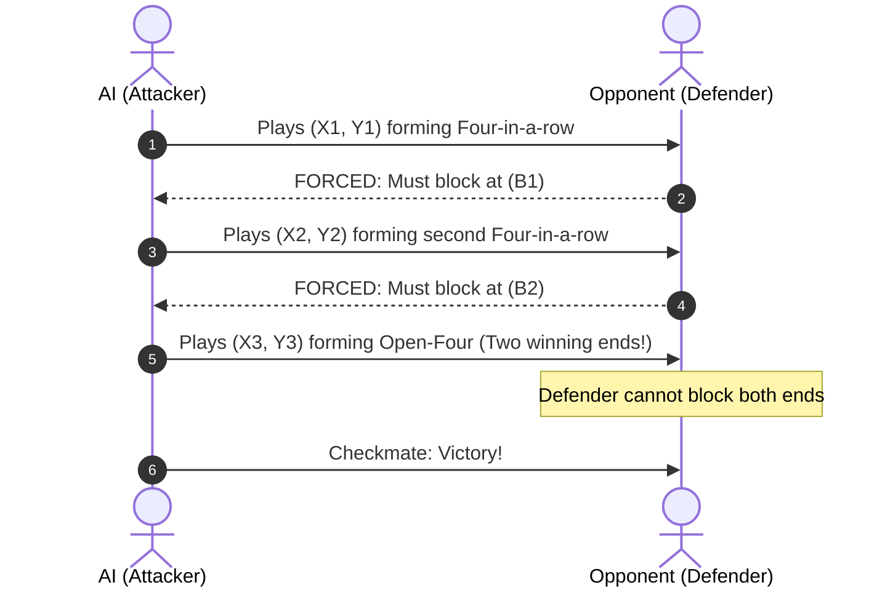

# Chapter 5: Tactical VCF Search (QuickWinSearch)

## 5.1 The Geometry of Forced Wins
In Gomoku, a **Four** (four stones of the same color with at least one open end) forces an immediate opponent response: the opponent *must* block that specific open square or lose on the very next turn. 

A sequence of consecutive four-threats where the opponent has zero free choices is called a **Victory by Continuous Fours (VCF)**. If an attacking player can link a chain of fours terminating in an open-four or five, the win is mathematically guaranteed regardless of search depth.

---

## 5.2 The QuickWinSearch Algorithm
Carbon Gomoku incorporates an aggressive, dedicated VCF solver (`quickWinSearch`) that executes prior to standard Minimax alpha-beta search.

### Algorithmic Workflow:
1. **Threat Inspection:** Check if the side to move already has a winning move (`nSt[who, ThreatA] > 0` or `nSt[who, ThreatB] > 0`). If so, return immediately.
2. **Defensive Obligation:** Check if the opponent already threatens a win (`nSt[opp, ThreatA] > 0`). The attacker cannot pursue VCF; they must block immediately.
3. **Candidate Selection:** Filter only candidate moves that create a **Threat B** (open four or double-four) or **Threat C** (four + open three). In typical positions, this reduces candidate branching from ~30 moves down to 1–3 moves!
4. **Recursive Exploration:**
   - Play the attacking move.
   - For every open end of the resulting four, simulate the opponent's forced block.
   - Recurse into `QuickWinSearch`.
   - If any branch returns victory, bubble the winning move up to the root.
   - Undo both moves and maintain `PatternBoard` consistency.

### Depth & Performance
Because the branching factor of forced responses is near 1, `QuickWinSearch` routinely searches **12 to 24 plies deep** in under 5 milliseconds. It turns positions that would require millions of minimax nodes into trivial sub-millisecond tactical victories.

