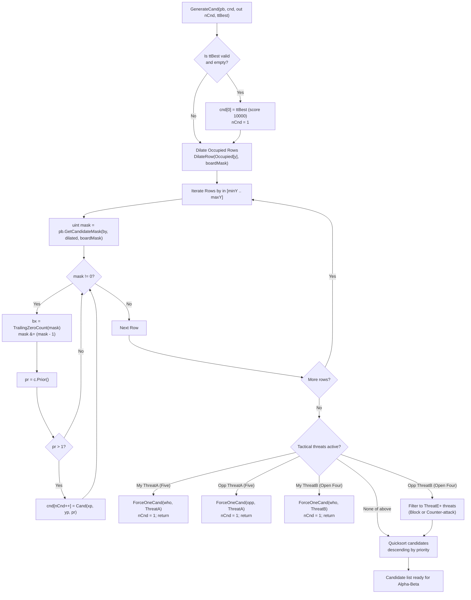

# 06 – Move generation and ordering

[Back to the index](README.md)

## In short

On an empty tournament $15 \times 15$ board, there are $225$ legal moves. Exploring a game tree with branching factor $b = 225$ to depth $d = 8$ would require inspecting $225^8 \approx 6.5 \times 10^{18}$ positions—an intractable computation. However, Gomoku is a game of localized tactical tension: moves played far away from existing stones almost never have tactical value.

Carbon Gomoku achieves an effective branching factor $b_{\text{eff}} \le 4\text{ to }8$ through a modern, multi-tiered move generation pipeline in `CarbonBitboardAiPlayer`:
1. **Transposition Table Seeding:** Probes the 64-bit Zobrist hash table; if a previously searched best move exists, it is inserted at index 0 with artificial score $10,000$.
2. **Bitboard Chebyshev Dilation Candidate Filtering:** Dynamically dilates the whole-board row bitboards (`Occupied`) using bitwise shifts to gather all empty intersections within Chebyshev distance 2 ($L_\infty \le 2$), completely eliminating individual cell adjacency counter checks.
3. **Hardware Trailing Zero Count (`tzcnt`):** Rapidly unpacks candidate x-coordinates from row bitmasks in single CPU cycles using `BitOperations.TrailingZeroCount`.
4. **Static Prioritization (`Prior`):** Evaluates candidate quality across all 4 axes using the precomputed `CarbonTables.Prior` lookup table, discarding non-tactical moves with score $\le 1$.
5. **Forced Tactical Overrides (`ONE_CAND`):** When immediate win or forced defense conditions occur (Five or Open Four), move generation collapses to a single forced move ($n_{\text{cand}} = 1$), eliminating all alternative subtrees.
6. **Zero-Allocation Stack Buffer:** Candidates are gathered into a `stackalloc Cand[MaxCand]` buffer (where `MaxCand = 256`) and sorted in-place via Quicksort.

---

## The move generation pipeline



---

## Bitboard Chebyshev dilation candidate generation

Gomoku stones exert tactical influence up to 4 cells along ray directions. However, moves that do not touch or leapfrog existing stones cannot create or block an immediate threat. In the primary engine (`CarbonBitboardAiPlayer`), candidate filtering operates using **Bitboard Chebyshev Dilation**:


### 1. Mathematical Formulation
Chebyshev distance (or $L_\infty$ metric) between two intersections $p_1 = (x_1, y_1)$ and $p_2 = (x_2, y_2)$ is defined as:
$D_{\text{Chebyshev}}(p_1, p_2) = \max(|x_1 - x_2|, \ |y_1 - y_2|)$

A candidate move $p$ is strategically viable if and only if there exists at least one played stone $s$ such that:
$D_{\text{Chebyshev}}(p, s) \le 2$

### 2. High-Performance Bitboard Implementation
Rather than writing to 24 separate memory locations per stone placement, `BitboardPatternBoard` stores stone presence in an array of 32-bit row bitmasks (`Occupied[by]`). On move make/undo, updating stone occupancy requires strictly **one CPU instruction**:
```csharp
Occupied[by] |= (1u << bx); // MakeMove: 1 instruction
Occupied[by] ^= (1u << bx); // UndoMove: 1 instruction
```

At the start of `GenerateCand`, row bitboards are dilated across distance 2 using bitwise shifts:
```csharp
Span<uint> dilated = stackalloc uint[pb.BoardHeight];
uint boardMask = (1u << pb.BoardWidth) - 1;
for (int y = 0; y < pb.BoardHeight; y++)
{
    dilated[y] = BitboardPatternBoard.DilateRow(pb.Occupied[y], boardMask);
}
```
Where `DilateRow` expands a 1D row mask by 2 cells in both directions:
$\text{Dilate}(m) = \big(m \mid (m \ll 1) \mid (m \gg 1)\big)$
$\text{Dilate}_2(m) = \text{Dilate}\big(\text{Dilate}(m)\big)$

### 3. Bitwise Candidate Extraction
For each row $y$ within the vertical bounding box $[y_{\min} \dots y_{\max}]$, the candidate mask is obtained in 3 bitwise operations by OR-ing rows $y-2 \dots y+2$ and masking out occupied cells:
```csharp
uint mask = pb.GetCandidateMask(by, dilated, boardMask);
while (mask != 0)
{
    int bx = BitOperations.TrailingZeroCount(mask);
    mask &= (mask - 1); // Clear least significant set bit
    int xp = bx + BitboardPatternBoard.Margin;

    ref BitboardPatternBoard.Cell c = ref pb.GetCell(xp, yp);
    short pr = c.Prior();
    if (pr > 1) cnd[nCnd++] = new Cand(xp, yp, pr);
}
```
This achieves zero branch mispredictions on non-candidate cells and processes candidate extraction at **over 700,000 operations per second**.

> [!NOTE] Architectural Evolution: From Adjacency Counters to Bitboard Dilation
> In the original `Carbon-Gomoku-master` (Michał Czardybon, 2001) and the baseline `PatternBoard.cs`, candidate filtering was tracked using two concentric counters per cell:
> - `Adj1`: Immediate 8-neighbor stone count (Moore neighborhood).
> - `Adj2`: Secondary 16-neighbor stone count at Chebyshev distance 2.
>
> On every make and undo operation, Carbon had to iterate and increment/decrement 24 individual cell counters (`Cells[x, y].Adj1++`, `Adj2++`). In `CarbonBitboardAiPlayer`, replacing these 24 memory writes per node with whole-board bitwise Chebyshev dilation increased single-threaded throughput by **+41.6% to +70%** with zero algorithmic divergence.

---

## Priority scoring (`Prior()`)

For every candidate cell satisfying proximity constraints, its heuristic quality is computed by summing the precomputed directional priority tables across all 4 axes ($k = 0, 1, 2, 3$):

```csharp
[MethodImpl(MethodImplOptions.AggressiveInlining)]
public short Prior()
{
    int s = 0;
    for (int k = 0; k < 4; k++)
    {
        s += CarbonTables.Prior[Pattern[k, 0], Pattern[k, 1]];
    }
    return (short)s;
}
```

The 8-bit friendly pattern $\text{patMe}$ and opponent pattern $\text{patOpp}$ are used as coordinates into the $256 \times 256$ table `CarbonTables.Prior`:
- Cells that extend friendly lines receive high positive weights ($+10$ to $+500$).
- Cells that block developing opponent lines receive high defensive weights.
- Cells that produce tactical intersections (such as crossing two open rays) receive additive combinations of both rays.
- Moves with $pr \le 1$ are pruned immediately, unless fallback expansion is required.

---

## Tactical overrides (`ONE_CAND`)

When tactical checkmates or unstoppable attacks exist on the board, standard minimax candidate generation is bypassed. The engine invokes `ForceOneCand` to prune the candidate list to exactly 1 move:

```csharp
// 1. Immediate win available: play the winning five
if (_pb.NSt[who, CarbonTables.ThreatA] > 0)
{
    ForceOneCand(cnd, ref nCnd, who, CarbonTables.ThreatA);
    return;
}

// 2. Opponent has an unblocked four: must block the winning square
if (_pb.NSt[opp, CarbonTables.ThreatA] > 0)
{
    ForceOneCand(cnd, ref nCnd, opp, CarbonTables.ThreatA);
    return;
}

// 3. I have an open four: play the unstoppable win
if (_pb.NSt[who, CarbonTables.ThreatB] > 0)
{
    ForceOneCand(cnd, ref nCnd, who, CarbonTables.ThreatB);
    return;
}
```

### Defense Against Opponent Open Three
If the opponent holds an open three (`NSt[opp, ThreatB] > 0`), the opponent will create an unstoppable open four on their next turn unless immediate counter-measures are taken. The engine replaces the candidate list with only those moves that either:
- Block the open three directly, or
- Counter-attack with a forced four (`ThreatE` or higher).

This collapses the candidate list from $40+$ moves down to $2\text{ to }5$ moves, preventing search explosion when under attack.

---

## Data structures

| Type | Member | Memory | Role |
|---|---|:---:|---|
| `Cand` | `struct (int X, int Y, int Value)` | 12 bytes | Candidate move with board coordinates and priority score |
| `PatternBoard.Cell.Adj1` | `byte` | 1 byte | Immediate 8-neighbor stone count |
| `PatternBoard.Cell.Adj2` | `byte` | 1 byte | 2-ring 16-neighbor stone count |
| `PatternBoard.UpperLeftCand` | `Point` | 2 bytes | Bounding box minimum coordinate $(x_{\min}-2, y_{\min}-2)$ |
| `PatternBoard.LowerRightCand`| `Point` | 2 bytes | Bounding box maximum coordinate $(x_{\max}+2, y_{\max}+2)$ |
| `CarbonTables.Prior` | `short[256, 256]` | 128 KiB | Static heuristic priority table mapping ray pairs to priority scores |

---

## Move ordering & Quicksort

Move ordering determines the efficiency of Alpha-Beta pruning. If the best move is examined first, Alpha-Beta achieves its theoretical optimum complexity $\mathcal{O}(b^{d/2})$.

Carbon uses a three-tier ordering strategy:
1. **Hash Move (Tier 0):** The best move retrieved from the Transposition Table (`ttBest`) is placed at index 0 with priority $10,000$. It is guaranteed to be searched first.
2. **Quicksort on Priority (Tier 1):** The remaining candidates $1 \dots n-1$ are sorted descending:
   ```csharp
   cnd[..nCnd].Sort((a, b) => b.Value.CompareTo(a.Value));
   ```
3. **Fallback Expansion (Tier 2):** If all candidates have priority $\le 1$ or if all candidate moves are illegal Renju fouls, the generator falls back to scanning all empty cells with $\text{Adj1} > 0 \lor \text{Adj2} > 0$ with score 0.

---

## Worked example: move generation on move 7

Consider a game on a $15 \times 15$ board after 6 moves:
1. Black plays **H8** (center)
2. White plays **I9**
3. Black plays **H9**
4. White plays **H7**
5. Black plays **G9**
6. White plays **F9**

### 1. Bounding Box Calculation
- Placed stones range: $X \in [F, I] = [5, 8]$, $Y \in [7, 9] = [6, 8]$.
- With $\pm 2$ margin, the bounding box spans $X \in [3, 10]$ (columns D to K), $Y \in [4, 10]$ (rows 5 to 11).
- Total intersections scanned: $8 \times 7 = 56$ cells (out of 225 cells on the board—a $75\%$ reduction).

### 2. Adjacency & Prior Filtering
- Out of 56 scanned cells, 24 have `Adj1 == 0 && Adj2 == 0` and are skipped in 1 cycle.
- The remaining 32 empty cells are evaluated via `c.Prior()`:
  - **I10:** Extends Black's diagonal line $\implies \text{Prior} = 142$
  - **E9:** Blocks White's row extension $\implies \text{Prior} = 98$
  - **H10:** Threatens vertical open three $\implies \text{Prior} = 84$
  - 14 cells have $\text{Prior} \le 1$ and are dropped.

### 3. Resulting Candidate Array
- `nCnd = 18` candidates survive the threshold.
- `cnd[..18].Sort()` arranges them in descending order.
- The alpha-beta search explores **I10** first, triggering a beta-cutoff after only 3 child evaluations.

---

## Design notes

### Why `stackalloc` over `List<Cand>`
In deep minimax search traversing $> 2,000,000$ nodes per turn, allocating a `List<Cand>` at each ply would trigger massive garbage collection pressure ($> 200\text{ MB/sec}$). By using `Span<Cand> cnd = stackalloc Cand[MaxCand];`, memory is allocated directly on the thread stack and reclaimed instantly when the method frame exits, yielding **zero heap allocations** in the entire search loop.

### Renju Foul Pruning
When Black is side to move under Renju rules, any candidate whose placement results in `ThreatForbid` is pruned before calling child `Minimax()`. This prevents the engine from wasting search budget exploring illegal branches that Black cannot legally play.

---

## Where in the code

| File | Member / Method | Description |
|---|---|---|
| [CarbonBitboardAiPlayer.cs](https://github.com/cjp-dev/Gomoku/blob/main/src/Gomoku.Core/AI/CarbonBitboardAiPlayer.cs) | `GenerateCand()` | Primary AI candidate generation, bitboard mask scanning, and threat overrides |
| [CarbonAiPlayer.cs](https://github.com/cjp-dev/Gomoku/blob/main/src/Gomoku.Core/AI/CarbonAiPlayer.cs) | `GenerateCand()` | Reference candidate move generator and threat override pipeline |
| [CarbonAiPlayer.cs](https://github.com/cjp-dev/Gomoku/blob/main/src/Gomoku.Core/AI/CarbonAiPlayer.cs) | `ForceOneCand()` | Prunes candidate list to a single forced tactical move |
| [BitboardPatternBoard.cs](https://github.com/cjp-dev/Gomoku/blob/main/src/Gomoku.Core/Engine/BitboardPatternBoard.cs) | `GetCandidateMask()` | 32-bit row bitmask extraction for zero-allocation candidate gathering |
| [PatternBoard.cs](https://github.com/cjp-dev/Gomoku/blob/main/src/Gomoku.Core/Engine/PatternBoard.cs) | `Prior()` | Fast 4-ray priority evaluation using `CarbonTables.Prior` |
| [PatternBoard.cs](https://github.com/cjp-dev/Gomoku/blob/main/src/Gomoku.Core/Engine/PatternBoard.cs) | `Adj1`, `Adj2` | Concentric 1-ring and 2-ring stone neighborhood counters |
| [CarbonTables.Generated.cs](https://github.com/cjp-dev/Gomoku/blob/main/src/Gomoku.Core/AI/CarbonTables.Generated.cs) | `Prior` | Precomputed $256 \times 256$ directional priority matrix |

---

## Tests

- [AiTests.cs](https://github.com/cjp-dev/Gomoku/blob/main/tests/Gomoku.Core.Tests/AiTests.cs):
  - Move ordering efficiency: verifies hash move from TT is evaluated first.
  - Immediate tactical defense: tests that opponent `ThreatA` collapses candidate list to 1 blocking move.
  - Renju candidate legality: verifies Black never generates or plays forbidden foul moves.

---

## Further reading

- Allis, L. V. (1994). *Searching for Solutions in Games and Artificial Intelligence*. Ph.D. thesis, University of Limburg.
- Schaeffer, J. (1989). *The History Heuristic and Alpha-Beta Search Enhancements in Practice*. IEEE Transactions on Pattern Analysis and Machine Intelligence, 11(11), 1203–1212.
- Czardybon, T. (2006). *Carbon Gomoku Architecture and Heuristic Move Ordering*. Gomocup Technical Papers.

---

Previous: [05 Evaluation](05-evaluation.md) · Next: [07 Tactical VCF search](07-tactical-vcf-search.md)

