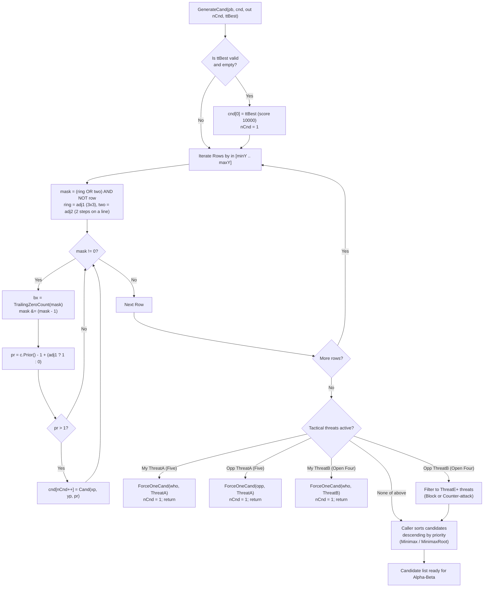

# 06 – Move generation and ordering

[Back to the index](README.md)

## In short

On an empty tournament $15 \times 15$ board, there are $225$ legal moves. Exploring a game tree with branching factor $b = 225$ to depth $d = 8$ would require inspecting $225^8 \approx 6.5 \times 10^{18}$ positions—an intractable computation. However, Gomoku is a game of localized tactical tension: moves played far away from existing stones almost never have tactical value.

Carbon Gomoku achieves an effective branching factor $b_{\text{eff}} \le 4\text{ to }8$ through a modern, multi-tiered move generation pipeline in `CarbonBitboardAiPlayer`:
1. **Transposition Table Seeding:** Probes the 64-bit Zobrist hash table; if a previously searched best move exists, it is inserted at index 0 with artificial score $10,000$.
2. **Bitboard Candidate Filtering:** Shifts the whole-board row bitboards (`Occupied`) to gather Carbon's candidate set: every empty intersection with a stone in its $3 \times 3$ ring (`adj1`) or two steps away along one of the four lines (`adj2`), completely eliminating individual cell adjacency counters. (With `CarbonSearchOptions.CarbonCandidates = 0`, the older full $5 \times 5$ square, Chebyshev distance $L_\infty \le 2$, is used instead.)
3. **Hardware Trailing Zero Count (`tzcnt`):** Rapidly unpacks candidate x-coordinates from row bitmasks in single CPU cycles using `BitOperations.TrailingZeroCount`.
4. **Static Prioritization (`Prior`):** Evaluates candidate quality across all 4 axes using the precomputed `CarbonTables.Prior` lookup table, plus $1$ next to a stone (`adj1`), discarding non-tactical moves with score $\le 1$.
5. **Forced Tactical Overrides (`ONE_CAND`):** When immediate win or forced defense conditions occur (Five or Open Four), move generation collapses to a single forced move ($n_{\text{cand}} = 1$), eliminating all alternative subtrees.
6. **Zero-Allocation Stack Buffer:** Candidates are gathered into a `stackalloc Cand[MaxCand]` buffer (where `MaxCand = 256`) and sorted in-place by `CandSort` (introsort).

---

## The move generation pipeline



---

## Bitboard candidate generation

Gomoku stones exert tactical influence up to 4 cells along ray directions. However, moves that do not touch or leapfrog existing stones cannot create or block an immediate threat. In the primary engine (`CarbonBitboardAiPlayer`), candidate filtering operates on **row bitboards**:


### 1. Mathematical Formulation
With `CarbonSearchOptions.CarbonCandidates` (default on), the engine uses Carbon's own neighbourhood (`adj1`/`adj2` in Carbon's `AICarbonMove.cpp`). An empty cell $p$ is a candidate if a played stone $s$ lies at offset $(dx, dy) = s - p$ with
$$\text{adj1}: \max(|dx|, |dy|) = 1 \qquad \text{or} \qquad \text{adj2}: (dx, dy) \in \{-2, 0, 2\}^2 \setminus \{(0, 0)\}$$
that is, a stone in the $3 \times 3$ ring around $p$, or a stone two steps away along one of the four lines (16 neighbour cells in total).

The older path (`CarbonCandidates = 0`) takes the full $5 \times 5$ square: a stone anywhere within Chebyshev distance 2 (24 neighbour cells):
$$D_{\text{Chebyshev}}(p, s) = \max(|x_p - x_s|, \ |y_p - y_s|) \le 2$$

### 2. High-Performance Bitboard Implementation
Rather than writing to 24 separate memory locations per stone placement, `BitboardPatternBoard` stores stone presence in an array of 32-bit row bitmasks (`Occupied[by]`). On move make/undo, updating stone occupancy requires strictly **one CPU instruction**:
```csharp
Occupied[by] |= (1u << bx); // MakeMove: 1 instruction
Occupied[by] ^= (1u << bx); // UndoMove: 1 instruction
```

### 3. Bitwise Candidate Extraction (`GenerateCarbonCand`)
For each row $by$ within the vertical bounding box $[y_{\min} \dots y_{\max}]$, the candidate mask is built from the five occupied rows $by-2 \dots by+2$ with shifts, and the cells are extracted with `TrailingZeroCount`:
```csharp
for (int by = minY; by <= maxY; by++)
{
    uint up = by > 0 ? occ[by - 1] : 0, row = occ[by], down = by < last ? occ[by + 1] : 0;
    uint up2 = by > 1 ? occ[by - 2] : 0, down2 = by < last - 1 ? occ[by + 2] : 0;
    uint near = up | row | down;
    uint ring = (near | (near << 1) | (near >> 1)) & boardMask;                     // adj1
    uint far2 = up2 | down2;
    uint two = ((row << 2) | (row >> 2) | far2 | (far2 << 2) | (far2 >> 2)) & boardMask; // adj2
    uint mask = (ring | two) & ~row & boardMask;
    int yp = by + BitboardPatternBoard.Margin;

    while (mask != 0)
    {
        int bx = BitOperations.TrailingZeroCount(mask);
        mask &= mask - 1; // Clear least significant set bit
        int xp = bx + BitboardPatternBoard.Margin;
        if (xp == ttFirstX && yp == ttFirstY) continue; // the hash move is already cnd[0]

        // Prior() includes a +1; Carbon adds it only next to a stone (adj1)
        short pr = (short)(pb.GetCell(xp, yp).Prior() - 1 + (int)((ring >> bx) & 1));
        if (pr > 1)
        {
            cnd[nCnd++] = new Cand(xp, yp, pr);
            if (nCnd >= MaxCand - 1) return;
        }
    }
}
```
This achieves zero branch mispredictions on non-candidate cells.

Compared with the $5 \times 5$ square, Carbon's set searched $14.3\%$ fewer nodes on the benchmark suite ($-10.3\%$ time, all 64 forced wins still found) and won a 730-game match (1 thread, $0.2\text{ s}$ per move) with $54.8\% \pm 3.6\%$, $+33$ Elo $[+9, +59]$; at 8 threads (300 games) the result was $+23$ Elo $[-16, +63]$.

### 4. The Older $5 \times 5$ Path (`DilateRow` & `GetCandidateMask`)
With `CarbonCandidates = 0`, every row is dilated twice and five rows are OR-ed, and `Prior()` (with its unconditional $+1$) is used as is:
```csharp
for (int y = 0; y < pb.BoardHeight; y++)
{
    dilated[y] = BitboardPatternBoard.DilateRow(pb.Occupied[y], boardMask);
}
// per row: uint mask = pb.GetCandidateMask(by, dilated, boardMask); short pr = c.Prior();
```
$\text{Dilate}(m) = \big(m \mid (m \ll 1) \mid (m \gg 1)\big) \mathbin{\&} \text{boardMask}, \qquad \text{Dilate}_2(m) = \text{Dilate}\big(\text{Dilate}(m)\big)$

> [!NOTE] Architectural Evolution: From Adjacency Counters to Bitboard Masks
> In the original `Carbon-Gomoku-master` (Michał Czardybon, 2001) and the baseline `PatternBoard.cs`, candidate filtering was tracked using two concentric counters per cell:
> - `Adj1`: Immediate 8-neighbor stone count (Moore neighborhood).
> - `Adj2`: Count of stones at the 8 ray-aligned cells two steps away.
>
> On every make and undo operation, Carbon had to iterate and increment/decrement 24 individual cell counters (`Cells[x, y].Adj1++`, `Adj2++`). The first `CarbonBitboardAiPlayer` replaced these 24 memory writes per node with whole-board bitwise dilation of the full $5 \times 5$ square and an unconditional $+1$ priority, which increased single-threaded throughput by **+41.6% to +70%** but searched a larger set than Carbon. `GenerateCarbonCand` keeps the bitboard speed and restores Carbon's exact set and priorities.

---

## Priority scoring (`Prior()`)

For every candidate cell satisfying proximity constraints, its heuristic quality is computed by summing the precomputed directional priority tables across all 4 axes ($k = 0, 1, 2, 3$):

```csharp
[MethodImpl(MethodImplOptions.AggressiveInlining)]
public short Prior()
{
    return (short)(
        CarbonTables.GetPrior(Pattern00, Pattern01) +
        CarbonTables.GetPrior(Pattern10, Pattern11) +
        CarbonTables.GetPrior(Pattern20, Pattern21) +
        CarbonTables.GetPrior(Pattern30, Pattern31) +
        CarbonTables.GetPrior(Pattern01, Pattern00) +
        CarbonTables.GetPrior(Pattern11, Pattern10) +
        CarbonTables.GetPrior(Pattern21, Pattern20) +
        CarbonTables.GetPrior(Pattern31, Pattern30) + 1);
}
```

The 8-bit friendly pattern $\text{patMe}$ and opponent pattern $\text{patOpp}$ are used as coordinates into the $256 \times 256$ table `CarbonTables.Prior`:
- Cells that extend friendly lines receive high positive weights ($+10$ to $+500$).
- Cells that block developing opponent lines receive high defensive weights.
- Cells that produce tactical intersections (such as crossing two open rays) receive additive combinations of both rays.
- With `CarbonCandidates` (default on), the candidate's priority is $\text{pr} = \text{Prior}() - 1 + [\text{adj1} \neq 0]$, i.e. the $+1$ is only given next to a stone, as in Carbon. Cells reached only through `adj2` therefore need a pattern prior of at least 2.
- Moves with $pr \le 1$ are pruned immediately, unless fallback expansion is required.

---

## Tactical overrides (`ONE_CAND`)

When tactical checkmates or unstoppable attacks exist on the board, standard minimax candidate generation is bypassed. The engine invokes `ForceOneCand` to prune the candidate list to exactly 1 move:

```csharp
// 1. Immediate win available: play the winning five
if (pb.GetNSt(who, CarbonTables.ThreatA) > 0)
{
    ForceOneCand(pb, cnd, ref nCnd, who, CarbonTables.ThreatA);
    return;
}

// 2. Opponent has an unblocked four: must block the winning square
if (pb.GetNSt(opp, CarbonTables.ThreatA) > 0)
{
    ForceOneCand(pb, cnd, ref nCnd, opp, CarbonTables.ThreatA);
    return;
}

// 3. I have an open four: play the unstoppable win
if (pb.GetNSt(who, CarbonTables.ThreatB) > 0)
{
    ForceOneCand(pb, cnd, ref nCnd, who, CarbonTables.ThreatB);
    return;
}
```

### Defense Against Opponent Open Three
If the opponent holds an open three (`NSt[opp, ThreatB] > 0`), the opponent will create an unstoppable open four on their next turn unless immediate counter-measures are taken. The engine replaces the candidate list with only those moves that either:
- Block the open three directly, or
- Counter-attack with a forced four (`ThreatE` or higher).

This collapses the candidate list from $40+$ moves down to $2\text{ to }5$ moves, preventing search explosion when under attack.

---

## Data structures

| Type | Member | Memory | Role |
|---|---|:---:|---|
| `Cand` | `struct (int X, int Y, int Value)` | 12 bytes | Candidate move with padded board coordinates and priority score |
| `BitboardPatternBoard.Occupied` | `uint[40]` | 160 bytes | Whole-board 32-bit row bitboards for the candidate masks |
| `BitboardPatternBoard.UpperLeftCand` | `Point` | 8 bytes | Bounding box minimum coordinate $(x_{\min}-2, y_{\min}-2)$ |
| `BitboardPatternBoard.LowerRightCand`| `Point` | 8 bytes | Bounding box maximum coordinate $(x_{\max}+2, y_{\max}+2)$ |
| `CarbonTables.PriorFlat` | `byte[256 * 256]` | 64 KiB | Static heuristic priority table mapping ray pairs to priority scores |

---

## Move ordering & sorting

Move ordering determines the efficiency of Alpha-Beta pruning. If the best move is examined first, Alpha-Beta achieves its theoretical optimum complexity $\mathcal{O}(b^{d/2})$.

Carbon uses a three-tier ordering strategy:
1. **Hash Move (Tier 0):** The best move retrieved from the Transposition Table (`ttBest`) is placed at index 0 with priority $10,000$. It is guaranteed to be searched first.
2. **Sort on Priority (Tier 1):** All candidates are sorted descending by `Value` (the hash move's $10,000$ keeps it first):
   ```csharp
   CandSort.SortDescending(cnd[..nCnd]);
   ```
   [`CandSort`](https://github.com/cjp-dev/Gomoku/blob/main/src/Gomoku.Core/AI/CandSort.cs) is the same introsort as `Span<T>.Sort(Comparison<T>)` (insertion sort for partitions of up to 16 elements, heapsort when the recursion gets too deep) with the comparison inlined instead of called through a delegate. Equal priorities therefore end up in exactly the same order as with `Span.Sort`, so the search is unchanged; the suite time dropped by $3.0\%$.
3. **Fallback Expansion (Tier 2):** If all candidates have priority $\le 1$ or if all candidate moves are illegal Renju fouls, the generator falls back to scanning all empty cells within the bounding box with score 0 (up to `MaxCand = 256`).

There are no killer moves and no history heuristic: the order is the hash move followed by Carbon's static `Prior` scores. (A history tie-break was tried in 2026; it saved $13.9\%$ nodes but only $6.4\%$ time, and its match gain, $+16$ Elo $[-9, +41]$ at 1 thread, was within the noise, so it was rejected.) At the root, Lazy SMP helper workers permute the sorted list (worker 1 reverses candidates $1 \dots n-1$, workers $\ge 2$ swap candidate 1 with another) to diversify their search.

---

## Worked example: move generation on move 7

Consider a game on a $15 \times 15$ board after 6 moves:
1. Black plays **H8** (center)
2. White plays **I9**
3. Black plays **H9**
4. White plays **H7**
5. Black plays **G9**
6. White plays **F9**

### 1. Bounding Box Calculation
- Placed stones range: $X \in [F, I] = [5, 8]$, $Y \in [7, 9] = [6, 8]$.
- With $\pm 2$ margin, the bounding box spans $X \in [3, 10]$ (columns D to K), $Y \in [4, 10]$ (rows 5 to 11).
- Total intersections scanned: $8 \times 7 = 56$ cells (out of 225 cells on the board—a $75\%$ reduction).

### 2. Adjacency & Prior Filtering
- Out of the 56 cells inside the bounding box, 6 hold stones. Carbon's candidate set (`adj1` ring or `adj2` cell two steps along a line) contains 38 of the 50 empty cells; the older $5 \times 5$ square would contain 44.
- The 38 cells are scored with $\text{Prior}() - 1 + [\text{adj1} \neq 0]$. The highest priorities, with Black to move, are:
  - **G8:** $\text{pr} = 28$
  - **I7** and **F10:** $\text{pr} = 20$
  - **I8:** $\text{pr} = 17$
  - 20 cells have $\text{pr} \le 1$ and are dropped.

### 3. Resulting Candidate Array
- `nCnd = 18` candidates survive the threshold (assuming no hash move from the table; there is no `ONE_CAND` threat on the board).
- `CandSort.SortDescending(cnd[..18])` arranges them in descending order, so the search explores **G8** first.

---

## Design notes

### Why `stackalloc` over `List<Cand>`
In deep minimax search traversing $> 2,000,000$ nodes per turn, allocating a `List<Cand>` at each ply would trigger massive garbage collection pressure ($> 200\text{ MB/sec}$). By using `Span<Cand> cnd = stackalloc Cand[MaxCand];`, memory is allocated directly on the thread stack and reclaimed instantly when the method frame exits, yielding **zero heap allocations** in the entire search loop.

### Renju Foul Pruning
When Black is side to move under Renju rules, any candidate whose placement results in `ThreatForbid` is pruned before calling child `Minimax()`. This prevents the engine from wasting search budget exploring illegal branches that Black cannot legally play.

---

## Where in the code

| File | Member / Method | Description |
|---|---|---|
| [CarbonBitboardAiPlayer.cs](https://github.com/cjp-dev/Gomoku/blob/main/src/Gomoku.Core/AI/CarbonBitboardAiPlayer.cs) | `GenerateCand()` | Primary AI candidate generation, bitboard mask scanning, and threat overrides |
| [CarbonBitboardAiPlayer.cs](https://github.com/cjp-dev/Gomoku/blob/main/src/Gomoku.Core/AI/CarbonBitboardAiPlayer.cs) | `GenerateCarbonCand()` | Carbon's `adj1`/`adj2` candidate set and priority from row bitmask shifts |
| [CarbonSearchOptions.cs](https://github.com/cjp-dev/Gomoku/blob/main/src/Gomoku.Core/AI/CarbonSearchOptions.cs) | `CarbonCandidates` | Switch between Carbon's set (default) and the older $5 \times 5$ square |
| [CandSort.cs](https://github.com/cjp-dev/Gomoku/blob/main/src/Gomoku.Core/AI/CandSort.cs) | `SortDescending()` | Introsort of `Span.Sort(Comparison)` with the comparison inlined |
| [CarbonAiPlayer.cs](https://github.com/cjp-dev/Gomoku/blob/main/src/Gomoku.Core/AI/CarbonAiPlayer.cs) | `GenerateCand()` | Reference candidate move generator and threat override pipeline |
| [CarbonAiPlayer.cs](https://github.com/cjp-dev/Gomoku/blob/main/src/Gomoku.Core/AI/CarbonAiPlayer.cs) | `ForceOneCand()` | Prunes candidate list to a single forced tactical move |
| [BitboardPatternBoard.cs](https://github.com/cjp-dev/Gomoku/blob/main/src/Gomoku.Core/Engine/BitboardPatternBoard.cs) | `DilateRow()`, `GetCandidateMask()` | $5 \times 5$ row bitmask extraction (used with `CarbonCandidates = 0`) |
| [PatternBoard.cs](https://github.com/cjp-dev/Gomoku/blob/main/src/Gomoku.Core/Engine/PatternBoard.cs) | `Prior()` | Fast 4-ray priority evaluation using `CarbonTables.Prior` |
| [PatternBoard.cs](https://github.com/cjp-dev/Gomoku/blob/main/src/Gomoku.Core/Engine/PatternBoard.cs) | `Adj1`, `Adj2` | Concentric 1-ring and 2-ring stone neighborhood counters |
| [CarbonTables.Generated.cs](https://github.com/cjp-dev/Gomoku/blob/main/src/Gomoku.Core/AI/CarbonTables.Generated.cs) | `Prior` | Precomputed $256 \times 256$ directional priority matrix |

---

## Tests

- [AiTests.cs](https://github.com/cjp-dev/Gomoku/blob/main/tests/Gomoku.Core.Tests/AiTests.cs):
  - Move ordering efficiency: verifies hash move from TT is evaluated first.
  - Immediate tactical defense: tests that opponent `ThreatA` collapses candidate list to 1 blocking move.
  - Renju candidate legality: verifies Black never generates or plays forbidden foul moves.

---

## Further reading

- Allis, L. V. (1994). *Searching for Solutions in Games and Artificial Intelligence*. Ph.D. thesis, University of Limburg.
- Schaeffer, J. (1989). *The History Heuristic and Alpha-Beta Search Enhancements in Practice*. IEEE Transactions on Pattern Analysis and Machine Intelligence, 11(11), 1203–1212.
- Czardybon, T. (2006). *Carbon Gomoku Architecture and Heuristic Move Ordering*. Gomocup Technical Papers.

---

Previous: [05 Evaluation](05-evaluation.md) · Next: [07 Tactical VCF search](07-tactical-vcf-search.md)

