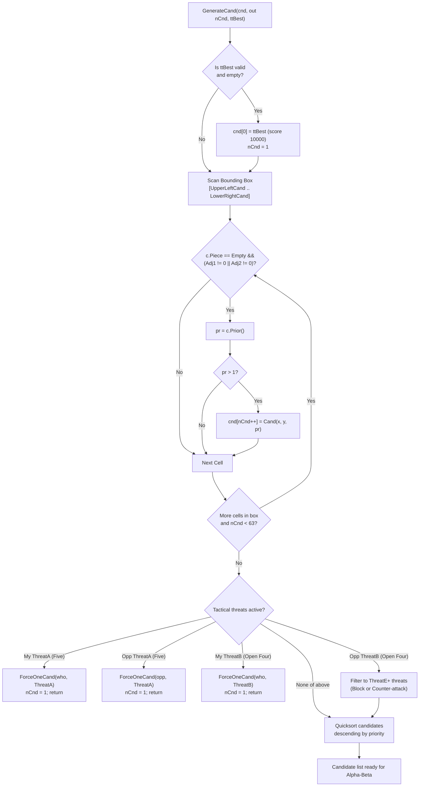

# 06 – Move generation and ordering

[Back to the index](README.md)

## In short

On an empty $19 \times 19$ board, there are $361$ legal moves. Exploring a game tree with branching factor $b = 361$ to depth $d = 8$ would require inspecting $361^8 \approx 2.9 \times 10^{20}$ positions—an intractable computation. However, Gomoku is a game of localized tactical tension: moves played far away from existing stones almost never have tactical value.

Carbon Gomoku achieves an effective branching factor $b_{\text{eff}} \le 4\text{ to }8$ through a high-performance, multi-tiered move generation pipeline:
1. **Geometric Bounding Box & 2-Ring Adjacency:** Only considers empty intersections within a dynamic bounding box that have stones within distance 2 ($\text{Adj1} > 0$ or $\text{Adj2} > 0$).
2. **Static Prioritization (`Prior`):** Evaluates candidate quality across all 4 axes using the precomputed `CarbonTables.Prior` lookup table, discarding moves with score $\le 1$.
3. **Transposition Table Seeding:** Probes the 64-bit Zobrist hash table; if a previously searched best move exists, it is inserted at index 0 with artificial score $10,000$.
4. **Forced Tactical Overrides (`ONE_CAND`):** When immediate win or forced defense conditions occur (Five or Open Four), move generation collapses to a single forced move ($n_{\text{cand}} = 1$), eliminating all subtrees.
5. **Zero-Allocation Stack Allocation:** Moves are gathered into a `stackalloc Cand[64]` buffer and sorted in-place via Quicksort.

---

## The move generation pipeline



---

## Geometric adjacency filtering

Gomoku stones exert geometric influence up to 4 cells along rays. However, moves that do not touch or leapfrog existing stones cannot create or block an immediate threat. Carbon tracks stone proximity using two concentric neighborhood counters per cell:


1. **`Adj1` (1-Ring Adjacency – Moore Neighborhood):**
   Counts how many stones occupy the 8 immediate neighboring cells:
   $$\mathcal{N}_1(x, y) = \{(x + dx, y + dy) \mid dx, dy \in \{-1, 0, 1\} \setminus \{(0, 0)\}\}$$
   $$\text{Adj1}(x, y) = \sum_{p \in \mathcal{N}_1(x, y)} [\text{Piece}(p) \neq \text{Empty}]$$

2. **`Adj2` (2-Ring Adjacency – Secondary Neighborhood):**
   Counts how many stones occupy the 16 cells at Chebyshev distance 2 (including knight jumps and two-step ray advances):
   $$\mathcal{N}_2(x, y) = \{(x + dx, y + dy) \mid \max(|dx|, |dy|) = 2\}$$
   $$\text{Adj2}(x, y) = \sum_{p \in \mathcal{N}_2(x, y)} [\text{Piece}(p) \neq \text{Empty}]$$

3. **Filtering Condition:**
   Any intersection with $\text{Adj1} == 0 \land \text{Adj2} == 0$ is completely ignored during candidate generation:
   ```csharp
   if (c.Piece == PieceColor.Empty && (c.Adj1 != 0 || c.Adj2 != 0))
   {
       short pr = c.Prior();
       if (pr > 1) cnd[nCnd++] = new Cand(x, y, pr);
   }
   ```
   This simple heuristic prunes over $80\%$ of the board area in the opening and midgame, focusing search exclusively on the active theater of operations.

---

## Priority scoring (`Prior()`)

For every candidate cell satisfying proximity constraints, its heuristic quality is computed by summing the precomputed directional priority tables across all 4 axes ($k = 0, 1, 2, 3$):

```csharp
[MethodImpl(MethodImplOptions.AggressiveInlining)]
public short Prior()
{
    int s = 0;
    for (int k = 0; k < 4; k++)
    {
        s += CarbonTables.Prior[Pattern[k, 0], Pattern[k, 1]];
    }
    return (short)s;
}
```

The 8-bit friendly pattern $\text{patMe}$ and opponent pattern $\text{patOpp}$ are used as coordinates into the $256 \times 256$ table `CarbonTables.Prior`:
- Cells that extend friendly lines receive high positive weights ($+10$ to $+500$).
- Cells that block developing opponent lines receive high defensive weights.
- Cells that produce tactical intersections (such as crossing two open rays) receive additive combinations of both rays.
- Moves with $pr \le 1$ are pruned immediately, unless fallback expansion is required.

---

## Tactical overrides (`ONE_CAND`)

When tactical checkmates or unstoppable attacks exist on the board, standard minimax candidate generation is bypassed. The engine invokes `ForceOneCand` to prune the candidate list to exactly 1 move:

```csharp
// 1. Immediate win available: play the winning five
if (_pb.NSt[who, CarbonTables.ThreatA] > 0)
{
    ForceOneCand(cnd, ref nCnd, who, CarbonTables.ThreatA);
    return;
}

// 2. Opponent has an unblocked four: must block the winning square
if (_pb.NSt[opp, CarbonTables.ThreatA] > 0)
{
    ForceOneCand(cnd, ref nCnd, opp, CarbonTables.ThreatA);
    return;
}

// 3. I have an open four: play the unstoppable win
if (_pb.NSt[who, CarbonTables.ThreatB] > 0)
{
    ForceOneCand(cnd, ref nCnd, who, CarbonTables.ThreatB);
    return;
}
```

### Defense Against Opponent Open Three
If the opponent holds an open three (`NSt[opp, ThreatB] > 0`), the opponent will create an unstoppable open four on their next turn unless immediate counter-measures are taken. The engine replaces the candidate list with only those moves that either:
- Block the open three directly, or
- Counter-attack with a forced four (`ThreatE` or higher).

This collapses the candidate list from $40+$ moves down to $2\text{ to }5$ moves, preventing search explosion when under attack.

---

## Data structures

| Type | Member | Memory | Role |
|---|---|:---:|---|
| `Cand` | `struct (int X, int Y, int Value)` | 12 bytes | Candidate move with board coordinates and priority score |
| `PatternBoard.Cell.Adj1` | `byte` | 1 byte | Immediate 8-neighbor stone count |
| `PatternBoard.Cell.Adj2` | `byte` | 1 byte | 2-ring 16-neighbor stone count |
| `PatternBoard.UpperLeftCand` | `Point` | 2 bytes | Bounding box minimum coordinate $(x_{\min}-2, y_{\min}-2)$ |
| `PatternBoard.LowerRightCand`| `Point` | 2 bytes | Bounding box maximum coordinate $(x_{\max}+2, y_{\max}+2)$ |
| `CarbonTables.Prior` | `short[256, 256]` | 128 KiB | Static heuristic priority table mapping ray pairs to priority scores |

---

## Move ordering & Quicksort

Move ordering determines the efficiency of Alpha-Beta pruning. If the best move is examined first, Alpha-Beta achieves its theoretical optimum complexity $\mathcal{O}(b^{d/2})$.

Carbon uses a three-tier ordering strategy:
1. **Hash Move (Tier 0):** The best move retrieved from the Transposition Table (`ttBest`) is placed at index 0 with priority $10,000$. It is guaranteed to be searched first.
2. **Quicksort on Priority (Tier 1):** The remaining candidates $1 \dots n-1$ are sorted descending:
   ```csharp
   cnd[..nCnd].Sort((a, b) => b.Value.CompareTo(a.Value));
   ```
3. **Fallback Expansion (Tier 2):** If all candidates have priority $\le 1$ or if all candidate moves are illegal Renju fouls, the generator falls back to scanning all empty cells with $\text{Adj1} > 0 \lor \text{Adj2} > 0$ with score 0.

---

## Worked example: move generation on move 7

Consider a game on a $15 \times 15$ board after 6 moves:
1. Black plays **H8** (center)
2. White plays **I9**
3. Black plays **H9**
4. White plays **H7**
5. Black plays **G9**
6. White plays **F9**

### 1. Bounding Box Calculation
- Placed stones range: $X \in [F, I] = [5, 8]$, $Y \in [7, 9] = [6, 8]$.
- With $\pm 2$ margin, the bounding box spans $X \in [3, 10]$ (columns D to K), $Y \in [4, 10]$ (rows 5 to 11).
- Total intersections scanned: $8 \times 7 = 56$ cells (out of 225 cells on the board—a $75\%$ reduction).

### 2. Adjacency & Prior Filtering
- Out of 56 scanned cells, 24 have `Adj1 == 0 && Adj2 == 0` and are skipped in 1 cycle.
- The remaining 32 empty cells are evaluated via `c.Prior()`:
  - **I10:** Extends Black's diagonal line $\implies \text{Prior} = 142$
  - **E9:** Blocks White's row extension $\implies \text{Prior} = 98$
  - **H10:** Threatens vertical open three $\implies \text{Prior} = 84$
  - 14 cells have $\text{Prior} \le 1$ and are dropped.

### 3. Resulting Candidate Array
- `nCnd = 18` candidates survive the threshold.
- `cnd[..18].Sort()` arranges them in descending order.
- The alpha-beta search explores **I10** first, triggering a beta-cutoff after only 3 child evaluations.

---

## Design notes

### Why `stackalloc` over `List<Cand>`
In deep minimax search traversing $> 2,000,000$ nodes per turn, allocating a `List<Cand>` at each ply would trigger massive garbage collection pressure ($> 200\text{ MB/sec}$). By using `Span<Cand> cnd = stackalloc Cand[MaxCand];`, memory is allocated directly on the thread stack and reclaimed instantly when the method frame exits, yielding **zero heap allocations** in the entire search loop.

### Renju Foul Pruning
When Black is side to move under Renju rules, any candidate whose placement results in `ThreatForbid` is pruned before calling child `Minimax()`. This prevents the engine from wasting search budget exploring illegal branches that Black cannot legally play.

---

## Where in the code

| File | Member / Method | Description |
|---|---|---|
| [CarbonAiPlayer.cs](https://github.com/cjp-dev/Gomoku/blob/main/src/Gomoku.Core/AI/CarbonAiPlayer.cs) | `GenerateCand()` | Main candidate move generator and threat override pipeline |
| [CarbonAiPlayer.cs](https://github.com/cjp-dev/Gomoku/blob/main/src/Gomoku.Core/AI/CarbonAiPlayer.cs) | `ForceOneCand()` | Prunes candidate list to a single forced tactical move |
| [PatternBoard.cs](https://github.com/cjp-dev/Gomoku/blob/main/src/Gomoku.Core/Engine/PatternBoard.cs) | `Prior()` | Fast 4-ray priority evaluation using `CarbonTables.Prior` |
| [PatternBoard.cs](https://github.com/cjp-dev/Gomoku/blob/main/src/Gomoku.Core/Engine/PatternBoard.cs) | `Adj1`, `Adj2` | Concentric 1-ring and 2-ring stone neighborhood counters |
| [CarbonTables.Generated.cs](https://github.com/cjp-dev/Gomoku/blob/main/src/Gomoku.Core/AI/CarbonTables.Generated.cs) | `Prior` | Precomputed $256 \times 256$ directional priority matrix |

---

## Tests

- [AiTests.cs](https://github.com/cjp-dev/Gomoku/blob/main/tests/Gomoku.Core.Tests/AiTests.cs):
  - Move ordering efficiency: verifies hash move from TT is evaluated first.
  - Immediate tactical defense: tests that opponent `ThreatA` collapses candidate list to 1 blocking move.
  - Renju candidate legality: verifies Black never generates or plays forbidden foul moves.

---

## Further reading

- Allis, L. V. (1994). *Searching for Solutions in Games and Artificial Intelligence*. Ph.D. thesis, University of Limburg.
- Schaeffer, J. (1989). *The History Heuristic and Alpha-Beta Search Enhancements in Practice*. IEEE Transactions on Pattern Analysis and Machine Intelligence, 11(11), 1203–1212.
- Czardybon, T. (2006). *Carbon Gomoku Architecture and Heuristic Move Ordering*. Gomocup Technical Papers.

---

Previous: [05 Evaluation](05-evaluation.md) · Next: [07 Tactical VCF search](07-tactical-vcf-search.md)

