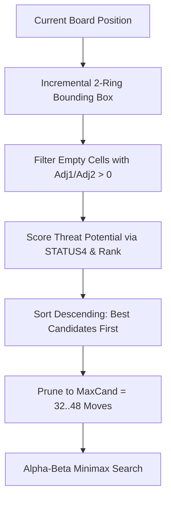

# Chapter 6: Minimax Search & Move Ordering

## 6.1 The Gomoku Branching Problem
On a standard $15 \times 15$ Gomoku board with 225 intersections, unpruned minimax search exhibits an astronomical branching factor. Searching 6 plies deep would require evaluating over $200^6 \approx 64 \text{ trillion}$ leaf states.

Carbon AI solves this problem by combining:
1. **Aggressive Move Pruning (`GenerateCand`)**
2. **Fail-Soft Alpha-Beta with Negamax Formulation**
3. **Iterative Deepening with Time Management**
4. **Zobrist Transposition Table Cutoffs**

---

## 6.2 Candidate Generation (`GenerateCand`)
Rather than scanning the entire board, Carbon tracks candidate squares incrementally:
1. **Bounding Box:** Maintains `UpperLeftCand` and `LowerRightCand` expanded by a margin of 2 cells around all played stones.
2. **Adjacency Rings:** Each cell maintains `Adj1` (adjacent 8-neighbors) and `Adj2` (distance-2 ring of 16 neighbors). Only cells with `Adj1 != 0` or `Adj2 != 0` are evaluated.
3. **Threat Scoring:**
   $$\text{Score} = \text{Rank}[\text{who}] + \text{Rank}[\text{opp}] + \text{Prior}$$
   Moves that simultaneously build friendly threats while disrupting opponent threats receive the highest score.
4. **Top-K Truncation:** Only the top $K$ candidates (bounded by `MaxCand`, typically 32 to 64) are generated.

---

## 6.3 Iterative Deepening
`CarbonAiPlayer` searches iteratively from depth $d = 2, 4, 6, \dots$ up to the requested maximum depth or until time expires:
- The principal variation (PV) move from depth $d-1$ is evaluated first at depth $d$, guaranteeing optimal alpha-beta cutoffs.
- A periodic node counter checks `Environment.TickCount64` against `_stopTime`. If time expires, the search unwinds cleanly and the best move from the last completed iteration is returned.
- This provides responsive move times under any time control (e.g. 5 seconds per move).

