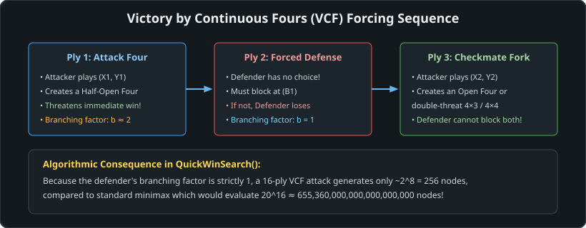
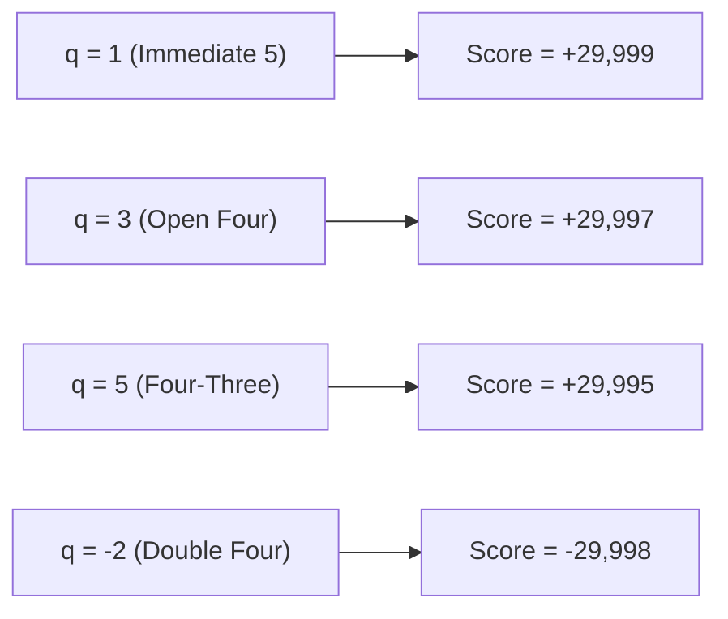

# 07 – Tactical VCF search

[Back to the index](README.md)

## In short

In Gomoku, tactical combinations often resolve into forced sequences that span 10 to 30 plies. Standard minimax search bounded at depth $d = 8\text{ to }12$ would fail to see the conclusion of these lines, resulting in either catastrophic blind spots or tactical horizon effects.

Carbon Gomoku solves this by decoupling tactical mate verification from positional search via **Victory by Continuous Fours (VCF)** and the `QuickWinSearch()` engine. VCF is a sequence of moves where the attacking side creates an active Four on every turn, forcing the defender to block on their immediate reply ($b_{\text{defender}} = 1$), culminating in Five-in-a-row.



---

## The tactical threat hierarchy

Every pattern formation detected across the 4 discrete ray axes by `STATUS4` corresponds to a tactical threat grade:


| Threat Grade | Internal Constant | Geometric Formation | Tactical Impact |
|---|:---:|---|---|
| **Five in a row** | `ThreatA` (8) | $\times \times \times \times \times$ | Immediate terminal victory. |
| **Open Four** | `ThreatB` (7) | $\cdot \times \times \times \times \cdot$ | Both ends open. Opponent cannot block both; win in 1 move. |
| **Four-Three Fork** | `ThreatC` (6) | $\times \times \times \times \cdot \land \cdot \times \times \times \cdot$ | Simultaneous Four and Open Three threats. Decisive win. |
| **Blocked Four** | `ThreatD` (5) | $\circ \times \times \times \times \cdot$ | One end blocked. Opponent must block the remaining open end. |
| **Open Three** | `ThreatE` (4) | $\cdot \times \times \times \cdot$ | Threatens to become Open Four on next move. |
| **Double-Three** | `ThreatF` (3) | $\cdot \times \times \times \cdot \land \cdot \times \times \times \cdot$ | Two simultaneous open three threats. |
| **Renju Foul** | `ThreatForbid` (9)| Overline, 3x3, 4x4 | Illegal for Black under Renju rules. |

---

## The `QuickWinSearch` algorithm

`QuickWinSearch` is invoked at the start of every node in minimax. It performs a fast recursive branch-and-bound search that checks whether the current player can force a win or is facing an unavoidable loss:

```csharp
private int QuickWinSearch(BitboardPatternBoard pb)
{
    int who = (int)pb.Who;
    int opp = (int)pb.Opp;

    // 1. Immediate win available
    if (pb.GetNSt(who, CarbonTables.ThreatA) >= 1) return 1;

    // 2. Opponent has double five threat: cannot block both
    if (pb.GetNSt(opp, CarbonTables.ThreatA) >= 2) return -2;

    // 3. Opponent has a single four threat: must block
    if (pb.GetNSt(opp, CarbonTables.ThreatA) == 1)
    {
        for (int y = pb.UpperLeftCand.Y; y <= pb.LowerRightCand.Y; y++)
        {
            for (int x = pb.UpperLeftCand.X; x <= pb.LowerRightCand.X; x++)
            {
                ref BitboardPatternBoard.Cell c = ref pb.GetCell(x, y);
                if (c.Piece == PieceColor.Empty && c.GetStatus4(opp) == CarbonTables.ThreatA)
                {
                    // In Renju, Black cannot defend if the blocking cell is a foul
                    if (pb.Variant == GomokuVariant.Renju && pb.Who == pb.FirstPlayer &&
                        c.GetStatus4(who) == CarbonTables.ThreatForbid)
                    {
                        return -2;
                    }

                    pb.MakePaddedMove(x, y);
                    int q = -QuickWinSearch(pb);
                    pb.UndoMove();
                    if (q < 0) q--; else if (q > 0) q++;
                    return q;
                }
            }
        }
    }

    // 4. Open four creates unstoppable win in 3 plies
    if (pb.GetNSt(who, CarbonTables.ThreatB) >= 1) return 3;

    // 5. Four-Three fork: test if opponent has counter-threats
    if (pb.GetNSt(who, CarbonTables.ThreatC) >= 1)
    {
        if (pb.GetNSt(opp, CarbonTables.ThreatB) == 0 &&
            pb.GetNSt(opp, CarbonTables.ThreatC) == 0 &&
            pb.GetNSt(opp, CarbonTables.ThreatD) == 0 &&
            pb.GetNSt(opp, CarbonTables.ThreatE) == 0)
        {
            return 5;
        }

        // Branch into VCF attack candidate moves
        for (int y = pb.UpperLeftCand.Y; y <= pb.LowerRightCand.Y; y++)
        {
            for (int x = pb.UpperLeftCand.X; x <= pb.LowerRightCand.X; x++)
            {
                ref BitboardPatternBoard.Cell c = ref pb.GetCell(x, y);
                if (c.Piece == PieceColor.Empty && c.GetStatus4(who) == CarbonTables.ThreatC)
                {
                    pb.MakePaddedMove(x, y);
                    int q = -QuickWinSearch(pb);
                    pb.UndoMove();
                    if (q > 0) return q + 1;
                }
            }
        }
    }

    // 6. Double-Three fork without opponent counter-threats
    if (pb.GetNSt(who, CarbonTables.ThreatF) >= 1)
    {
        if (pb.GetNSt(opp, CarbonTables.ThreatB) == 0 &&
            pb.GetNSt(opp, CarbonTables.ThreatC) == 0 &&
            pb.GetNSt(opp, CarbonTables.ThreatD) == 0 &&
            pb.GetNSt(opp, CarbonTables.ThreatE) == 0)
        {
            return 5;
        }
    }

    return 0; // No tactical mate found; resume positional minimax
}
```

---

## Return value semantics & score mapping

`QuickWinSearch()` returns a signed integer $q$:

$$q = \begin{cases}
+k & \text{Forced win in } k \text{ plies for the side to move} \\
-k & \text{Forced loss in } k \text{ plies for the side to move} \\
0  & \text{No forced mate found at this node}
\end{cases}$$

When $q \neq 0$, the minimax search does not evaluate leaf positions or expand candidate moves. Instead, it converts $q$ into an exact tactical mate score:

$$\text{Minimax Score} = \begin{cases}
+\text{WinMax} - q = 30000 - q & \text{if } q > 0 \text{ (Attacker)} \\
-\text{WinMax} - q = -30000 - q & \text{if } q < 0 \text{ (Defender)}
\end{cases}$$



Because shorter win sequences yield higher scores ($29999 > 29997 > 29995$), minimax naturally selects the fastest path to victory. Conversely, for a losing position, longer sequences yield higher (less negative) scores ($-29995 > -29998$), causing the AI to resist tenaciously and maximize defensive distance.

---

## Branching factor collapse

In standard midgame search, branching factor $b \approx 10\text{ to }25$. During tactical VCF execution:

1. **Attacker Branching:** Attacker only considers moves creating `ThreatC` (Four-Three) or `ThreatD` (Continuous Four) $\implies b_{\text{attacker}} \approx 1\text{ to }3$.
2. **Defender Branching:** Defender is forced to block `ThreatA` (Five) $\implies b_{\text{defender}} = 1$.
3. **Double-Threat Termination:** If the attacker creates two simultaneous Four threats (`NSt[opp, ThreatA] >= 2`), defender branching is $0$ (loss proven immediately).

This drops the average branching factor over the VCF tree to:
$$\bar{b}_{\text{VCF}} = \sqrt{b_{\text{attacker}} \times b_{\text{defender}}} \approx \sqrt{2 \times 1} \approx 1.41$$

At $\bar{b} \approx 1.41$, a 14-ply VCF tree comprises only $1.41^{14} \approx 128$ nodes, evaluated in under $0.2\text{ milliseconds}$.

---

## Worked example: 5-ply VCF combination

Consider Black to move with stones forming a dispersed setup:
- Black stones at **G8, H8, I8** (open three along row 8)
- Black stone at **J7** (forming a diagonal knight relationship)

```
        F   G   H   I   J   K
    10  .   .   .   .   .   .
     9  .   .   .   .   .   .
     8  .   ●   ●   ●   .   .  <-- Open Three (row 8)
     7  .   .   .   .   ●   .
     6  .   .   .   .   .   .
```

1. **Ply 1 (Black):** Black plays **F8**.
   - Row 8 becomes a Blocked Four: $\cdot \times \times \times \times \circ$ (`ThreatD`).
   - `NSt[Black, ThreatA] = 1` targeting **J8**.
2. **Ply 2 (White):** White is forced to play **J8** to block Five.
   - White has no choice: $b_{\text{defender}} = 1$.
3. **Ply 3 (Black):** Black plays **J9**.
   - Black creates an intersecting Four along column J with **J7, J8, J9** (`ThreatD`), while simultaneously opening a diagonal threat with **H7, I8, J9** (`ThreatB`).
   - This constitutes a **Four-Three Fork** (`ThreatC`).
4. **Ply 4 (White):** White attempts to block column J at **J10**.
5. **Ply 5 (Black):** Black plays **K10**, completing an open four along the diagonal.
   - White cannot block both ends; Black wins.

`QuickWinSearch` recognizes this forced sequence at the root node in under $0.5\text{ ms}$, returning $q = 5$ and directing minimax to play **F8** instantly.

---

## Renju foul defenses & traps

Under Renju rules, Black is forbidden from playing Double-Three (3x3), Double-Four (4x4), or Overline ($6+$ stones). This creates unique tactical defense dynamics:

1. **Foul Trap as Defense:**
   If White creates a Four that Black can only block by playing into a square that forms a 3x3 or 4x4 foul for Black, Black is forbidden from making the move:
   ```csharp
   if (_pb.Variant == GomokuVariant.Renju && _pb.Who == _pb.FirstPlayer &&
       c.GetStatus4(who) == CarbonTables.ThreatForbid)
   {
       return -2; // Cannot defend due to forbidden square
   }
   ```
   White wins immediately because Black cannot legally defend.
2. **Attacker Verification:**
   When Black is attacking with VCF, any offensive candidate move that is forbidden by Renju rules is rejected immediately, preventing false-positive win detection.

---

## Data structures

| Member | Type | Memory | Role |
|---|---|:---:|---|
| `PatternBoard.NSt` | `int[2, 10]` | 80 bytes | Real-time threat counters by player and threat category |
| `PatternBoard.Cell.GetStatus4` | `byte` | 1 byte | Cell threat classification (`ThreatA` through `ThreatForbid`) |
| `CarbonTables.ThreatA` | `const byte = 8` | Inlined | Constant for Five in a row threat |
| `CarbonTables.ThreatB` | `const byte = 7` | Inlined | Constant for Open Four threat |
| `CarbonTables.ThreatC` | `const byte = 6` | Inlined | Constant for Four-Three fork threat |
| `CarbonTables.ThreatForbid` | `const byte = 9` | Inlined | Constant for Renju forbidden foul move |

---

## Where in the code

| File | Member / Method | Description |
|---|---|---|
| [CarbonBitboardAiPlayer.cs](https://github.com/cjp-dev/Gomoku/blob/main/src/Gomoku.Core/AI/CarbonBitboardAiPlayer.cs) | `QuickWinSearch()` | Primary 1D bitboard VCF mate solver returning ply distance $q$ |
| [CarbonAiPlayer.cs](https://github.com/cjp-dev/Gomoku/blob/main/src/Gomoku.Core/AI/CarbonAiPlayer.cs) | `QuickWinSearch()` | Reference recursive VCF mate solver returning ply distance $q$ |
| [CarbonAiPlayer.cs](https://github.com/cjp-dev/Gomoku/blob/main/src/Gomoku.Core/AI/CarbonAiPlayer.cs) | `Minimax()` | Evaluates $q$ at root and internal nodes, assigning $[\text{WinMin}, \text{WinMax}]$ |
| [PatternBoard.cs](https://github.com/cjp-dev/Gomoku/blob/main/src/Gomoku.Core/Engine/PatternBoard.cs) | `NSt` | Live $2 \times 10$ threat state tensor updated incrementally on make/undo |
| [CarbonTables.Generated.cs](https://github.com/cjp-dev/Gomoku/blob/main/src/Gomoku.Core/AI/CarbonTables.Generated.cs) | `ThreatA` .. `ThreatForbid` | Canonical tactical threat status constants |

---

## Tests

- [AiTests.cs](https://github.com/cjp-dev/Gomoku/blob/main/tests/Gomoku.Core.Tests/AiTests.cs):
  - `Ai_FindsImmediateWin`: verifies AI detects and plays $q = 1$ five-in-a-row.
  - `Ai_BlocksOpponentWinningMove`: verifies AI detects opponent $q = -1$ threat and plays the forced block.
  - `Ai_ExecutesOpenFourWin`: verifies AI plays open four ($q = 3$) for an unstoppable win.

---

## Further reading

- Allis, L. V. (1994). *Victory by Continuous Fours*. In *Searching for Solutions in Games and Artificial Intelligence*, Chapter 6.
- Sakata, E., & Ikawa, W. (1981). *Five-in-a-Row (Renju)*. The Ishi Press, Tokyo.
- Chen, W. (2005). *Threat-Space Search and Proof-Number Search in Connect6 and Gomoku*. ICGA Journal.

---

Previous: [06 Move generation and ordering](06-move-generation-and-ordering.md) · Next: [08 Midgame search](08-midgame-search.md)

