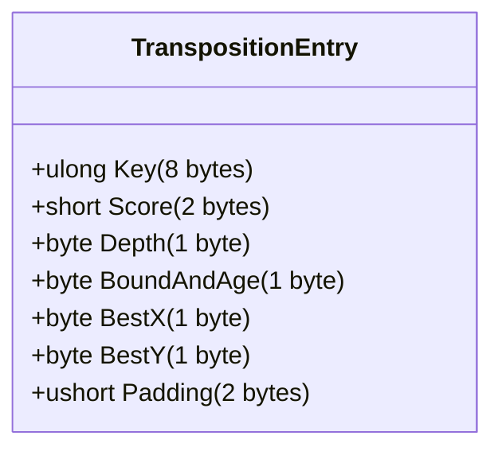

# Chapter 7: Transposition Table & Zobrist Hashing

## 7.1 Transpositions in Gomoku
Because stone placements are commutative (placing A then B reaches the exact same position as placing B then A), the search graph contains a vast number of transpositions. Without a transposition table (TT), identical board positions are re-searched hundreds of times across different branches.

---

## 7.2 Zobrist Hashing
The board state is hashed using 64-bit Zobrist keys:
- A $2 \times 64 \times 32$ array of pseudo-random 64-bit integers generated via a deterministic PRNG seeded with `0x474F4D4F` ("GOMO").
- When a stone is placed or undone, the hash is updated incrementally in $O(1)$ time:
  $$\text{Hash}_{\text{new}} = \text{Hash}_{\text{old}} \oplus \text{ZobristKey}[p, x, y]$$

---

## 7.3 Memory Layout: The 16-Byte Aligned Entry
Each entry in the Transposition Table occupies exactly **16 bytes** (two 64-bit quadwords), fitting cleanly into CPU cache lines without struct padding overhead:

- **Bits 0..1 of `BoundAndAge`:** Bound type (`Exact`, `LowerBound`, `UpperBound`).
- **Bits 2..7 of `BoundAndAge`:** Generation Age $(0..63)$, incremented on each new search.

### Sizing and Fast Indexing
The table size is strictly constrained to powers of two ($2^{16}$ to $2^{24}$ entries):
- **1,048,576 entries (default):** Exactly $16 \text{ MiB}$ of RAM.
- **Fast Masking:** The index is computed using a single bitwise AND:
  $$\text{Index} = \text{Key} \ \& \ (\text{Capacity} - 1)$$
  This avoids the expensive modulo division operator (`%`), achieving over **39 million probe operations per second**.

### Replacement Policy
When a hash collision occurs at a slot:
1. If the existing entry is empty or has the same key $\implies$ **Overwrite**.
2. If the existing entry belongs to an older search age $\implies$ **Overwrite** (stale entry).
3. If the new search depth is greater than or equal to the stored depth $\implies$ **Overwrite** (deeper information is superior).
4. Otherwise $\implies$ **Retain** the existing deeper entry.

