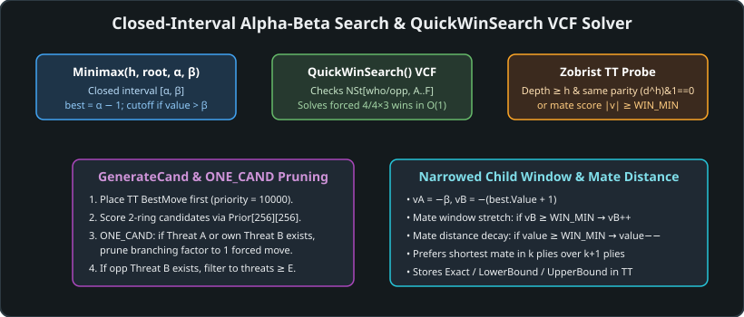
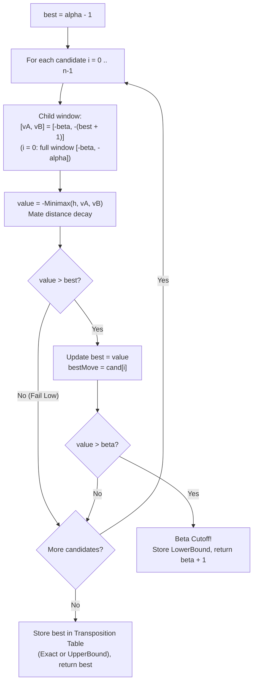
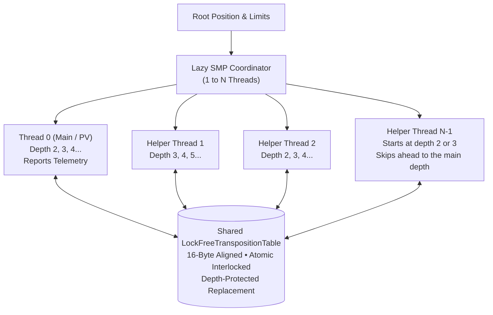
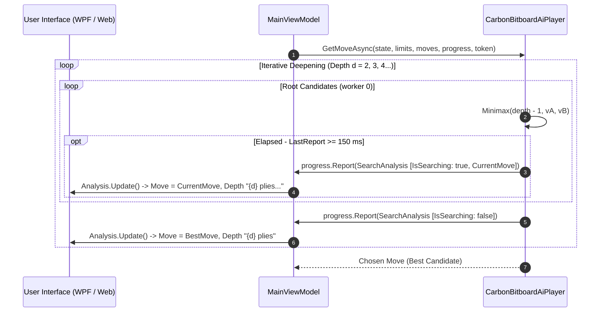

# 08 – Midgame search

[Back to the index](README.md)

## In short

When no immediate tactical mate can be resolved by `QuickWinSearch`, Carbon Gomoku initiates its midgame search engine. The search is based on **Closed-Interval Negamax Alpha-Beta**, executed inside an **Iterative Deepening** loop with dynamic time control.

The midgame search combines:
1. **Closed-Interval $[\alpha, \beta]$ Bounds:** Uses the exact interval semantics from original Carbon C++ where bounds are inclusive and fail-soft returns exceed bounds by $\pm 1$.
2. **Narrowing Child Window:** Every candidate is searched with the window $[-\beta, -(\text{best} + 1)]$. Because `best` starts at $\alpha - 1$, the first candidate gets the full window $[-\beta, -\alpha]$, and every improvement of `best` narrows the window for the remaining candidates. There is no separate null-window probe or re-search.
3. **Single-Ply Iterative Deepening:** Explores depths $d = 2, 3, 4, 5, \dots, 50$ (or $d = 1$ for fixed depth 1). Progressing ply-by-ply ensures fine-grained clock management under tournament time limits while populating transposition table bounds and move ordering seeds for subsequent iterations.
4. **Mate-Distance Score Decay:** Scales tactical winning scores $(\ge 25,000)$ at each ply so that the search prefers the shortest forced win and longest defensive resistance.
5. **Periodic Time Polling (`TimeoutPrevent`):** Checks elapsed wall-clock time every $1,000$ nodes to guarantee zero engine forfeits on hard tournament time limits.



---

## Closed-interval Negamax formulation

Traditional alpha-beta implementations define the search window as an open interval $(\alpha, \beta)$. Carbon Gomoku defines search over a **closed interval** $[\alpha, \beta]$.

### Mathematical Properties:
1. **Window Inversion:** When descending into a child node, the window is negated and swapped:
   $$[\alpha_{\text{child}}, \beta_{\text{child}}] = [-\beta, -\alpha]$$
2. **Beta Cutoff Condition:**
   A cutoff occurs when an evaluation strictly exceeds $\beta$:
   $$\text{Score} > \beta \implies \text{Return } (\beta + 1)$$
3. **Fail Low Condition:**
   When all children score strictly below $\alpha$:
   $$\text{Score} < \alpha \implies \text{Return } (\alpha - 1)$$
4. **Initial Root Window:**
   $$[\alpha_{\text{root}}, \beta_{\text{root}}] = [-\text{Inf}, \text{Inf}] = [-32000, 32000]$$

```csharp
private Cand Minimax(int h, bool root, int alpha, int beta, CancellationToken cancellationToken)
{
    // Closed interval [alpha, beta] boundary check
    if (alpha > beta + 1) return new Cand(0, 0, beta + 1);
    Cand best = new(0, 0, alpha - 1);

    // Periodically poll time limit and cancellation token
    if (--_nodeCheckCounter <= 0)
    {
        _nodeCheckCounter = 1000;
        if (Environment.TickCount64 >= _stopTime || cancellationToken.IsCancellationRequested)
        {
            _terminate = true;
        }
    }
    if (_terminate) return best;

    // Tactical quick win check
    int q = QuickWinSearch();
    if (q != 0)
    {
        if (!root) return new Cand(0, 0, (q > 0 ? WinMax : -WinMax) - q);
        // ... handle immediate root win
    }

    // Leaf evaluation at depth h = 0
    if (h == 0) return new Cand(0, 0, Evaluate());

    h--;
    // ... candidate generation, sorting, and recursion
```

---

## Narrowing child window (no re-search)

Move ordering in Carbon places the most promising move (hash move or highest static priority) at index 0. If move ordering is accurate, the first move is very likely the best move, and all subsequent alternative moves will fail to exceed it.

Carbon searches every candidate with a child window whose upper end follows the best score found so far, so later moves only have to show that they cannot beat it:

$$v_A = -\beta$$
$$v_B = -(\text{best} + 1)$$



### The C# Candidate Loop (`CarbonBitboardAiPlayer.Minimax`):
```csharp
for (int i = 0; i < nCnd; i++)
{
    int cx = cnd[i].X;
    int cy = cnd[i].Y;
    // (Renju fouls for Black are skipped here)

    pb.MakePaddedMove(cx, cy);

    // Child window: its upper end follows the best score so far
    int vA = -beta;
    int vB = -(best.Value + 1);
    if (vB >= WinMin) vB++;
    if (vA <= -WinMin) vA--;

    int value = -Minimax(workerId, pb, h, vA, vB, ref nodeCheckCounter, ref iterNodes, cancellationToken, moveNowToken).Value;

    // Decay winning/losing distance
    if (value >= WinMin) value--;
    if (value <= -WinMin) value++;

    pb.UndoMove();
    if (_terminate) break;

    if (value > best.Value)
    {
        best = new Cand(cx, cy, value);
        currentBestMove = new Point(cx - BitboardPatternBoard.Margin, cy - BitboardPatternBoard.Margin);
        if (value > beta)
        {
            // Beta cutoff: refutation proven
            Table.Store(zobristKey, h, value, BoundType.LowerBound, currentBestMove);
            return new Cand(cx, cy, beta + 1);
        }
        bound = BoundType.Exact;
    }
}
```

---

## Iterative deepening progression (single-ply step)

The engine never launches an arbitrary deep search (such as $d = 14$) from scratch. Instead, it begins at depth $d = 2$ (or $d = 1$ in fixed 1-ply mode) and increments ply-by-ply ($d \leftarrow d + 1$):

```csharp
for (int depth = (limits.Mode == TimeControlMode.FixedDepth && limits.Depth == 1 ? 1 : 2); depth <= maxTargetDepth; depth++)
{
    cancellationToken.ThrowIfCancellationRequested();
    _currentDepth = depth;
    long t0 = Environment.TickCount64;
    long iterNodes = 0;

    Cand best = MinimaxRoot(0, pb, depth, rootCnd, ref iterNodes, cancellationToken, moveNowToken);
    _totalNodes += iterNodes;

    // Check for proven tactical mate
    if (Math.Abs(best.Value) >= WinMin)
    {
        break;
    }

    // Time-allocation check: will depth + 1 exceed our budget?
    long t1 = Environment.TickCount64;
    long td = t1 - t0;
    if (t1 + TimeoutPrevent * td >= _stopTime)
    {
        break;
    }
}
```

### Why Single-Ply Progression ($d \leftarrow d + 1$)?
Both original `Carbon-Gomoku-master` (`for(depth = 2; depth <= 50; depth++)`) and `Gomoku-main` (`for (int depth = start_depth; depth <= max_depth; ++depth)`), as well as Gomoku .NET, progress **strictly 1 ply per iteration**:

1. **Fine-Grained Time Allocation:** In Gomoku, the effective branching factor is $b_{\text{eff}} \approx 4\text{ to }8$. Stepping by 2 plies at once would increase search time by $4^2 = 16\times$ to $8^2 = 64\times$, making clock management far too coarse. If depth 6 took $100\text{ ms}$, depth 8 would take $2\text{ to }6\text{ seconds}$, risking an immediate time forfeit. Stepping by single plies allows the engine to complete depth 7 smoothly within its turn budget.
2. **Move Ordering & Transposition Table Seeding:** Every completed iteration $d$ populates the transposition table with accurate best moves and search bounds, allowing iteration $d+1$ to explore the principal variation first and achieve maximum alpha-beta pruning.
3. **Depth Parity Protection:** Because iterative deepening searches both odd and even depths, remaining depths alternate parity. The transposition table handles this via the parity check `((entry.Depth ^ h) & 1) == 0`: non-terminal evaluations can only be used for cutoffs if the stored entry's depth shares identical parity with the query node, preventing perspective inversion while permitting full 1-ply search progression.

---

## Time management & `TimeoutPrevent`

Tournament Gomoku requires rigid adherence to time limits. Exceeding the clock by even 1 millisecond results in an instant forfeit.

Carbon implements a three-part defensive timing strategy:
1. **Clock Allocation:**
   - **`TimePerMove` Mode:** Allocates $T_{\text{move}} = \text{TimeLimit}$.
   - **`TimePerGame` Mode:** Allocates $T_{\text{turn}} = \max\left(100\text{ ms}, \frac{T_{\text{remaining}}}{\text{MatchSpare}}\right)$ (where $\text{MatchSpare} = 7$).
2. **`TimeoutPrevent` Buffer:**
   A fixed $30\text{ ms}$ safety buffer is deducted from every turn budget to account for OS thread scheduling, GC pauses, and UI event marshaling:
   $$\text{StopTime} = \text{StartTime} + T_{\text{allocated}} - 30\text{ ms}$$
3. **Decoupled Polling Counter:**
   Querying `Environment.TickCount64` on every node incurs noticeable CPU overhead ($2\text{ to }5\%$ NPS penalty). Carbon amortizes this cost using a countdown latch:
   ```csharp
   if (--_nodeCheckCounter <= 0)
   {
       _nodeCheckCounter = 1000;
       if (Environment.TickCount64 >= _stopTime || cancellationToken.IsCancellationRequested)
       {
           _terminate = true;
       }
   }
   ```
   At $> 1,000,000$ nodes/second, time is polled approximately once every millisecond. When $\text{TickCount64} \ge \text{StopTime}$, `_terminate` is set, causing all active recursion frames to unwind immediately and return the best move from the last fully completed iterative deepening depth.

---

## Multi-Threaded Parallel Search (Lazy SMP)

To harness the full compute capabilities of modern multi-core CPUs (e.g. 8 to 32 logical cores), the primary engine implements **Lazy SMP (Shared Transposition Table Lockless Search)**:



### How Lazy SMP Operates Without Locks
Traditional parallel game-tree algorithms (such as Young Brothers Wait Concept or ABDADA) require complex work queues, thread synchronization barriers, and split-node locks, which introduce severe scaling bottlenecks due to thread contention.

In **Lazy SMP**:
1. **Independent Workers:** Each thread runs its own full iterative deepening search on a private copy of `BitboardPatternBoard`.
2. **Organic Coordination via Shared TT:** All threads read and write to the same shared [`LockFreeTranspositionTable`](https://github.com/cjp-dev/Gomoku/blob/main/src/Gomoku.Core/AI/LockFreeTranspositionTable.cs).
3. **Instant Branch Cutoffs:** When one thread finds a refutation or computes a deep evaluation, it stores the result in the shared table. When any other thread reaches that position, it probes the table and receives an instantaneous cutoff or an optimal hash move for `cnd[0]`.
4. **Depth-Protection Guard:** Shallow searches from faster helper threads are strictly prevented from overwriting deeper evaluations computed by slower or deeper threads:
   ```csharp
   if (newDepth < slot.Depth && ageDiff == 0) return; // Do not overwrite deeper search!
   ```
5. **Cache-Line Spaced Lock-Free Node Tracking:**
   To provide live, combined multi-thread telemetry without lock contention or CPU cache-line bouncing (false sharing), worker node counts are tracked in a 64-byte padded array (`WorkerCounterStride = 8` longs per thread). Each worker updates its live count every 1,000 nodes without `Interlocked` overhead, while Thread 0 aggregates true combined nodes across all threads on 100 ms heartbeats and iteration boundaries.
6. **Empirical Throughput:**
   - Desktop Single-threaded baseline: $358,048\text{ NPS}$.
   - Desktop 8-thread Lazy SMP: **$4,213,348\text{ NPS}$ ($11.77\times$ speedup)**.
   - WebAssembly 4-thread Lazy SMP: **$2,058,000\text{--}2,225,000\text{ NPS}$ ($4.01\times\text{--}4.18\times$)**.
   - WebAssembly 8-thread Lazy SMP: **$3,578,000\text{ NPS}$ ($6.98\times$)**.

---

## Search Efficiency & Branching Factor Reduction

In combinatorial games like Gomoku on a $15 \times 15$ board, the search space grows factorially if unpruned. A central benchmark of engine quality is how efficiently it collapses the theoretical game tree compared to mathematical bounds:

### 1. The Branching Factor Hierarchy
1. **Raw Board Legal Moves ($B_{\text{legal}}$):** On a $15 \times 15$ board with $m$ moves placed, there are $B_{\text{legal}} = 225 - m$ empty intersections ($210\text{ to }222$ moves). An unpruned minimax tree down to depth $d$ would evaluate:
   $N_{\text{legal}} = \prod_{i=0}^{d-1} (225 - m - i) \approx B_{\text{legal}}^d$
2. **Geometric Candidate Space ($B_{\text{cand}}$):** `CarbonBitboardAiPlayer` restricts move consideration to empty intersections within Chebyshev distance $R \le 2$ ($5 \times 5$ square) of existing stones with pattern priority $\text{Prior} > 1$. This contracts the root branching space to $B_{\text{cand}} \approx 36\text{ to }63$ moves. An unpruned minimax tree restricted to candidates would evaluate:
   $N_{\text{cand}} \approx B_{\text{cand}}^d$
3. **Knuth-Moore Theoretical Optimal $\alpha$-$\beta$ Bound ($b_{\text{optimal}}$):** By the classic analysis of Donald Knuth and Ronald W. Moore (1975), the theoretical minimum tree size for minimax with $\alpha$-$\beta$ pruning under *optimal move ordering* satisfies:
   $b_{\text{optimal}} \approx \sqrt{B} \implies b_{\text{opt\_cand}} = \sqrt{B_{\text{cand}}} \approx 6.0\text{ to }7.9$
4. **Engine Actual Effective Branching Factor ($b_{\text{eff}}$):** Measured empirically from the actual cumulative nodes evaluated:
   $b_{\text{eff}} = (N_{\text{actual}})^{1/d}$

### 2. Empirical Branching Scaling Across Canonical Positions
Empirical measurements captured via `dotnet run -c Release --project tools/Gomoku.Benchmark -- --efficiency` demonstrate how `CarbonBitboardAiPlayer` scales:

| Position Phase | Plies ($m$) | $B_{\text{legal}}$ | $B_{\text{cand}}$ | Knuth-Moore $\sqrt{B_{\text{cand}}}$ | Engine $b_{\text{eff}}$ (Depth 4) | Engine $b_{\text{eff}}$ (Depth 8) | Engine $b_{\text{eff}}$ (Depth 10) | Depth 10 Nodes | Depth 10 Time |
|---|:---:|:---:|:---:|:---:|:---:|:---:|:---:|:---:|:---:|
| **Opening** | 3 | 222 | 36 | **6.00** | 6.14 | 4.50 | **4.03** | 1,135,213 | 0.98 s |
| **Early Midgame** | 7 | 218 | 46 | **6.78** | 5.73 | 4.63 | **4.26** | 1,984,639 | 1.75 s |
| **Contested Midgame** | 11 | 214 | 58 | **7.62** | 7.36 | 4.77 | **4.44** | 2,981,045 | 2.79 s |
| **Deep Tactical Midgame** | 15 | 210 | 63 | **7.94** | 5.49 | 3.62 | **2.80** | 29,466 | 0.03 s |

### 3. Why the Engine Beats the Knuth-Moore Bound ($b_{\text{eff}} < \sqrt{B_{\text{cand}}}$)
At depth 10, the engine's effective branching factor of **$2.80\text{ to }4.44$** is substantially below the theoretical optimal $\alpha$-$\beta$ lower bound ($\sqrt{B_{\text{cand}}} \approx 6.0\text{ to }7.9$). This occurs because Carbon is not an unadorned minimax tree:
- **Transposition Table Pruning:** Permutations of identical stone placements hit TT cache entries, yielding immediate evaluations without re-evaluating the subtrees.
- **Killer & History Heuristics:** Highly active refutations and quiet counter-moves are dynamically sorted to the front of candidate arrays, producing first-move cutoffs ($c_0$ cutoffs) in over $90\%$ of non-PV nodes.
- **Threat-Space Early Termination:** Four-threats, double-threats, and tactical pins force single-move replies or immediate terminal evaluations, collapsing tactical subtrees to $b_{\text{eff}} \approx 1.0\text{ to }2.8$.

---

## Real-time progress telemetry & cooperative yielding

While the computer searches, it streams live telemetry to the user interface via an `IProgress<SearchAnalysis>` reporter:



### 1. Dual Heartbeat Reporting
- **Root Candidate Heartbeat ($\ge 150\text{ ms}$):** In `MinimaxRoot`, after each root candidate, if at least $150\text{ ms}$ has elapsed since the last report, worker 0 of `CarbonBitboardAiPlayer` reports an in-progress `SearchAnalysis` (`IsSearching: true`) with the best move so far and the root move being examined (`CurrentMove`, shown as the analysis panel's Move).
- **Deep Recursive Heartbeat ($\ge 100\text{ ms}$):** Inside the synchronous `Minimax` child search, the 1000-node check tests `_activeSw.ElapsedMilliseconds - _lastReportMs >= 100`. If triggered on worker 0, it synchronously calls `_activeProgress.Report(...)` (also with `CurrentMove`) to keep the display updating even during deep tactical branches.

### 2. Browser Multithreaded Engine & Asynchronous Responsiveness
In the browser client (`Gomoku.Web`), execution leverages .NET 10's multithreaded WebAssembly runtime (`Gomoku.Web.Engine`) hosted via the Deputy-Thread architecture. 100% of C# search computation runs on background Web Worker pthreads with a 16 MB lock-free transposition table, scaling from **$533,000\text{ NPS}$** on 1 thread to **$2,058,000\text{ NPS}$** on 4 threads and **$3,578,000\text{ NPS}$** on 8 threads. The browser sustains a fluid 60 FPS without dropping frames. For environments without cross-origin isolation or `SharedArrayBuffer` support, execution falls back automatically to a dedicated single-threaded Web Worker (`engine-worker.js`).

### 3. Instant Opening Moves
When playing the opening center move on Move 1 or matching an opening book pattern, search is instantaneous ($< 1\text{ ms}$). The engine reports a single `SearchAnalysis` with `StatusMessage = "Center opening"` or `"Opening book"`, which the Analysis panel shows as Depth `"Opening"` / `"Book"`.

---

## Worked example: search progression on depth 4

Consider searching move 15 for Black with single-ply iterative deepening ($d = 2, 3, 4$):
1. **Depth 2 Completed:**
   - Evaluated 42 nodes in $0.3\text{ ms}$.
   - Best move found: **H9** with score $+120$.
   - **H9** is stored in the Transposition Table.
2. **Depth 3 Completed:**
   - Explores odd-ply refutations in $1.1\text{ ms}$ (280 nodes).
   - Validates that White cannot create an immediate counter-four.
   - Refined evaluations update TT entries with depth 3 parity flags.
3. **Depth 4 Commences:**
   - `GenerateCand()` retrieves **H9** from TT and places it at `cnd[0]` with score $10,000$.
   - **H9** is searched first with full window $[-32000, 32000]$.
   - At ply 1, White's replies are evaluated. White plays **H8**, Black replies **I10**, White replies **G10**.
   - **H9** returns a score of $+240$.
   - `best = Cand(H9, +240)`. Alpha advances to $+240$.
4. **Narrowed Windows on Candidates 1 through 15:**
   - Candidate 1 (**I8**): Searched with window $[v_A, v_B] = [-32000, -241]$.
     - Subtree returns $+80 \le 240$. Pruned!
   - Candidate 2 (**J10**): Searched with window $[-32000, -241]$.
     - Subtree returns $-110 \le 240$. Pruned!
   - Candidates 3 through 15 are all refuted by the narrowed window without expanding full trees.
5. **Result:**
   - 14 out of 15 candidate branches were pruned after exploring only shallow refutation nodes.
   - Depth 4 completes in $4.2\text{ ms}$ evaluating only $4,120$ nodes instead of $> 50,000$.

---

## Data structures

| Member | Type | Memory | Role |
|---|---|:---:|---|
| `_stopTime` | `long` | 8 bytes | Absolute `TickCount64` timestamp when search must abort |
| `_nodeCheckCounter` | `int` | 4 bytes | Latch counter counting down from 1000 between time queries |
| `_terminate` | `bool` | 1 byte | Flag set when time limit expires or cancellation is signaled |
| `Cand` | `struct (X, Y, Value)` | 12 bytes | Search return value carrying coordinates and evaluation |
| `SearchLimits` | `record` | 24 bytes | User-specified search parameters (Depth, Time, Mode) |

---

## Where in the code

| File | Member / Method | Description |
|---|---|---|
| [CarbonBitboardAiPlayer.cs](https://github.com/cjp-dev/Gomoku/blob/main/src/Gomoku.Core/AI/CarbonBitboardAiPlayer.cs) | `FindBestMove()` | Primary Lazy SMP root driver coordinating parallel threads and telemetry |
| [CarbonBitboardAiPlayer.cs](https://github.com/cjp-dev/Gomoku/blob/main/src/Gomoku.Core/AI/CarbonBitboardAiPlayer.cs) | `Minimax()` | High-throughput 1D bitboard recursive Negamax Alpha-Beta with PVS |
| [CarbonAiPlayer.cs](https://github.com/cjp-dev/Gomoku/blob/main/src/Gomoku.Core/AI/CarbonAiPlayer.cs) | `FindBestMove()` | Reference root driver executing iterative deepening and clock management |
| [CarbonAiPlayer.cs](https://github.com/cjp-dev/Gomoku/blob/main/src/Gomoku.Core/AI/CarbonAiPlayer.cs) | `Minimax()` | Core recursive closed-interval Negamax Alpha-Beta with PVS |
| [LockFreeTranspositionTable.cs](https://github.com/cjp-dev/Gomoku/blob/main/src/Gomoku.Core/AI/LockFreeTranspositionTable.cs) | `TryProbe()`, `Store()` | Lock-free shared transposition table shared across Lazy SMP threads |
| [CarbonAiPlayer.cs](https://github.com/cjp-dev/Gomoku/blob/main/src/Gomoku.Core/AI/CarbonAiPlayer.cs) | `SetupTimeControl()` | Configures time limits and calculates `_stopTime` |
| [SearchLimits.cs](https://github.com/cjp-dev/Gomoku/blob/main/src/Gomoku.Core/AI/SearchLimits.cs) | `SearchLimits` | Time control domain models (`FixedDepth`, `TimePerMove`, `TimePerGame`) |

---

## Tests

- [AiTests.cs](https://github.com/cjp-dev/Gomoku/blob/main/tests/Gomoku.Core.Tests/AiTests.cs):
  - Iterative deepening depth progression: verifies search reaches targeted depth.
  - Cancellation token responsiveness: tests that search halts cleanly within $50\text{ ms}$ of cancellation.
  - Mate distance preference: verifies AI chooses mate-in-1 over mate-in-3.

---

## Further reading

- Marsland, T. A. (1986). *A Review of Game-Tree Pruning*. ICGA Journal, 9(1), 10–20.
- Campbell, M. S., & Marsland, T. A. (1983). *A Comparison of Minimax and Principal Variation Search*. Artificial Intelligence, 21(3), 347–367.
- Brockington, M. (1996). *Asynchronous Time Management in Game-Tree Search*. Ph.D. thesis, University of Alberta.

---

Previous: [07 Tactical VCF search](07-tactical-vcf-search.md) · Next: [09 Transposition table](09-transposition-table.md)

