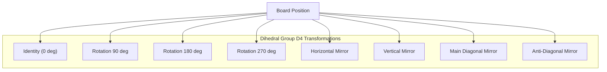

# Chapter 8: Dihedral Opening Book & Symmetry Transformations

## 8.1 The Gomoku Opening Problem
Opening theory in Gomoku is critical. Early moves determine the tempo of the entire match. Carbon Gomoku contains a compact, master-level opening database of **67 distinct pattern clusters** stored in `data[]` in `AICarbonMove.cpp`.

---

## 8.2 The Dihedral Group $D_4$ (8 Board Symmetries)
To avoid redundantly storing 8 orientations of the same opening, the database stores each position in a canonical orientation. At runtime, the engine tests all 8 symmetries of the Dihedral Group $D_4$ (4 orthogonal rotations $\times$ 2 reflections):

| Flip Index | Transformation $(x, y) \to (x', y')$ | Geometric Meaning |
| :---: | :---: | :--- |
| **0** | $(x, y)$ | Identity (Original orientation) |
| **1** | $(y, x)$ | Reflection across diagonal $y = x$ |
| **2** | $(x, -y)$ | Horizontal axis reflection |
| **3** | $(y, -x)$ | $90^\circ$ Clockwise rotation |
| **4** | $(-x, y)$ | Vertical axis reflection |
| **5** | $(-y, x)$ | $270^\circ$ Clockwise ($90^\circ$ CCW) rotation |
| **6** | $(-x, -y)$ | $180^\circ$ Rotation |
| **7** | $(-y, -x)$ | Reflection across anti-diagonal |

---

## 8.3 Coordinate Relative Offsets
The database records positions not in absolute board coordinates (like $H8$), but relative to the bounding box center of existing stones:
- Move 0: The AI directly plays the geometric center (`Size.Center`, e.g. $H8$ on 15x15, $J10$ on 19x19).
- Moves 1..6: The engine extracts the played stones, normalizes their coordinates around $(x_0, y_0)$, and matches against the 67 patterns across all 8 flips.
- If a pattern matches, one of the recorded candidate responses is selected pseudo-randomly to vary play.
- Once the game moves beyond the book (typically after move 4 to 8), control transitions seamlessly to `CarbonAiPlayer`.

