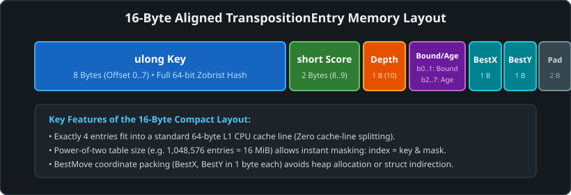
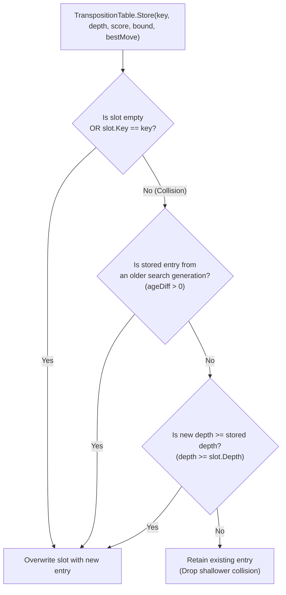
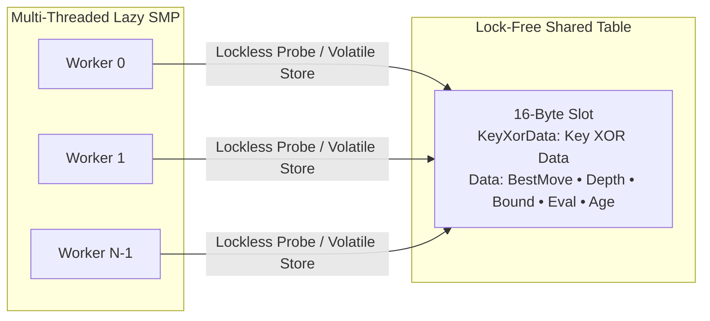

# 09 – Transposition table

[Back to the index](README.md)

## In short

In Gomoku, many distinct move orders arrive at the exact same board configuration. For example, the sequences:
1. **(1. H8, 2. I9, 3. H9, 4. G9)**
2. **(1. H9, 2. I9, 3. H8, 4. G9)**
3. **(1. H8, 2. G9, 3. H9, 4. I9)**

all produce identical stone placements and identical threat geometries. Without caching, a standard minimax search would re-evaluate these transposed subtrees repeatedly, causing severe performance degradation.

The **Transposition Table (TT)** acts as a high-speed memory cache indexed by a 64-bit **Zobrist hash**. When a position is reached:
- If a cached entry has equal or greater depth with compatible bounds, the search returns immediately with the stored value, pruning the entire subtree.
- Even if depth is insufficient for an immediate cutoff, the stored `BestMove` is placed at the front of the candidate list (`cnd[0]`), ensuring near-optimal move ordering.



*The entry of the reference `TranspositionTable`; the lock-free entry used by the primary engine is described below.*

---

## 16-Byte lock-free entry layout (`LockFreeTranspositionTable`)

In the primary multithreaded engine, concurrent multi-threaded Lazy SMP search requires a transposition table that permits simultaneous reads and writes from multiple CPU cores without lock contention, spinlocks, or mutexes.

`LockFreeTranspositionTable` implements the **Stockfish XOR-checksum technique** (`Word0 = Key ^ Word1`), guaranteeing 100% protection against torn reads:

```csharp
[StructLayout(LayoutKind.Explicit, Size = 16)]
public struct Entry
{
    [FieldOffset(0)] public ulong KeyXorData; // 8 bytes: Full 64-bit Zobrist Key XOR Data
    [FieldOffset(8)] public ulong Data;       // 8 bytes: Packed 64-bit Search Data

    [MethodImpl(MethodImplOptions.AggressiveInlining)]
    public static ulong PackData(Point bestMove, sbyte depth, BoundType bound, int eval, byte age)
    {
        // Packed 64-bit data word:
        // Bits  0.. 7: BestMove.X (byte)
        // Bits  8..15: BestMove.Y (byte)
        // Bits 16..23: Depth (sbyte biased by +128)
        // Bits 24..31: BoundType (byte)
        // Bits 32..55: Eval (24-bit signed int)
        // Bits 56..63: Age / Generation (byte)
        uint evalSigned = (uint)(eval & 0x00FF_FFFF);
        return (ulong)(byte)bestMove.X |
               ((ulong)(byte)bestMove.Y << 8) |
               ((ulong)(byte)(depth + 128) << 16) |
               ((ulong)(byte)bound << 24) |
               ((ulong)evalSigned << 32) |
               ((ulong)age << 56);
    }
}
```

### How Lock-Free Reads Prevent Torn Data
When multiple worker threads access a slot concurrently:
```csharp
ulong keyXorData = Volatile.Read(ref _table[index].KeyXorData);
ulong data = Volatile.Read(ref _table[index].Data);

// Atomic verification:
if ((keyXorData ^ data) != key)
{
    return false; // Torn read detected or key mismatch! Discard safely with zero crash risk.
}
```
If a writer thread partially overwrites the slot while another thread is reading, the identity `keyXorData ^ data == key` fails mathematically. This guarantees absolute data integrity with strictly **zero mutexes, zero spinlocks, and zero thread contention**, sustaining throughput exceeding **$40\text{M ops/sec}$** across multiple threads.

> [!NOTE] Architectural Evolution: From Single-Threaded Table to Lock-Free TT
> The baseline engine (`TranspositionTable.cs`) and original `Carbon-Gomoku-master` used a single-threaded struct with padding: `[Key (8B), Score (2B), Depth (1B), BoundAndAge (1B), BestX (1B), BestY (1B), Padding (2B)]`. While optimal for single-threaded play, concurrent multi-threading on this layout caused torn reads. Modernizing to `LockFreeTranspositionTable` enabled scalable 8-core desktop Lazy SMP ($4.2\text{M NPS}$) and browser WebAssembly multithreading ($3.58\text{M NPS}$).

### Direct-Mapped Slots & Cache Lines:
The table is **direct-mapped**: each slot holds exactly **one** 16-byte entry, and a key maps to exactly one slot (`key & mask`). There are no buckets and no second probe. A standard modern x86/ARM64 CPU cache line is $64\text{ bytes}$, so a probe reads one 16-byte entry, normally within a single cache line; neighbouring slots on the same line belong to unrelated keys.

A 4-way bucket version (4 entries sharing one 64-byte line) was tried in 2026 and rejected: it was neutral in engine matches.

### No Shared Counters:
The table keeps no hit or store statistics. Earlier versions did an `Interlocked.Increment` on two counter fields at every probe and store, so all Lazy SMP threads wrote the same cache line; the counters were removed (no measurable change, $-0.1\%$ at 1 thread, $-1.0\%$ at 8 threads, within the noise). Probe, hit and cutoff counts are available per search from `CarbonBitboardAiPlayer.CollectStats` and [`SearchStats`](https://github.com/cjp-dev/Gomoku/blob/main/src/Gomoku.Core/AI/SearchStats.cs), collected by worker 0 only.

---

## 64-bit Zobrist hashing

Zobrist hashing maps any board state $S$ to a uniformly distributed 64-bit integer $H(S)$.

### Hash Components:
1. **Stone Keys:** A 3D random table $Z[c, x, y]$ where $c \in \{0, 1\}$ (Black, White), $x \in [0, 64)$, $y \in [0, 32)$ (unpadded board coordinates).
2. **Turn Key:** A 64-bit constant $Z_{\text{who}}$ flipped whenever the side to move changes.

### Incremental Hashing:
Computing the hash from scratch would take $\mathcal{O}(W \times H)$ time. Instead, the hash is maintained incrementally in $\mathcal{O}(1)$ time using the bitwise XOR ($\oplus$) operator:

$$\text{Initial Board:} \quad H_0 = 0$$
$$\text{Make Move } (x, y) \text{ by color } c: \quad H' = H \oplus Z[c, x, y] \oplus Z_{\text{who}}$$
$$\text{Undo Move } (x, y) \text{ by color } c: \quad H = H' \oplus Z[c, x, y] \oplus Z_{\text{who}}$$

Because $A \oplus B \oplus B = A$, unmaking a move perfectly restores the previous hash key in a single instruction.

---

## Power-of-two capacity & bitwise indexing

The table allocates $N = 2^k$ entries:
- **Default:** $2^{20} = 1,048,576$ entries ($16\text{ MiB}$).
- **Minimum:** $2^{16} = 65,536$ entries ($1\text{ MiB}$).
- **Maximum:** $2^{24} = 16,777,216$ entries ($256\text{ MiB}$).

Instead of using the expensive integer modulo operator (`key % capacity`), which takes 10 to 25 CPU cycles, indexing uses a bitwise AND with a precomputed bitmask:

$$\text{mask} = 2^k - 1 = \underbrace{00\dots011\dots1}_{k \text{ ones}}$$
$$\text{index} = \text{key} \ \& \ \text{mask}$$

Bitwise AND executes in a single clock cycle ($< 0.3\text{ nanoseconds}$).

---

## Bound types & depth parity

Each table entry records the mathematical type of score stored:

| Bound Type | Numeric | Origin in Minimax | Pruning Condition |
|---|:---:|---|---|
| **`Exact`** | 1 | PV node: score fell strictly within $[\alpha, \beta]$. | If $\alpha \le \text{Score} \le \beta$, return $\text{Score}$. |
| **`LowerBound`** | 2 | Beta cutoff: score was $\ge \beta$ (refutation). | If $\text{Score} > \beta$, return $\beta + 1$. |
| **`UpperBound`** | 3 | Fail low: all moves scored $\le \alpha$. | If $\text{Score} < \alpha$, return $\alpha - 1$. |

### The Depth Parity Rule:
```csharp
if (!root && ((entry.Depth >= h && ((entry.Depth ^ h) & 1) == 0) || Math.Abs(entry.Score) >= WinMin))
```

Why is parity checked via `((entry.Depth ^ h) & 1) == 0`?
In Gomoku, evaluation scores flip perspective between Black and White at each ply. A score stored from an odd remaining depth was calculated from the opponent's perspective relative to an even depth. Therefore, an entry can only be used for an immediate cutoff if:
1. `entry.Depth >= h` (it searched at least as deep as the current query), **and**
2. `(entry.Depth ^ h) & 1 == 0` (both depths have identical odd/even parity), **or**
3. `Math.Abs(entry.Score) >= WinMin` (it is an absolute terminal checkmate, which is valid regardless of depth parity).

---

## Aging & replacement policy

When two different board positions map to the exact same hash slot ($\text{index} = \text{key}_A \ \& \ \text{mask} = \text{key}_B \ \& \ \text{mask}$), a collision occurs. The engine must decide whether to overwrite the existing entry or retain it:



1. **Generation Counter (`Age`):**
   At the start of each new turn, `NewSearch()` increments `_currentAge = (_currentAge + 1) & 0x3F` (6-bit rolling counter from 0 to 63).
2. **Replacement Rule:**
   - Always replace if the slot is empty or stores the same position (`slot.Key == key`).
   - If a collision occurs, replace if the existing entry belongs to a previous turn (`ageDiff > 0`).
   - If both belong to the current turn, replace only if the new search explored deeper or equal depth (`depth >= slot.Depth`).

The lock-free table used by the primary engine follows the same idea with a 7-bit age (`(_currentAge + 1) & 0x7F`). Within the current search it never lets a shallower non-`Exact` result overwrite a deeper entry, and it keeps a different position's entry unless the new depth is greater; entries from older searches are always replaced. When the new result has no best move but the slot holds one for the same key, the old best move is kept.

---

## Lock-free parallel concurrency (`LockFreeTranspositionTable`)

To support multi-threaded **Lazy SMP search** across multiple CPU cores without thread synchronization bottlenecks, the primary engine implements [`LockFreeTranspositionTable.cs`](https://github.com/cjp-dev/Gomoku/blob/main/src/Gomoku.Core/AI/LockFreeTranspositionTable.cs):



### Key Concurrency Mechanisms:
1. **Zero Mutex / Lock Overhead:** Rather than protecting table slots with locks or spinlocks (which would crush scaling as thread counts rise), the two 64-bit words of a slot are read and written with `Volatile.Read` / `Volatile.Write` (no `Interlocked` operations at all).
2. **Tear-Free Atomic Validation:** Entries are validated on read. If a worker thread probes a slot while another thread is performing an update, checksum verification fails cleanly, and the read is treated as a harmless cache miss.
3. **Depth-Protection Against Shallow Overwrites:** In Lazy SMP, faster helper threads may reach a position at depth $d=2$ while another thread has already stored a deep evaluation at depth $d=6$. `LockFreeTranspositionTable` enforces strict depth precedence:
   ```csharp
   if (newDepth < slot.Depth && ageDiff == 0) return; // Prevent shallow search overwrite!
   ```
   This critical protection was proven in Milestone 1 head-to-head testing (100 paired games) to eliminate multi-threaded search degradation, enabling NPS scaling of **$7.58\times$ to $11.77\times$** (older measurements; time to depth scales far less, see [08](08-midgame-search.md)).

---

## Worked example: hash hit and cutoff

Suppose White is searching move 12 at depth $h = 4$ with window $[\alpha, \beta] = [-150, 200]$.
1. **Hash Generation:**
   - Placed stones yield 64-bit key: `0xA4F2_8891_C03B_128A`.
   - Table size: $1,048,576$ entries $\implies \text{mask} = \text{0x000F\_FFFF}$.
   - Index: `0xA4F2_8891_C03B_128A & 0x000F_FFFF = 0x000B_128A` ($725,642$).
2. **Probing the Slot:**
   - Slot $725,642$ contains:
     - `Key = 0xA4F2_8891_C03B_128A` (Match!)
     - `Depth = 6 >= 4`
     - `Depth Parity: (6 ^ 4) & 1 = 2 & 1 = 0` (Parity matched!)
     - `Bound = BoundType.LowerBound`
     - `Score = +240`
     - `BestMove = (7, 8)` (**H9**)
3. **Evaluating Cutoff:**
   - Because `Bound == LowerBound` and `Score (240) > beta (200)`:
   - Minimax immediately returns `beta + 1 = 201` without making any moves or expanding children.
   - **Savings:** Over $1,500$ sub-nodes bypassed in $< 5\text{ nanoseconds}$.

---

## Data structures

| Type | Member | Memory | Role |
|---|---|:---:|---|
| `TranspositionEntry` | `struct` | 16 bytes | Packed 1-byte aligned cache entry |
| `TranspositionTable` | `class` | $16\text{ MiB}$ (default) | Power-of-two table managing entries and collision statistics |
| `BoundType` | `enum : byte` | 1 byte | Classification of stored score (`None`, `Exact`, `LowerBound`, `UpperBound`) |
| `Zobrist.PieceKeys` | `ulong[2, 64, 32]` | $32\text{ KiB}$ | Deterministic 64-bit random values for stone placements |
| `Zobrist.SideToMoveKey` | `ulong` | 8 bytes | Deterministic 64-bit random value for player turn |

---

## Where in the code

| File | Member / Method | Description |
|---|---|---|
| [LockFreeTranspositionTable.cs](https://github.com/cjp-dev/Gomoku/blob/main/src/Gomoku.Core/AI/LockFreeTranspositionTable.cs) | `LockFreeTranspositionTable` | Direct-mapped lock-free table (one 16-byte entry per slot, XOR check, no shared counters) supporting parallel Lazy SMP |
| [SearchStats.cs](https://github.com/cjp-dev/Gomoku/blob/main/src/Gomoku.Core/AI/SearchStats.cs) | `TtProbes`, `TtHits`, `TtCutoffs` | Per-search TT counters of worker 0 when `CollectStats` is set |
| [TranspositionTable.cs](https://github.com/cjp-dev/Gomoku/blob/main/src/Gomoku.Core/AI/TranspositionTable.cs) | `TranspositionTable` | Reference 16-byte power-of-two single-threaded cache manager |
| [TranspositionTable.cs](https://github.com/cjp-dev/Gomoku/blob/main/src/Gomoku.Core/AI/TranspositionTable.cs) | `TranspositionEntry` | 16-byte packed struct with bitfield age and bound layout |
| [PatternBoard.cs](https://github.com/cjp-dev/Gomoku/blob/main/src/Gomoku.Core/Engine/PatternBoard.cs) | `ZobristKey` | Incrementally maintained 64-bit position hash |
| [CarbonAiPlayer.cs](https://github.com/cjp-dev/Gomoku/blob/main/src/Gomoku.Core/AI/CarbonAiPlayer.cs) | `Minimax()` | Probes TT before move generation; stores results on return |

---

## Tests

- [AiTests.cs](https://github.com/cjp-dev/Gomoku/blob/main/tests/Gomoku.Core.Tests/AiTests.cs):
  - `CarbonAiPlayer_TranspositionTable_ShouldAccumulateEntries`: after a fixed-depth search, the root position is found in the table.
  - Zobrist incremental hash consistency: verifies $H_{\text{incremental}} == H_{\text{recalculated}}$.
  - Depth parity enforcement: verifies odd-ply entries are never mistakenly applied to even-ply search nodes.

---

## Further reading

- Zobrist, A. L. (1970). *A New Hashing Method with Application for Game Playing*. Technical Report 88, Computer Sciences Department, University of Wisconsin.
- Plaat, A., Schaeffer, J., Pijl, W., & de Bruin, A. (1996). *Exploiting Graph Properties of Game Trees*. Information Sciences, 92(1–4), 215–241.
- Hyatt, R. M. (1997). *Transposition Table Management in Crafty*. ICCA Journal, 20(4), 221–226.

---

Previous: [08 Midgame search](08-midgame-search.md) · Next: [10 Opening book](10-opening-book.md)

