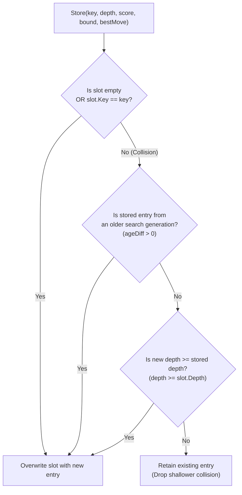

# 09 – Transposition table

[Back to the index](README.md)

## In short

In Gomoku, many distinct move orders arrive at the exact same board configuration. For example, the sequences:
1. **(1. H8, 2. I9, 3. H9, 4. G9)**
2. **(1. H9, 2. I9, 3. H8, 4. G9)**
3. **(1. H8, 2. G9, 3. H9, 4. I9)**

all produce identical stone placements and identical threat geometries. Without caching, a standard minimax search would re-evaluate these transposed subtrees repeatedly, causing severe performance degradation.

The **Transposition Table (TT)** acts as a high-speed memory cache indexed by a 64-bit **Zobrist hash**. When a position is reached:
- If a cached entry has equal or greater depth with compatible bounds, the search returns immediately with the stored value, pruning the entire subtree.
- Even if depth is insufficient for an immediate cutoff, the stored `BestMove` is placed at the front of the candidate list (`cnd[0]`), ensuring near-optimal move ordering.


---

## 16-Byte packed entry layout

To minimize memory footprint and maximize CPU L1/L2 cache efficiency, `TranspositionEntry` is packed into a sequential 16-byte struct:

```csharp
[StructLayout(LayoutKind.Sequential, Pack = 1)]
public struct TranspositionEntry
{
    public ulong Key;          // 8 bytes: 64-bit full Zobrist hash key
    public short Score;        // 2 bytes: clamped evaluation [-32000, 32000]
    public byte Depth;         // 1 byte:  search depth remaining (0 to 255)
    public byte BoundAndAge;   // 1 byte:  bits 0..1: BoundType, bits 2..7: Age
    public byte BestX;         // 1 byte:  best move column (255 if none)
    public byte BestY;         // 1 byte:  best move row (255 if none)
    public ushort Padding;     // 2 bytes: alignment padding to 16 bytes

    public BoundType Bound => (BoundType)(BoundAndAge & 0x03);
    public byte Age => (byte)(BoundAndAge >> 2);
    public Point BestMove => BestX == 255 ? Point.Empty : new Point(BestX, BestY);
}
```

### CPU Cache Line Alignment:
A standard modern x86/ARM64 CPU cache line is exactly $64\text{ bytes}$. Because each entry is exactly $16\text{ bytes}$:
$$\frac{64\text{ bytes per cache line}}{16\text{ bytes per entry}} = 4\text{ entries per cache line}$$

No entry ever crosses a cache line boundary. When the CPU fetches a cache line from RAM, it brings 4 adjacent hash slots into the L1 data cache simultaneously, avoiding split-line latency.

---

## 64-bit Zobrist hashing

Zobrist hashing maps any board state $S$ to a uniformly distributed 64-bit integer $H(S)$.

### Hash Components:
1. **Stone Keys:** A 3D random table $Z[c, x, y]$ where $c \in \{0, 1\}$ (Black, White), $x \in [0, W+8)$, $y \in [0, H+8)$.
2. **Turn Key:** A 64-bit constant $Z_{\text{who}}$ flipped whenever the side to move changes.

### Incremental Hashing:
Computing the hash from scratch would take $\mathcal{O}(W \times H)$ time. Instead, the hash is maintained incrementally in $\mathcal{O}(1)$ time using the bitwise XOR ($\oplus$) operator:

$$\text{Initial Board:} \quad H_0 = 0$$
$$\text{Make Move } (x, y) \text{ by color } c: \quad H' = H \oplus Z[c, x, y] \oplus Z_{\text{who}}$$
$$\text{Undo Move } (x, y) \text{ by color } c: \quad H = H' \oplus Z[c, x, y] \oplus Z_{\text{who}}$$

Because $A \oplus B \oplus B = A$, unmaking a move perfectly restores the previous hash key in a single instruction.

---

## Power-of-two capacity & bitwise indexing

The table allocates $N = 2^k$ entries:
- **Default:** $2^{20} = 1,048,576$ entries ($16\text{ MiB}$).
- **Minimum:** $2^{16} = 65,536$ entries ($1\text{ MiB}$).
- **Maximum:** $2^{24} = 16,777,216$ entries ($256\text{ MiB}$).

Instead of using the expensive integer modulo operator (`key % capacity`), which takes 10 to 25 CPU cycles, indexing uses a bitwise AND with a precomputed bitmask:

$$\text{mask} = 2^k - 1 = \underbrace{00\dots011\dots1}_{k \text{ ones}}$$
$$\text{index} = \text{key} \ \& \ \text{mask}$$

Bitwise AND executes in a single clock cycle ($< 0.3\text{ nanoseconds}$).

---

## Bound types & depth parity

Each table entry records the mathematical type of score stored:

| Bound Type | Numeric | Origin in Minimax | Pruning Condition |
|---|:---:|---|---|
| **`Exact`** | 1 | PV node: score fell strictly within $[\alpha, \beta]$. | If $\alpha \le \text{Score} \le \beta$, return $\text{Score}$. |
| **`LowerBound`** | 2 | Beta cutoff: score was $\ge \beta$ (refutation). | If $\text{Score} > \beta$, return $\beta + 1$. |
| **`UpperBound`** | 3 | Fail low: all moves scored $\le \alpha$. | If $\text{Score} < \alpha$, return $\alpha - 1$. |

### The Depth Parity Rule:
```csharp
if (!root && ((entry.Depth >= h && ((entry.Depth ^ h) & 1) == 0) || Math.Abs(entry.Score) >= WinMin))
```

Why is parity checked via `((entry.Depth ^ h) & 1) == 0`?
In Gomoku, evaluation scores flip perspective between Black and White at each ply. A score stored from an odd remaining depth was calculated from the opponent's perspective relative to an even depth. Therefore, an entry can only be used for an immediate cutoff if:
1. `entry.Depth >= h` (it searched at least as deep as the current query), **and**
2. `(entry.Depth ^ h) & 1 == 0` (both depths have identical odd/even parity), **or**
3. `Math.Abs(entry.Score) >= WinMin` (it is an absolute terminal checkmate, which is valid regardless of depth parity).

---

## Aging & replacement policy

When two different board positions map to the exact same hash slot ($\text{index} = \text{key}_A \ \& \ \text{mask} = \text{key}_B \ \& \ \text{mask}$), a collision occurs. The engine must decide whether to overwrite the existing entry or retain it:



1. **Generation Counter (`Age`):**
   At the start of each new turn, `NewSearch()` increments `_currentAge = (_currentAge + 1) & 0x3F` (6-bit rolling counter from 0 to 63).
2. **Replacement Rule:**
   - Always replace if the slot is empty or stores the same position (`slot.Key == key`).
   - If a collision occurs, replace if the existing entry belongs to a previous turn (`ageDiff > 0`).
   - If both belong to the current turn, replace only if the new search explored deeper or equal depth (`depth >= slot.Depth`).

---

## Worked example: hash hit and cutoff

Suppose White is searching move 12 at depth $h = 4$ with window $[\alpha, \beta] = [-150, 200]$.
1. **Hash Generation:**
   - Placed stones yield 64-bit key: `0xA4F2_8891_C03B_128A`.
   - Table size: $1,048,576$ entries $\implies \text{mask} = \text{0x000F\_FFFF}$.
   - Index: `0xA4F2_8891_C03B_128A & 0x000F_FFFF = 0x000B_128A` ($725,642$).
2. **Probing the Slot:**
   - Slot $725,642$ contains:
     - `Key = 0xA4F2_8891_C03B_128A` (Match!)
     - `Depth = 6 >= 4`
     - `Depth Parity: (6 ^ 4) & 1 = 2 & 1 = 0` (Parity matched!)
     - `Bound = BoundType.LowerBound`
     - `Score = +240`
     - `BestMove = (7, 8)` (**H9**)
3. **Evaluating Cutoff:**
   - Because `Bound == LowerBound` and `Score (240) > beta (200)`:
   - Minimax immediately returns `beta + 1 = 201` without making any moves or expanding children.
   - **Savings:** Over $1,500$ sub-nodes bypassed in $< 5\text{ nanoseconds}$.

---

## Data structures

| Type | Member | Memory | Role |
|---|---|:---:|---|
| `TranspositionEntry` | `struct` | 16 bytes | Packed 1-byte aligned cache entry |
| `TranspositionTable` | `class` | $16\text{ MiB}$ (default) | Power-of-two table managing entries and collision statistics |
| `BoundType` | `enum : byte` | 1 byte | Classification of stored score (`None`, `Exact`, `LowerBound`, `UpperBound`) |
| `_zobristTable` | `ulong[2, 28, 28]` | $12.5\text{ KiB}$ | Deterministic 64-bit random values for stone placements |
| `_zobristWho` | `ulong` | 8 bytes | Deterministic 64-bit random value for player turn |

---

## Where in the code

| File | Member / Method | Description |
|---|---|---|
| [TranspositionTable.cs](https://github.com/cjp-dev/Gomoku/blob/main/src/Gomoku.Core/AI/TranspositionTable.cs) | `TranspositionTable` | High-performance 16-byte power-of-two cache manager |
| [TranspositionTable.cs](https://github.com/cjp-dev/Gomoku/blob/main/src/Gomoku.Core/AI/TranspositionTable.cs) | `TranspositionEntry` | 16-byte packed struct with bitfield age and bound layout |
| [PatternBoard.cs](https://github.com/cjp-dev/Gomoku/blob/main/src/Gomoku.Core/Engine/PatternBoard.cs) | `ZobristKey` | Incrementally maintained 64-bit position hash |
| [CarbonAiPlayer.cs](https://github.com/cjp-dev/Gomoku/blob/main/src/Gomoku.Core/AI/CarbonAiPlayer.cs) | `Minimax()` | Probes TT before move generation; stores results on return |

---

## Tests

- [AiTests.cs](https://github.com/cjp-dev/Gomoku/blob/main/tests/Gomoku.Core.Tests/AiTests.cs):
  - Transposition table hit rate verification on symmetric openings.
  - Zobrist incremental hash consistency: verifies $H_{\text{incremental}} == H_{\text{recalculated}}$.
  - Depth parity enforcement: verifies odd-ply entries are never mistakenly applied to even-ply search nodes.

---

## Further reading

- Zobrist, A. L. (1970). *A New Hashing Method with Application for Game Playing*. Technical Report 88, Computer Sciences Department, University of Wisconsin.
- Plaat, A., Schaeffer, J., Pijl, W., & de Bruin, A. (1996). *Exploiting Graph Properties of Game Trees*. Information Sciences, 92(1–4), 215–241.
- Hyatt, R. M. (1997). *Transposition Table Management in Crafty*. ICCA Journal, 20(4), 221–226.

---

Previous: [08 Midgame search](08-midgame-search.md) · Next: [10 Opening book](10-opening-book.md)

