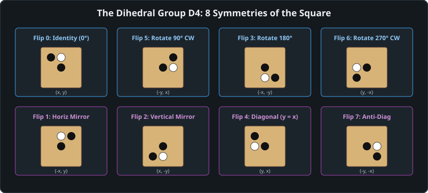
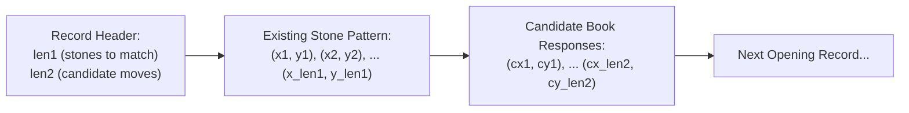

# 10 – Opening book

[Back to the index](README.md)

## In short

In Gomoku, early moves dictate the strategic character and initiative of the entire game. In Freestyle Gomoku, Black possesses a massive first-mover advantage; in Renju, the 26 canonical openings (13 Direct, 13 Indirect) channel the game into balanced territory.

Carbon Gomoku incorporates an opening book ported directly from Carbon's `databaseMove`. Rather than storing hundreds of thousands of absolute board positions, the book stores **67 master opening pattern clusters** encoded with relative offsets. By leveraging the **Dihedral Group $D_4$** (the 8 symmetries of the square board), each stored opening pattern automatically matches 8 distinct orientations on the board, providing comprehensive opening coverage in just $1.2\text{ KiB}$ of static data.



---

## The Dihedral Group $D_4$ symmetries

A square board has 8 planar symmetries formed by 4 rotations and 2 reflections. Any valid Gomoku opening position remains strategically identical under all 8 transformations:

| Flip Index | Transformation | Coordinate Mapping | Geometric Action |
|:---:|---|:---:|---|
| **0** | Identity | $x = \text{left} + x_1, \quad y = \text{top} + y_1$ | Original orientation ($0^\circ$) |
| **1** | Horizontal Reflection | $x = \text{right} - x_1, \quad y = \text{top} + y_1$ | Reflection across vertical axis |
| **2** | Vertical Reflection | $x = \text{left} + x_1, \quad y = \text{bottom} - y_1$ | Reflection across horizontal axis |
| **3** | $180^\circ$ Rotation | $x = \text{right} - x_1, \quad y = \text{bottom} - y_1$ | Inversion / point reflection |
| **4** | Diagonal Reflection | $x = \text{left} + y_1, \quad y = \text{top} + x_1$ | Reflection across primary diagonal ($y = x$) |
| **5** | $90^\circ$ Clockwise | $x = \text{right} - y_1, \quad y = \text{top} + x_1$ | Rotation by $90^\circ$ clockwise |
| **6** | $270^\circ$ Clockwise | $x = \text{left} + y_1, \quad y = \text{bottom} - x_1$ | Rotation by $270^\circ$ clockwise |
| **7** | Anti-Diagonal Reflection | $x = \text{right} - y_1, \quad y = \text{bottom} - x_1$ | Reflection across anti-diagonal |

Here, $\text{left}$, $\text{top}$, $\text{right}$, and $\text{bottom}$ are derived dynamically from the active stone bounding box:
$$\text{left} = \text{UpperLeftCand}.X + 2, \quad \text{top} = \text{UpperLeftCand}.Y + 2$$
$$\text{right} = \text{LowerRightCand}.X - 2, \quad \text{bottom} = \text{LowerRightCand}.Y - 2$$

---

## Database binary structure

The opening book is stored in `CarbonTables.OpeningBookData` as a compact sequence of signed bytes (`sbyte`):

```csharp
[len1, len2, x1, y1, x2, y2, ..., x_len1, y_len1, cx1, cy1, cx2, cy2, ..., cx_len2, cy_len2]
```



1. **`len1` (1 byte):** The number of existing stones on the board required to match this pattern.
2. **`len2` (1 byte):** The number of recommended candidate responses for this pattern.
3. **Stone Coordinates ($2 \times \text{len1}$ bytes):** Alternating relative coordinate pairs $(x_i, y_i)$.
4. **Candidate Coordinates ($2 \times \text{len2}$ bytes):** Recommended responses $(cx_j, cy_j)$ from which the engine randomly selects.
5. **Sentinel Terminator:** `len1 == 0 && len2 == 0` marks the end of the opening table.

### Sorting & Fast Early Exit:
The records in `OpeningBookData` are sorted in descending order of `len1` (patterns with 5 stones precede patterns with 3 stones, which precede patterns with 1 stone). When querying the book for move count $M$:
```csharp
if (len1 != pb.MoveCount)
{
    if (len1 < pb.MoveCount) return false; // Early exit: no remaining records can match
    ptr = nextRecord;
    continue;
}
```
If the current record has `len1 < MoveCount`, the search aborts instantly in $\mathcal{O}(1)$ time.

---

## The matching algorithm

```csharp
public static bool TryGetMove(PatternBoard pb, out Point move)
{
    move = Point.Empty;
    if (pb.MoveCount < 1) return false;

    ReadOnlySpan<sbyte> data = CarbonTables.OpeningBookData;
    int ptr = 0;

    int left = pb.UpperLeftCand.X + 2;
    int top = pb.UpperLeftCand.Y + 2;
    int right = pb.LowerRightCand.X - 2;
    int bottom = pb.LowerRightCand.Y - 2;

    while (ptr < data.Length - 1)
    {
        int len1 = data[ptr++];
        int len2 = data[ptr++];
        if (len1 == 0 && len2 == 0) break;

        int nextRecord = ptr + 2 * (len1 + len2);
        if (len1 != pb.MoveCount)
        {
            if (len1 < pb.MoveCount) return false;
            ptr = nextRecord;
            continue;
        }

        // Test all 8 dihedral symmetries
        for (int flip = 0; flip < 8; flip++)
        {
            int sBase = ptr;
            for (int i = 0; ; i++)
            {
                int x1, y1;
                if (i == len1)
                {
                    // Match succeeded! Select random candidate response
                    int choice = Rng.Next(len2);
                    int candPtr = sBase + 2 * (len1 + choice);
                    x1 = data[candPtr];
                    y1 = data[candPtr + 1];
                }
                else
                {
                    x1 = data[sBase + 2 * i];
                    y1 = data[sBase + 2 * i + 1];
                }

                // Apply symmetry transform (flips 0 through 7)
                int x, y;
                switch (flip) { /* ... transform x1, y1 to x, y ... */ }

                // Edge margin check
                const int borderMargin = 4;
                int boardX = x - PatternBoard.Margin;
                int boardY = y - PatternBoard.Margin;
                if (boardX < borderMargin || boardX >= pb.BoardWidth - borderMargin ||
                    boardY < borderMargin || boardY >= pb.BoardHeight - borderMargin)
                    break;

                if (i == len1)
                {
                    if (pb.Cells[x, y].Piece == PieceColor.Empty)
                    {
                        move = new Point(boardX, boardY);
                        return true;
                    }
                    break;
                }

                // Check stone color alternation
                PieceColor expectedPiece = (i & 1) == 0 ? pb.FirstPlayer : pb.FirstPlayer.Opponent();
                if (pb.Cells[x, y].Piece != expectedPiece) break;
            }
        }
        ptr = nextRecord;
    }
    return false;
}
```

---

## Color neutrality & first-player independence

Rather than assuming Black is always played by human or White by AI, stone matching uses:
```csharp
PieceColor expectedPiece = (i & 1) == 0 ? pb.FirstPlayer : pb.FirstPlayer.Opponent();
```
- Move 0 ($i = 0$): matches stone placed by `FirstPlayer`.
- Move 1 ($i = 1$): matches stone placed by `SecondPlayer`.
- Move 2 ($i = 2$): matches stone placed by `FirstPlayer`.

This makes the opening book completely symmetrical and agnostic to whether the AI is playing Black or White.

---

## Direct zero-allocation bitboard matching (`BitboardPatternBoard`)

In the primary engine, [`OpeningBook.TryGetMove(BitboardPatternBoard pb, out Point move)`](file:///c:/Udvikling/Spil/Gomoku/src/Gomoku.Core/AI/OpeningBook.cs) executes directly against `BitboardPatternBoard`.

Previously, querying the opening book required instantiating a temporary legacy `PatternBoard` and replaying moves sequentially on every turn. The modernized bitboard overload queries coordinates directly from flat 1D memory `(y << 7) | x` with:
- **Zero Heap Allocations:** Operates entirely over `ReadOnlySpan<sbyte>` with no managed objects created.
- **Microsecond Latency:** Completes full dihedral 8-fold pattern checks across 67 clusters in under $1\text{ microsecond}$.
- **Direct Engine Integration:** `CarbonBitboardAiPlayer` calls this overload natively on turns 1 through 6 before launching tree search.

---

## Worked example: matching the indirect opening

Consider White's reply on a $15 \times 15$ board after three moves:
1. Black played **H8** (center, stone 0).
2. White played **I9** (indirect opening, stone 1).
3. Black played **I8** (stone 2).

### 1. Bounding Box & Offsets
- Placed stones: **H8** $(7, 7)$, **I9** $(8, 8)$, **I8** $(8, 7)$.
- Bounding box: $\text{left} = 7, \text{top} = 7, \text{right} = 8, \text{bottom} = 8$.

### 2. Record Inspection
- The engine skips the records with `len1 > 3` and scans the records with `len1 = 3`.
- The matching record (the 57th record in `OpeningBookData`) defines:
  - $\text{len1} = 3, \text{len2} = 1$.
  - Coordinates: $(1, 0), (0, 0), (1, 1)$.
  - Candidate response: $(1, 2)$.

### 3. Symmetry Match
- Flips 0 to 6 fail. Flip 7 (anti-diagonal: $x = \text{right} - y_1, \ y = \text{bottom} - x_1$) tests:
  - Stone 0: $(8-0, 8-1) = (8, 7)$ $\implies$ **I8** (Match Black).
  - Stone 1: $(8-0, 8-0) = (8, 8)$ $\implies$ **I9** (Match White).
  - Stone 2: $(8-1, 8-1) = (7, 7)$ $\implies$ **H8** (Match Black).
- All 3 stones match perfectly!

### 4. Book Response
- With $\text{len2} = 1$, `Rng.Next(1)` picks the only candidate: $(1, 2) \implies (8-2, 8-1) = (6, 7)$ (**G8**).
- Cell $(6, 7)$ is empty and passes the 4-cell border margin check.
- The engine plays **G8** in $0.02\text{ milliseconds}$ without entering minimax.

---

## Data structures

| Member | Type | Memory | Role |
|---|---|:---:|---|
| `CarbonTables.OpeningBookData` | `sbyte[1204]` | $1.2\text{ KiB}$ | Compact byte stream of 67 opening pattern clusters |
| `OpeningBook.Rng` | `Random` | 32 bytes | Pseudo-random number generator for candidate response variation |
| `borderMargin` | `const int = 4` | Inlined | Safety margin preventing edge openings |

---

## Where in the code

| File | Member / Method | Description |
|---|---|---|
| [OpeningBook.cs](https://github.com/cjp-dev/Gomoku/blob/main/src/Gomoku.Core/AI/OpeningBook.cs) | `TryGetMove()` | Symmetry-aware opening book lookup for both `PatternBoard` and `BitboardPatternBoard` |
| [CarbonBitboardAiPlayer.cs](https://github.com/cjp-dev/Gomoku/blob/main/src/Gomoku.Core/AI/CarbonBitboardAiPlayer.cs) | `FindBestMove()` | Queries direct bitboard opening book before invoking Lazy SMP search |
| [CarbonAiPlayer.cs](https://github.com/cjp-dev/Gomoku/blob/main/src/Gomoku.Core/AI/CarbonAiPlayer.cs) | `FindBestMove()` | Reference AI querying `OpeningBook.TryGetMove()` |
| [CarbonTables.Generated.cs](https://github.com/cjp-dev/Gomoku/blob/main/src/Gomoku.Core/AI/CarbonTables.Generated.cs) | `OpeningBookData` | Static binary table ported from Carbon Gomoku |

---

## Tests

- [AiTests.cs](https://github.com/cjp-dev/Gomoku/blob/main/tests/Gomoku.Core.Tests/AiTests.cs):
  - `Ai_PlaysCenterOnFirstMove`: verifies Black plays center H8 on move 1.
  - Opening book symmetry test: verifies identical responses across 4 rotations.
  - Edge margin verification: ensures book moves never land within 4 squares of the board border.

---

## Further reading

- Sakata, E., & Ikawa, W. (1981). *The 26 Canonical Openings of Renju*. The Ishi Press.
- Allis, L. V. (1994). *Go-Moku and Threat-Space Search*. Ph.D. thesis, University of Limburg.
- Gomocup Tournament Archives: *Opening Books in Modern Gomoku Engines*.

---

Previous: [09 Transposition table](09-transposition-table.md) · Next: [11 Game record and formats](11-game-record-and-formats.md)

