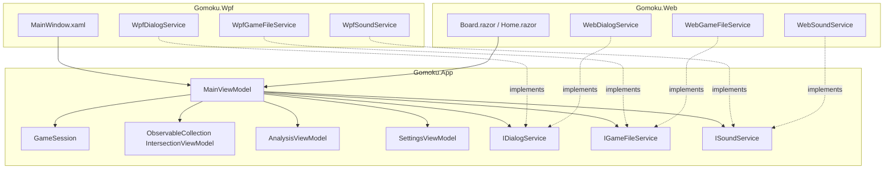

# Chapter 10: Shared MVVM Application Architecture

## 10.1 The Role of `Gomoku.App`
`Gomoku.App` serves as the single source of truth for application state, business logic, game coordination, and asynchronous AI execution. It is shared 100% without modification between the WPF desktop application and the Blazor WebAssembly browser client.

---

## 10.2 ViewModels
1. **`MainViewModel`**:
   - Manages the board state, move history, turn sequencing, and undo/redo stacks.
   - Spawns asynchronous AI searches on worker threads via `Task.Run` with `CancellationTokenSource`.
   - Dispatches real-time search telemetry to `AnalysisViewModel`.
   - Handles game over states and sound effects.
2. **`IntersectionViewModel`**:
   - Represents a single coordinate $(x, y)$ on the board.
   - Exposes properties: `Piece`, `IsStarPoint`, `IsLastMove`, `IsWinningLine`, `IsHovered`.
   - Relays user clicks to `MainViewModel.OnIntersectionClicked`.
3. **`AnalysisViewModel`**:
   - Formats search depth, evaluation score ("+1.50" or "Mate in 3"), node count, nodes per second, and elapsed time.
4. **`SettingsViewModel`**:
   - Manages board dimensions, rules, time controls, transposition table sizes, and aesthetics.

---

## 10.3 Procedural Audio Synthesis (`SoundWaves`)
To ensure zero external media dependencies, `SoundWaves.cs` procedurally generates 16-bit mono 22,050 Hz PCM audio directly in memory:
- **`StonePlaced`**: High attack decaying exponential sine sweep ($700 \to 300\text{ Hz}$ in 80 ms), authentically mimicking the snap of a slate/shell stone on a Kaya board.
- **`Win` / `Loss`**: Harmonic chord progressions synthesized with exponential dampening.
- **`IllegalMove`**: Low-frequency warning buzz.

