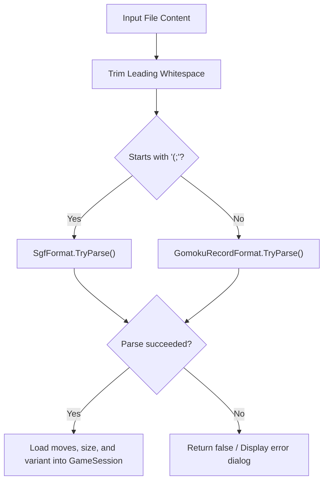
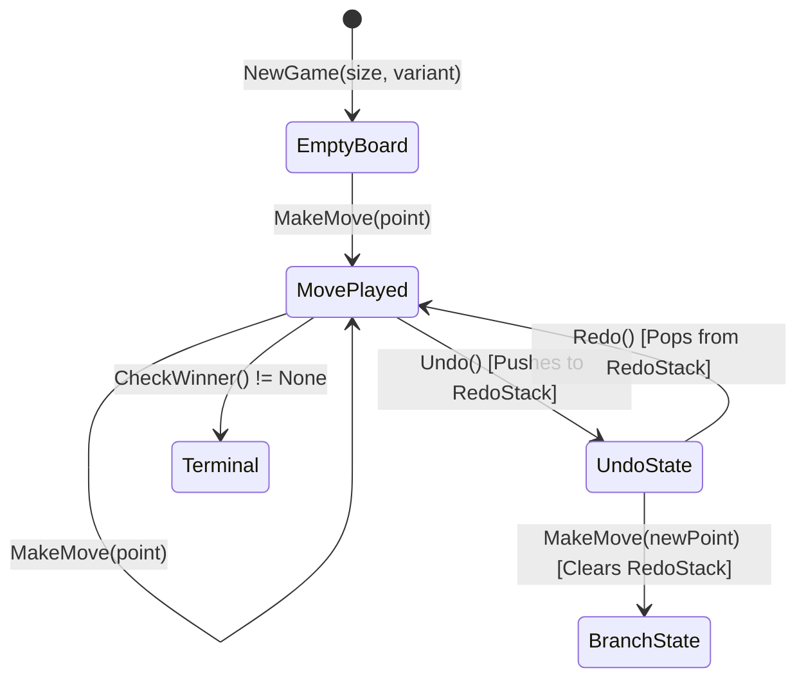

# 11 – Game record and formats

[Back to the index](README.md)

## In short

Long-term preservation, game sharing, and tournament analysis require robust, standardized serialization formats. Gomoku .NET supports two primary formats:
1. **Smart Game Format (SGF):** The international standard for board games (Game ID `GM[11]`), supported by Sabaki, Gomocup tools, and online tournament platforms.
2. **Gomoku Algebraic Record (`.gomoku` / `.txt`):** A human-readable text format with tagged bracket metadata headers (`[Size "15x15"]`, `[Variant "Renju"]`) and numbered algebraic move coordinates (`1. H8 H9 2. I9 J10`).

Both formats are unified under an auto-detecting facade (`GameFileSerializer`) and integrated directly into the `GameSession` state engine with full bidirectional undo/redo support.

---

## File format comparison

| Feature | Smart Game Format (SGF) | Gomoku Algebraic (`.gomoku`) |
|---|---|---|
| **Primary Use** | Interoperability with external viewers & Gomocup | Human reading, sharing in chat/forums, rapid editing |
| **File Extension** | `.sgf` | `.gomoku`, `.txt` |
| **Standard** | FF[4] `GM[11]` (Gomoku/Renju) | PGN-like Gomoku standard |
| **Coordinate System** | 0-indexed lowercase alpha (`aa` to `ss`) | 1-indexed algebraic (`A1` to `O15`, `S19`) |
| **Move Syntax** | `;B[hh];W[ih]` | `1. H8 I8 2. H9 ...` |
| **Metadata Syntax** | `SZ[15]RU[Renju]PB[Black]PW[White]` | `[Size "15x15"]` `[Variant "Renju"]` |

---

## Smart Game Format (SGF `GM[11]`)

SGF represents the game tree as a sequence of nodes enclosed in parentheses. Each node starts with a semicolon `;` followed by property tags and bracketed values.

```sgf
(;GM[11]FF[4]CA[UTF-8]AP[Gomoku.Net:1.0]SZ[15]RU[Renju]PB[Human]PW[Carbon AI]KM[0];B[hh];W[ii];B[hi];W[ih])
```

### Coordinate Mapping:
SGF coordinates use lowercase letters where `a` represents index 0:
$$x_{\text{sgf}} = \text{char}('a' + x), \quad y_{\text{sgf}} = \text{char}('a' + y)$$

For a $15 \times 15$ board:
- Top-left $(0, 0) \implies \text{"aa"}$
- Center $(7, 7) \implies \text{"hh"}$
- Bottom-right $(14, 14) \implies \text{"oo"}$

### SGF Serialization:
```csharp
public static string Serialize(
    IReadOnlyList<Move> moves,
    BoardSize size,
    GomokuVariant variant = GomokuVariant.Freestyle,
    string blackPlayer = "Human",
    string whitePlayer = "Carbon AI")
{
    StringBuilder sb = new();
    sb.Append("(;GM[11]FF[4]CA[UTF-8]AP[Gomoku.Net:1.0]");
    sb.Append($"SZ[{size.Width}]");
    sb.Append($"RU[{variant}]");
    sb.Append($"PB[{Escape(blackPlayer)}]");
    sb.Append($"PW[{Escape(whitePlayer)}]");
    sb.Append("KM[0]");

    foreach (Move m in moves)
    {
        char playerTag = m.Player == PieceColor.Black ? 'B' : 'W';
        sb.Append($";{playerTag}[{m.Position.ToSgfString()}]");
    }

    sb.Append(')');
    return sb.ToString();
}
```

---

## Human-readable Gomoku record (`.gomoku`)

The `.gomoku` format follows a clean, human-oriented layout modeled after chess PGN:

```text
[Game "Gomoku"]
[Size "15x15"]
[Variant "Renju"]
[Black "Grandmaster Alice"]
[White "Carbon AI"]
[Date "2026-10-17"]
[Result "1-0"]

1. H8 H9 2. I9 J10 3. G7 F6 4. I8 J8 
5. G9 F10 6. I7 I6 7. H7 G6 8. J7 K7 
9. H6 H5 10. G5 F4 11. H10
```

### Parsing Engine:
```csharp
[GeneratedRegex(@"^\[(?<key>\w+)\s+""(?<value>[^""]*)""\]$")]
private static partial Regex TagRegex();
```

1. **Tag Processing:** Lines starting with `[` are parsed via regex into a metadata dictionary (`metadata["Size"]`, `metadata["Variant"]`, etc.).
2. **Move Stream Parsing:** Move tokens are split on whitespace and punctuation (`.` and `,`). Any token matching column letter ($A\dots T$) followed by row number ($1\dots 20$) is parsed into a `Point`:
   $$\text{Column } C \implies x = C - 'A'$$
   $$\text{Row } R \implies y = R - 1$$

---

## Auto-detecting file serializer

When loading a file from disk or pasting text into the import dialog, `GameFileSerializer` inspects the initial characters to identify the format:



```csharp
public static bool TryParse(
    string fileContent,
    out IReadOnlyList<Move> moves,
    out BoardSize size,
    out GomokuVariant variant,
    out Dictionary<string, string> metadata)
{
    string trimmed = fileContent.TrimStart();
    if (trimmed.StartsWith("(;"))
    {
        return SgfFormat.TryParse(fileContent, out moves, out size, out variant, out metadata);
    }
    return GomokuRecordFormat.TryParse(fileContent, out moves, out size, out variant, out metadata);
}
```

---

## Session state & undo/redo navigation

`GameSession` manages the live game state, move history, and navigation:



### Undo/Redo Invariants:
1. **Move History Stack:** All played moves are maintained in chronological order.
2. **Redo Stack:** Whenever `Undo()` is invoked, the undone move is pushed onto a redo stack.
3. **Branching Invalidation:** If `MakeMove()` is executed while the redo stack is non-empty, the redo stack is cleared, creating a new canonical game line.
4. **Incremental Board Sync:** In `PatternBoard`, moves are rolled back via `UndoMove()`, restoring patterns, `NSt` counters, and Zobrist keys in $\mathcal{O}(1)$ time.

---

## Worked example: round-trip serialization

1. **Original Position:**
   - Board size: $15 \times 15$
   - Variant: `Renju`
   - Moves:
     - 1. Black: **H8** $(7, 7)$
     - 2. White: **I9** $(8, 8)$
     - 3. Black: **H9** $(7, 8)$

2. **Serialized to SGF:**
   ```sgf
   (;GM[11]FF[4]CA[UTF-8]AP[Gomoku.Net:1.0]SZ[15]RU[Renju]PB[Human]PW[Carbon AI]KM[0];B[hh];W[ii];B[hi])
   ```

3. **Deserialization & Verification:**
   - `SZ[15]` $\implies$ `BoardSize(15, 15)`.
   - `RU[Renju]` $\implies$ `GomokuVariant.Renju`.
   - `hh` $\implies (7, 7) \implies \text{H8}$.
   - `ii` $\implies (8, 8) \implies \text{I9}$.
   - `hi` $\implies (7, 8) \implies \text{H9}$.
   - Move count $= 3$, side to move $=$ White. The state matches the original board identically.

---

## Data structures

| Type | Member | Role |
|---|---|---|
| `SgfFormat` | `static class` | Encoder and decoder for Smart Game Format GM[11] |
| `GomokuRecordFormat` | `static class` | Encoder and decoder for `.gomoku` algebraic coordinate records |
| `GameFileSerializer` | `static class` | Format-detecting facade coordinating SGF and text parsers |
| `GameSession` | `class` | Central game coordinator managing move history and undo/redo stacks |
| `Move` | `struct (Point, PieceColor)` | Immutable record of a played stone |

---

## Where in the code

| File | Member / Method | Description |
|---|---|---|
| [SgfFormat.cs](../../src/Gomoku.Core/Formats/SgfFormat.cs) | `Serialize()`, `TryParse()` | SGF `GM[11]` parser and serializer |
| [GomokuRecordFormat.cs](../../src/Gomoku.Core/Formats/GomokuRecordFormat.cs) | `Serialize()`, `TryParse()` | Bracketed tag and algebraic move parser |
| [GameFileSerializer.cs](../../src/Gomoku.Core/Formats/GameFileSerializer.cs) | `TryParse()` | Sniffing facade distinguishing SGF from text |
| [GameSession.cs](../../src/Gomoku.Core/Models/GameSession.cs) | `Undo()`, `Redo()`, `MakeMove()` | Game session coordinator managing move stacks |

---

## Tests

- [SgfFormatTests.cs](../../tests/Gomoku.Core.Tests/SgfFormatTests.cs):
  - Round-trip fidelity: verifies serializing and parsing moves results in identical states.
  - SGF metadata extraction: tests extraction of board size, variant, and player names.
  - Malformed SGF resilience: ensures unclosed brackets and invalid characters fail gracefully without exceptions.

---

## Further reading

- Hollosi, A. (2000). *Smart Game Format (SGF) File Format FF[4] Specification*.
- European Renju Federation (2018). *Notation and Recording Standards in Renju Tournaments*.
- Gomocup Rulebook: *Standard Input/Output Formats for Gomoku Engines*.

---

Previous: [10 Opening book](10-opening-book.md) · Next: [12 App architecture and audio](12-app-architecture-and-audio.md)

