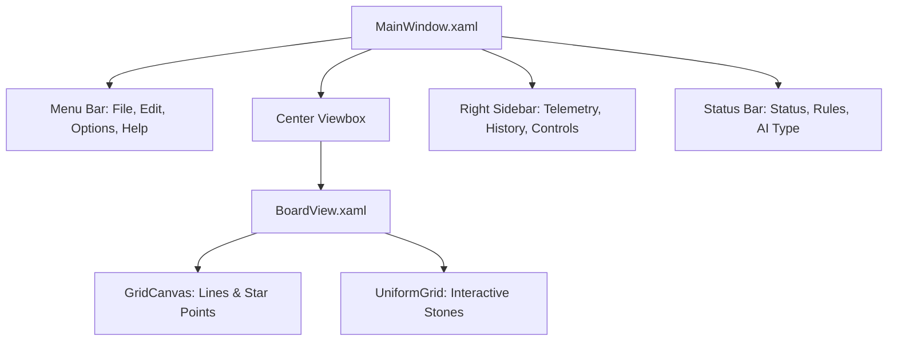

# Chapter 11: WPF Desktop Client Implementation

## 11.1 Presentation Layer Architecture
`Gomoku.Wpf` targets `net10.0-windows` and uses hardware-accelerated DirectX rendering via WPF.

---

## 11.2 The BoardView Component
The board is styled after a traditional Japanese Kaya wood board:
- **Wood Texture:** Multi-stop linear gradient from `#E8C99B` to `#D2A673` with a solid wood border `#7A5229` and drop shadow.
- **Dynamic Grid Rendering:**
  When board size changes ($15 \times 15 \to 19 \times 19 \to 20 \times 20$), `BoardView.xaml.cs` computes exact cell centers and redraws the grid lines and star points on `GridCanvas`.
- **Stone Styling:**
  - **Black Stone:** Radial gradient from `#4A4A4A` (specular highlight) down to `#0A0A0A` with drop shadow.
  - **White Stone:** Radial gradient from `#FFFFFF` down to `#D5D5D5` with subtle shadow.
- **Hover Ghost Stone:**
  Moving the mouse over an empty intersection renders a semi-transparent ghost stone matching the player to move, previewing the placement.
- **Winning Line Highlight:**
  The 5 stones forming the winning combination are highlighted with an animated golden ring (`#F39C12`).

---

## 11.3 Dialogs and Services
- **`WpfDialogService`**: Uses native WPF modal dialogs for `SettingsWindow` and `AboutWindow`.
- **`WpfGameFileService`**: Uses `Microsoft.Win32.OpenFileDialog` and `SaveFileDialog` with filter presets for SGF and Gomoku records.
- **`WpfSoundService`**: Uses `System.Media.SoundPlayer` reading in-memory WAV streams from `SoundWaves`.

