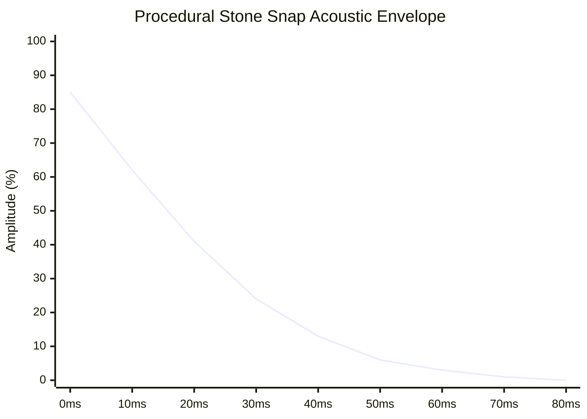

# 12 – App architecture and audio

[Back to the index](README.md)

## In short

Gomoku .NET is built upon a **Clean MVVM (Model-View-ViewModel)** architecture. To achieve maximum portability across desktop and browser environments, all state machines, view models, audio synthesizers, and game logic reside in the shared project `Gomoku.App`.

The presentation layer is strictly decoupled:
- **`Gomoku.Wpf`** binds to `Gomoku.App` using hardware-accelerated WPF XAML and native Windows audio drivers.
- **`Gomoku.Web`** binds to `Gomoku.App` using Blazor WebAssembly and HTML5 Web Audio API.

A standout architectural feature is **Procedural Audio Synthesis (`SoundWaves`)**: all acoustic sound effects (the physical snap of a stone on kaya wood, victory fanfares, foul buzzers) are synthesized algorithmically from first mathematical principles into standard 16-bit PCM WAV streams in memory, requiring zero external MP3/WAV asset files.

---

## Architectural layers & MVVM structure

```mermaid
graph TD
    subgraph Presentation Hosts
        WPF["Gomoku.Wpf (Desktop)"]
        WEB["Gomoku.Web (Blazor WASM)"]
    end

    subgraph Gomoku.App (Shared Application Layer)
        MVM["MainViewModel<br/>Game orchestration & AI dispatch"]
        IVM["IntersectionViewModel<br/>Grid cell binding & hover state"]
        AVM["AnalysisViewModel<br/>Engine evaluation & win-rate bar"]
        SVM["SettingsViewModel<br/>Board size, variant, AI difficulty"]
        AUDIO["SoundWaves<br/>Procedural 16-bit PCM synthesis"]
        SVC["Service Abstractions<br/>ISoundService • IGameFileService • IDialogService"]
    end

    subgraph Gomoku.Core (Domain Core)
        GAME["GameSession • BoardState • Move"]
        AI["CarbonAiPlayer • OpeningBook"]
        TABLES["PatternBoard • CarbonTables"]
    end

    WPF --> Gomoku.App
    WEB --> Gomoku.App
    Gomoku.App --> Gomoku.Core
```

---

## ViewModels in detail

### 1. `MainViewModel` (The Orchestrator)
`MainViewModel` coordinates user interaction, turn pacing, AI invocation, clock management, and undo/redo stacks:
- **Engine Hosting (`IEngineHost`):** AI execution is decoupled via the `IEngineHost` interface. On desktop WPF, [`LocalEngineHost.cs`](file:///c:/Udvikling/Spil/Gomoku/src/Gomoku.App/Services/LocalEngineHost.cs) manages `CarbonBitboardAiPlayer` backed by `LockFreeTranspositionTable` with user-configurable Lazy SMP multi-threading. On Blazor WebAssembly, `EngineWorker` offloads computation to a background Web Worker.
- **Asynchronous AI Execution & Search ID Guard:** AI calculations run on background threads (`Task.Run` or Web Worker). A monotonic `_searchId` counter ensures that when a search is cancelled or superseded by a new game, in-flight callbacks from the previous search are discarded.
- **Standardized 15×15 Tournament Board:** Standardizes on official $15 \times 15$ tournament geometry across all game modes, building a 225-cell grid of `IntersectionViewModel` instances with fixed board orientation.
- **Renju Real-Time Foul Overlay:** On every turn, if Renju rules are active and Black is to move, `MainViewModel` flags forbidden intersections with `IsForbidden = true`, rendering instantaneous red $\times$ markers on the UI.
- **Competitive Integrity Tracking (`IsGameModified`):** Tracks whether the match has diverged from strict tournament conditions (via Undos against AI, switching sides mid-game, adjusting settings during play, or timeout continuation). Exposes `IsStatusModified` to tint the UI `STATUS` badge crimson red (`#E74C3C`).
- **Per-Ply Clock Snapshotting & Time Refund:** Maintains an internal dictionary `_timeAtPly` that records remaining chess clock times for both players at each turn. When `Undo()` is invoked, elapsed thinking time is refunded to the exact snapshot recorded at that ply.
- **Mid-Match Safeguards:** Prompts confirmation dialogs before resetting an in-progress game when initiating New Game, switching Game Modes, or altering settings.
- **Side Switching (`SwitchSidesCommand`):** Swaps player roles between Black and White mid-game without rotating the board, seamlessly activating the AI if it becomes the computer's turn.
- **Timeout Continuation Safeguard:** In timed games against the AI, if the human runs out of time, prompts an interactive continuation dialog so casual play can proceed.

### 2. `IntersectionViewModel` (Cell Binding)
Represents a single coordinate $(x, y)$ on the board:
```csharp
public sealed partial class IntersectionViewModel : ObservableObject
{
    public int X { get; }
    public int Y { get; }
    public string CoordinateLabel { get; } // e.g. "H8"

    [ObservableProperty] private PieceColor _piece = PieceColor.Empty;
    [ObservableProperty] private bool _isHoverGhost;
    [ObservableProperty] private bool _isLastMove;
    [ObservableProperty] private bool _isWinningStone;
    [ObservableProperty] private bool _isForbidden;
    [ObservableProperty] private string _moveNumberText = "";
}
```

### 3. `AnalysisViewModel` (Real-Time Search Telemetry)
Translates engine internal `SearchAnalysis` snapshots into human-readable metrics:
- **Dynamic Depth Formatting:** Displays `"{depth} plies..."` while the engine is actively exploring a depth, `"{depth} plies"` when the iteration concludes, and `"Book"` or `"Opening"` for instant opening moves.
- **Mate Distance Detection:** Detects scores $|S| \ge 25,000$ and renders `"Mate in K"` or `"-Mate in K"`.
- **Invariant Culture Formatting:** Formats `Nodes` and `Speed` using `CultureInfo.InvariantCulture` (`142,850`), ensuring uniform display across cultures.
- **Elapsed Time Formatting:** Formats elapsed calculation time in standard stopwatch format `m\:ss\.f` (e.g. `0:00.0` or `0:01.9`).
- **Reactive UI Streaming (`Updated` Event):** Raises `public event Action? Updated;` so Blazor components can invoke `_ = InvokeAsync(StateHasChanged)` on incoming progress reports without polling.

---

## Procedural audio synthesis (`SoundWaves`)

Rather than shipping static sound files that bloat binary sizes and require complex file-path resolution across WebAssembly virtual file systems, all game sounds are synthesized on-the-fly in pure C# using mathematical waveform equations:

$$\text{Sample Rate: } f_s = 22,050\text{ Hz (16-bit mono PCM)}$$

### 1. The Stone Snap (`StoneSnap`)
Simulates the sharp, percussive impact of a clamshell or slate stone striking a solid kaya wooden board. The physical event consists of a high-frequency transient dropping rapidly in pitch under steep exponential decay:

$$f(t) = 700 - 400t\text{ Hz}$$
$$E(t) = e^{-18t}$$
$$s(t) = A \cdot E(t) \cdot \sin\left(2\pi \cdot f(t) \cdot t\right)$$

```csharp
private static short[] StoneSnap(double seconds)
{
    int count = (int)(SampleRate * seconds);
    var samples = new short[count];
    for (int i = 0; i < count; i++)
    {
        double t = (double)i / count;
        double freq = 700 - 400 * t;
        double phase = 2 * Math.PI * freq * i / SampleRate;
        double envelope = Math.Exp(-18 * t);
        samples[i] = (short)(short.MaxValue * 0.85 * envelope * Math.Sin(phase));
    }
    return samples;
}
```



### 2. Victory Arpeggio (`Notes`)
Synthesizes a bright, ascending major pentatonic chord sequence:
$$[C_5 (523.25\text{ Hz}), E_5 (659.25\text{ Hz}), G_5 (783.99\text{ Hz}), C_6 (1046.50\text{ Hz}), E_6 (1318.50\text{ Hz})]$$
Each note is modulated by an attack-decay envelope with exponential tail:
$$E_n(t) = (1 - e^{-50t}) \cdot e^{-6t}$$

### 3. Defeat Chime (`Loss`)
Descending minor chord progression:
$$[G_4 (392.00\text{ Hz}), E^\flat_4 (311.13\text{ Hz}), C_4 (261.63\text{ Hz})]$$

### 4. Illegal Move / Foul Warning (`Sweep`)
A dissonant downward frequency sweep from $220\text{ Hz}$ to $110\text{ Hz}$ producing a distinct percussive warning thud.

---

## In-memory RIFF/WAVE header assembly

Audio sample arrays (`short[]`) are packaged into valid 44-byte standard RIFF/WAVE byte buffers entirely in RAM:

```csharp
private static byte[] ToWav(short[] samples)
{
    int dataBytes = samples.Length * 2;
    var ms = new MemoryStream(44 + dataBytes);
    using (var w = new BinaryWriter(ms))
    {
        w.Write("RIFF"u8);
        w.Write(36 + dataBytes); // Total file size minus 8
        w.Write("WAVE"u8);
        w.Write("fmt "u8);
        w.Write(16);             // Sub-chunk size (16 for PCM)
        w.Write((short)1);       // Audio format (1 = PCM)
        w.Write((short)1);       // Channels (1 = Mono)
        w.Write(SampleRate);     // Sample rate (22050 Hz)
        w.Write(SampleRate * 2); // Byte rate (SampleRate * Channels * Bits/8)
        w.Write((short)2);       // Block align
        w.Write((short)16);      // Bits per sample
        w.Write("data"u8);
        w.Write(dataBytes);      // Data chunk length
        for (int i = 0; i < samples.Length; i++) w.Write(samples[i]);
    }
    return ms.ToArray();
}
```

The resulting byte arrays are cached indefinitely in a static dictionary (`SoundWaves.Cache`), ensuring zero re-allocation on subsequent sound triggers.

---

## Platform service abstractions

To keep `Gomoku.App` 100% platform-agnostic, OS-specific interactions are abstracted behind three core interfaces:

```csharp
public interface ISoundService
{
    void Play(SoundType sound);
    bool IsMuted { get; set; }
}

public interface IGameFileService
{
    Task<string?> OpenGameFileAsync();
    Task<bool> SaveGameFileAsync(string content, string defaultFileName);
}

public interface IDialogService
{
    Task ShowMessageAsync(string title, string message);
    Task<bool> ShowConfirmAsync(string title, string message);
}
```

- In **WPF**, `SoundPlayer` streams the generated WAV bytes directly into the Windows multimedia subsystem.
- In **Blazor**, `BrowserSoundService` calls JavaScript interop to decode and play the WAV bytes through an HTML5 `AudioContext`.

---

## Data structures

| Member | Type | Memory | Role |
|---|---|:---:|---|
| `MainViewModel` | `class` | $\approx 2\text{ KiB}$ | Root presentation orchestrator |
| `IntersectionViewModel` | `class` | 64 bytes | Per-cell UI state (225 to 400 instances per board) |
| `SoundWaves.Cache` | `Dictionary<SoundType, byte[]>` | $\approx 45\text{ KiB}$ | In-memory cache of pre-synthesized WAV buffers |
| `SoundType` | `enum` | 1 byte | Acoustic event type (`StonePlaced`, `Win`, `Loss`, `IllegalMove`, etc.) |

---

## Where in the code

| File | Member / Method | Description |
|---|---|---|
| [MainViewModel.cs](https://github.com/cjp-dev/Gomoku/blob/main/src/Gomoku.App/ViewModels/MainViewModel.cs) | `MainViewModel` | Central MVVM controller coordinating board, engine, and turns |
| [LocalEngineHost.cs](https://github.com/cjp-dev/Gomoku/blob/main/src/Gomoku.App/Services/LocalEngineHost.cs) | `LocalEngineHost` | Host service executing `CarbonBitboardAiPlayer` with Lazy SMP and lock-free TT |
| [IEngineHost.cs](https://github.com/cjp-dev/Gomoku/blob/main/src/Gomoku.App/Services/IEngineHost.cs) | `IEngineHost` | Engine hosting abstraction unifying desktop and browser worker backends |
| [IntersectionViewModel.cs](https://github.com/cjp-dev/Gomoku/blob/main/src/Gomoku.App/ViewModels/IntersectionViewModel.cs) | `IntersectionViewModel` | Observable cell representation for data-binding |
| [AnalysisViewModel.cs](https://github.com/cjp-dev/Gomoku/blob/main/src/Gomoku.App/ViewModels/AnalysisViewModel.cs) | `AnalysisViewModel` | Real-time AI evaluation dashboard and win-rate bar |
| [SoundWaves.cs](https://github.com/cjp-dev/Gomoku/blob/main/src/Gomoku.App/Services/SoundWaves.cs) | `SoundWaves` | Procedural 16-bit PCM WAV synthesizer |
| [ISoundService.cs](https://github.com/cjp-dev/Gomoku/blob/main/src/Gomoku.App/Services/ISoundService.cs) | `ISoundService` | Audio output abstraction implemented by WPF and Web clients |

---

## Tests

- [MainViewModelTests.cs](https://github.com/cjp-dev/Gomoku/blob/main/tests/Gomoku.App.Tests/MainViewModelTests.cs):
  - Board re-layout verification: confirms switching from 15x15 to 19x19 instantiates 361 cells.
  - Sound synthesis verification: validates that `SoundWaves.Create(SoundType.StonePlaced)` generates valid RIFF header bytes.
  - Renju forbidden cell flagging: verifies `IsForbidden` updates reactively when moves change.
  - Time refund on Undo: confirms remaining time is restored from `_timeAtPly` snapshots when moves are undone.
  - Side switching mid-match: verifies `SwitchSidesCommand` swaps player roles, flags `IsGameModified`, and preserves fixed board layout.
- [AnalysisViewModelTests.cs](https://github.com/cjp-dev/Gomoku/blob/main/tests/Gomoku.App.Tests/AnalysisViewModelTests.cs):
  - Time format verification: verifies `Time` property formats stopwatch durations as `m\:ss\.f` (e.g., `0:00.0`, `0:01.9`).

---

## Further reading

- Smith, J. O. (2010). *Physical Audio Signal Processing: For Virtual Musical Instruments and Digital Audio Effects*. W3K Publishing.
- Gamma, E., Helm, R., Johnson, R., & Vlissides, J. (1994). *Design Patterns: Elements of Reusable Object-Oriented Software* (Model-View-ViewModel pattern).
- Microsoft Docs: *CommunityToolkit.Mvvm Architecture and Observable Properties*.

---

Previous: [11 Game record and formats](11-game-record-and-formats.md) · Next: [13 UI clients](13-ui-clients.md)

