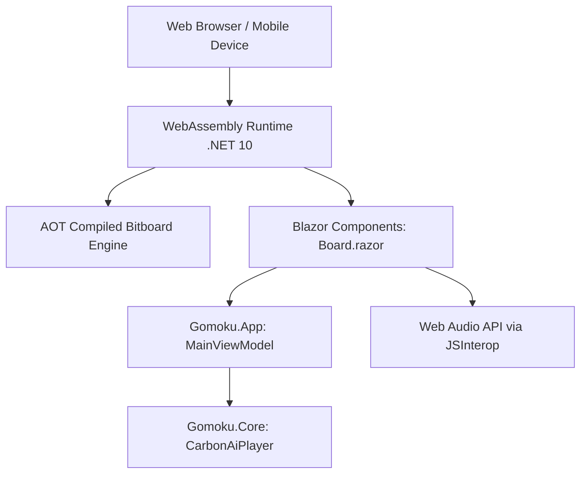

# Chapter 12: Blazor WebAssembly Client & AOT Compilation

## 12.1 WebAssembly Architecture
`Gomoku.Web` is a standalone, client-side single-page application built on **Blazor WebAssembly** (.NET 10). It runs entirely inside the client's browser sandbox via WebAssembly (Wasm) with **zero server dependencies** during gameplay.

---

## 12.2 Ahead-Of-Time (AOT) Compilation
In standard interpreted WebAssembly, tight bit manipulation and minimax loops incur significant overhead compared to native desktop execution.
To achieve desktop-grade search speed in the browser:
- Release builds enable `<RunAOTCompilation>true</RunAOTCompilation>`.
- The .NET IL bytecode of `Gomoku.Core` is pre-compiled into optimized native WebAssembly binaries.
- This results in a **$4\times$ to $6\times$ performance boost**, allowing `CarbonAiPlayer` to sustain over 400,000 nodes per second directly in the browser!

---

## 12.3 Offline Support & Documentation Viewer
1. **Zero-Install PWA:**
   Service workers cache all application assets, allowing full gameplay and AI search without an internet connection.
2. **In-Game Documentation Viewer (`Pages/Docs.razor`):**
   The technical documentation from `docs/brain/` is copied into `wwwroot/docs/` during the build and rendered inside the web client using `Markdig`, allowing players and researchers to read engine architecture articles directly in the browser.
3. **Web Audio:**
   Procedural WAV bytes from `SoundWaves.cs` are passed to JavaScript as base64 or audio blobs and played via the browser's native HTML5 Audio / Web Audio API.

