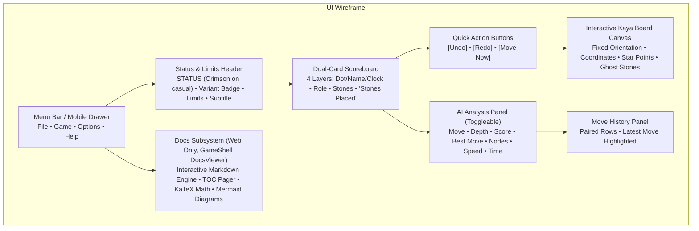

# 13 – UI clients

[Back to the index](README.md)

## In short

Gomoku .NET delivers a modern, high-fidelity user experience across two distinct presentation targets:
1. **WPF Desktop Client (`Gomoku.Wpf`):** A Windows desktop application using DirectX hardware acceleration, sub-pixel text rendering, and native OS dialog integration.
2. **Blazor WebAssembly Client (`Gomoku.Web`):** An in-browser client compiled via WebAssembly Ahead-of-Time (AOT), running 100% client-side with zero server latency, complete with a responsive SVG game board, mobile sliding drawer navigation, and embedded architectural documentation viewer.

Both clients share the exact same view models, game engine, and procedural audio synthesis from `Gomoku.App` and `Gomoku.Core`.


---

## Presentation architecture & UI layout



---

## Visual board representation (Kaya wood & stones)

Both desktop and web clients render the board with authentic Japanese Go/Renju aesthetic styling:

### 1. Kaya Wood Texture & Grid Lines
The board surface uses a multi-stop golden-amber gradient simulating aged Japanese Hon-Kaya wood:
```xml
<linearGradient id="wood-gradient" x1="0%" y1="0%" x2="100%" y2="100%">
    <stop offset="0%" stop-color="#E8C99B" />
    <stop offset="50%" stop-color="#DCB985" />
    <stop offset="100%" stop-color="#D2A673" />
</linearGradient>
```
Grid lines are drawn with double-weight borders ($2.0\text{ px}$) around the perimeter and crisp interior lines ($1.2\text{ px}$).

### 2. Star Points (Hoshi)
Star points (traditional black alignment dots, $r = 4\text{ px}$) are placed according to the active board size:
- **$15 \times 15$ Board:** 5 star points at `(3, 3), (11, 3), (7, 7), (3, 11), (11, 11)` (D4, L4, H8, D12, L12).
- **$19 \times 19$ Board:** 9 star points at traditional Go intersections (columns 4, 10, 16).
- **$20 \times 20$ Board:** 4 star points at `(4, 4), (15, 4), (4, 15), (15, 15)`.

### 3. Slate and Clamshell 3D Stones
Stones are rendered with realistic lighting gradients and drop shadows:
- **Black Stones:** Slate appearance with off-center specular reflection at $(cx = 32\%, cy = 32\%)$, transitioning from charcoal gray (`#555555`) to deep midnight black (`#080808`).
- **White Stones:** Mexican clamshell appearance with subtle off-white spherical gradient from pure white (`#FFFFFF`) to pearl cream (`#D0D0D0`).
- **Drop Shadow:** SVG `feDropShadow` filter ($dx = 2, dy = 3, \sigma = 3$) giving the physical illusion of stones resting on wood.

### 4. Invariant Fixed Board Orientation
In Gomoku, games always begin at the geometric center point (H8 on $15 \times 15$). Unlike edge-starting games such as Checkers, the board orientation remains strictly fixed and is never flipped or rotated when playing White or switching sides mid-game. Standard algebraic coordinates (A1 bottom-left, O15 top-right) remain static.

---

## Interactive board features

### 1. Hover Ghost Stones
When the player hovers the cursor over an empty intersection:
- If the intersection is a legal move, a semi-transparent ghost stone ($45\%$ opacity) of the current player's color is displayed, providing visual confirmation of placement alignment.
- When the mouse leaves the intersection or clicks to place, the ghost stone vanishes.

### 2. Renju Real-Time Foul Markers
Under Renju rules, Black is forbidden from creating Overlines, Double-Threes, or Double-Fours. When Black is to move:
- The UI scans the board using `PatternBoard.CheckForbid()`.
- Forbidden intersections are marked with a distinct red diagonal cross ($\times$).
- Clicking a marked intersection triggers the procedural illegal-move audio buzzer and displays an explanatory tooltip, preventing inadvertent fouls.

### 3. Last Move & Winning Line Highlights
- **Last Move Marker:** A contrasting circular ring or center dot indicates the most recently played stone.
- **Winning Line Highlight:** When a five-in-a-row is completed, the winning stones are encircled in glowing amber/gold rings, and the board enters terminal display mode.

---

## Blazor WebAssembly client (`Gomoku.Web`)

The web client runs entirely in the browser using WebAssembly Ahead-of-Time (AOT) compilation:
- **Multithreaded WebAssembly Engine (`Gomoku.Web.Engine` / `engine-client.js`):** Carbon AI runs in a dedicated Ahead-of-Time (AOT) compiled multithreaded WASM runtime using .NET 10's Deputy-Thread model and 16 pre-warmed pthreads, delivering about **$1,150,000\text{ NPS}$** on 1 thread and **$4,000,000\text{ NPS}$** on 4 threads (first reply after H8 to depth 12; older measurements: $2,058,000\text{ NPS}$ on 4 threads and $3,578,000\text{ NPS}$ on 8 threads) with zero UI thread blocking and instant 4 ms cancellation. When cross-origin isolation is unavailable, it automatically falls back to a dedicated single-threaded Web Worker (`engine-worker.js`, $530,000\text{ NPS}$ in an older measurement).
- **High Computational Throughput:** WebAssembly AOT compiles C# IL directly to native WebAssembly bytecode, achieving $> 70\%$ of native C# desktop performance.
- **Zero Server Latency:** AI calculations, tactical VCF searches, and audio generation execute directly on the user's CPU without making HTTP API roundtrips.
- **Refined Settings Modal:** The web settings dialog groups **Rules Variant** (Freestyle, Standard Exact 5, Renju), **AI Engine**, dedicated **Multi-Threading & Performance** controls (`Auto (4 threads)` up to `8 threads`), and opening book and transposition table sizing, standardized on official 15×15 tournament geometry. The board theme (Wood, Dark, Classic) is chosen in the **Options** menu.
- **Responsive Layout & Mobile Navigation Drawer:**
  - **Desktop View ($> 768\text{px}$):** Horizontal menu bar (`File`, `Game`, `Options`, `Help`), 4-layer player scorecards, quick action row (`[Undo]`, `[Redo]`, `[Move Now]`), and side-by-side SVG board with real-time AI telemetry.
  - **Mobile View ($\le 768\text{px}$):** Collapses the menu bar into a top brand header with hamburger button (`☰`). Tapping toggles an off-canvas slide-out drawer (`.mobile-drawer`) with a backdrop overlay, presenting all menu actions in touch-friendly tap targets.
  - **Touch Zones:** Touch-optimized target intersections ($> 32\text{ px}$ hit zones) allow accurate move placement on mobile screens.

### Integrated Brain Documentation Viewer (`Docs.razor`)
The web application hosts the entire `docs/brain` repository directly at `/docs`, with the documentation viewer shared by the four games ([GameShell](https://github.com/cjp-dev/GameShell)'s `DocsViewer` and `BrainDocs`, registered with `AddBrainDocs` in `Program.cs`):
- Dynamic Markdown rendering via Markdig.
- Mathematical equation rendering via KaTeX and diagram rendering via Mermaid.
- Automatic table of contents generation and inter-chapter pager navigation.
- Offline accessibility via Service Worker and Progressive Web App (PWA) manifest.

---

## Data structures

| Component | Host | Technology | Role |
|---|---|---|---|
| `MainWindow.xaml` | `Gomoku.Wpf` | WPF XAML / DirectX | Hardware-accelerated desktop view |
| `Board.razor` | `Gomoku.Web` | Blazor WASM / SVG | Interactive web game board component |
| `DialogHost.razor` | GameShell | Blazor Components | Modal new game, timeout and about dialogs, shared by the four games |
| `SettingsForm.razor` | `Gomoku.Web` | Blazor Components | The Settings form, shown in the dialog host |
| `Docs.razor` | `Gomoku.Web` | Blazor route | The `/docs` pages, shown by GameShell's `DocsViewer` |
| `BrainDocs.cs` | GameShell | C# Service | Markdown loader, URL rewriter, and chapter parser |

---

## Where in the code

| File | Member / Method | Description |
|---|---|---|
| [MainWindow.xaml](https://github.com/cjp-dev/Gomoku/blob/main/src/Gomoku.Wpf/MainWindow.xaml) | `MainWindow` | WPF primary desktop user interface and canvas bindings |
| [Board.razor](https://github.com/cjp-dev/Gomoku/blob/main/src/Gomoku.Web/Components/Board.razor) | `Board` | Scalable SVG board with wood gradients, stones, and star points |
| [DialogHost.razor](https://github.com/cjp-dev/GameShell/blob/main/src/GameShell/Dialogs/DialogHost.razor) | `DialogHost` | Shared modal dialog manager (GameShell) for mid-game confirmations, timeout continuation and the About box |
| [SettingsForm.razor](https://github.com/cjp-dev/Gomoku/blob/main/src/Gomoku.Web/Components/SettingsForm.razor) | `SettingsForm` | The game settings form, shown in the dialog host |
| [EngineWorker.cs](https://github.com/cjp-dev/Gomoku/blob/main/src/Gomoku.Web.Engine/EngineWorker.cs) | `EngineWorker` | Dedicated multithreaded WASM engine export host managing Deputy-Thread Lazy SMP and progress streaming |
| [engine-client.js](https://github.com/cjp-dev/Gomoku/blob/main/src/Gomoku.Web/wwwroot/js/engine-client.js) | `engine-client.js` | Page-side orchestrator managing Window-hosted threaded engine and single-threaded worker fallback |
| [engine-worker.js](https://github.com/cjp-dev/Gomoku/blob/main/src/Gomoku.Web/wwwroot/js/engine-worker.js) | `engine-worker.js` | Single-threaded Dedicated Web Worker fallback when cross-origin isolation is unavailable |
| [Docs.razor](https://github.com/cjp-dev/Gomoku/blob/main/src/Gomoku.Web/Pages/Docs.razor) | `Docs` | The `/docs` routes for the shared documentation viewer |
| [DocsViewer.razor](https://github.com/cjp-dev/GameShell/blob/main/src/GameShell/Docs/DocsViewer.razor) | `DocsViewer` | Live browser manual reader with KaTeX math rendering (GameShell) |
| [BrainDocs.cs](https://github.com/cjp-dev/GameShell/blob/main/src/GameShell/Docs/BrainDocs.cs) | `BrainDocs` | Document discovery service matching chapter regexes (GameShell) |

---

## Tests

- [MainViewModelTests.cs](https://github.com/cjp-dev/Gomoku/blob/main/tests/Gomoku.App.Tests/MainViewModelTests.cs):
  - Star points layout test: verifies 15x15 has 5 star points and 19x19 has 9 star points.
  - Ghost stone reactivity: verifies ghost stone matches active player color.
  - Move numbering toggle: verifies coordinate text visibility binding.
  - Time refund on Undo: verifies clocks are restored to per-ply snapshots on undo.
  - Side switching mid-game: validates role toggling, fixed orientation, and modified status flag.

---

## Further reading

- W3C Scalable Vector Graphics (SVG) 2.0 Specification.
- Microsoft Docs: *Blazor WebAssembly Ahead-of-Time (AOT) Compilation*.
- Nielsen, J. (1994). *Usability Engineering*. Morgan Kaufmann (Heuristics for board game UI design).

---

Previous: [12 App architecture and audio](12-app-architecture-and-audio.md) · Next: [14 GUI and settings](14-gui-and-settings.md)
