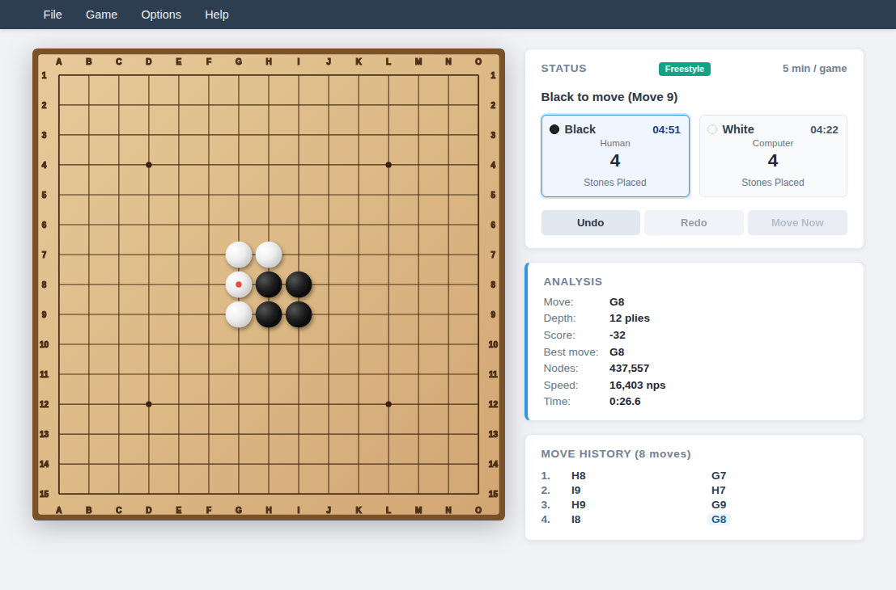
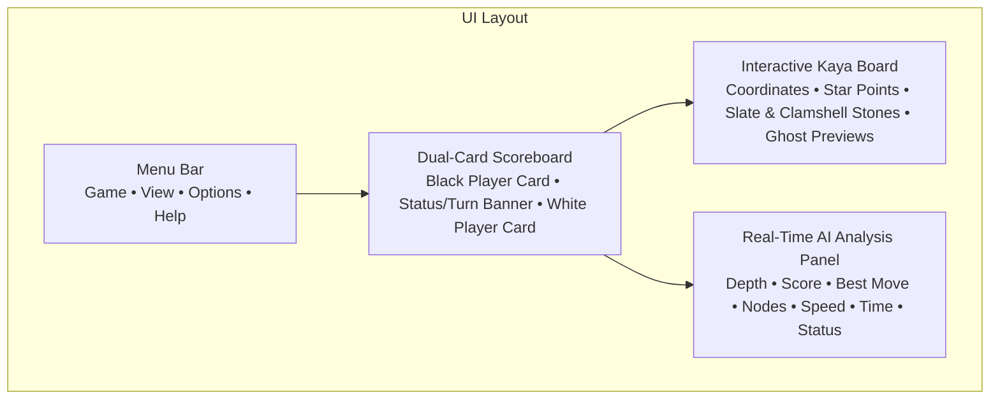
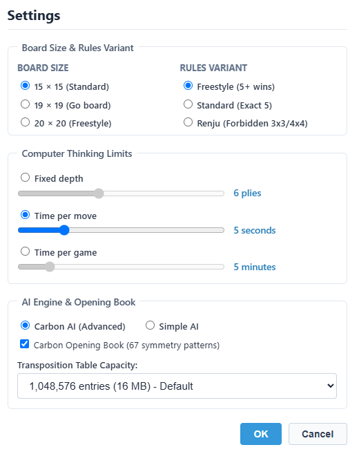
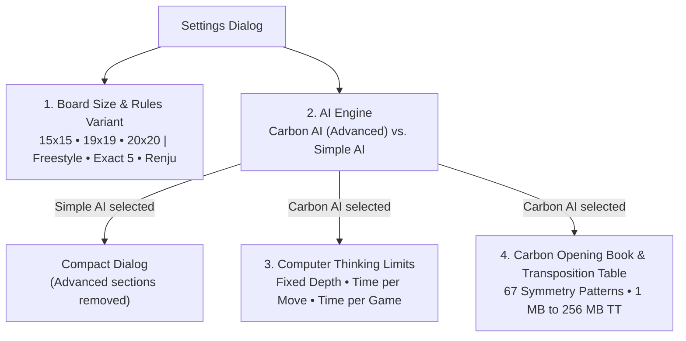
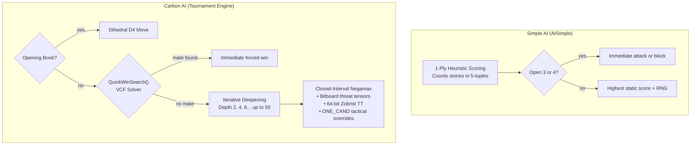

# 14 – GUI and settings

[Back to the index](README.md)

## In short

Gomoku .NET features a unified, modern user interface across both **WPF desktop** and **Blazor WebAssembly** clients. Designed with a clean light theme, Japanese Hon-Kaya wood aesthetic, dual-card scoreboard, and responsive SVG vector graphics, the application provides intuitive controls for casual players while exposing professional tournament analysis tools and engine configuration.

This chapter documents the visual layout, menu commands, settings configuration, the technical differences between **Carbon AI (Advanced)** and **Simple AI**, and the real-time search analysis telemetry streaming engine.

---

## Graphical User Interface layout





### Modern Light Theme & Color Palette

Both clients share a consistent palette designed for high contrast and visual warmth:

| UI Element | Color Value | Description |
|---|---|---|
| **App Background** | `#FFFDF8` | Warm Japanese parchment / rice paper background |
| **Card & Panel Background** | `#FFFFFF` / `#F8FAFC` | Elevated card surfaces with soft ambient drop shadows |
| **Border Stroke** | `#E2E8F0` / `#CBD5E1` | Subtle $1\text{ px}$ borders separating navigation, cards, and boards |
| **Primary Typography** | `#0F172A` / `#334155` | Deep slate gray text ensuring high readability |
| **Active Turn Highlight** | `#3B82F6` / `#0284C7` | Sky-blue ring and badge highlighting the side to move |
| **Evaluation Score** | `#B45309` | Warm amber text displaying centipawn advantages and mate notices |
| **Best Move Coordinate** | `#0284C7` | Blue accent text displaying the engine's current principal candidate |
| **Renju Foul Markers** | `#DC2626` | Crimson diagonal crosses ($\times$) marking illegal moves for Black |

---

## Menu bar and navigation

The application header features a clean menu bar providing quick access to all game operations and shortcuts:

### 1. Game Menu
* **New Game (`Ctrl+N`):** Resets the game session, clears undo/redo history, resets clocks, and positions Black for the opening move.
* **Open... (`Ctrl+O`):** Loads saved `.gomoku` algebraic coordinate files or standard SGF (`GM[11]`) game records into the session.
* **Save As... (`Ctrl+S`):** Exports the current match, complete with player metadata, board size, variant, and move history, to `.gomoku` or `.sgf` format.
* **Game Mode Radio Group:** Toggles the active player configuration:
  * **Human vs Computer (`Ctrl+1`):** User plays Black; Computer plays White.
  * **Computer vs Human (`Ctrl+2`):** Computer plays Black (opening center); User plays White.
  * **Human vs Human (`Ctrl+3`):** Hot-seat multiplayer mode; both sides are controlled manually.
* **Settings... (`Ctrl+,`):** Opens the modal Game Settings dialog to configure board dimensions, rules, AI engine, and time controls.
* **Exit:** Closes the desktop application.

### 2. View Menu
* **AI Analysis Panel (`Ctrl+A`):** Toggles the visibility of the real-time AI search analysis side panel.

### 3. Options Menu
* **Coordinate Labels:** Toggles algebraic coordinate lettering (`A`–`T`) and numbering (`1`–`20`) around the board perimeter.
* **Move Numbers:** Displays move placement sequence numbers directly on top of the placed stones.
* *(Separator)*
* **Sound Effects:** Toggles procedural audio feedback (stone placement, game start, illegal move buzzer, and undo chimes).

### 4. Help Menu
* **User guide (`F1`):** Opens this chapter directly, providing immediate access to interface instructions, settings explanations, and shortcut tables.
* **Rules & Documentation (`Shift+F1`):** Opens the complete Gomoku .NET Architecture and Rules manual (at `/docs` in the web client, or GitHub documentation for desktop).
* **About Gomoku .NET...:** Displays engine version, author credits, and license information.

---

## Dual-Card player status and scoreboard

Located above the game board, the dual-card scoreboard displays real-time state for both players:

```
┌─────────────────────────────────┐  ┌─────────────────────┐  ┌─────────────────────────────────┐
│ ● BLACK (You)                   │  │     MOVE #14        │  │ ○ WHITE (Computer)     [THINKING]│
│ Role: Human    Time: 04:32      │  │ Black to move       │  │ Role: Carbon AI  Time: 04:48    │
│ Last move: H8                   │  │ Clocks active       │  │ Last move: J10                  │
└─────────────────────────────────┘  └─────────────────────┘  └─────────────────────────────────┘
```

1. **Player Role & Color Identification:** Clearly identifies stone color, display name, and assigned engine (e.g., `Human`, `Computer (Carbon AI)`, or `Computer (Simple AI)`).
2. **Active Turn Indicator:** The player currently to move is illuminated with a prominent colored border, glowing indicator dot, and status badge (`Thinking...`).
3. **Chess Clocks:** In `TimePerGame` mode, dual countdown clocks tick down in real time during the active player's thinking phase. When taking back moves via Undo, elapsed time is refunded proportionally.
4. **Move Counter & Center Status:** Central card tracks total plies played and announces game termination states (`Black wins!`, `White wins!`, `Five in a row`, or `Draw`).

---

## Game Settings dialog

Accessed via **Game $\rightarrow$ Settings...** (`F2`), the modal settings dialog lets players tailor rules, geometry, opponent difficulty, and tournament limits.



The dialog is arranged into four sequential sections:
1. **Board Size & Rules Variant:** Board geometry ($15 \times 15$, $19 \times 19$, $20 \times 20$) and Gomoku victory rules (Freestyle, Exact 5, Renju).
2. **AI Engine:** Opponent engine selection: **Carbon AI (Advanced)** or **Simple AI**.
3. **Computer Thinking Limits:** Search depth and clock allocation modes (Fixed depth, Time per move, Time per game). *Visible only when Carbon AI is selected.*
4. **Carbon Opening Book & Transposition Table:** Opening book activation and memory table allocation. *Visible only when Carbon AI is selected.*



> [!NOTE] Dynamic AI Settings Visibility
> When **Simple AI** is selected, the dialog dynamically removes sections 3 and 4 (**Computer Thinking Limits** and **Carbon Opening Book & Transposition Table**). Because Simple AI is an instant 1-ply heuristic evaluator that does not utilize tree search, transposition memory, or opening books, hiding these controls keeps the interface focused, clean, and intuitive for casual play. Switching back to **Carbon AI (Advanced)** immediately restores all tournament search controls.

### 1. Board Dimensions

| Dimension | Standard Name | Common Usage | Star Points (Hoshi) |
|---|---|---|---|
| **$15 \times 15$** | Renju / Modern Gomoku | International tournament standard (RIF). Fastest tactical play. | 5 points: D4, L4, H8, D12, L12 |
| **$19 \times 19$** | Go / Weiqi Size | Traditional East Asian board size. Expansive positional midgame. | 9 points (columns 4, 10, 16) |
| **$20 \times 20$** | Gomocup Standard | Global computer tournament standard used in Gomocup championships. | 4 points: E5, P5, E16, P16 |

### 2. Rule Variants

Gomoku rules govern winning conditions and first-player advantage restrictions:

* **Freestyle:** The purest five-in-a-row rule. Five or more consecutive stones of the same color in any direction (horizontal, vertical, or diagonal) wins the game immediately. Overlines ($6+$ stones) count as a win.
* **Exact Five:** A line of exactly five stones wins. Overlines ($6+$ consecutive stones) do *not* count as a win and play continues.
* **Renju:** Professional tournament rules designed to balance Black's first-move advantage:
  * **Black Restrictions (Fouls):** Black cannot play **Double-Threes** ($3 \times 3$), **Double-Fours** ($4 \times 4$), or **Overlines** ($6+$ stones). Attempting to play a foul square is an immediate forfeit loss.
  * **White Freedom:** White has no restrictions whatsoever. White wins with five in a row *or* by creating an Overline ($6+$ stones). White can also win by forcing Black into a forbidden foul square.

---

### 3. AI Opponents: Carbon AI (Advanced) vs. Simple AI

Gomoku .NET provides two distinct artificial intelligence engines:



#### Detailed Comparison

| Engine Property | [Simple AI](file:///c:/Udvikling/Spil/Gomoku/src/Gomoku.Core/AI/SimpleAiPlayer.cs) | [Carbon AI (Advanced)](file:///c:/Udvikling/Spil/Gomoku/src/Gomoku.Core/AI/CarbonAiPlayer.cs) |
|---|---|---|
| **Origin** | Ported from Carbon Gomoku's `AISimple` | Direct port of Michał Czardybon's championship engine |
| **Search Depth** | **1 ply** (no tree search) | **6 to 16+ plies** (deep tree search) |
| **Lookahead** | Evaluates only the immediate placed stone | Calculates deep counter-replies and multi-turn combinations |
| **Tactical Solver** | Checks only immediate open-threes and fours | **QuickWinSearch (VCF solver)** detects checkmates 20+ plies deep |
| **Pattern Bitboards** | Basic looping counter in 4 directions | **Directional Ray Bitboards** with $10,000$-cell threat tensors |
| **Transposition Table** | None | **64-bit Zobrist Transposition Table** with depth/bound caching |
| **Opening Book** | None (plays center on move 1) | **Embedded Opening Book** with 22 canonical opening systems |
| **Candidate Pruning** | Proximity filter ($3 \times 3$ around stones) | Bounding box scanning, `Prior()` sorting, and `ONE_CAND` overrides |
| **Renju Awareness** | Checks immediate legal move list | Foresees and avoids playing into multi-move foul traps |
| **Playing Strength** | Beginner to Casual | Expert / Tournament Champion |
| **Response Time** | Instant ($< 1\text{ ms}$) | Controlled by time limit ($1\text{–}60\text{ s}$) or fixed depth |

#### When to choose which?
* **Choose Simple AI:** When learning Gomoku, playing fast casual games on low-power devices, or wanting an opponent that makes human-like tactical oversights without punishing subtle mistakes.
* **Choose Carbon AI (Advanced):** For serious, competitive play. Carbon AI anticipates opponent forks, executes unstoppable VCF winning sequences, defends against multi-move combinations, and plays optimal book openings.

---

### 4. Time Controls and Limits

* **Time per Move:** Allocates a dedicated thinking window (e.g., $1\text{ s}$ to $60\text{ s}$) for every turn. The engine uses soft limits ($2/3$ time) to conclude iterations safely before hard timeout interrupts.
* **Fixed Depth:** Forces the engine to search to an exact ply depth (e.g., $1$ to $16$ plies), regardless of time taken.
* **Time per Game (Chess Clock):** Provides a total bank of time per player (e.g., $5\text{ min}$ to $60\text{ min}$). The engine dynamically divides remaining time by the estimated remaining moves in the game.
* **Use Opening Book:** Toggles whether the engine queries its 22-opening dihedral pattern database before launching tree search.

---

## Real-Time AI Analysis panel

When enabled via **View $\rightarrow$ AI Analysis Panel** (`Ctrl+A`), the telemetry sidebar streams real-time search statistics while the computer thinks:

```
┌─────────────────────────────────┐
│ AI ANALYSIS                     │
├───────────────────┬─────────────┤
│ Move:             │ #15         │
│ Depth:            │ 8 plies...  │
│ Score:            │ +140        │
│ Best move:        │ J10         │
│ Nodes:            │ 142,850     │
│ Speed:            │ 850,000 nps │
│ Time:             │ 0.62s       │
│ Status:           │ Searching...│
└───────────────────┴─────────────┘
```

### Telemetry Fields Explained

| Field | Description & Formatting |
|---|---|
| **Move** | The active game ply number (e.g., `#1`, `#15`). |
| **Depth** | The active search depth in plies: <br/>• Displays `"{depth} plies..."` while searching an in-progress iteration.<br/>• Displays `"{depth} plies"` when the depth iteration completes cleanly.<br/>• Displays `"Book"` on opening book hits or `"Opening"` on first-move center hits. |
| **Score** | Positional evaluation from the moving player's perspective:<br/>• Positive (e.g. `+140`): Advantage for the engine.<br/>• Negative (e.g. `-80`): Advantage for the opponent.<br/>• `"Mate in N"` / `"-Mate in N"`: Forced winning/losing tactical combination found. |
| **Best move** | Algebraic coordinate of the currently leading candidate (e.g., `H8`, `J10`, `K11`). |
| **Nodes** | Total board states evaluated during the search, formatted with invariant thousands separators (`142,850`). |
| **Speed** | Search throughput in nodes per second (`nps`), indicating computational efficiency. |
| **Time** | Elapsed thinking duration in seconds (`0.62s`). |
| **Status** | Engine activity descriptor (`Searching...`, `Ready`, `Opening book`, or `Center opening`). |

### Instant Opening Moves & 250ms Delay
When the engine plays an instant move—such as placing the initial center stone on Move 1 or matching a recognized opening book line—it emits `StatusMessage = "Center opening"` or `"Opening book"` and pauses for **$250\text{ ms}$**. This deliberate brief delay ensures the user can visually register the engine's opening acknowledgment and analysis badge before the stone is placed.

### Cooperative WebAssembly Yielding
In the browser client (`Gomoku.Web`), execution runs within a single-threaded WebAssembly runtime. To prevent long AI calculations from freezing the browser UI and blocking animation frames:
1. `MinimaxRootAsync` tracks elapsed thinking time and checks a $\ge 150\text{ ms}$ heartbeat between root candidates.
2. When the heartbeat threshold is reached, it emits a `SearchAnalysis` telemetry snapshot with `IsSearching: true` and executes:
   ```csharp
   await Task.Delay(1, cancellationToken);
   ```
3. This yields a macrotask slice back to the browser's JavaScript event loop. The `BrowserSynchronizationContext` executes pending `Analysis.Updated` events, invokes `StateHasChanged()`, and paints updated depths, nodes, and speeds at a fluid 60 FPS.

---

## Keyboard shortcuts reference

| Shortcut | Scope | Action |
|---|---|---|
| `Ctrl+N` | Global | New Game |
| `Ctrl+O` | Global | Open saved game record (`.gomoku` / `.sgf`) |
| `Ctrl+S` | Global | Save current game record |
| `Ctrl+1` | Global | Switch to **Human vs Computer** mode |
| `Ctrl+2` | Global | Switch to **Computer vs Human** mode |
| `Ctrl+3` | Global | Switch to **Human vs Human** mode |
| `Ctrl+A` | Global | Toggle **AI Analysis Panel** visibility |
| `F2` | Global | Open **Settings...** dialog |
| `Ctrl+Z` | Board | Undo last move |
| `Ctrl+Y` | Board | Redo previously undone move |
| `F1` | Global | Open **User guide** (this chapter) |
| `Shift+F1` | Global | Open **Rules & Documentation** (architectural manual) |

---

## Where in the code

| File | Component | Description |
|---|---|---|
| [`MainViewModel.cs`](file:///c:/Udvikling/Spil/Gomoku/src/Gomoku.App/ViewModels/MainViewModel.cs) | `MainViewModel` | Central orchestrator managing modes, turn dispatching, and telemetry subscriptions |
| [`AnalysisViewModel.cs`](file:///c:/Udvikling/Spil/Gomoku/src/Gomoku.App/ViewModels/AnalysisViewModel.cs) | `AnalysisViewModel` | Observable ViewModel formatting depth strings, centipawn scores, and node rates |
| [`SettingsViewModel.cs`](file:///c:/Udvikling/Spil/Gomoku/src/Gomoku.App/ViewModels/SettingsViewModel.cs) | `SettingsViewModel` | Data backing for the Settings dialog (board size, rules, engines, time controls) |
| [`CarbonAiPlayer.cs`](file:///c:/Udvikling/Spil/Gomoku/src/Gomoku.Core/AI/CarbonAiPlayer.cs) | `CarbonAiPlayer` | Tournament Minimax search engine with iterative deepening and VCF quick-win solver |
| [`SimpleAiPlayer.cs`](file:///c:/Udvikling/Spil/Gomoku/src/Gomoku.Core/AI/SimpleAiPlayer.cs) | `SimpleAiPlayer` | Fast 1-ply heuristic pattern evaluator for beginner and casual gameplay |
| [`SearchAnalysis.cs`](file:///c:/Udvikling/Spil/Gomoku/src/Gomoku.Core/AI/SearchAnalysis.cs) | `SearchAnalysis` | Immutable record transporting live telemetry snapshots across thread boundaries |

---

## Further reading

- Allis, L. V. (1994). *Searching for Solutions in Games and Artificial Intelligence*. Ph.D. thesis, University of Limburg (Solved Gomoku proofs and VCF search).
- Czardybon, M. (2004–2024). *Carbon Gomoku Engine Architecture and Gomocup Tournament History*.
- Nielsen, J. (1994). *Usability Engineering*. Morgan Kaufmann (Principles of status visibility and user control).

---

Previous: [13 UI clients](13-ui-clients.md) · Next: [15 Benchmarks and performance](15-benchmarks-and-performance.md)

