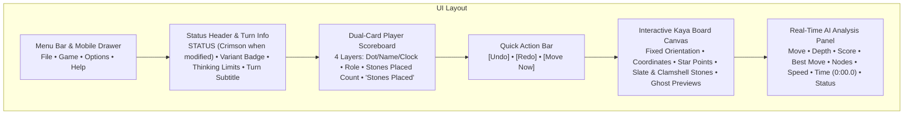
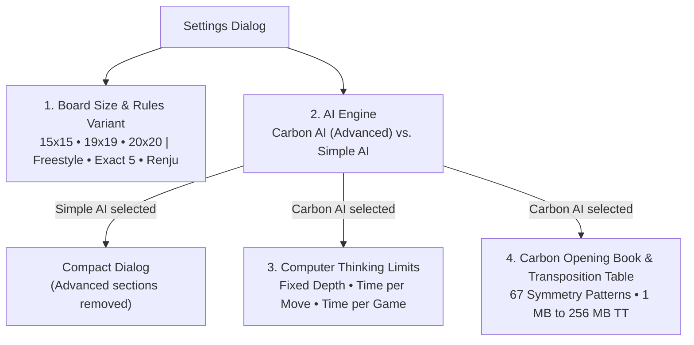
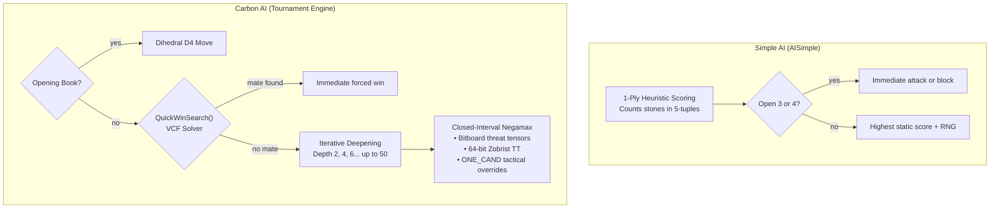

# 14 – GUI and settings

[Back to the index](README.md)

## In short

Gomoku .NET features a unified, modern user interface across both **WPF desktop** and **Blazor WebAssembly** clients. Designed with a clean light theme, Japanese Hon-Kaya wood aesthetic, 4-layer dual-card scoreboard, fixed board orientation, quick action controls, and responsive SVG vector graphics, the application provides intuitive controls for casual players while exposing professional tournament analysis tools and engine configuration.

This chapter documents the visual layout, menu commands, settings configuration, the competitive integrity status system, the technical differences between **Carbon AI (Advanced)** and **Simple AI**, and the real-time search analysis telemetry streaming engine.

---

## Graphical User Interface layout




### Modern Light Theme & Color Palette

Both clients share a consistent palette designed for high contrast and visual warmth:

| UI Element | Color Value | Description |
|---|---|---|
| **App Background** | `#FFFDF8` | Warm Japanese parchment / rice paper background |
| **Card & Panel Background** | `#FFFFFF` / `#F8FAFC` | Elevated card surfaces with soft ambient drop shadows |
| **Border Stroke** | `#E2E8F0` / `#CBD5E1` | Subtle $1\text{ px}$ borders separating navigation, cards, and boards |
| **Primary Typography** | `#0F172A` / `#334155` | Deep slate gray text ensuring high readability |
| **Active Turn Highlight** | `#3B82F6` / `#F0F7FF` | Sky-blue ring, border, and light tint highlighting the active player card |
| **Status Modified Notice** | `#E74C3C` | Crimson red text for `STATUS` indicating unranked/casual state (Undo, side switch, etc.) |
| **Evaluation Score** | `#B45309` | Warm amber text displaying centipawn advantages and mate notices |
| **Best Move Coordinate** | `#0284C7` | Blue accent text displaying the engine's current principal candidate |
| **Renju Foul Markers** | `#DC2626` | Crimson diagonal crosses ($\times$) marking illegal moves for Black |

---

## Menu bar and navigation

The application header features a standardized 4-menu hierarchy providing structured access to all game operations and shortcuts:

### 1. File Menu
* **New Game (`Ctrl+N`):** Starts a new game session. If a match is actively underway, a confirmation prompt prevents accidental loss of progress. Resets clocks, clears undo/redo history, and sets Black for the opening move.
* **Open... (`Ctrl+O`):** Loads saved `.gomoku` algebraic coordinate files or standard SGF (`GM[11]`) game records into the active session.
* **Save As... (`Ctrl+S`):** Exports the current match, complete with player metadata, board size, variant, and move history, to `.gomoku` or `.sgf` format.
* *(Separator)*
* **Exit:** Closes the desktop application.

### 2. Game Menu
* **Switch sides:** Switches player roles between Black and White mid-match without resetting the board. Board orientation remains fixed. If a match is underway, prompts confirmation, marks the game as modified (`IsGameModified = true`), and triggers AI thinking if it becomes the computer's turn.
* *(Separator)*
* **Human vs Computer (`Ctrl+1`):** User plays Black; Computer plays White. Prompts confirmation if switching modes during an active match.
* **Computer vs Human (`Ctrl+2`):** Computer plays Black (opening center); User plays White. Prompts confirmation if switching modes during an active match.
* **Human vs Human (`Ctrl+3`):** Hot-seat multiplayer mode; both sides are controlled locally.
* *(Separator)*
* **Settings...:** Opens the modal Game Settings dialog to configure board dimensions, rules, AI engine, and time controls. (Accessed via menu; no shortcut key).

### 3. Options Menu
* **Coordinate Labels:** Toggles algebraic coordinate lettering (`A`–`O` or `A`–`T`) and numbering (`1`–`15` or `1`–`20`) around the board perimeter.
* **Move Numbers:** Displays move placement sequence numbers directly on top of the placed stones.
* *(Separator)*
* **Sound Effects:** Toggles procedural audio feedback (stone placement snap, victory fanfare, loss chime, illegal move buzzer, and undo chimes).
* *(Separator)*
* **Show Analysis (`Ctrl+A`):** Toggles the visibility of the real-time AI search analysis side panel.

### 4. Help Menu
* **User guide (`F1`):** Opens this chapter directly, providing immediate access to interface instructions, settings explanations, and shortcut tables.
* **Rules & Documentation (`Shift+F1`):** Opens the complete Gomoku .NET Architecture and Rules manual (at `/docs` in the web client, or GitHub documentation for desktop).
* *(Separator)*
* **About Gomoku .NET...:** Displays engine version, author credits, and license information.

> [!NOTE] Dedicated Quick Action Buttons for Undo & Redo
> Undo and Redo are intentionally omitted from the top menus. To optimize workflow and avoid menu clutter, Undo and Redo are provided exclusively via the prominent **Quick Action buttons** beneath the scoreboard and via standard keyboard shortcuts (`Ctrl+Z` / `Ctrl+Y`).

### Responsive Mobile Navigation Drawer ($\le 768\text{px}$)
On mobile devices and narrow viewports ($\le 768\text{px}$), the horizontal menu bar transforms into a streamlined mobile header featuring a brand title (`Gomoku`) and hamburger button (`☰`). Tapping the hamburger slides out an off-canvas navigation drawer (`.mobile-drawer`) with a dimmed background overlay, grouping File, Game, Options, and Help actions into touch-friendly tap targets.

---

## Status header, dual-card scoreboard and quick actions

Located above the game board, the status board displays real-time match conditions, player clocks, and immediate action controls:

```
┌─────────────────────────────────────────────────────────────────┐
│ STATUS [FREESTYLE]                                   5s / move  │
│ Black to move (Move 1)                                          │
│                                                                 │
│ ┌─────────────────────────────┐   ┌───────────────────────────┐ │
│ │ ● Black            05:00    │   │ ○ White          05:00    │ │
│ │ Human                       │   │ Computer                  │ │
│ │ 0                           │   │ 0                         │ │
│ │ Stones Placed               │   │ Stones Placed             │ │
│ └─────────────────────────────┘   └───────────────────────────┘ │
│                                                                 │
│ [  Undo  ]           [  Redo  ]            [ Move Now ]         │
└─────────────────────────────────────────────────────────────────┘
```

### 1. Status Header & Competitive Integrity
* **Status Label (`STATUS`):** Normally displayed in neutral slate gray. When an unranked event occurs—such as taking back moves against the computer, switching sides mid-game, modifying engine settings during a match, or continuing past clock expiration—the `STATUS` text dynamically turns **crimson red (`#E74C3C`)**, visually indicating that the game has been modified and competitive tournament ranking is voided.
* **Variant Badge:** A rounded teal badge indicating the active victory rule (`[FREESTYLE]`, `[EXACT 5]`, or `[RENJU]`).
* **Thinking Limits Badge:** Summarizes the active AI constraint in the top-right corner (e.g., `5s / move`, `5 min / game`, or `8 plies`).
* **Turn Subtitle:** Announces the current turn and ply count (e.g., `Black to move (Move 1)`) or terminal outcome (`Black wins! Five in a row`, `White wins!`, `Draw`).

### 2. Dual-Card Player Scoreboard (4 Vertical Layers)
Each player card is structured into 4 clear vertical layers:
1. **Layer 1 (Identity & Digital Clock):**
   * Color indicator dot (`●` Slate / `○` Clamshell).
   * Player name (`Black` / `White`).
   * Digital countdown chess clock (`05:00` / `04:32`) when time controls are active.
   * The card of the player currently to move is illuminated with a sky-blue border (`#3B82F6`) and subtle background tint (`#F0F7FF`).
2. **Layer 2 (Role):** Identifies the controller type (`Human`, `Computer (Carbon AI)`, or `Computer (Simple AI)`).
3. **Layer 3 (Primary Metric):** Displays the total number of stones placed by this player in prominent bold numerals.
4. **Layer 4 (Secondary Metric Label):** Standardized subtitle label `"Stones Placed"`.

### 3. Quick Action Buttons
Positioned directly beneath the dual player cards:
* **`[Undo]`:** Reverts the previous move (in Human vs Human) or rolls back the human and AI move pair (in Human vs Computer). Elapsed chess clock times are refunded back to the exact snapshot recorded at that ply (`_timeAtPly`). Disabled at Move 0 or while the AI is thinking.
* **`[Redo]`:** Re-applies the most recently undone move.
* **`[Move Now]`:** Persistently rendered when playing against the computer. While the AI is actively searching, pressing `[Move Now]` triggers the AI's cancellation token, forcing the engine to immediately conclude its search and play the best candidate evaluated up to that point. Disabled when the AI is idle.

### 4. Board Orientation (Fixed)
Unlike games where pieces originate from opposite edges, Gomoku's $15 \times 15$ grid is symmetric and starts from the center star point (H8). The board orientation remains **strictly fixed** regardless of whether the human plays Black or White or switches sides mid-game. Standard algebraic coordinates (columns `A`–`O`, rows `1`–`15`) remain invariant at all times.

### 5. Timeout Continuation Safeguard
In timed matches (`TimePerGame`), if the human player's clock reaches zero against the computer, an interactive confirmation dialog is presented: *"Your time has expired. Would you like to continue playing?"*. Accepting allows play to proceed casually while marking the match status modified (`#E74C3C`). Declining concludes the game as a loss on time.

---

## Game Settings dialog

Accessed via **Game $\rightarrow$ Settings...**, the modal settings dialog lets players tailor rules, geometry, opponent difficulty, and tournament limits.


The dialog is arranged into four sequential sections:
1. **Board Size & Rules Variant:** Board geometry ($15 \times 15$, $19 \times 19$, $20 \times 20$) and Gomoku victory rules (Freestyle, Exact 5, Renju).
2. **AI Engine:** Opponent engine selection: **Carbon AI (Advanced)** or **Simple AI**.
3. **Computer Thinking Limits:** Search depth and clock allocation modes (Fixed depth, Time per move, Time per game). *Visible only when Carbon AI is selected.*
4. **Carbon Opening Book & Transposition Table:** Opening book activation and memory table allocation. *Visible only when Carbon AI is selected.*



> [!NOTE] Dynamic AI Settings Visibility
> When **Simple AI** is selected, the dialog dynamically removes sections 3 and 4 (**Computer Thinking Limits** and **Carbon Opening Book & Transposition Table**). Because Simple AI is an instant 1-ply heuristic evaluator that does not utilize tree search, transposition memory, or opening books, hiding these controls keeps the interface focused, clean, and intuitive for casual play. Switching back to **Carbon AI (Advanced)** immediately restores all tournament search controls.

### 1. Board Dimensions

| Dimension | Standard Name | Common Usage | Star Points (Hoshi) |
|---|---|---|---|
| **$15 \times 15$** | Renju / Modern Gomoku | International tournament standard (RIF). Fastest tactical play. | 5 points: D4, L4, H8, D12, L12 |
| **$19 \times 19$** | Go / Weiqi Size | Traditional East Asian board size. Expansive positional midgame. | 9 points (columns 4, 10, 16) |
| **$20 \times 20$** | Gomocup Standard | Global computer tournament standard used in Gomocup championships. | 4 points: E5, P5, E16, P16 |

### 2. Rule Variants

Gomoku rules govern winning conditions and first-player advantage restrictions:

* **Freestyle:** The purest five-in-a-row rule. Five or more consecutive stones of the same color in any direction (horizontal, vertical, or diagonal) wins the game immediately. Overlines ($6+$ stones) count as a win.
* **Exact Five:** A line of exactly five stones wins. Overlines ($6+$ consecutive stones) do *not* count as a win and play continues.
* **Renju:** Professional tournament rules designed to balance Black's first-move advantage:
  * **Black Restrictions (Fouls):** Black cannot play **Double-Threes** ($3 \times 3$), **Double-Fours** ($4 \times 4$), or **Overlines** ($6+$ stones). Attempting to play a foul square is an immediate forfeit loss.
  * **White Freedom:** White has no restrictions whatsoever. White wins with five in a row *or* by creating an Overline ($6+$ stones). White can also win by forcing Black into a forbidden foul square.

---

### 3. AI Opponents: Carbon AI (Advanced) vs. Simple AI

Gomoku .NET provides two distinct artificial intelligence engines:



#### Detailed Comparison

| Engine Property | [Simple AI](https://github.com/cjp-dev/Gomoku/blob/main/src/Gomoku.Core/AI/SimpleAiPlayer.cs) | [Carbon AI (Advanced)](https://github.com/cjp-dev/Gomoku/blob/main/src/Gomoku.Core/AI/CarbonAiPlayer.cs) |
|---|---|---|
| **Origin** | Ported from Carbon Gomoku's `AISimple` | Direct port of Michał Czardybon's championship engine |
| **Search Depth** | **1 ply** (no tree search) | **6 to 16+ plies** (deep tree search) |
| **Lookahead** | Evaluates only the immediate placed stone | Calculates deep counter-replies and multi-turn combinations |
| **Tactical Solver** | Checks only immediate open-threes and fours | **QuickWinSearch (VCF solver)** detects checkmates 20+ plies deep |
| **Pattern Bitboards** | Basic looping counter in 4 directions | **Directional Ray Bitboards** with $10,000$-cell threat tensors |
| **Transposition Table** | None | **64-bit Zobrist Transposition Table** with depth/bound caching |
| **Opening Book** | None (plays center on move 1) | **Embedded Opening Book** with 22 canonical opening systems |
| **Candidate Pruning** | Proximity filter ($3 \times 3$ around stones) | Bounding box scanning, `Prior()` sorting, and `ONE_CAND` overrides |
| **Renju Awareness** | Checks immediate legal move list | Foresees and avoids playing into multi-move foul traps |
| **Playing Strength** | Beginner to Casual | Expert / Tournament Champion |
| **Response Time** | Instant ($< 1\text{ ms}$) | Controlled by time limit ($1\text{–}60\text{ s}$) or fixed depth |

#### When to choose which?
* **Choose Simple AI:** When learning Gomoku, playing fast casual games on low-power devices, or wanting an opponent that makes human-like tactical oversights without punishing subtle mistakes.
* **Choose Carbon AI (Advanced):** For serious, competitive play. Carbon AI anticipates opponent forks, executes unstoppable VCF winning sequences, defends against multi-move combinations, and plays optimal book openings.

---

### 4. Time Controls and Limits

* **Time per Move:** Allocates a dedicated thinking window (e.g., $1\text{ s}$ to $60\text{ s}$) for every turn. The engine uses soft limits ($2/3$ time) to conclude iterations safely before hard timeout interrupts.
* **Fixed Depth:** Forces the engine to search to an exact ply depth (e.g., $1$ to $16$ plies), regardless of time taken.
* **Time per Game (Chess Clock):** Provides a total bank of time per player (e.g., $5\text{ min}$ to $60\text{ min}$). The engine dynamically divides remaining time by the estimated remaining moves in the game.
* **Use Opening Book:** Toggles whether the engine queries its 22-opening dihedral pattern database before launching tree search.

---

## Real-Time AI Analysis panel

When enabled via **Options $\rightarrow$ Show Analysis** (`Ctrl+A`), the telemetry sidebar streams real-time search statistics while the computer thinks:

```
┌─────────────────────────────────┐
│ AI ANALYSIS                     │
├───────────────────┬─────────────┤
│ Move:             │ #15         │
│ Depth:            │ 8 plies...  │
│ Score:            │ +140        │
│ Best move:        │ J10         │
│ Nodes:            │ 142,850     │
│ Speed:            │ 850,000 nps │
│ Time:             │ 0:01.9      │
│ Status:           │ Searching...│
└───────────────────┴─────────────┘
```

### Telemetry Fields Explained

| Field | Description & Formatting |
|---|---|
| **Move** | The active game ply number (e.g., `#1`, `#15`). |
| **Depth** | The active search depth in plies: <br/>• Displays `"{depth} plies..."` while searching an in-progress iteration.<br/>• Displays `"{depth} plies"` when the depth iteration completes cleanly.<br/>• Displays `"Book"` on opening book hits or `"Opening"` on first-move center hits. |
| **Score** | Positional evaluation from the moving player's perspective:<br/>• Positive (e.g. `+140`): Advantage for the engine.<br/>• Negative (e.g. `-80`): Advantage for the opponent.<br/>• `"Mate in N"` / `"-Mate in N"`: Forced winning/losing tactical combination found. |
| **Best move** | Algebraic coordinate of the currently leading candidate (e.g., `H8`, `J10`, `K11`). |
| **Nodes** | Total board states evaluated during the search, formatted with invariant thousands separators (`142,850`). |
| **Speed** | Search throughput in nodes per second (`nps`), indicating computational efficiency. |
| **Time** | Elapsed thinking duration in standard stopwatch format (`m\:ss\.f`, e.g. `0:00.0` or `0:01.9`). |
| **Status** | Engine activity descriptor (`Searching...`, `Ready`, `Opening book`, or `Center opening`). |

### Instant Opening Moves & 250ms Delay
When the engine plays an instant move—such as placing the initial center stone on Move 1 or matching a recognized opening book line—it emits `StatusMessage = "Center opening"` or `"Opening book"` and pauses for **$250\text{ ms}$**. This deliberate brief delay ensures the user can visually register the engine's opening acknowledgment and analysis badge before the stone is placed.

### Cooperative WebAssembly Yielding
In the browser client (`Gomoku.Web`), execution runs within a single-threaded WebAssembly runtime. To prevent long AI calculations from freezing the browser UI and blocking animation frames:
1. `MinimaxRootAsync` tracks elapsed thinking time and checks a $\ge 150\text{ ms}$ heartbeat between root candidates.
2. When the heartbeat threshold is reached, it emits a `SearchAnalysis` telemetry snapshot with `IsSearching: true` and executes:
   ```csharp
   await Task.Delay(1, cancellationToken);
   ```
3. This yields a macrotask slice back to the browser's JavaScript event loop. The `BrowserSynchronizationContext` executes pending `Analysis.Updated` events, invokes `StateHasChanged()`, and paints updated depths, nodes, and speeds at a fluid 60 FPS.

---

## Keyboard shortcuts reference

| Shortcut | Scope | Action |
|---|---|---|
| `Ctrl+N` | Global | New Game (with mid-game safeguard) |
| `Ctrl+O` | Global | Open saved game record (`.gomoku` / `.sgf`) |
| `Ctrl+S` | Global | Save current game record |
| `Ctrl+1` | Global | Switch to **Human vs Computer** mode |
| `Ctrl+2` | Global | Switch to **Computer vs Human** mode |
| `Ctrl+3` | Global | Switch to **Human vs Human** mode |
| `Ctrl+A` | Global | Toggle **AI Analysis Panel** visibility |
| `Ctrl+Z` | Board | Undo last move (refunds chess clock time) |
| `Ctrl+Y` | Board | Redo previously undone move |
| `F1` | Global | Open **User guide** (this chapter) |
| `Shift+F1` | Global | Open **Rules & Documentation** (architectural manual) |

*(Note: Settings dialog is opened via menu **Game $\rightarrow$ Settings...**; Undo/Redo are available via Quick Action buttons and `Ctrl+Z`/`Ctrl+Y`).*

---

## Where in the code

| File | Component | Description |
|---|---|---|
| [`MainViewModel.cs`](https://github.com/cjp-dev/Gomoku/blob/main/src/Gomoku.App/ViewModels/MainViewModel.cs) | `MainViewModel` | Central orchestrator managing modes, competitive integrity (`IsGameModified`), per-ply clock snapshots (`_timeAtPly`), turn dispatching, and telemetry subscriptions |
| [`AnalysisViewModel.cs`](https://github.com/cjp-dev/Gomoku/blob/main/src/Gomoku.App/ViewModels/AnalysisViewModel.cs) | `AnalysisViewModel` | Observable ViewModel formatting depth strings, centipawn scores, node rates, and elapsed time (`m\:ss\.f`) |
| [`SettingsViewModel.cs`](https://github.com/cjp-dev/Gomoku/blob/main/src/Gomoku.App/ViewModels/SettingsViewModel.cs) | `SettingsViewModel` | Data backing for the Settings dialog (board size, rules, engines, time controls) |
| [`CarbonAiPlayer.cs`](https://github.com/cjp-dev/Gomoku/blob/main/src/Gomoku.Core/AI/CarbonAiPlayer.cs) | `CarbonAiPlayer` | Tournament Minimax search engine with iterative deepening and VCF quick-win solver |
| [`SimpleAiPlayer.cs`](https://github.com/cjp-dev/Gomoku/blob/main/src/Gomoku.Core/AI/SimpleAiPlayer.cs) | `SimpleAiPlayer` | Fast 1-ply heuristic pattern evaluator for beginner and casual gameplay |
| [`SearchAnalysis.cs`](https://github.com/cjp-dev/Gomoku/blob/main/src/Gomoku.Core/AI/SearchAnalysis.cs) | `SearchAnalysis` | Immutable record transporting live telemetry snapshots across thread boundaries |

---

## Further reading

- Allis, L. V. (1994). *Searching for Solutions in Games and Artificial Intelligence*. Ph.D. thesis, University of Limburg (Solved Gomoku proofs and VCF search).
- Czardybon, M. (2004–2024). *Carbon Gomoku Engine Architecture and Gomocup Tournament History*.
- Nielsen, J. (1994). *Usability Engineering*. Morgan Kaufmann (Principles of status visibility and user control).

---

Previous: [13 UI clients](13-ui-clients.md) · Next: [15 Benchmarks and performance](15-benchmarks-and-performance.md)
