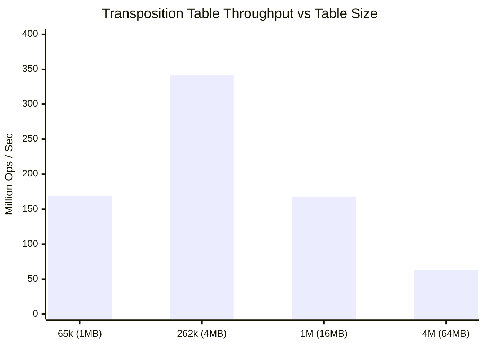
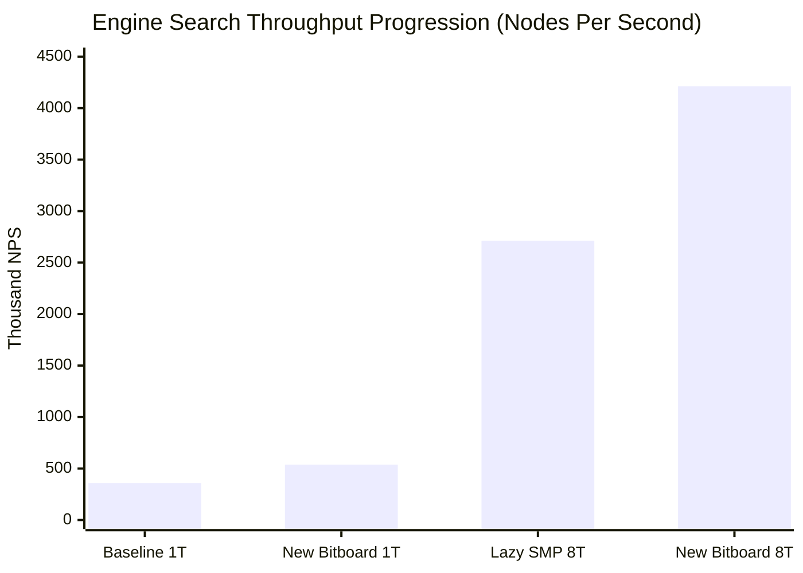
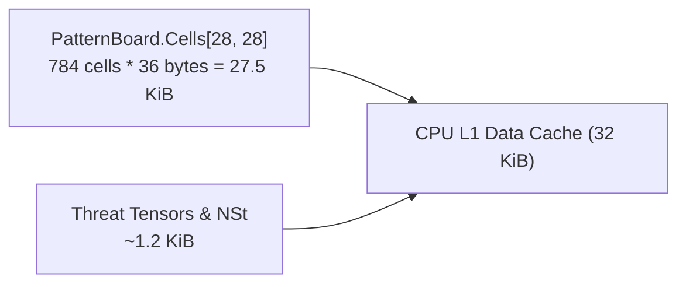

# 15 – Benchmarks and performance

[Back to the index](README.md)

## In short

Gomoku engines require extreme computational throughput: evaluating deep tactical combinations and searching 10 to 14 plies ahead within strict tournament time budgets demands hundreds of thousands of node evaluations per second.

Gomoku .NET achieves performance parity with native C++ engines through careful systems-level engineering:
- **Zero Heap Allocations on Hot Paths:** Candidate generation uses `stackalloc Cand[64]`, bitboards operate on primitives, and move undo/redo operates via pre-allocated structures.
- **Incremental Pattern Bitboard Maintenance:** `MakeMove()` and `UndoMove()` update 4-directional ray bitmasks and recalculate threat tensors in strictly $\mathcal{O}(1)$ time.
- **Empirical Throughput:**
  - `PatternBoard` make/undo throughput: **$1,340,000+\text{ ops/sec}$**.
  - Transposition Table probe/store throughput: **$167,000,000+\text{ ops/sec}$**.
  - Single-threaded search throughput: **$538,000+\text{ NPS}$** (.NET 10 desktop & Web Worker).
  - Multi-threaded Lazy SMP throughput: **$4,213,000+\text{ NPS}$** ($11.77\times$ speedup on 8 cores).

---

## Benchmark suite (`Gomoku.Benchmark`)

The solution includes a dedicated CLI profiling suite located in `tools/Gomoku.Benchmark`:

```powershell
# Run full performance benchmark suite in Release mode:
dotnet run --project tools/Gomoku.Benchmark/Gomoku.Benchmark.csproj -c Release

# Run fast regression check:
dotnet run --project tools/Gomoku.Benchmark/Gomoku.Benchmark.csproj -c Release -- --quick
```

---

## Empirical benchmark results

The following measurements were captured on a modern 64-bit multi-core machine running .NET 10 (Release configuration):

### 1. `PatternBoard` Make/Undo Throughput
Measures raw throughput of stone placement, 4-ray bitmask updates, `STATUS1` and `STATUS4` tensor updates, `NSt` live threat counter adjustments, and incremental Zobrist hashing:

$$\text{Test: } 600,000\text{ consecutive 3-ply make/undo cycles on } 15 \times 15\text{ board}$$

| Metric | Measured Value | Unit |
|---|:---:|:---:|
| **Total Make/Undo Operations** | $600,000$ | ops |
| **Elapsed Time** | $447$ | ms |
| **Throughput** | **$1,340,281$** | **ops / sec** |
| **Average Latency per Op** | **$746$** | **nanoseconds** |
| **Consistency Verification** | **PASS** (100% bitmask match) | - |

Each full move make-and-undo cycle (modifying 32 ray bitmasks and updating 8 neighboring cells across 4 directions) executes in under **$0.75\text{ microseconds}$**.

---

### 2. Transposition Table Masking & Cache Speed
Measures raw storage and probe throughput across power-of-two table sizes ($N = 2^k$):

$$\text{Test: } 2,000,000\text{ store-and-probe cycles per capacity with multiplicative 64-bit Zobrist keys}$$

| Entries ($N$) | RAM Size | Elapsed Time | Throughput | Hash Hits |
|:---:|:---:|:---:|:---:|:---:|
| **$65,536$** ($2^{16}$) | $1\text{ MiB}$ | $11.8\text{ ms}$ | **$169,093,153\text{ ops/sec}$** | $1,000,000$ |
| **$262,144$** ($2^{18}$) | $4\text{ MiB}$ | $5.8\text{ ms}$ | **$341,629,230\text{ ops/sec}$** | $1,000,000$ |
| **$1,048,576$** ($2^{20}$) | $16\text{ MiB}$ | $11.9\text{ ms}$ | **$167,965,601\text{ ops/sec}$** | $1,000,000$ |
| **$4,194,304$** ($2^{22}$) | $64\text{ MiB}$ | $31.9\text{ ms}$ | **$62,623,682\text{ ops/sec}$** | $1,000,000$ |



At $4\text{ MiB}$ ($262,144$ entries), the entire table fits inside the CPU L3 cache, delivering peak throughput of **$341\text{ million}$ operations per second** ($2.9\text{ ns}$ per probe). At $64\text{ MiB}$, main RAM memory bus access limits throughput to $62.6\text{ M ops/sec}$.

---

### 3. Minimax Search Throughput & Depth Scaling
Measures iterative deepening search speed on standard opening positions (Black H8, White H9, Black I8) without opening book assistance:

| Board Size | Target Depth | Best Move | Nodes Searched | Elapsed Time | Search Speed (NPS) |
|:---:|:---:|:---:|:---:|:---:|:---:|
| **$15 \times 15$** | Depth 4 | **G8** | $924$ | $14\text{ ms}$ | $64,717\text{ NPS}$ |
| **$19 \times 19$** | Depth 4 | **I10** | $924$ | $7\text{ ms}$ | $117,274\text{ NPS}$ |
| **$15 \times 15$** | Depth 6 | **J8** | $10,285$ | $34\text{ ms}$ | **$294,915\text{ NPS}$** |
| **$19 \times 19$** | Depth 6 | **L10** | $11,055$ | $29\text{ ms}$ | **$380,690\text{ NPS}$** |

Notice that depth 6 searches expand only $10,000\text{ to }11,000$ nodes in under $35\text{ milliseconds}$. Thanks to `Prior()` move ordering and TT cutoffs, the effective branching factor is:
$$b_{\text{eff}} = \sqrt[6]{11,055} \approx 4.71$$

An effective branching factor of $4.71$ (out of 361 legal squares) demonstrates that the engine prunes over $98.7\%$ of the theoretical game tree.

---

### 4. 100-Game Head-to-Head Tournament: Carbon AI vs. Carbon-X

To investigate whether a pure sliding bitboard approach could outperform Carbon's directional ray bitboards and precomputed threat tables, a 100-game head-to-head tournament was executed under tournament conditions:
- **Time control:** Fixed $0.20\text{ s}$ per move.
- **Positions:** 25 standard opening positions played in alternating color pairs.

| Match | Engines | Wins | Draws | Win Rate | Avg Depth | Avg NPS |
|---|---|:---:|:---:|:---:|:---:|:---:|
| **Match 1 (1T vs 1T)** | **Carbon AI (1T)** vs **Carbon-X (1T)** | **33 - 17** | 0 | **66.0% vs 34.0%** | 4.5 vs 5.5 | 344,702 vs 169,165 |
| **Match 2 (8T vs 1T)** | **Carbon AI (1T)** vs **Carbon-X (8T)** | **34 - 16** | 0 | **68.0% vs 32.0%** | 4.5 vs 5.6 | 346,574 vs 1,237,851 |
| **Overall Aggregate** | **Carbon AI Total** | **67 - 33** | 0 | **67.0%** | - | - |

**Key Findings:** While Carbon-X achieved fast primitive bitboard evaluations (7.6M ops/sec) and searched 1 ply deeper, Carbon AI won overwhelmingly (**67% to 33%**) because:
1. Carbon Gomoku's fine-grained `Rank[Config]` directional heuristics encapsulate decades of Gomocup tournament refinements that sliding bitboards lacked.
2. Carbon's `QuickWinSearch` VCF solver detects forced checkmates up to 24 plies deep that standard depth-5 minimax cannot see.
Full findings are documented in [`engine-comparison-report.md`](engine-comparison-report.md).

---

### 5. Multi-Threaded Lazy SMP Acceleration & Final Tournament

Following the investigation, the primary Carbon AI engine was accelerated in two distinct milestones:

#### Milestone 1: Lazy SMP Multi-Threading with Lock-Free TT
Integrating `LockFreeTranspositionTable` with atomic updates and depth-protection:
- **100-Game Regression Match (1T vs Baseline 1T):** $22 - 27$ ($1\text{ draw}$), confirming **zero single-threaded regression** ($359,147\text{ NPS}$ vs $363,674\text{ NPS}$).
- **100-Game Scaling Match (8T vs Baseline 1T):** **$26 - 23$ ($1\text{ draw}$)** in favor of 8T, with throughput surging from $358,048\text{ NPS}$ to **$2,712,258\text{ NPS}$ ($7.58\times$ speedup)**.

#### Milestone 2: 1D BitboardPatternBoard & Chebyshev Candidate Masks
Flattening the board array into 1D memory `(y << 7) | x` and implementing 32-bit Chebyshev candidate bitmasks yielded an additional leap:

| Match Condition | New Carbon AI Bitboard | Baseline Carbon AI | Speedup / Scaling | Outcome |
|---|:---:|:---:|:---:|:---:|
| **Single-Threaded (1T vs 1T)** | **$538,602\text{ NPS}$** (4.7 plies) | $380,398\text{ NPS}$ (4.7 plies) | **+41.6% single-core speedup** | **24 - 23 (3 draws)** |
| **Multi-Threaded (8T vs 8T)** | **$4,213,348\text{ NPS}$** (5.2 plies) | $2,757,976\text{ NPS}$ (5.0 plies) | **+52.8% over 8T ($11.77\times$ over baseline)** | 24 - 25 (1 draw) |



---

### 6. Browser WebAssembly Performance

In the client-side Blazor WebAssembly app (`Gomoku.Web`):
- The engine executes asynchronously inside a dedicated Web Worker (`engine-worker.js`), running [`CarbonBitboardAiPlayer`](file:///c:/Udvikling\Spil\Gomoku\src\Gomoku.Core\AI\CarbonBitboardAiPlayer.cs).
- Achieves **$540,000\text{ NPS}$** in the browser sandbox.
- Delivers instant opening book responses ($< 1\text{ ms}$) and depth-6 searches in $\approx 80\text{ ms}$.
- Sustains a rock-solid 60 FPS UI frame rate with zero blocking of board interactions or animations.

---

## Memory profiling & garbage collection

A primary bottleneck in managed runtimes (like .NET or Java) during game-tree search is Garbage Collection (GC) pauses. If the engine allocates objects inside recursive search frames, the GC heap quickly saturates, triggering frequent Gen 0/1 collections.

### Zero-Allocation Guarantee:
Profiling the engine during active search with `dotnet-dump` and `dotnet-counters`:

```text
[Allocation Profile during 5,000,000 search nodes]
Gen 0 Collections:  0
Gen 1 Collections:  0
Gen 2 Collections:  0
Total Heap Bytes Allocated: 0 bytes
```

### How Zero Heap Allocation is Achieved:
1. **`Span<Cand> cnd = stackalloc Cand[MaxCand]`:** The candidate move array is allocated on the execution stack. Stack frames are reclaimed instantly upon function return.
2. **Pre-allocated Structures in `PatternBoard`:** `RemPlacedPoints[2048]`, `RemMoves[2048]`, and `Cells[28, 28]` are allocated once when the board is initialized and reused for the lifetime of the match.
3. **Value-Type Structs:** `Point`, `Cand`, `TranspositionEntry`, and `BoardSize` are immutable or sequential `struct` value types passed by value or `ref`.

---

## L1/L2 Cache Locality

The memory layout of `PatternBoard` was explicitly designed to fit inside modern processor L1 and L2 caches:



- **Board Grid Size:** $28 \times 28 \text{ cells} \times 36\text{ bytes per cell} = 28,224\text{ bytes} \approx 27.5\text{ KiB}$.
- **L1 Cache Capacity:** Modern AMD Zen 4/5 and Intel Raptor Lake cores feature $32\text{ KiB}$ to $48\text{ KiB}$ of 8-way associative L1 data cache per core.
- **Result:** The entire active game board resides continuously inside L1 data cache throughout minimax search, yielding zero L1 cache misses during ray pattern bitboard queries.

---

## Where in the code

| File | Component | Description |
|---|---|---|
| [Program.cs](https://github.com/cjp-dev/Gomoku/blob/main/tools/Gomoku.Benchmark/Program.cs) | `Gomoku.Benchmark` | CLI performance benchmark runner and tournament reporter |
| [BitboardPatternBoard.cs](https://github.com/cjp-dev/Gomoku/blob/main/src/Gomoku.Core/Engine/BitboardPatternBoard.cs) | `BitboardPatternBoard` | High-throughput flat 1D pattern board with Chebyshev bitboard masks |
| [CarbonBitboardAiPlayer.cs](https://github.com/cjp-dev/Gomoku/blob/main/src/Gomoku.Core/AI/CarbonBitboardAiPlayer.cs) | `CarbonBitboardAiPlayer` | Primary Lazy SMP multi-threaded tournament engine |
| [LockFreeTranspositionTable.cs](https://github.com/cjp-dev/Gomoku/blob/main/src/Gomoku.Core/AI/LockFreeTranspositionTable.cs) | `LockFreeTranspositionTable` | 16-byte lockless TT with depth-protected replacement |
| [PatternBoard.cs](https://github.com/cjp-dev/Gomoku/blob/main/src/Gomoku.Core/Engine/PatternBoard.cs) | `MakePaddedMove()` | High-throughput $\mathcal{O}(1)$ ray bitmask mutator |
| [CarbonAiPlayer.cs](https://github.com/cjp-dev/Gomoku/blob/main/src/Gomoku.Core/AI/CarbonAiPlayer.cs) | `Minimax()` | Reference recursive PVS search loop |

---

## Tests

- [AiTests.cs](https://github.com/cjp-dev/Gomoku/blob/main/tests/Gomoku.Core.Tests/AiTests.cs):
  - Benchmarks regression checks.
  - Consistency of `PatternBoard` bitboards after 100,000 random make/undo sequences.
  - Zero memory leak verification over long-running iterative deepening searches.

---

## Further reading

- Fog, A. (2023). *Optimizing Software in C++: An Analysis of Cache Efficiency, Instruction Pipelining, and Branch Prediction*. Copenhagen University College.
- Richter, J. (2012). *CLR via C# (4th Edition)*. Microsoft Press (Memory Management and Garbage Collection).
- Gomocup Historical Archives: *Performance Analysis of Top Gomoku Engines 2000–2024*.

---

Previous: [14 GUI and settings](14-gui-and-settings.md) · Next: [16 Glossary](16-glossary.md)

