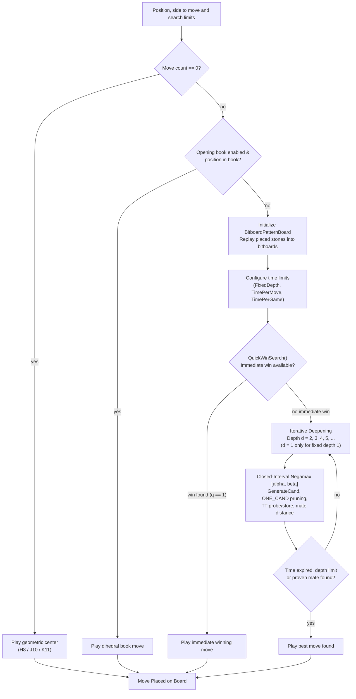
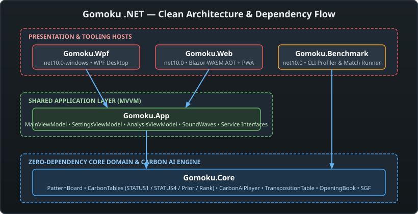
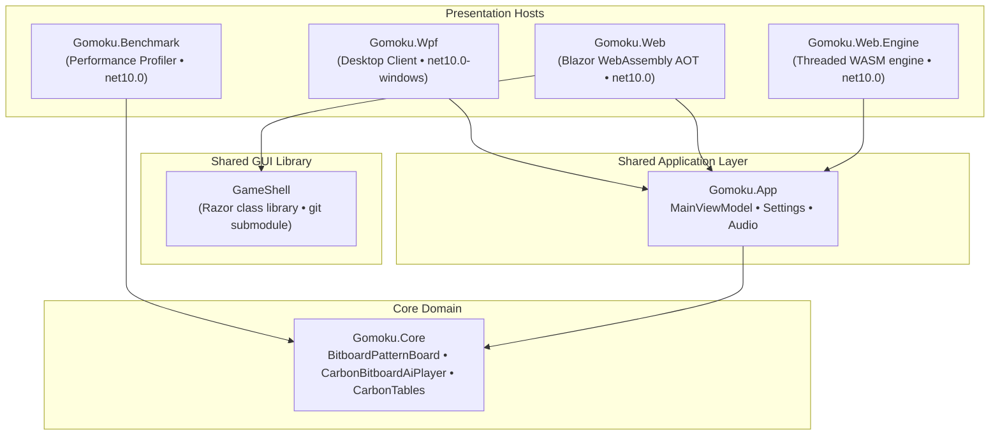

# The Gomoku brain

**Gomoku .NET** is a high-performance Gomoku (Five in a Row, 五目並べ) engine and cross-platform application written in modern C# (.NET 10). The engine is inspired by Michał Czardybon's world-class **Carbon Gomoku** (international Gomocup champion), featuring directional pattern bitboards, precomputed threat tensors, deep tactical VCF search, and Clean Architecture.

The "brain" consists of:

- **The board and rules:** Standardized $15 \times 15$ international tournament geometry (with historical/arbitrary core support), sentinel-padded bitboards, and fast legality checking for Freestyle, Exact5, and Renju variants;
- **Pattern bitboards and threat tensors:** Flat 1D memory layout `(y << 7) | x`, Chebyshev dilation candidate bitmasks (`GetCandidateMask`), precomputed 8-cell ray bitmasks, directional line threat grades, and 4-way threat tensors;
- **The tactical solver (QuickWinSearch):** Sub-millisecond Victory by Continuous Fours (VCF) search detecting checkmates up to 24 plies deep;
- **The midgame search:** Iterative deepening closed-interval Negamax Alpha-Beta with mate-distance scaling, move ordering, and **Lazy SMP multi-threaded search** scaling up to **$4,213,000+\text{ NPS}$** ($11.8\times$ speedup on 8 cores);
- **The transposition table:** 16-byte cache-aligned **Lock-Free Transposition Table** (`LockFreeTranspositionTable`) with atomic lockless updates, depth-protection against shallow worker overwrites, and configurable $1\text{ MB}$ to $256\text{ MB}$ memory allocation;
- **The opening book:** Dihedral group $D_4$ symmetry matching across 67 canonical opening pattern clusters with zero-allocation direct bitboard queries.

These documents explain how all engine subsystems work, how they are implemented in C#, and how they fit together.

---

## The brain on one page

This is how the computer finds a move, from the input position to the move placed on the board:

---

## Architecture overview

---

## Chapters

| # | Chapter | Description |
|---|---|---|
| 01 | [Overview](01-overview.md) | Architectural layers, core types, the lifecycle of a move, and design principles |
| 02 | [Board and geometry](02-board-and-geometry.md) | Standardized 15x15 tournament geometry, coordinate indexing, sentinel margin padding, and star points |
| 03 | [Rules and variants](03-rules-and-variants.md) | Freestyle, Exact5, and Renju foul rules (3x3, 4x4, overlines) with formal algorithms |
| 04 | [Pattern bitboards and lookup tables](04-pattern-bitboards-and-lookup-tables.md) | Flat 1D layout, Chebyshev dilation bitmasks, 8-cell ray bitmasks, STATUS1, STATUS4, Prior, and Rank |
| 05 | [Evaluation](05-evaluation.md) | Static board scoring, stone rankings, positional threat counters, and tempo effects |
| 06 | [Move generation and ordering](06-move-generation-and-ordering.md) | Candidate bounding box, 32-bit Chebyshev bitmasks, Prior() scoring, and ONE_CAND tactical overrides |
| 07 | [Tactical VCF search](07-tactical-vcf-search.md) | Victory by Continuous Fours, QuickWinSearch, forcing sequences, and branching collapse |
| 08 | [Midgame search](08-midgame-search.md) | Closed-interval Negamax Alpha-Beta, PVS, Lazy SMP multi-threaded search, and iterative deepening |
| 09 | [Transposition table](09-transposition-table.md) | 16-byte lock-free transposition table, atomic updates, 64-bit Zobrist hashing, and depth-protection |
| 10 | [Opening book](10-opening-book.md) | Dihedral group $D_4$ symmetries, 67 master opening pattern clusters, and zero-allocation direct bitboard matching |
| 11 | [Game record and formats](11-game-record-and-formats.md) | GameSession, SGF `GM[11]`, `.gomoku` algebraic coordinate format, and undo/redo history |
| 12 | [App architecture and audio](12-app-architecture-and-audio.md) | Clean MVVM architecture, MainViewModel, service abstractions, and procedural 16-bit PCM audio |
| 13 | [UI clients](13-ui-clients.md) | WPF desktop client with Lazy SMP controls and Blazor WebAssembly client with multithreaded WASM engine and fallback worker |
| 14 | [GUI and settings](14-gui-and-settings.md) | Interface layout, menu commands, settings dialog, Carbon vs Simple AI, and real-time analysis |
| 15 | [Benchmarks and performance](15-benchmarks-and-performance.md) | Empirical throughput: 100-game head-to-head tournaments, Lazy SMP scaling up to 4.2M NPS on desktop and 3.58M NPS in WebAssembly |
| 16 | [Glossary](16-glossary.md) | Comprehensive dictionary of Gomoku, Renju, bitboard, search, and engine terminology |
| 17 | [References](17-references.md) | Academic papers, tournament archives, Carbon Gomoku origins, and external resources |
| A | [Appendix A: Engine comparison report](appendix-a-engine-comparison-report.md) | Comparative architectural analysis: Gomoku-main (HUST Bitboard) vs. Carbon Gomoku .NET |
| B | [Appendix B: Single-threaded match report](appendix-b-single-threaded-match-investigation-report.md) | Empirical investigation of single-threaded matches, determinism, and clock jitter |

---

## Reading paths

- **Complete understanding:** Read chapters 01 through 17 in order.
- **Engine & algorithmic core:** 01, 02, 03, 04, 05, 06, 07, 08, 09, 10.
- **Rules & variants only:** 02, 03, 04.
- **Search & tactical solver:** 06, 07, 08, 09.
- **UI, settings & application architecture:** 01, 11, 12, 13, 14.
- **Performance tuning & benchmarking:** 04, 08, 09, 15.

---

## How to view these documents

- **On GitHub:** LaTeX math, tables, and SVG diagrams render directly in the markdown viewer.
- **In VS Code:** Open the Markdown Preview (`Ctrl+Shift+V`). Formulas are rendered natively; diagrams use Mermaid preview support.
- **In the Web App:** Navigate to the `/docs` route in `Gomoku.Web` to browse and read all chapters interactively.
