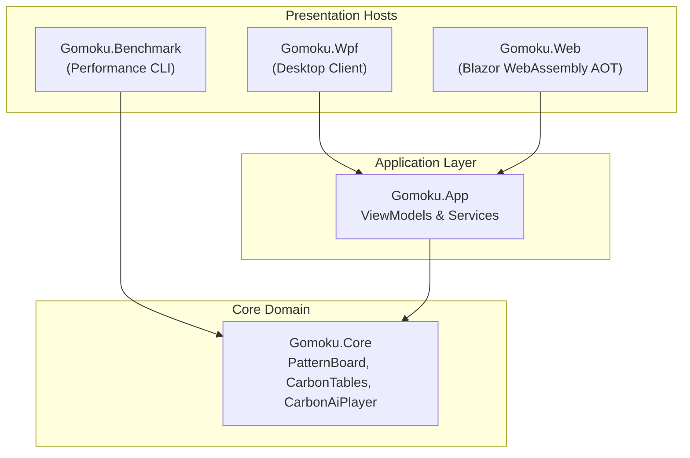

# Gomoku .NET: Technical Documentation & Architecture Manual

Welcome to the comprehensive technical documentation for **Gomoku .NET**, a high-performance Gomoku (Five in a Row) application written in C# and .NET 10. The engine is inspired by Michał Czardybon's world-class **Carbon Gomoku**, featuring bitboard pattern recognition, tactical VCF search, and Clean Architecture.

---

## Architecture Overview

---

## Table of Contents

1. [Chapter 1: Project Charter & System Architecture](01_project_charter.md)
   - Problem space, project goals, Clean Architecture, and performance targets.
2. [Chapter 2: Gomoku Rules & Mathematical Representation](02_gomoku_rules_and_representation.md)
   - Freestyle, Exact5, and Renju foul rules (3x3, 4x4, overlines) across 15x15, 19x19, and 20x20 boards.
3. [Chapter 3: Carbon Gomoku Engine Forensics](03_carbon_gomoku_forensics.md)
   - Deep analysis of Michał Czardybon's C++ source code, lookup tables, and porting strategy to .NET 10.
4. [Chapter 4: Pattern Bitboards & Threat Tensors](04_pattern_bitboards_and_tensors.md)
   - 4-direction 8-cell bitboards, STATUS1 directional grades, and the 10,000-cell STATUS4 tensor.
5. [Chapter 5: Tactical VCF Search (QuickWinSearch)](05_tactical_vcf_search.md)
   - Victory by Continuous Fours, forcing moves, and sub-millisecond tactical checkmate detection.
6. [Chapter 6: Minimax Search & Move Ordering](06_minimax_and_move_ordering.md)
   - Incremental 2-ring candidate generation, fail-soft alpha-beta, and iterative deepening.
7. [Chapter 7: Transposition Table & Zobrist Hashing](07_transposition_table.md)
   - 16-byte aligned entries, 64-bit Zobrist keys, power-of-two bitwise masking, and depth/age replacement.
8. [Chapter 8: Dihedral Opening Book & Symmetry Transformations](08_opening_book.md)
   - 67 master opening pattern clusters and the Dihedral Group $D_4$ (8 orthogonal rotations and reflections).
9. [Chapter 9: Game Serialization: SGF & Gomoku Formats](09_game_formats.md)
   - Smart Game Format (`GM[11]`) and human-readable Gomoku coordinate records (`.gomoku`).
10. [Chapter 10: Shared MVVM Application Architecture](10_mvvm_architecture.md)
    - ViewModel hierarchy, service abstractions, and procedural 16-bit PCM sound synthesis (`SoundWaves`).
11. [Chapter 11: WPF Desktop Client Implementation](11_wpf_desktop_client.md)
    - Hardware-accelerated Kaya wood board, dynamic grid rendering, ghost stone previews, and telemetry.
12. [Chapter 12: Blazor WebAssembly Client & AOT Compilation](12_blazor_webassembly_client.md)
    - Zero-install web client, ahead-of-time (AOT) compilation, offline PWA support, and docs viewer.
13. [Chapter 13: Benchmarks & Empirical Performance](13_benchmarks_and_performance.md)
    - Empirical throughput: 407,000 make/undo ops/sec, 39,500,000 TT probes/sec, and sub-15ms search times.

